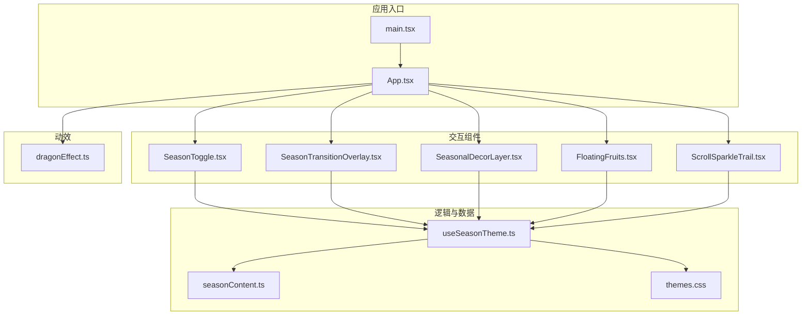
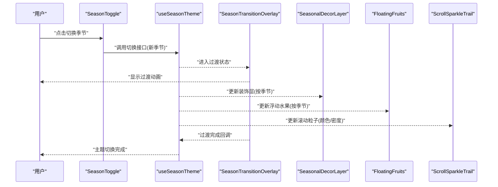

# 交互功能

<cite>
**本文引用的文件**   
- [src/components/SeasonToggle.tsx](file://src/components/SeasonToggle.tsx)
- [src/hooks/useSeasonTheme.ts](file://src/hooks/useSeasonTheme.ts)
- [src/data/seasonContent.ts](file://src/data/seasonContent.ts)
- [src/styles/themes.css](file://src/styles/themes.css)
- [src/components/SeasonTransitionOverlay.tsx](file://src/components/SeasonTransitionOverlay.tsx)
- [src/components/SeasonalDecorLayer.tsx](file://src/components/SeasonalDecorLayer.tsx)
- [src/components/FloatingFruits.tsx](file://src/components/FloatingFruits.tsx)
- [src/components/ScrollSparkleTrail.tsx](file://src/components/ScrollSparkleTrail.tsx)
- [src/effects/dragonEffect.ts](file://src/effects/dragonEffect.ts)
- [src/App.tsx](file://src/App.tsx)
- [src/main.tsx](file://src/main.tsx)
- [public/index.html](file://public/index.html)
</cite>

## 目录
1. [简介](#简介)
2. [项目结构](#项目结构)
3. [核心组件](#核心组件)
4. [架构总览](#架构总览)
5. [详细组件分析](#详细组件分析)
6. [依赖关系分析](#依赖关系分析)
7. [性能考量](#性能考量)
8. [故障排查指南](#故障排查指南)
9. [结论](#结论)
10. [附录](#附录)

## 简介
本文件面向 oo-space 项目的交互功能，聚焦以下特性：
- 季节主题切换：通过配置驱动的主题与内容切换，提供平滑过渡与装饰层更新。
- 滚动特效：滚动时生成粒子轨迹，增强浏览体验。
- 浮动水果效果：在页面中呈现可配置的浮动元素，提升视觉趣味。
- 龙形特效（扩展）：基于 Canvas 的动效模块，可按需集成。

文档将解释这些特性的实现细节、调用关系、接口与领域模型，并给出配置项、参数与返回值说明，帮助初学者快速上手，同时为有经验的开发者提供足够的技术深度。

## 项目结构
与交互功能相关的代码主要分布在以下目录：
- components：UI 组件（季节切换按钮、过渡遮罩、装饰层、浮动水果、滚动粒子等）
- hooks：自定义 Hook（季节主题状态管理）
- data：数据与配置（季节内容与主题映射）
- effects：Canvas 动效（龙形特效）
- styles：样式与主题变量
- App 与 main：应用入口与根组件挂载



图表来源
- [src/main.tsx](file://src/main.tsx)
- [src/App.tsx](file://src/App.tsx)
- [src/components/SeasonToggle.tsx](file://src/components/SeasonToggle.tsx)
- [src/components/SeasonTransitionOverlay.tsx](file://src/components/SeasonTransitionOverlay.tsx)
- [src/components/SeasonalDecorLayer.tsx](file://src/components/SeasonalDecorLayer.tsx)
- [src/components/FloatingFruits.tsx](file://src/components/FloatingFruits.tsx)
- [src/components/ScrollSparkleTrail.tsx](file://src/components/ScrollSparkleTrail.tsx)
- [src/hooks/useSeasonTheme.ts](file://src/hooks/useSeasonTheme.ts)
- [src/data/seasonContent.ts](file://src/data/seasonContent.ts)
- [src/styles/themes.css](file://src/styles/themes.css)
- [src/effects/dragonEffect.ts](file://src/effects/dragonEffect.ts)

章节来源
- [src/main.tsx](file://src/main.tsx)
- [src/App.tsx](file://src/App.tsx)
- [public/index.html](file://public/index.html)

## 核心组件
本节概述各交互组件的职责与协作方式：
- 季节主题切换（SeasonToggle）：用户触发切换，驱动主题与内容更新。
- 过渡遮罩（SeasonTransitionOverlay）：切换期间展示过渡动画，避免闪烁。
- 装饰层（SeasonalDecorLayer）：根据当前季节渲染背景装饰元素。
- 浮动水果（FloatingFruits）：按季节或配置渲染浮动水果元素。
- 滚动粒子（ScrollSparkleTrail）：监听滚动事件，生成粒子轨迹。
- 龙形特效（dragonEffect）：可选的 Canvas 动效模块，按需集成。

章节来源
- [src/components/SeasonToggle.tsx](file://src/components/SeasonToggle.tsx)
- [src/components/SeasonTransitionOverlay.tsx](file://src/components/SeasonTransitionOverlay.tsx)
- [src/components/SeasonalDecorLayer.tsx](file://src/components/SeasonalDecorLayer.tsx)
- [src/components/FloatingFruits.tsx](file://src/components/FloatingFruits.tsx)
- [src/components/ScrollSparkleTrail.tsx](file://src/components/ScrollSparkleTrail.tsx)
- [src/effects/dragonEffect.ts](file://src/effects/dragonEffect.ts)

## 架构总览
整体交互架构围绕“主题状态”展开：
- useSeasonTheme 维护当前季节主题与切换状态，暴露 API 供组件订阅。
- SeasonToggle 作为触发器，调用切换接口。
- SeasonTransitionOverlay 在切换过程中显示过渡效果。
- SeasonalDecorLayer 与 FloatingFruits 根据主题渲染对应装饰与元素。
- ScrollSparkleTrail 独立于主题，但可通过主题影响颜色与密度。
- dragonEffect 作为可选动效模块，由 App 按需初始化。



图表来源
- [src/components/SeasonToggle.tsx](file://src/components/SeasonToggle.tsx)
- [src/hooks/useSeasonTheme.ts](file://src/hooks/useSeasonTheme.ts)
- [src/components/SeasonTransitionOverlay.tsx](file://src/components/SeasonTransitionOverlay.tsx)
- [src/components/SeasonalDecorLayer.tsx](file://src/components/SeasonalDecorLayer.tsx)
- [src/components/FloatingFruits.tsx](file://src/components/FloatingFruits.tsx)
- [src/components/ScrollSparkleTrail.tsx](file://src/components/ScrollSparkleTrail.tsx)

## 详细组件分析

### 季节主题切换（SeasonToggle）
职责与行为：
- 提供 UI 控件用于切换季节主题。
- 调用主题 Hook 的切换方法，传入目标季节标识。
- 处理切换过程中的禁用态与反馈。

关键接口与参数：
- 切换方法：接收目标季节标识（字符串），返回 Promise 或同步布尔值表示切换结果。
- 受控属性：当前季节标识、是否禁用、回调函数（切换前/后）。

常见用法：
- 在 App 中注册 SeasonToggle，并绑定到 useSeasonTheme 的切换方法。
- 结合过渡遮罩确保切换过程流畅。

章节来源
- [src/components/SeasonToggle.tsx](file://src/components/SeasonToggle.tsx)
- [src/hooks/useSeasonTheme.ts](file://src/hooks/useSeasonTheme.ts)

### 主题状态管理（useSeasonTheme）
职责与行为：
- 维护当前季节主题与切换状态（进行中/完成/失败）。
- 提供切换方法与查询方法，供其他组件订阅。
- 与 seasonContent 和 themes.css 联动，更新内容与样式。

数据结构与复杂度：
- 主题状态对象包含：当前季节、切换进度、错误信息等。
- 切换操作时间复杂度 O(1)，样式与内容更新取决于 DOM 节点数量。

依赖关系：
- 读取 seasonContent 获取季节对应的内容映射。
- 写入 CSS 变量或类名以驱动主题样式。

章节来源
- [src/hooks/useSeasonTheme.ts](file://src/hooks/useSeasonTheme.ts)
- [src/data/seasonContent.ts](file://src/data/seasonContent.ts)
- [src/styles/themes.css](file://src/styles/themes.css)

### 过渡遮罩（SeasonTransitionOverlay）
职责与行为：
- 在主题切换期间显示全屏过渡动画。
- 监听切换状态变化，控制显示与隐藏。
- 支持回调通知切换完成。

关键接口与参数：
- visible：是否显示遮罩。
- duration：过渡时长。
- onComplete：切换完成回调。

章节来源
- [src/components/SeasonTransitionOverlay.tsx](file://src/components/SeasonTransitionOverlay.tsx)
- [src/hooks/useSeasonTheme.ts](file://src/hooks/useSeasonTheme.ts)

### 装饰层（SeasonalDecorLayer）
职责与行为：
- 根据当前季节渲染背景装饰元素（如雪花、花瓣等）。
- 支持配置装饰元素的密度、大小、位置分布。

关键接口与参数：
- season：当前季节标识。
- density：装饰元素密度。
- size：基础尺寸。
- positionMode：布局模式（随机/网格/固定）。

章节来源
- [src/components/SeasonalDecorLayer.tsx](file://src/components/SeasonalDecorLayer.tsx)
- [src/hooks/useSeasonTheme.ts](file://src/hooks/useSeasonTheme.ts)

### 浮动水果（FloatingFruits）
职责与行为：
- 在页面中渲染浮动水果元素，增强趣味性。
- 支持按季节选择水果类型与配色。
- 监听窗口尺寸变化，动态调整布局。

关键接口与参数：
- fruits：水果数组（类型、颜色、大小、速度）。
- season：当前季节标识，用于过滤或替换水果集合。
- container：容器选择器或 DOM 引用。
- animation：动画配置（缓动、循环、延迟）。

章节来源
- [src/components/FloatingFruits.tsx](file://src/components/FloatingFruits.tsx)
- [src/hooks/useSeasonTheme.ts](file://src/hooks/useSeasonTheme.ts)

### 滚动粒子（ScrollSparkleTrail）
职责与行为：
- 监听滚动事件，沿滚动路径生成粒子轨迹。
- 支持按主题调整粒子颜色、密度与生命周期。
- 提供节流与防抖策略，优化性能。

关键接口与参数：
- enabled：是否启用。
- color：粒子颜色（可随主题变化）。
- density：粒子密度。
- lifecycle：粒子生命周期（毫秒）。
- throttle：滚动事件节流间隔。

章节来源
- [src/components/ScrollSparkleTrail.tsx](file://src/components/ScrollSparkleTrail.tsx)
- [src/hooks/useSeasonTheme.ts](file://src/hooks/useSeasonTheme.ts)

### 龙形特效（dragonEffect）
职责与行为：
- 基于 Canvas 的动效模块，渲染龙形粒子或路径。
- 可由 App 按需初始化与销毁，避免不必要的资源占用。

关键接口与参数：
- canvas：Canvas 元素引用。
- options：动效配置（速度、颜色、路径算法）。
- start/stop：启动与停止方法。

章节来源
- [src/effects/dragonEffect.ts](file://src/effects/dragonEffect.ts)
- [src/App.tsx](file://src/App.tsx)

## 依赖关系分析
组件之间的依赖关系如下：
- SeasonToggle 依赖 useSeasonTheme 进行状态切换。
- SeasonTransitionOverlay 依赖 useSeasonTheme 的切换状态。
- SeasonalDecorLayer 与 FloatingFruits 依赖 useSeasonTheme 提供的当前季节。
- ScrollSparkleTrail 依赖 useSeasonTheme 提供的主题变量（颜色、密度）。
- App 负责编排以上组件，并可按需集成 dragonEffect。

```mermaid
classDiagram
class SeasonToggle {
+onClick()
+props : { season, disabled, onChange }
}
class UseSeasonTheme {
+currentSeason
+isTransitioning
+switchSeason(season)
+getThemeVars()
}
class SeasonTransitionOverlay {
+visible
+duration
+onComplete()
}
class SeasonalDecorLayer {
+season
+density
+size
+positionMode
}
class FloatingFruits {
+fruits
+season
+container
+animation
}
class ScrollSparkleTrail {
+enabled
+color
+density
+lifecycle
+throttle
}
class DragonEffect {
+canvas
+options
+start()
+stop()
}
SeasonToggle --> UseSeasonTheme : "调用切换"
SeasonTransitionOverlay --> UseSeasonTheme : "订阅状态"
SeasonalDecorLayer --> UseSeasonTheme : "读取季节"
FloatingFruits --> UseSeasonTheme : "读取季节"
ScrollSparkleTrail --> UseSeasonTheme : "读取主题变量"
App --> DragonEffect : "按需集成"
```

图表来源
- [src/components/SeasonToggle.tsx](file://src/components/SeasonToggle.tsx)
- [src/hooks/useSeasonTheme.ts](file://src/hooks/useSeasonTheme.ts)
- [src/components/SeasonTransitionOverlay.tsx](file://src/components/SeasonTransitionOverlay.tsx)
- [src/components/SeasonalDecorLayer.tsx](file://src/components/SeasonalDecorLayer.tsx)
- [src/components/FloatingFruits.tsx](file://src/components/FloatingFruits.tsx)
- [src/components/ScrollSparkleTrail.tsx](file://src/components/ScrollSparkleTrail.tsx)
- [src/effects/dragonEffect.ts](file://src/effects/dragonEffect.ts)
- [src/App.tsx](file://src/App.tsx)

章节来源
- [src/App.tsx](file://src/App.tsx)
- [src/hooks/useSeasonTheme.ts](file://src/hooks/useSeasonTheme.ts)

## 性能考量
- 主题切换：尽量减少 DOM 重排，使用 CSS 变量与类名切换；过渡遮罩避免频繁渲染。
- 装饰层与浮动水果：控制密度与尺寸，避免过多节点；使用 requestAnimationFrame 优化动画。
- 滚动粒子：对滚动事件进行节流与防抖；限制粒子生命周期与数量。
- 龙形特效：按需初始化与销毁；使用离屏 Canvas 减少主线程压力。

[本节为通用指导，不直接分析具体文件]

## 故障排查指南
常见问题与解决方案：
- 主题切换无效：检查 useSeasonTheme 的切换方法是否正确调用；确认 seasonContent 中存在对应季节键。
- 过渡遮罩不消失：检查 onComplete 回调是否被正确触发；确认切换状态已重置。
- 装饰层未渲染：确认 season 参数有效；检查容器可见性与尺寸。
- 浮动水果不显示：检查 fruits 配置与容器引用；确认动画配置合法。
- 滚动粒子卡顿：降低 density 与 lifecycle；增加 throttle 间隔；关闭非必要特效。
- 龙形特效异常：确认 Canvas 元素存在且尺寸正确；检查 options 配置；确保 start/stop 成对调用。

章节来源
- [src/hooks/useSeasonTheme.ts](file://src/hooks/useSeasonTheme.ts)
- [src/components/SeasonTransitionOverlay.tsx](file://src/components/SeasonTransitionOverlay.tsx)
- [src/components/SeasonalDecorLayer.tsx](file://src/components/SeasonalDecorLayer.tsx)
- [src/components/FloatingFruits.tsx](file://src/components/FloatingFruits.tsx)
- [src/components/ScrollSparkleTrail.tsx](file://src/components/ScrollSparkleTrail.tsx)
- [src/effects/dragonEffect.ts](file://src/effects/dragonEffect.ts)

## 结论
oo-space 的交互功能以主题状态为核心，通过组件化与 Hook 管理实现了季节主题切换、滚动特效与浮动水果等特性。合理的依赖关系与清晰的接口设计使得扩展与维护更加便捷。遵循性能与故障排查建议，可获得更流畅的用户体验。

[本节为总结性内容，不直接分析具体文件]

## 附录
- 配置示例与最佳实践：建议在 seasonContent 中集中管理季节相关的数据与映射；在 themes.css 中定义统一的 CSS 变量。
- 扩展建议：新增季节时，仅需更新 seasonContent 与 themes.css，并在 SeasonalDecorLayer 与 FloatingFruits 中适配新元素。
- 集成指引：在 App 中按需引入 dragonEffect，并根据用户偏好或设备能力决定是否启用。

[本节为补充信息，不直接分析具体文件]