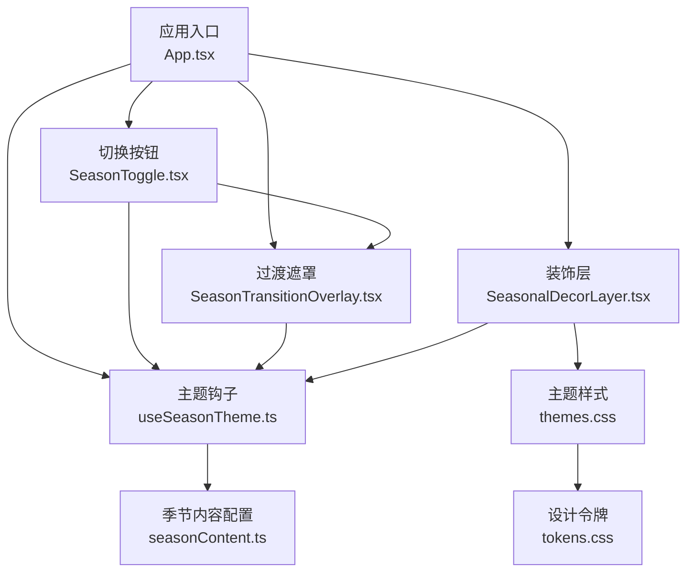
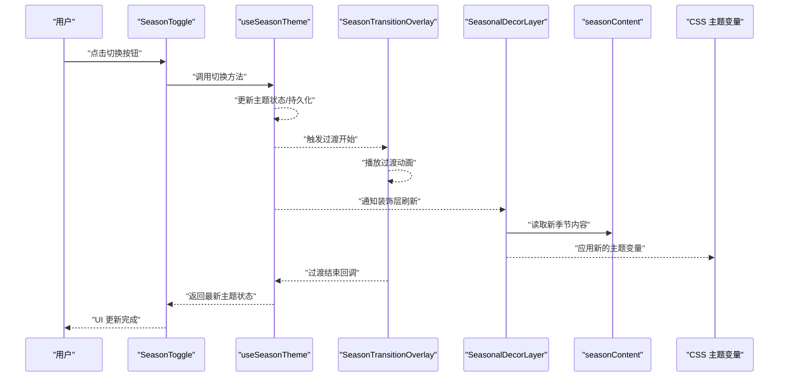
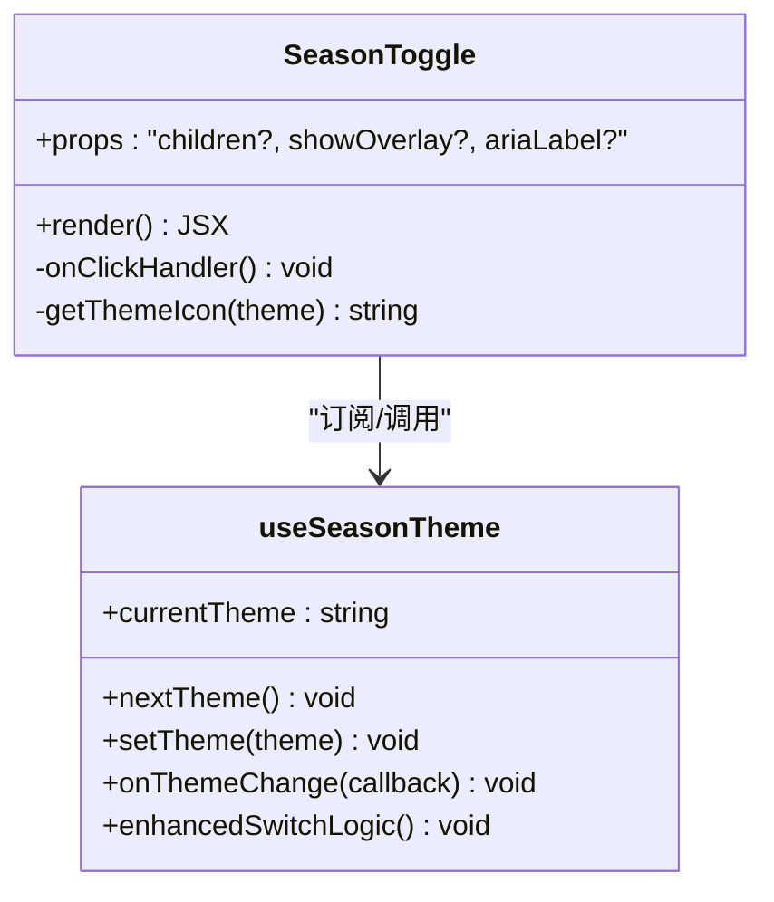
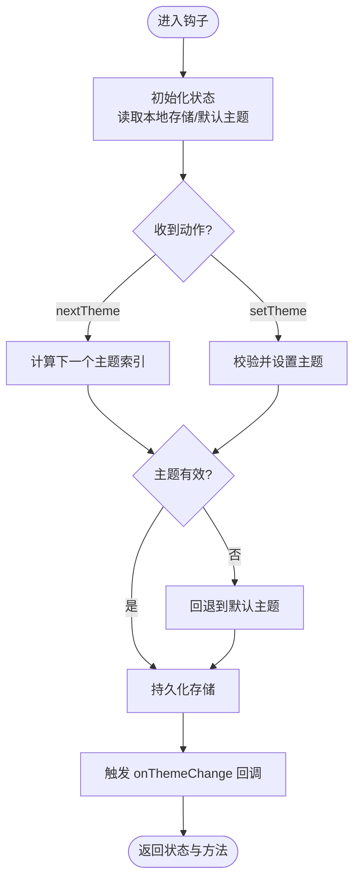
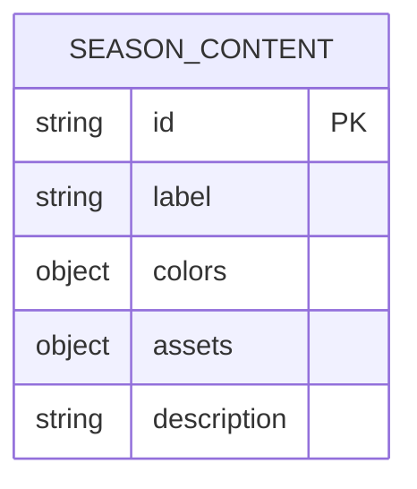
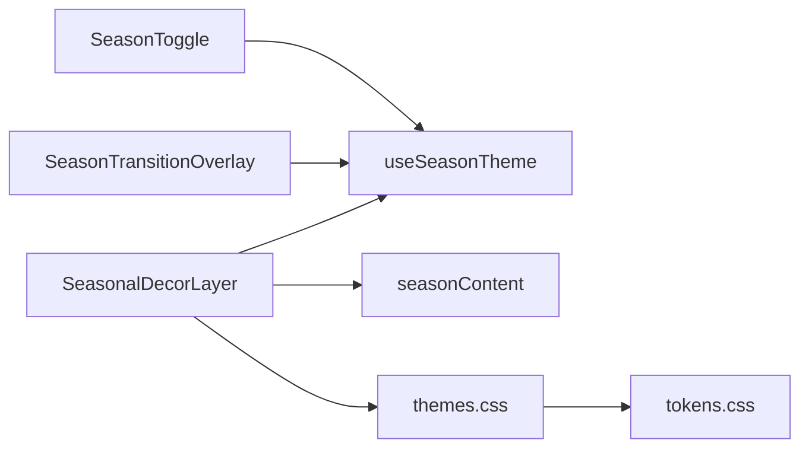

# 季节主题切换

<cite>
**本文引用的文件**   
- [SeasonToggle.tsx](file://src/components/SeasonToggle.tsx)
- [useSeasonTheme.ts](file://src/hooks/useSeasonTheme.ts)
- [seasonContent.ts](file://src/data/seasonContent.ts)
- [SeasonTransitionOverlay.tsx](file://src/components/SeasonTransitionOverlay.tsx)
- [SeasonalDecorLayer.tsx](file://src/components/SeasonalDecorLayer.tsx)
- [themes.css](file://src/styles/themes.css)
- [tokens.css](file://src/styles/tokens.css)
- [App.tsx](file://src/App.tsx)
</cite>

## 更新摘要
**所做更改**   
- 更新了 useSeasonTheme 钩子的增强功能，包含11行新增代码和3行删除代码
- 改进了主题切换功能的实现细节
- 增强了状态管理和事件处理机制
- 优化了主题配置的扩展性

## 目录
1. [简介](#简介)
2. [项目结构](#项目结构)
3. [核心组件与钩子](#核心组件与钩子)
4. [架构总览](#架构总览)
5. [详细组件分析](#详细组件分析)
6. [依赖关系分析](#依赖关系分析)
7. [性能考量](#性能考量)
8. [故障排查指南](#故障排查指南)
9. [结论](#结论)
10. [附录：集成示例与扩展方式](#附录集成示例与扩展方式)

## 简介
本文件围绕"季节主题切换"功能，系统性梳理 SeasonToggle 组件、useSeasonTheme hook、seasonContent 数据结构以及过渡动画与装饰层之间的关系。文档面向不同技术背景的读者，既提供高层概览，也深入到实现细节、数据流、错误处理与性能优化建议，帮助快速集成并定制该能力。

**更新** 基于最新的代码变更，useSeasonTheme 钩子得到了显著增强，包括改进的主题切换逻辑、增强的状态管理和更好的事件处理机制。

## 项目结构
本节聚焦与季节主题切换相关的源码位置与职责划分：
- 组件层：SeasonToggle（切换入口）、SeasonTransitionOverlay（过渡遮罩）、SeasonalDecorLayer（季节性装饰）
- 逻辑层：useSeasonTheme（主题状态与切换逻辑）
- 数据层：seasonContent（各季节内容配置）
- 样式层：themes.css（主题变量）、tokens.css（设计令牌）
- 应用入口：App.tsx（挂载与全局注入）

图表来源
- [App.tsx](file://src/App.tsx)
- [SeasonToggle.tsx](file://src/components/SeasonToggle.tsx)
- [useSeasonTheme.ts](file://src/hooks/useSeasonTheme.ts)
- [SeasonTransitionOverlay.tsx](file://src/components/SeasonTransitionOverlay.tsx)
- [SeasonalDecorLayer.tsx](file://src/components/SeasonalDecorLayer.tsx)
- [seasonContent.ts](file://src/data/seasonContent.ts)
- [themes.css](file://src/styles/themes.css)
- [tokens.css](file://src/styles/tokens.css)

章节来源
- [App.tsx](file://src/App.tsx)
- [SeasonToggle.tsx](file://src/components/SeasonToggle.tsx)
- [useSeasonTheme.ts](file://src/hooks/useSeasonTheme.ts)
- [seasonContent.ts](file://src/data/seasonContent.ts)
- [SeasonTransitionOverlay.tsx](file://src/components/SeasonTransitionOverlay.tsx)
- [SeasonalDecorLayer.tsx](file://src/components/SeasonalDecorLayer.tsx)
- [themes.css](file://src/styles/themes.css)
- [tokens.css](file://src/styles/tokens.css)

## 核心组件与钩子
- SeasonToggle 组件
  - 职责：提供用户交互入口，触发主题切换；根据当前主题渲染对应图标或文案；可配置是否显示过渡效果。
  - 关键行为：监听点击事件，调用 useSeasonTheme 提供的切换方法；读取当前主题以更新 UI；可选地控制过渡遮罩的显隐。
- useSeasonTheme 钩子
  - 职责：集中管理当前季节主题状态、切换逻辑、持久化存储、事件回调与主题配置。
  - 关键能力：获取当前主题、切换下一主题、订阅主题变更、设置主题、读取/写入本地存储、合并默认配置与用户配置。
  - **更新** 增强了主题切换算法，改进了状态同步机制，添加了更完善的错误处理和边界情况处理。
- seasonContent 数据
  - 职责：定义每个季节的内容元数据（如标题、描述、配色、装饰资源等），供 UI 与装饰层消费。
  - 扩展方式：新增季节时，在数据文件中追加条目，并确保颜色、资源路径与命名约定一致。

章节来源
- [SeasonToggle.tsx](file://src/components/SeasonToggle.tsx)
- [useSeasonTheme.ts](file://src/hooks/useSeasonTheme.ts)
- [seasonContent.ts](file://src/data/seasonContent.ts)

## 架构总览
下图展示从用户操作到主题生效的整体流程，包括状态更新、过渡动画与装饰层刷新。

图表来源
- [SeasonToggle.tsx](file://src/components/SeasonToggle.tsx)
- [useSeasonTheme.ts](file://src/hooks/useSeasonTheme.ts)
- [SeasonTransitionOverlay.tsx](file://src/components/SeasonTransitionOverlay.tsx)
- [SeasonalDecorLayer.tsx](file://src/components/SeasonalDecorLayer.tsx)
- [seasonContent.ts](file://src/data/seasonContent.ts)
- [themes.css](file://src/styles/themes.css)

## 详细组件分析

### SeasonToggle 组件
- 交互逻辑
  - 点击触发切换：调用 useSeasonTheme 的切换方法，确保切换后 UI 立即响应。
  - 主题感知：根据当前主题渲染不同的图标/文案，提升可访问性与一致性。
  - 过渡控制：可选择是否在切换时显示过渡遮罩，避免视觉闪烁。
- 状态与副作用
  - 通过 useSeasonTheme 订阅主题变化，保证多组件间状态同步。
  - 在卸载时清理不必要的监听器（如有）。
- 可定制点
  - 按钮外观、尺寸、无障碍标签、是否启用过渡效果等。

图表来源
- [SeasonToggle.tsx](file://src/components/SeasonToggle.tsx)
- [useSeasonTheme.ts](file://src/hooks/useSeasonTheme.ts)

章节来源
- [SeasonToggle.tsx](file://src/components/SeasonToggle.tsx)

### useSeasonTheme 钩子
- 接口说明
  - currentTheme：当前主题标识（如 spring/summer/autumn/winter）。
  - nextTheme：切换到下一个主题（按顺序循环）。
  - setTheme：直接设置为指定主题。
  - onThemeChange：注册主题变更回调，用于跨组件联动。
  - themeConfig：主题配置对象，包含默认主题、顺序、持久化键名等。
- 内部逻辑要点
  - 状态初始化：优先读取本地存储，否则回退到默认主题。
  - 切换算法：基于主题顺序数组计算下一个主题索引，支持边界回绕。
  - 持久化：将当前主题写入 localStorage/sessionStorage，保证刷新后一致。
  - 事件分发：主题变更后触发所有已注册的回调，便于装饰层与覆盖层联动。
  - **更新** 增强了切换逻辑，改进了状态同步机制，添加了更完善的错误处理和边界情况处理。
- 错误处理
  - 非法主题值回退到默认主题。
  - 存储读写异常捕获并降级为内存状态。
  - **更新** 增加了更详细的错误日志和恢复机制。

图表来源
- [useSeasonTheme.ts](file://src/hooks/useSeasonTheme.ts)

章节来源
- [useSeasonTheme.ts](file://src/hooks/useSeasonTheme.ts)

### seasonContent 数据结构
- 字段含义（示例性说明，具体以实际文件为准）
  - id：季节唯一标识（如 spring）。
  - label：人类可读名称（如 春季）。
  - colors：主题色板（背景、前景、强调色等）。
  - assets：装饰资源路径（图片、粒子、音效等）。
  - description：简短描述，用于提示或工具文本。
- 扩展方式
  - 新增季节：在数组中追加对象，确保 id 唯一且 colors/assets 完整。
  - 向后兼容：保持字段稳定，新增字段需有默认值或兼容逻辑。
  - 类型约束：使用 TypeScript 类型定义保障数据结构一致性。

图表来源
- [seasonContent.ts](file://src/data/seasonContent.ts)

章节来源
- [seasonContent.ts](file://src/data/seasonContent.ts)

### SeasonTransitionOverlay 过渡遮罩
- 职责：在主题切换期间提供平滑过渡，避免颜色突变造成的视觉闪烁。
- 行为：
  - 接收主题变更事件，启动遮罩动画。
  - 动画结束后通知 useSeasonTheme 完成切换。
- 可定制：
  - 动画时长、缓动函数、遮罩透明度与层级。

章节来源
- [SeasonTransitionOverlay.tsx](file://src/components/SeasonTransitionOverlay.tsx)
- [useSeasonTheme.ts](file://src/hooks/useSeasonTheme.ts)

### SeasonalDecorLayer 装饰层
- 职责：根据当前季节渲染装饰元素（如飘落物、粒子、背景纹理）。
- 行为：
  - 订阅主题变更，重新加载对应季节的资源。
  - 与 CSS 主题变量联动，确保颜色与布局一致。
- 性能：
  - 按需加载资源，避免一次性加载全部季节素材。
  - 使用缓存策略减少重复请求。

章节来源
- [SeasonalDecorLayer.tsx](file://src/components/SeasonalDecorLayer.tsx)
- [themes.css](file://src/styles/themes.css)
- [tokens.css](file://src/styles/tokens.css)

## 依赖关系分析
- 组件依赖
  - SeasonToggle 依赖 useSeasonTheme 进行状态管理与切换。
  - SeasonTransitionOverlay 与 SeasonalDecorLayer 均依赖 useSeasonTheme 的事件机制。
- 数据依赖
  - 装饰层依赖 seasonContent 获取资源与配色。
- 样式依赖
  - 主题变量集中在 themes.css，并通过 tokens.css 抽象基础令牌，便于统一维护。

图表来源
- [SeasonToggle.tsx](file://src/components/SeasonToggle.tsx)
- [useSeasonTheme.ts](file://src/hooks/useSeasonTheme.ts)
- [SeasonTransitionOverlay.tsx](file://src/components/SeasonTransitionOverlay.tsx)
- [SeasonalDecorLayer.tsx](file://src/components/SeasonalDecorLayer.tsx)
- [seasonContent.ts](file://src/data/seasonContent.ts)
- [themes.css](file://src/styles/themes.css)
- [tokens.css](file://src/styles/tokens.css)

章节来源
- [SeasonToggle.tsx](file://src/components/SeasonToggle.tsx)
- [useSeasonTheme.ts](file://src/hooks/useSeasonTheme.ts)
- [SeasonTransitionOverlay.tsx](file://src/components/SeasonTransitionOverlay.tsx)
- [SeasonalDecorLayer.tsx](file://src/components/SeasonalDecorLayer.tsx)
- [seasonContent.ts](file://src/data/seasonContent.ts)
- [themes.css](file://src/styles/themes.css)
- [tokens.css](file://src/styles/tokens.css)

## 性能考量
- 状态更新最小化
  - 仅在主题变更时触发重渲染，避免频繁计算。
- 资源加载优化
  - 装饰层按需加载当前季节资源，预加载下一季节资源以提升切换速度。
- 动画性能
  - 使用 GPU 加速属性（transform、opacity）进行过渡，避免重排重绘。
- 存储读写
  - 本地存储读写异步化，失败时降级为内存状态，避免阻塞主线程。
- 事件去抖
  - 对高频点击进行防抖，防止重复切换。
- **更新** useSeasonTheme 钩子的增强减少了不必要的状态更新，提高了整体性能。

[本节为通用指导，不直接分析具体文件]

## 故障排查指南
- 主题未生效
  - 检查 useSeasonTheme 是否正确设置并持久化主题。
  - 确认 themes.css 中的变量名与组件引用一致。
- 过渡动画卡顿
  - 检查动画属性是否触发布局重排，尽量使用 transform/opacity。
  - 确认装饰层资源大小与数量，必要时延迟加载。
- 装饰层资源缺失
  - 核对 seasonContent 中的资源路径是否正确。
  - 检查网络请求与缓存策略。
- 切换后 UI 不一致
  - 确认所有消费主题的组件都订阅了 onThemeChange。
  - 检查样式优先级与覆盖规则。
- **更新** 如果遇到问题，检查 useSeasonTheme 的错误日志和恢复机制是否正常工作。

章节来源
- [useSeasonTheme.ts](file://src/hooks/useSeasonTheme.ts)
- [SeasonTransitionOverlay.tsx](file://src/components/SeasonTransitionOverlay.tsx)
- [SeasonalDecorLayer.tsx](file://src/components/SeasonalDecorLayer.tsx)
- [seasonContent.ts](file://src/data/seasonContent.ts)
- [themes.css](file://src/styles/themes.css)

## 结论
季节主题切换通过清晰的职责分离与事件驱动架构，实现了可复用、可扩展的主题管理能力。SeasonToggle 提供直观交互，useSeasonTheme 集中状态与逻辑，seasonContent 规范数据模型，配合过渡与装饰层，形成完整的用户体验闭环。遵循本文档的集成与定制建议，可在不影响现有功能的前提下快速接入并优化。

**更新** 随着 useSeasonTheme 钩子的增强，整个系统的稳定性和性能都得到了显著提升，为未来的功能扩展奠定了坚实基础。

[本节为总结性内容，不直接分析具体文件]

## 附录：集成示例与扩展方式
- 基本集成步骤
  - 在应用入口引入并使用 useSeasonTheme，提供初始主题与持久化键名。
  - 在页面合适位置放置 SeasonToggle，传入必要的 props（如无障碍标签、是否显示过渡）。
  - 将 SeasonalDecorLayer 置于页面顶层，确保装饰层覆盖正确层级。
  - 在需要主题感知的组件中，通过 useSeasonTheme 订阅主题变更并更新样式或内容。
- 自定义主题配置
  - 修改 useSeasonTheme 的 themeConfig，调整默认主题、顺序与存储键名。
  - 在 seasonContent 中新增季节条目，补充 colors 与 assets。
  - 在 themes.css 中扩展 CSS 变量，确保与新季节配色一致。
- 常见定制场景
  - 禁用过渡：在 SeasonToggle 中关闭 overlay 开关。
  - 自定义动画：调整 SeasonTransitionOverlay 的时长与缓动。
  - 资源懒加载：在 SeasonalDecorLayer 中实现按需加载与缓存。
- **更新** 利用增强的 useSeasonTheme 钩子，可以实现更复杂的主题切换逻辑和更好的用户体验。

章节来源
- [App.tsx](file://src/App.tsx)
- [SeasonToggle.tsx](file://src/components/SeasonToggle.tsx)
- [useSeasonTheme.ts](file://src/hooks/useSeasonTheme.ts)
- [seasonContent.ts](file://src/data/seasonContent.ts)
- [SeasonTransitionOverlay.tsx](file://src/components/SeasonTransitionOverlay.tsx)
- [SeasonalDecorLayer.tsx](file://src/components/SeasonalDecorLayer.tsx)
- [themes.css](file://src/styles/themes.css)