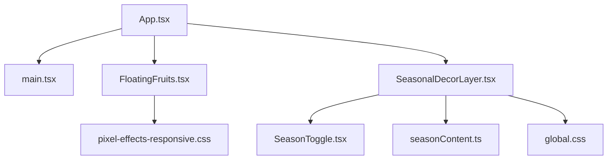
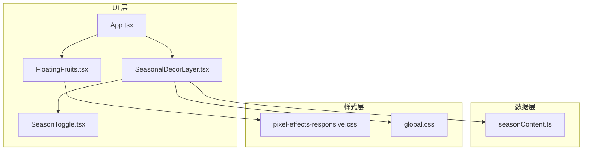
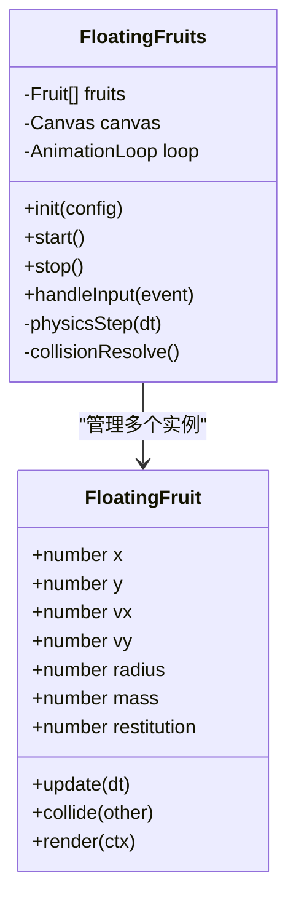
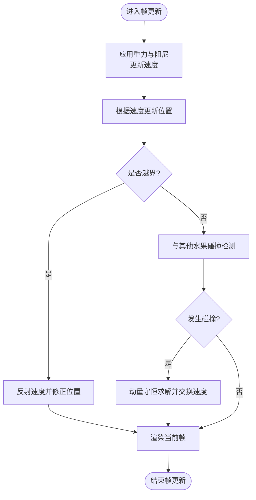
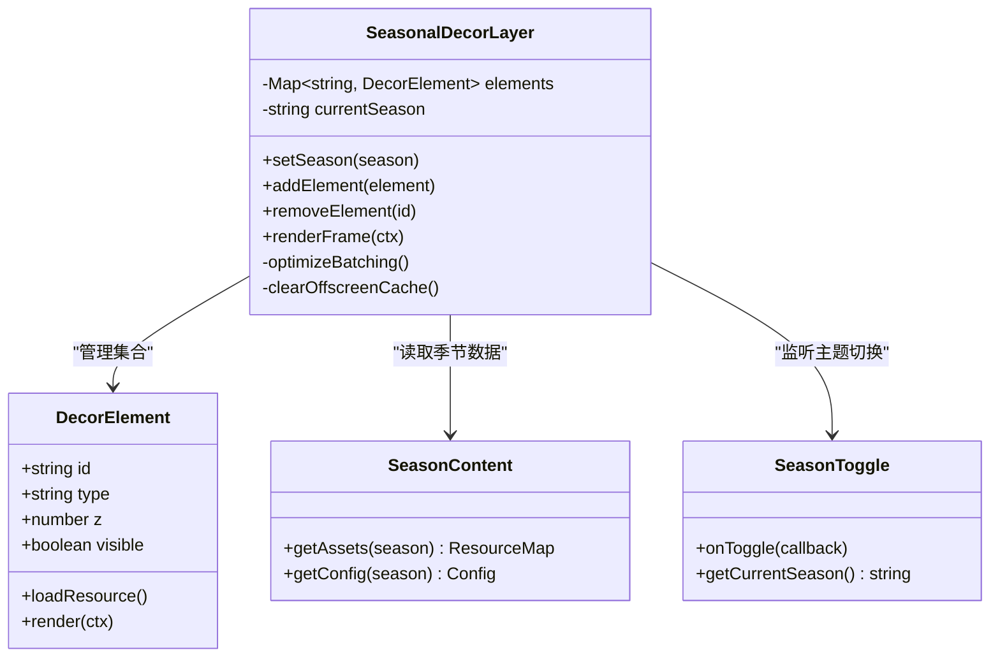
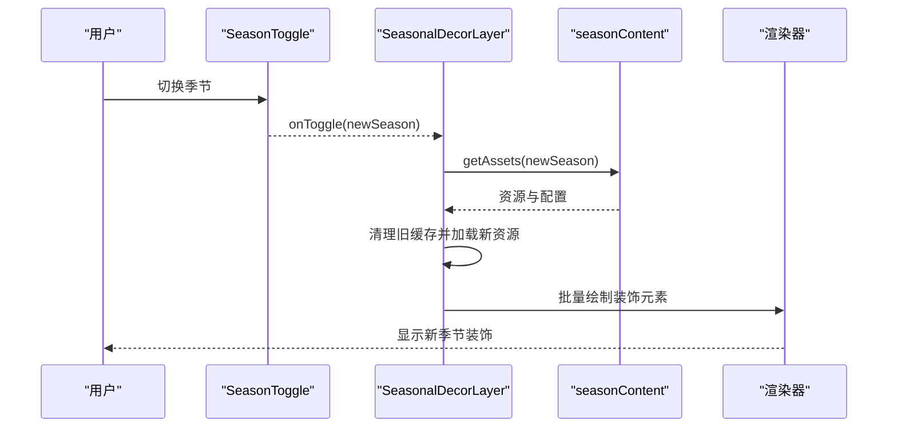
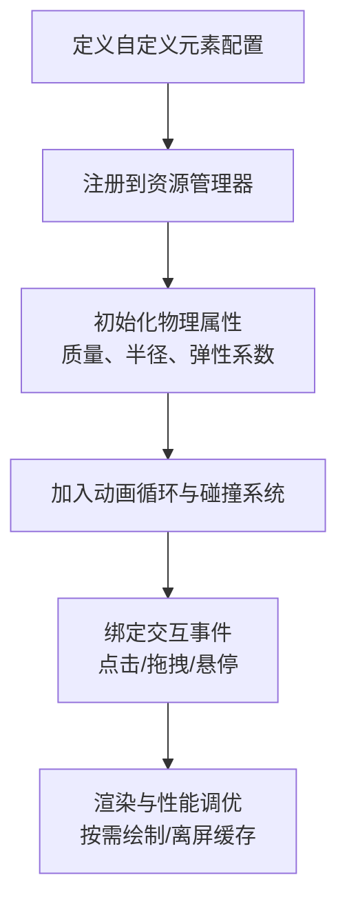
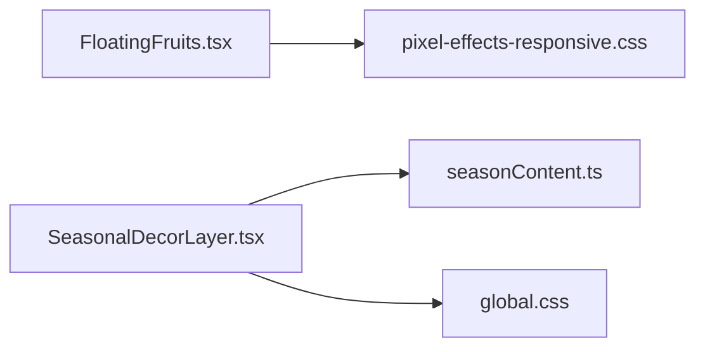

# 浮动元素效果

<cite>
**本文引用的文件**   
- [FloatingFruits.tsx](file://src/components/FloatingFruits.tsx)
- [SeasonalDecorLayer.tsx](file://src/components/SeasonalDecorLayer.tsx)
- [SeasonToggle.tsx](file://src/components/SeasonToggle.tsx)
- [seasonContent.ts](file://src/data/seasonContent.ts)
- [pixel-effects-responsive.css](file://src/styles/pixel-effects-responsive.css)
- [global.css](file://src/styles/global.css)
- [App.tsx](file://src/App.tsx)
- [main.tsx](file://src/main.tsx)
</cite>

## 目录
1. [简介](#简介)
2. [项目结构](#项目结构)
3. [核心组件](#核心组件)
4. [架构总览](#架构总览)
5. [详细组件分析](#详细组件分析)
6. [依赖关系分析](#依赖关系分析)
7. [性能考量](#性能考量)
8. [故障排查指南](#故障排查指南)
9. [结论](#结论)
10. [附录](#附录)

## 简介
本文件围绕“浮动元素效果”展开，重点解析 FloatingFruits 组件与 SeasonalDecorLayer 的设计与实现。内容涵盖物理模拟、碰撞检测、动画循环、装饰层动态加载、层级管理、性能优化策略、配置参数说明、运动轨迹算法、交互响应机制，以及跨设备适配与调试技巧。文档力求在技术深度与可读性之间取得平衡，帮助开发者快速理解并扩展该效果。

## 项目结构
与浮动元素效果相关的代码主要位于 src/components、src/data 与 src/styles 三个目录：
- components: 包含 FloatingFruits（浮动水果）、SeasonalDecorLayer（季节装饰层）、SeasonToggle（季节切换）等
- data: 包含 seasonContent（季节内容数据）
- styles: 包含像素风格与响应式样式，影响浮动元素的视觉与布局



图表来源
- [App.tsx](file://src/App.tsx)
- [main.tsx](file://src/main.tsx)
- [FloatingFruits.tsx](file://src/components/FloatingFruits.tsx)
- [SeasonalDecorLayer.tsx](file://src/components/SeasonalDecorLayer.tsx)
- [SeasonToggle.tsx](file://src/components/SeasonToggle.tsx)
- [seasonContent.ts](file://src/data/seasonContent.ts)
- [pixel-effects-responsive.css](file://src/styles/pixel-effects-responsive.css)
- [global.css](file://src/styles/global.css)

章节来源
- [App.tsx](file://src/App.tsx)
- [main.tsx](file://src/main.tsx)
- [FloatingFruits.tsx](file://src/components/FloatingFruits.tsx)
- [SeasonalDecorLayer.tsx](file://src/components/SeasonalDecorLayer.tsx)
- [SeasonToggle.tsx](file://src/components/SeasonToggle.tsx)
- [seasonContent.ts](file://src/data/seasonContent.ts)
- [pixel-effects-responsive.css](file://src/styles/pixel-effects-responsive.css)
- [global.css](file://src/styles/global.css)

## 核心组件
- FloatingFruits：负责浮动水果的生成、物理模拟、碰撞检测与动画循环，提供可配置的参数以控制数量、尺寸、速度、重力、反弹系数等。
- SeasonalDecorLayer：负责季节装饰层的渲染与管理，支持按季节动态加载装饰元素、维护层级顺序、进行性能优化（如按需渲染、离屏缓存）。
- SeasonToggle：用于切换季节主题，驱动 SeasonalDecorLayer 的内容更新。
- seasonContent：集中管理不同季节的装饰资源与配置。

章节来源
- [FloatingFruits.tsx](file://src/components/FloatingFruits.tsx)
- [SeasonalDecorLayer.tsx](file://src/components/SeasonalDecorLayer.tsx)
- [SeasonToggle.tsx](file://src/components/SeasonToggle.tsx)
- [seasonContent.ts](file://src/data/seasonContent.ts)

## 架构总览
整体架构采用分层设计：UI 层（React 组件）通过 hooks 或状态管理驱动视觉效果；动画与物理计算集中在组件内部或专用模块；样式与响应式规则由 CSS 统一管理；数据层提供季节内容与资源映射。



图表来源
- [App.tsx](file://src/App.tsx)
- [FloatingFruits.tsx](file://src/components/FloatingFruits.tsx)
- [SeasonalDecorLayer.tsx](file://src/components/SeasonalDecorLayer.tsx)
- [SeasonToggle.tsx](file://src/components/SeasonToggle.tsx)
- [seasonContent.ts](file://src/data/seasonContent.ts)
- [pixel-effects-responsive.css](file://src/styles/pixel-effects-responsive.css)
- [global.css](file://src/styles/global.css)

## 详细组件分析

### FloatingFruits 组件分析
FloatingFruits 实现了浮动水果的物理模拟与动画循环，核心能力包括：
- 物理模拟：基于简单的二维刚体模型，使用位置、速度、加速度（重力）描述每个水果的运动状态。
- 碰撞检测：与边界（屏幕边缘）及与其他水果之间的碰撞检测，采用 AABB（轴对齐包围盒）近似，必要时引入圆形近似以提升性能。
- 动画循环：使用 requestAnimationFrame 驱动帧更新，确保平滑且高效的动画表现。
- 交互响应：支持鼠标/触摸事件触发扰动或弹跳，增强用户互动体验。
- 配置参数：可通过 props 或配置对象控制数量、初始尺寸、速度范围、重力、阻尼、反弹系数、碰撞半径等。



图表来源
- [FloatingFruits.tsx](file://src/components/FloatingFruits.tsx)

```mermaid
sequenceDiagram
participant UI as "浏览器渲染"
participant Loop as "动画循环"
participant Phys as "物理引擎"
participant Coll as "碰撞检测"
participant Render as "渲染器"
UI->>Loop : requestAnimationFrame()
Loop->>Phys : physicsStep(dt)
Phys->>Coll : collisionResolve()
Coll-->>Phys : 更新后的状态
Phys-->>Render : 各水果新位置与姿态
Render-->>UI : 绘制下一帧
```

图表来源
- [FloatingFruits.tsx](file://src/components/FloatingFruits.tsx)



图表来源
- [FloatingFruits.tsx](file://src/components/FloatingFruits.tsx)

章节来源
- [FloatingFruits.tsx](file://src/components/FloatingFruits.tsx)

### SeasonalDecorLayer 组件分析
SeasonalDecorLayer 负责季节装饰层的渲染与管理，关键特性包括：
- 动态加载：根据当前季节主题从 seasonContent 中加载对应的装饰资源与配置。
- 层级管理：维护装饰元素的层级顺序，确保前景与背景正确叠加。
- 性能优化：采用按需渲染、离屏缓存、批量绘制等手段减少重绘与内存占用。
- 主题切换：与 SeasonToggle 联动，切换时平滑过渡并更新装饰元素。



图表来源
- [SeasonalDecorLayer.tsx](file://src/components/SeasonalDecorLayer.tsx)
- [seasonContent.ts](file://src/data/seasonContent.ts)
- [SeasonToggle.tsx](file://src/components/SeasonToggle.tsx)



图表来源
- [SeasonalDecorLayer.tsx](file://src/components/SeasonalDecorLayer.tsx)
- [seasonContent.ts](file://src/data/seasonContent.ts)
- [SeasonToggle.tsx](file://src/components/SeasonToggle.tsx)

章节来源
- [SeasonalDecorLayer.tsx](file://src/components/SeasonalDecorLayer.tsx)
- [seasonContent.ts](file://src/data/seasonContent.ts)
- [SeasonToggle.tsx](file://src/components/SeasonToggle.tsx)

### 概念总览
以下流程图展示“添加自定义浮动元素”的概念步骤，便于理解整体流程与关键点：



[此图为概念性流程，不直接映射具体源码文件]

## 依赖关系分析
FloatingFruits 与 SeasonalDecorLayer 分别依赖样式与数据层，形成松耦合的结构：
- FloatingFruits 依赖 pixel-effects-responsive.css 进行响应式适配与像素风格呈现。
- SeasonalDecorLayer 依赖 seasonContent.ts 获取季节资源与配置，并通过 global.css 统一全局样式。



图表来源
- [FloatingFruits.tsx](file://src/components/FloatingFruits.tsx)
- [SeasonalDecorLayer.tsx](file://src/components/SeasonalDecorLayer.tsx)
- [seasonContent.ts](file://src/data/seasonContent.ts)
- [pixel-effects-responsive.css](file://src/styles/pixel-effects-responsive.css)
- [global.css](file://src/styles/global.css)

章节来源
- [FloatingFruits.tsx](file://src/components/FloatingFruits.tsx)
- [SeasonalDecorLayer.tsx](file://src/components/SeasonalDecorLayer.tsx)
- [seasonContent.ts](file://src/data/seasonContent.ts)
- [pixel-effects-responsive.css](file://src/styles/pixel-effects-responsive.css)
- [global.css](file://src/styles/global.css)

## 性能考量
- 动画循环优化：使用 requestAnimationFrame 并确保每帧计算轻量，避免阻塞主线程。
- 碰撞检测优化：优先使用 AABB 近似，仅在必要时启用更精确的圆形或线段检测；对大量对象可采用空间分割（网格/四叉树）降低复杂度。
- 渲染优化：批量绘制、离屏缓存、视口裁剪，减少不必要的重绘与合成开销。
- 内存管理：及时释放不再使用的资源，避免内存泄漏；在主题切换时清理旧缓存并复用可用资源。
- 响应式适配：依据设备像素比与屏幕尺寸调整粒子数量与物理参数，保证移动端流畅度。

章节来源
- [FloatingFruits.tsx](file://src/components/FloatingFruits.tsx)
- [SeasonalDecorLayer.tsx](file://src/components/SeasonalDecorLayer.tsx)
- [pixel-effects-responsive.css](file://src/styles/pixel-effects-responsive.css)
- [global.css](file://src/styles/global.css)

## 故障排查指南
- 动画卡顿：检查 requestAnimationFrame 回调是否过重；确认碰撞检测是否过于复杂；考虑降低对象数量或简化几何形状。
- 碰撞异常：验证 AABB/圆形参数是否正确；检查边界反射逻辑与位置修正；确保质量与弹性系数合理。
- 资源加载失败：确认 seasonContent 中的资源路径与类型；检查网络请求与缓存策略；在切换季节时清理旧资源引用。
- 样式错位：核对像素风格与响应式规则；检查容器尺寸与 transform 设置；在不同设备上测试布局。
- 交互无响应：确认事件绑定与作用域；检查 pointer events 兼容性；在移动端启用触摸事件处理。

章节来源
- [FloatingFruits.tsx](file://src/components/FloatingFruits.tsx)
- [SeasonalDecorLayer.tsx](file://src/components/SeasonalDecorLayer.tsx)
- [seasonContent.ts](file://src/data/seasonContent.ts)
- [pixel-effects-responsive.css](file://src/styles/pixel-effects-responsive.css)
- [global.css](file://src/styles/global.css)

## 结论
FloatingFruits 与 SeasonalDecorLayer 共同构建了丰富的浮动元素与季节装饰效果。通过清晰的物理模拟、碰撞检测、动画循环与资源管理机制，系统在保持视觉表现的同时兼顾了性能与可维护性。遵循本文档的配置说明、优化策略与调试技巧，开发者可以高效地扩展自定义浮动元素与装饰层，并在多设备上获得一致的用户体验。

## 附录
- 配置参数建议：
  - 数量与密度：根据设备性能与屏幕尺寸动态调整
  - 物理参数：重力、阻尼、弹性系数需平衡真实感与性能
  - 碰撞半径：AABB 与圆形的选择取决于精度需求
  - 渲染批次：合并绘制以减少状态切换
- 最佳实践：
  - 使用离屏缓存与视口裁剪提升渲染效率
  - 在主题切换时进行资源清理与懒加载
  - 针对不同设备设定降级策略（如减少粒子数）
- 调试技巧：
  - 开启 FPS 监控与性能面板分析
  - 可视化碰撞框与速度向量辅助定位问题
  - 逐步关闭功能模块以隔离异常来源

[本节为通用指导，不直接分析具体文件]