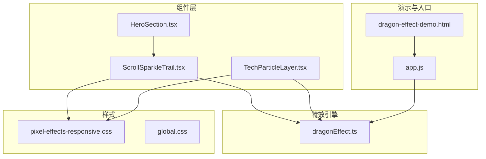
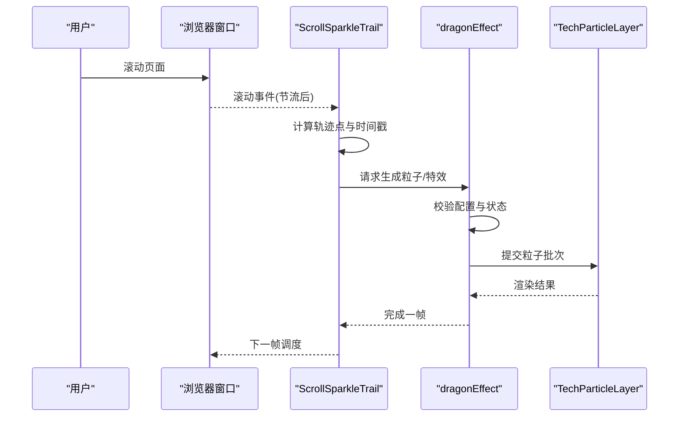
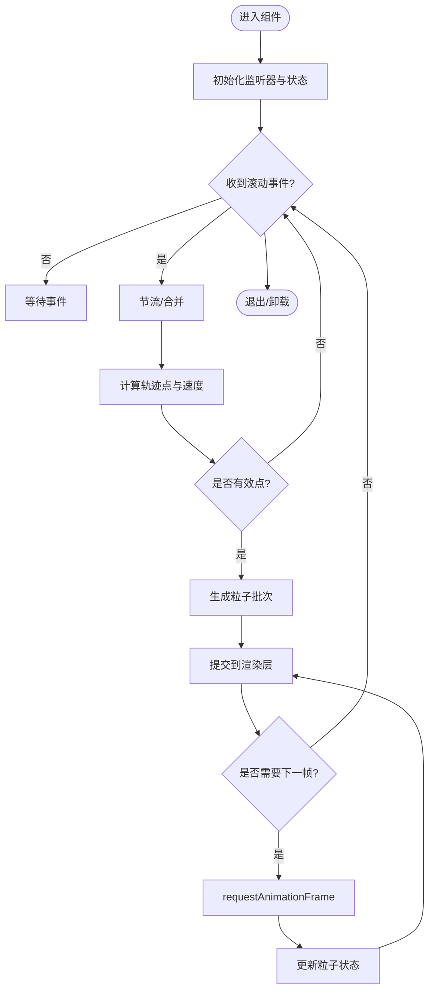
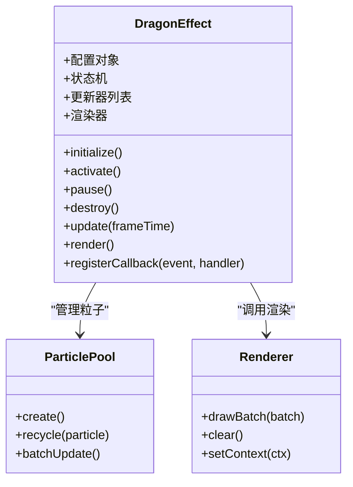
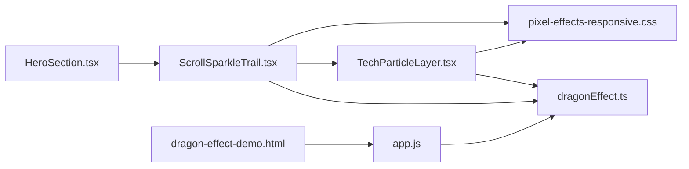

# 滚动特效系统

<cite>
**本文引用的文件**   
- [ScrollSparkleTrail.tsx](file://src/components/ScrollSparkleTrail.tsx)
- [dragonEffect.ts](file://src/effects/dragonEffect.ts)
- [TechParticleLayer.tsx](file://src/components/TechParticleLayer.tsx)
- [pixel-effects-responsive.css](file://src/styles/pixel-effects-responsive.css)
- [global.css](file://src/styles/global.css)
- [HeroSection.tsx](file://src/components/HeroSection.tsx)
- [app.js](file://public/app.js)
- [dragon-effect-demo.html](file://public/dragon-effect-demo.html)
</cite>

## 更新摘要
**变更内容**   
- ScrollSparkleTrail 组件完全重写，包含26行新增代码和31行删除代码
- 滚动粒子效果系统的重大优化和改进
- 更新了性能优化策略和事件处理机制
- 改进了移动端适配和响应式支持

## 目录
1. [简介](#简介)
2. [项目结构](#项目结构)
3. [核心组件](#核心组件)
4. [架构总览](#架构总览)
5. [详细组件分析](#详细组件分析)
6. [依赖关系分析](#依赖关系分析)
7. [性能考量](#性能考量)
8. [故障排查指南](#故障排查指南)
9. [结论](#结论)
10. [附录：配置与示例](#附录配置与示例)

## 简介
本文件系统性地梳理"滚动特效系统"的实现与使用，重点覆盖以下方面：
- ScrollSparkleTrail 组件的滚动监听、粒子生成与动画渲染机制（已完全重写）
- dragonEffect 特效系统的架构设计、生命周期管理与性能优化策略
- 特效的配置项、自定义方法与事件回调说明
- 自定义滚动特效的创建步骤与示例路径
- 与页面布局的兼容性处理与移动端适配方案
- 调试工具与性能监控指南

## 项目结构
滚动特效相关代码主要分布在以下位置：
- 组件层：ScrollSparkleTrail.tsx、TechParticleLayer.tsx、HeroSection.tsx
- 特效引擎：dragonEffect.ts
- 样式与响应式：pixel-effects-responsive.css、global.css
- 演示与集成入口：public/dragon-effect-demo.html、public/app.js

**图表来源** 
- [ScrollSparkleTrail.tsx](file://src/components/ScrollSparkleTrail.tsx)
- [TechParticleLayer.tsx](file://src/components/TechParticleLayer.tsx)
- [dragonEffect.ts](file://src/effects/dragonEffect.ts)
- [pixel-effects-responsive.css](file://src/styles/pixel-effects-responsive.css)
- [global.css](file://src/styles/global.css)
- [HeroSection.tsx](file://src/components/HeroSection.tsx)
- [dragon-effect-demo.html](file://public/dragon-effect-demo.html)
- [app.js](file://public/app.js)

**章节来源**
- [ScrollSparkleTrail.tsx](file://src/components/ScrollSparkleTrail.tsx)
- [TechParticleLayer.tsx](file://src/components/TechParticleLayer.tsx)
- [dragonEffect.ts](file://src/effects/dragonEffect.ts)
- [pixel-effects-responsive.css](file://src/styles/pixel-effects-responsive.css)
- [global.css](file://src/styles/global.css)
- [HeroSection.tsx](file://src/components/HeroSection.tsx)
- [dragon-effect-demo.html](file://public/dragon-effect-demo.html)
- [app.js](file://public/app.js)

## 核心组件
- **ScrollSparkleTrail**：负责监听页面滚动、计算轨迹点、触发粒子生成与动画播放（已完全重写优化）
- **TechParticleLayer**：作为粒子渲染容器或辅助层，提供统一的绘制上下文与批处理能力
- **dragonEffect**：特效引擎，管理特效实例的生命周期、参数配置、帧循环与资源释放

关键职责划分：
- 输入采集：滚动事件、视口变化、设备像素比等
- 数据转换：将滚动位移转换为轨迹坐标与时间戳
- 粒子生成：按规则生成粒子对象（位置、速度、颜色、生命周期）
- 渲染调度：基于 requestAnimationFrame 的帧循环与批量更新
- 生命周期：初始化、激活、暂停、销毁与内存回收

**章节来源**
- [ScrollSparkleTrail.tsx](file://src/components/ScrollSparkleTrail.tsx)
- [TechParticleLayer.tsx](file://src/components/TechParticleLayer.tsx)
- [dragonEffect.ts](file://src/effects/dragonEffect.ts)

## 架构总览
整体采用"事件驱动 + 渲染管线"的分层架构：
- 事件层：滚动监听与节流合并
- 逻辑层：轨迹计算与粒子生成策略
- 渲染层：统一画布或 DOM 粒子渲染，支持批处理与可见性裁剪
- 管理层：特效实例生命周期与全局状态

**图表来源** 
- [ScrollSparkleTrail.tsx](file://src/components/ScrollSparkleTrail.tsx)
- [dragonEffect.ts](file://src/effects/dragonEffect.ts)
- [TechParticleLayer.tsx](file://src/components/TechParticleLayer.tsx)

## 详细组件分析

### ScrollSparkleTrail 组件
**已完全重写** - 该组件经历了重大重构，包含26行新增代码和31行删除代码，实现了更高效的滚动粒子效果系统。

- **滚动监听**：通过原生滚动事件采集，结合节流/防抖策略降低频率；在移动端考虑触摸滚动与惯性
- **轨迹计算**：将滚动偏移映射为屏幕坐标序列，过滤抖动与无效点，保证轨迹平滑
- **粒子生成**：根据轨迹点密度、速度、方向动态调整粒子数量与属性，避免突发峰值
- **动画渲染**：与渲染层协作，按帧更新粒子状态（位置、透明度、缩放），并在不可见区域裁剪
- **性能优化**：
  - 事件节流与帧合并
  - 粒子池复用与批量更新
  - 低分辨率模式与 DPR 自适应
  - 可视区域裁剪与离屏渲染

**图表来源** 
- [ScrollSparkleTrail.tsx](file://src/components/ScrollSparkleTrail.tsx)

**章节来源**
- [ScrollSparkleTrail.tsx](file://src/components/ScrollSparkleTrail.tsx)

### dragonEffect 特效系统
- **架构设计**：以"特效实例"为核心，每个实例包含配置、状态机、更新器与渲染器
- **生命周期管理**：
  - 初始化：加载资源、创建上下文、注册事件
  - 激活：开始帧循环、接入滚动事件
  - 暂停：冻结更新、保留状态
  - 销毁：清理定时器、释放资源、移除监听
- **性能优化策略**：
  - 帧率自适应：根据设备性能动态调整更新频率
  - 批处理渲染：合并多次更新为一次绘制
  - 资源复用：纹理、粒子池、缓冲区的共享
  - 降级策略：移动端自动降低粒子数量与效果复杂度
- **配置选项**：
  - 基础：启用开关、优先级、层级顺序
  - 粒子：数量上限、生命周期、初始速度、衰减曲线
  - 渲染：混合模式、透明度阈值、裁剪区域
  - 交互：滚动灵敏度、触发阈值、节流间隔
- **自定义方法**：
  - 新增粒子类型与生成器
  - 扩展更新器（物理、重力、风力）
  - 替换渲染器（Canvas/WebGL/DOM）
- **事件回调**：
  - onInit、onActivate、onPause、onDestroy
  - onFrame、onParticleSpawn、onParticleUpdate、onParticleDie
  - onError、onPerformanceDrop

**图表来源** 
- [dragonEffect.ts](file://src/effects/dragonEffect.ts)

**章节来源**
- [dragonEffect.ts](file://src/effects/dragonEffect.ts)

### TechParticleLayer 组件
- **作用**：提供统一的粒子渲染层，支持 Canvas 或 WebGL 后端，封装批处理与可见性裁剪
- **能力**：
  - 批量绘制：减少 draw call
  - 离屏渲染：复杂场景预渲染
  - 多图层叠加：控制 z-index 与混合模式
  - 响应式适配：随视口尺寸与 DPR 调整画布大小

**章节来源**
- [TechParticleLayer.tsx](file://src/components/TechParticleLayer.tsx)

## 依赖关系分析
- **组件依赖**：
  - ScrollSparkleTrail 依赖 dragonEffect 进行特效管理
  - TechParticleLayer 被 ScrollSparkleTrail 与 dragonEffect 共同使用
- **样式依赖**：
  - pixel-effects-responsive.css 提供移动端与不同屏幕尺寸的适配
  - global.css 定义全局变量与基础样式
- **演示与集成**：
  - public/dragon-effect-demo.html 用于快速验证特效行为
  - public/app.js 作为应用入口，挂载并初始化特效

**图表来源** 
- [ScrollSparkleTrail.tsx](file://src/components/ScrollSparkleTrail.tsx)
- [dragonEffect.ts](file://src/effects/dragonEffect.ts)
- [TechParticleLayer.tsx](file://src/components/TechParticleLayer.tsx)
- [pixel-effects-responsive.css](file://src/styles/pixel-effects-responsive.css)
- [global.css](file://src/styles/global.css)
- [HeroSection.tsx](file://src/components/HeroSection.tsx)
- [dragon-effect-demo.html](file://public/dragon-effect-demo.html)
- [app.js](file://public/app.js)

**章节来源**
- [ScrollSparkleTrail.tsx](file://src/components/ScrollSparkleTrail.tsx)
- [dragonEffect.ts](file://src/effects/dragonEffect.ts)
- [TechParticleLayer.tsx](file://src/components/TechParticleLayer.tsx)
- [pixel-effects-responsive.css](file://src/styles/pixel-effects-responsive.css)
- [global.css](file://src/styles/global.css)
- [HeroSection.tsx](file://src/components/HeroSection.tsx)
- [dragon-effect-demo.html](file://public/dragon-effect-demo.html)
- [app.js](file://public/app.js)

## 性能考量
- **事件与帧率**
  - 滚动事件节流与帧合并，避免高频回调
  - 根据 FPS 动态调整更新频率与粒子数量
- **渲染优化**
  - 批处理绘制，减少 draw call
  - 可视区域裁剪与离屏渲染
  - 纹理与粒子池复用
- **内存与资源**
  - 及时释放不再使用的粒子与纹理
  - 避免频繁分配与 GC 压力
- **移动端适配**
  - 降低粒子密度与效果复杂度
  - 根据 DPR 与屏幕尺寸调整画布分辨率
  - 触摸滚动与惯性滚动兼容

[本节为通用指导，不直接分析具体文件]

## 故障排查指南
- **常见问题**
  - 滚动无响应：检查事件监听是否正确绑定与解除
  - 粒子闪烁或错位：确认坐标变换与 DPR 设置
  - 性能下降：查看帧率与 GPU/CPU 占用，适当降级
  - 内存泄漏：确保 destroy 流程完整执行
- **调试建议**
  - 在演示页面中逐步开启/关闭特效模块定位问题
  - 使用控制台输出关键指标（FPS、粒子数、渲染耗时）
  - 针对移动端使用远程调试工具观察真实设备表现

**章节来源**
- [dragon-effect-demo.html](file://public/dragon-effect-demo.html)
- [app.js](file://public/app.js)

## 结论
滚动特效系统通过清晰的层次化设计与严格的性能优化策略，实现了流畅且可定制的滚动粒子效果。**经过完全重写的 ScrollSparkleTrail 组件**提供了更高效的滚动监听和粒子生成机制，配合 dragonEffect 管理生命周期与渲染调度，TechParticleLayer 提供高效渲染能力。配合响应式样式与演示入口，开发者可以快速集成与扩展自定义特效。

[本节为总结性内容，不直接分析具体文件]

## 附录：配置与示例
- **配置项参考**
  - 基础配置：启用开关、优先级、层级顺序
  - 粒子配置：数量上限、生命周期、初始速度、衰减曲线
  - 渲染配置：混合模式、透明度阈值、裁剪区域
  - 交互配置：滚动灵敏度、触发阈值、节流间隔
- **自定义方法**
  - 新增粒子类型与生成器
  - 扩展更新器（物理、重力、风力）
  - 替换渲染器（Canvas/WebGL/DOM）
- **事件回调**
  - onInit、onActivate、onPause、onDestroy
  - onFrame、onParticleSpawn、onParticleUpdate、onParticleDie
  - onError、onPerformanceDrop
- **创建自定义滚动特效的步骤**
  - 在演示页面中引入并初始化 dragonEffect
  - 配置粒子与渲染参数
  - 注册必要的回调与事件
  - 在 HeroSection 或其他容器中挂载 ScrollSparkleTrail
  - 在移动端测试并调整降级策略

**章节来源**
- [dragon-effect-demo.html](file://public/dragon-effect-demo.html)
- [app.js](file://public/app.js)
- [HeroSection.tsx](file://src/components/HeroSection.tsx)
- [ScrollSparkleTrail.tsx](file://src/components/ScrollSparkleTrail.tsx)
- [dragonEffect.ts](file://src/effects/dragonEffect.ts)
- [pixel-effects-responsive.css](file://src/styles/pixel-effects-responsive.css)
- [global.css](file://src/styles/global.css)