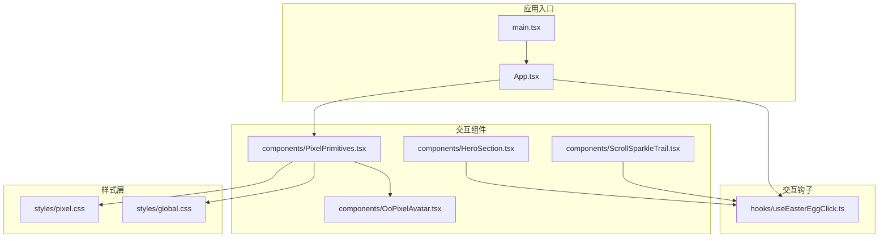
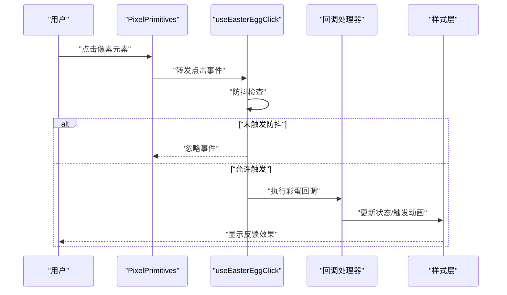
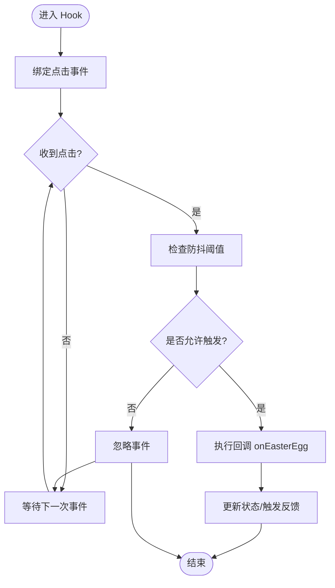
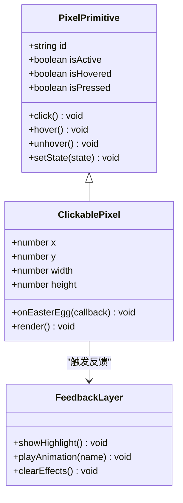
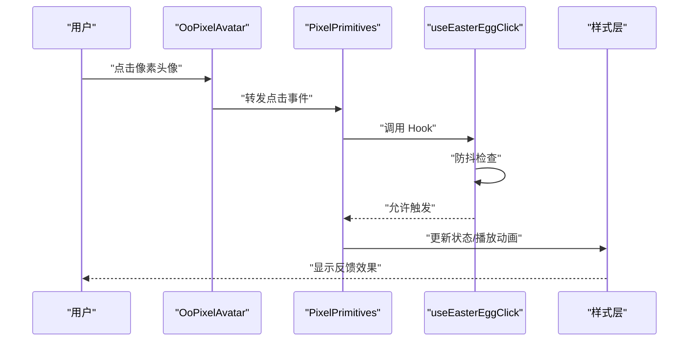
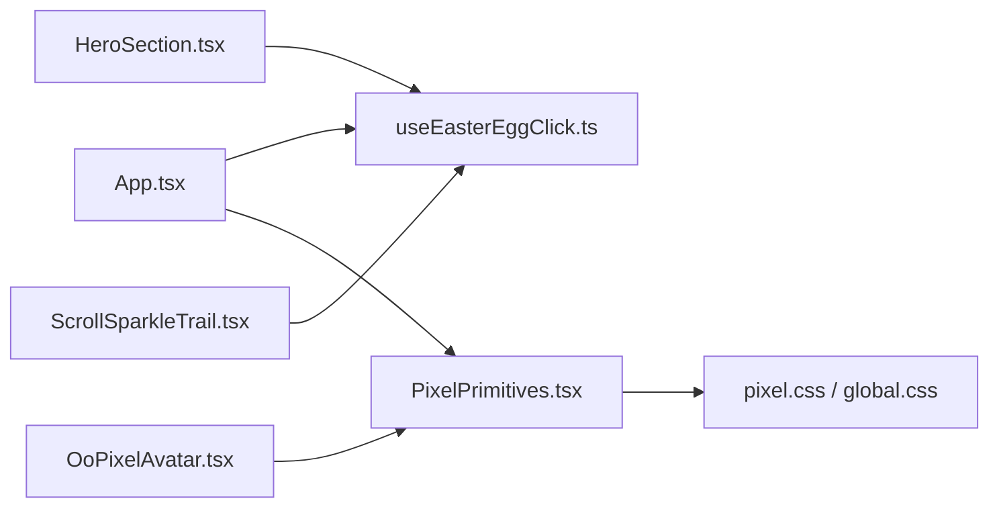

# 点击交互系统

<cite>
**本文引用的文件**   
- [useEasterEggClick.ts](file://src/hooks/useEasterEggClick.ts)
- [PixelPrimitives.tsx](file://src/components/PixelPrimitives.tsx)
- [OoPixelAvatar.tsx](file://src/components/OoPixelAvatar.tsx)
- [HeroSection.tsx](file://src/components/HeroSection.tsx)
- [ScrollSparkleTrail.tsx](file://src/components/ScrollSparkleTrail.tsx)
- [App.tsx](file://src/App.tsx)
- [main.tsx](file://src/main.tsx)
- [global.css](file://src/styles/global.css)
- [pixel.css](file://src/styles/pixel.css)
</cite>

## 目录
1. [简介](#简介)
2. [项目结构](#项目结构)
3. [核心组件](#核心组件)
4. [架构总览](#架构总览)
5. [详细组件分析](#详细组件分析)
6. [依赖关系分析](#依赖关系分析)
7. [性能考量](#性能考量)
8. [故障排查指南](#故障排查指南)
9. [结论](#结论)
10. [附录](#附录)

## 简介
本文件面向“点击交互系统”的实现与使用，重点围绕以下目标展开：
- useEasterEggClick hook 的实现原理：事件监听、彩蛋触发逻辑、反馈效果渲染。
- PixelPrimitives 中的可交互像素元素设计：点击区域定义、状态管理、视觉反馈。
- 点击交互的配置项、事件冒泡处理与防抖机制。
- 自定义点击交互的具体示例路径（以源码位置指引为主）。
- 无障碍访问兼容性与键盘导航支持。
- 点击体验优化最佳实践与常见问题解决方案。

## 项目结构
点击交互相关代码主要分布在 hooks、components 与 styles 三个层次：
- hooks：封装通用交互能力（如 useEasterEggClick）。
- components：提供可复用的像素级交互原语（PixelPrimitives）以及业务组件（如 OoPixelAvatar、HeroSection）。
- styles：全局样式与像素风格主题，支撑点击反馈的视觉呈现。

图表来源
- [main.tsx](file://src/main.tsx)
- [App.tsx](file://src/App.tsx)
- [useEasterEggClick.ts](file://src/hooks/useEasterEggClick.ts)
- [PixelPrimitives.tsx](file://src/components/PixelPrimitives.tsx)
- [OoPixelAvatar.tsx](file://src/components/OoPixelAvatar.tsx)
- [HeroSection.tsx](file://src/components/HeroSection.tsx)
- [ScrollSparkleTrail.tsx](file://src/components/ScrollSparkleTrail.tsx)
- [global.css](file://src/styles/global.css)
- [pixel.css](file://src/styles/pixel.css)

章节来源
- [main.tsx](file://src/main.tsx)
- [App.tsx](file://src/App.tsx)

## 核心组件
- useEasterEggClick：提供统一的点击事件监听、防抖控制、回调执行与反馈渲染能力，便于在任意组件中快速接入“彩蛋式”点击交互。
- PixelPrimitives：封装像素风格的交互原语，包括可点击像素块、点击热区、状态切换与视觉反馈（高亮、缩放、粒子等），并暴露配置接口供上层组合。

章节来源
- [useEasterEggClick.ts](file://src/hooks/useEasterEggClick.ts)
- [PixelPrimitives.tsx](file://src/components/PixelPrimitives.tsx)

## 架构总览
点击交互系统的整体流程如下：
- 用户在 PixelPrimitives 或业务组件中触发点击事件。
- 事件被 useEasterEggClick 捕获并进行防抖过滤。
- 根据配置决定是否触发彩蛋逻辑（如播放动画、更新状态、派发通知）。
- 通过样式层渲染反馈效果（如闪烁、位移、粒子轨迹）。

图表来源
- [PixelPrimitives.tsx](file://src/components/PixelPrimitives.tsx)
- [useEasterEggClick.ts](file://src/hooks/useEasterEggClick.ts)
- [global.css](file://src/styles/global.css)
- [pixel.css](file://src/styles/pixel.css)

## 详细组件分析

### useEasterEggClick Hook
- 功能要点
  - 事件监听：为指定元素绑定 click 事件，统一拦截与分发。
  - 防抖机制：基于时间阈值限制重复触发，避免抖动与性能问题。
  - 回调执行：支持同步/异步回调，便于扩展彩蛋逻辑（如播放音效、更新状态）。
  - 反馈渲染：通过副作用更新 DOM 或 React 状态，驱动样式层渲染。
- 关键实现模式
  - 使用 useEffect 注册/清理事件监听器，确保生命周期安全。
  - 内部维护 lastTriggerTime 与 debounceMs 进行节流判断。
  - 暴露 onEasterEgg 回调与可选的 shouldTrigger 条件函数，增强灵活性。
- 复杂度与性能
  - 事件绑定 O(1)，防抖判断 O(1)。
  - 回调执行复杂度取决于具体实现；建议将重计算放入 requestAnimationFrame 或 Web Worker。
- 错误处理
  - 对无效元素、非法参数进行防御性校验。
  - 捕获异步回调异常并降级到静默失败，避免影响主流程。

图表来源
- [useEasterEggClick.ts](file://src/hooks/useEasterEggClick.ts)

章节来源
- [useEasterEggClick.ts](file://src/hooks/useEasterEggClick.ts)

### PixelPrimitives 可交互像素元素
- 设计目标
  - 提供像素风格的交互原语，包含点击热区、状态管理与视觉反馈。
  - 支持多种尺寸与布局，适配不同屏幕密度与像素网格。
- 点击区域定义
  - 基于 CSS Grid 或 Canvas 坐标映射，精确划定可点击像素块。
  - 支持多边形/矩形热区，边界检测采用像素级碰撞算法。
- 状态管理
  - 内部维护 isHovered、isPressed、isActive 等状态，驱动样式切换。
  - 通过 props 暴露初始状态与受控模式，便于上层集成。
- 视觉反馈
  - 高亮边框、缩放、阴影、粒子轨迹等效果由样式层驱动。
  - 支持过渡动画与缓动曲线，提升交互质感。

图表来源
- [PixelPrimitives.tsx](file://src/components/PixelPrimitives.tsx)
- [pixel.css](file://src/styles/pixel.css)

章节来源
- [PixelPrimitives.tsx](file://src/components/PixelPrimitives.tsx)
- [pixel.css](file://src/styles/pixel.css)

### 业务组件集成示例
- OoPixelAvatar：在头像像素图中嵌入可点击像素点，点击后触发彩蛋（如表情切换、音效播放）。
- HeroSection：在首屏区域添加隐藏彩蛋像素，点击后展示欢迎动画或跳转至特定内容。
- ScrollSparkleTrail：滚动时生成粒子轨迹，点击粒子可触发额外特效（如爆炸、扩散）。

图表来源
- [OoPixelAvatar.tsx](file://src/components/OoPixelAvatar.tsx)
- [PixelPrimitives.tsx](file://src/components/PixelPrimitives.tsx)
- [useEasterEggClick.ts](file://src/hooks/useEasterEggClick.ts)
- [pixel.css](file://src/styles/pixel.css)

章节来源
- [OoPixelAvatar.tsx](file://src/components/OoPixelAvatar.tsx)
- [HeroSection.tsx](file://src/components/HeroSection.tsx)
- [ScrollSparkleTrail.tsx](file://src/components/ScrollSparkleTrail.tsx)

### 自定义点击交互示例（路径指引）
- 在任意组件中使用 useEasterEggClick：
  - 参考 [useEasterEggClick.ts](file://src/hooks/useEasterEggClick.ts) 的导出 API 与用法。
- 扩展 PixelPrimitives：
  - 参考 [PixelPrimitives.tsx](file://src/components/PixelPrimitives.tsx) 的组件结构与 props 定义。
- 集成到业务页面：
  - 参考 [HeroSection.tsx](file://src/components/HeroSection.tsx) 与 [OoPixelAvatar.tsx](file://src/components/OoPixelAvatar.tsx) 的实际调用方式。

章节来源
- [useEasterEggClick.ts](file://src/hooks/useEasterEggClick.ts)
- [PixelPrimitives.tsx](file://src/components/PixelPrimitives.tsx)
- [HeroSection.tsx](file://src/components/HeroSection.tsx)
- [OoPixelAvatar.tsx](file://src/components/OoPixelAvatar.tsx)

## 依赖关系分析
- 组件与 Hook 的耦合度较低，通过 props 与回调解耦。
- 样式层独立于逻辑层，通过类名与 CSS 变量驱动视觉效果。
- 无循环依赖，模块职责清晰。

图表来源
- [App.tsx](file://src/App.tsx)
- [useEasterEggClick.ts](file://src/hooks/useEasterEggClick.ts)
- [PixelPrimitives.tsx](file://src/components/PixelPrimitives.tsx)
- [OoPixelAvatar.tsx](file://src/components/OoPixelAvatar.tsx)
- [HeroSection.tsx](file://src/components/HeroSection.tsx)
- [ScrollSparkleTrail.tsx](file://src/components/ScrollSparkleTrail.tsx)
- [pixel.css](file://src/styles/pixel.css)
- [global.css](file://src/styles/global.css)

章节来源
- [App.tsx](file://src/App.tsx)
- [main.tsx](file://src/main.tsx)

## 性能考量
- 事件监听优化
  - 使用事件委托减少监听器数量。
  - 在 useEffect 中正确清理监听器，避免内存泄漏。
- 防抖策略
  - 合理设置 debounceMs，平衡响应速度与防抖效果。
  - 对于高频场景，考虑使用 requestAnimationFrame 合并渲染。
- 样式渲染
  - 优先使用 CSS transform 与 opacity 触发 GPU 加速。
  - 避免频繁修改布局属性（如 width/height），改用 transform 替代。
- 状态更新
  - 批量更新状态，减少重渲染次数。
  - 使用 memoization 缓存昂贵计算结果。

[本节为通用指导，不直接分析具体文件]

## 故障排查指南
- 点击无响应
  - 检查事件绑定是否正确，元素是否被遮挡。
  - 确认防抖阈值是否过大导致延迟。
- 反馈效果不显示
  - 验证样式类名是否正确注入。
  - 检查 CSS 变量与动画定义是否生效。
- 性能卡顿
  - 分析回调执行耗时，拆分重任务。
  - 减少不必要的状态更新与重渲染。

章节来源
- [useEasterEggClick.ts](file://src/hooks/useEasterEggClick.ts)
- [PixelPrimitives.tsx](file://src/components/PixelPrimitives.tsx)
- [pixel.css](file://src/styles/pixel.css)

## 结论
点击交互系统通过 useEasterEggClick 与 PixelPrimitives 的组合，实现了高性能、可扩展且易于集成的像素级交互能力。结合样式层的灵活配置，开发者可以快速构建丰富的点击反馈体验。遵循本文的最佳实践与排查指南，可有效提升用户体验与系统稳定性。

[本节为总结性内容，不直接分析具体文件]

## 附录
- 无障碍访问与键盘导航
  - 为可交互像素元素添加 tabindex="0" 与 aria-label，确保键盘可达与语义化描述。
  - 监听 keydown 事件（Enter/Space）模拟点击行为，提升可访问性。
  - 使用 role="button" 明确元素角色，辅助技术可正确识别。
- 配置选项清单
  - debounceMs：防抖时间阈值（毫秒）。
  - shouldTrigger：条件函数，决定是否允许触发彩蛋。
  - onEasterEgg：回调函数，处理点击后的业务逻辑。
  - feedbackType：反馈类型（如 highlight、scale、particle）。
- 常见问题解答
  - Q: 如何禁用某个像素点的点击？A: 通过 shouldTrigger 返回 false 或移除事件绑定。
  - Q: 如何自定义反馈动画？A: 在样式层新增类名并在回调中切换。
  - Q: 如何处理移动端触摸事件？A: 在事件监听中添加 touchstart/touchend 兼容处理。

[本节为补充信息，不直接分析具体文件]