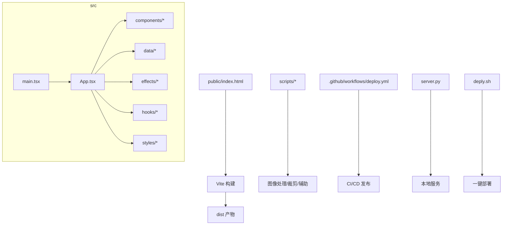
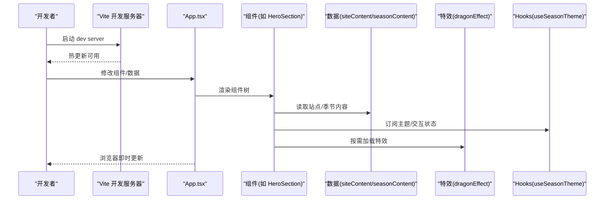
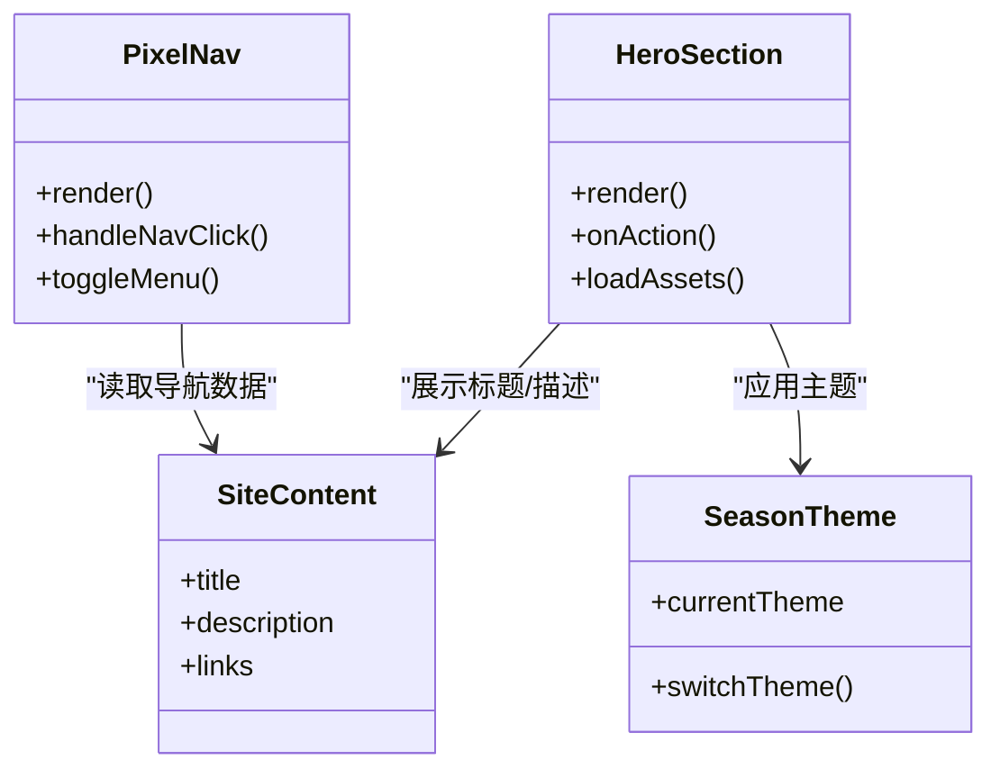
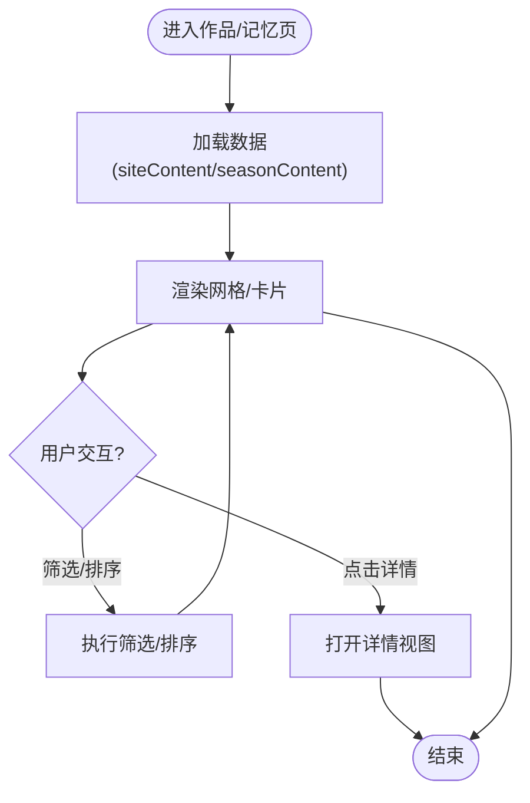
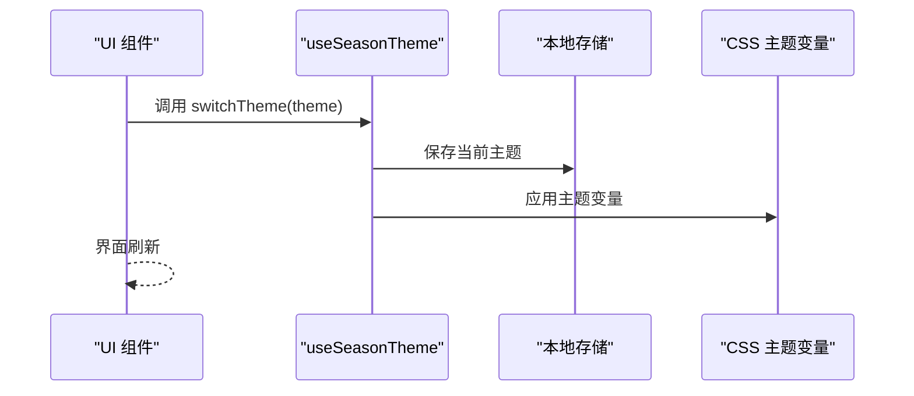
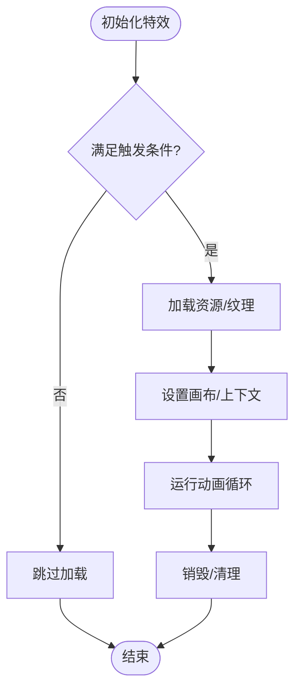
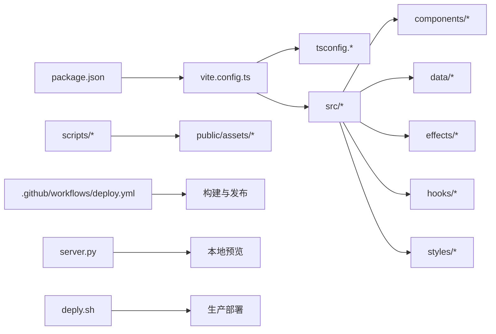
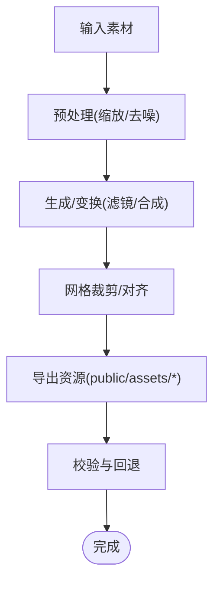

# 开发指南

<cite>
**本文引用的文件**   
- [README.md](file://README.md)
- [package.json](file://package.json)
- [vite.config.ts](file://vite.config.ts)
- [tsconfig.json](file://tsconfig.json)
- [tsconfig.app.json](file://tsconfig.app.json)
- [tsconfig.node.json](file://tsconfig.node.json)
- [server.py](file://server.py)
- [deply.sh](file://deply.sh)
- [.github/workflows/deploy.yml](file://.github/workflows/deploy.yml)
- [scripts/image_gen.py](file://scripts/image_gen.py)
- [scripts/crop-oo-grid.mjs](file://scripts/crop-oo-grid.mjs)
- [scripts/open_app.command](file://scripts/open_app.command)
- [src/main.tsx](file://src/main.tsx)
- [src/App.tsx](file://src/App.tsx)
- [src/components/PixelNav.tsx](file://src/components/PixelNav.tsx)
- [src/components/HeroSection.tsx](file://src/components/HeroSection.tsx)
- [src/components/WorksSection.tsx](file://src/components/WorksSection.tsx)
- [src/components/MemoryGallery.tsx](file://src/components/MemoryGallery.tsx)
- [src/components/OoPixelAvatar.tsx](file://src/components/OoPixelAvatar.tsx)
- [src/data/siteContent.ts](file://src/data/siteContent.ts)
- [src/data/seasonContent.ts](file://src/data/seasonContent.ts)
- [src/data/poseMap.ts](file://src/data/poseMap.ts)
- [src/effects/dragonEffect.ts](file://src/effects/dragonEffect.ts)
- [src/hooks/useSeasonTheme.ts](file://src/hooks/useSeasonTheme.ts)
- [src/hooks/useEasterEggClick.ts](file://src/hooks/useEasterEggClick.ts)
- [src/styles/global.css](file://src/styles/global.css)
- [src/styles/themes.css](file://src/styles/themes.css)
- [src/styles/tokens.css](file://src/styles/tokens.css)
- [public/index.html](file://public/index.html)
- [public/app.js](file://public/app.js)
- [public/dragon-effect-demo.html](file://public/dragon-effect-demo.html)
</cite>

## 目录
1. [简介](#简介)
2. [项目结构](#项目结构)
3. [核心组件](#核心组件)
4. [架构总览](#架构总览)
5. [详细组件分析](#详细组件分析)
6. [依赖关系分析](#依赖关系分析)
7. [性能考虑](#性能考虑)
8. [故障排查指南](#故障排查指南)
9. [结论](#结论)
10. [附录](#附录)

## 简介
本指南面向 oo-space 项目的开发者，覆盖从环境搭建、代码规范、组件开发最佳实践到脚本工具使用、图像生成与处理流程、配置文件结构与自定义选项、调试技巧、性能优化、错误排查以及贡献流程等全链路内容。目标是帮助新成员快速上手，并提升团队协作效率与交付质量。

## 项目结构
项目采用 Vite + React + TypeScript 的现代前端工程化方案，配合 Python 脚本进行图像处理，Shell/GitHub Actions 完成部署自动化。关键目录与职责如下：
- src: 应用源码（组件、数据、效果、钩子、样式）
- public: 静态资源与入口 HTML
- scripts: 本地工具脚本（图像处理、裁剪、快捷打开）
- .github/workflows: CI/CD 工作流
- server.py: 本地或轻量服务脚本
- deply.sh: 部署脚本
- 配置与构建: package.json、vite.config.ts、tsconfig.*



**图表来源** 
- [public/index.html](file://public/index.html)
- [src/main.tsx](file://src/main.tsx)
- [src/App.tsx](file://src/App.tsx)
- [vite.config.ts](file://vite.config.ts)
- [scripts/image_gen.py](file://scripts/image_gen.py)
- [scripts/crop-oo-grid.mjs](file://scripts/crop-oo-grid.mjs)
- [.github/workflows/deploy.yml](file://.github/workflows/deploy.yml)
- [server.py](file://server.py)
- [deply.sh](file://deply.sh)

**章节来源**
- [package.json](file://package.json)
- [vite.config.ts](file://vite.config.ts)
- [tsconfig.json](file://tsconfig.json)
- [tsconfig.app.json](file://tsconfig.app.json)
- [tsconfig.node.json](file://tsconfig.node.json)

## 核心组件
- 入口与根应用
  - main.tsx: 应用初始化与挂载点
  - App.tsx: 路由与页面组织、主题与全局状态接入
- 导航与首屏
  - PixelNav.tsx: 像素风格导航栏
  - HeroSection.tsx: 首屏展示区
- 作品与记忆
  - WorksSection.tsx: 作品展示区块
  - MemoryGallery.tsx: 记忆相册/画廊
- 角色与交互
  - OoPixelAvatar.tsx: 像素头像/角色展示
  - useSeasonTheme.ts: 季节主题切换 Hook
  - useEasterEggClick.ts: 彩蛋点击交互 Hook
- 数据与效果
  - siteContent.ts / seasonContent.ts / poseMap.ts: 站点内容与姿态映射
  - dragonEffect.ts: 龙形特效逻辑
- 样式体系
  - global.css / themes.css / tokens.css: 全局样式、主题变量与 Token

**章节来源**
- [src/main.tsx](file://src/main.tsx)
- [src/App.tsx](file://src/App.tsx)
- [src/components/PixelNav.tsx](file://src/components/PixelNav.tsx)
- [src/components/HeroSection.tsx](file://src/components/HeroSection.tsx)
- [src/components/WorksSection.tsx](file://src/components/WorksSection.tsx)
- [src/components/MemoryGallery.tsx](file://src/components/MemoryGallery.tsx)
- [src/components/OoPixelAvatar.tsx](file://src/components/OoPixelAvatar.tsx)
- [src/hooks/useSeasonTheme.ts](file://src/hooks/useSeasonTheme.ts)
- [src/hooks/useEasterEggClick.ts](file://src/hooks/useEasterEggClick.ts)
- [src/data/siteContent.ts](file://src/data/siteContent.ts)
- [src/data/seasonContent.ts](file://src/data/seasonContent.ts)
- [src/data/poseMap.ts](file://src/data/poseMap.ts)
- [src/effects/dragonEffect.ts](file://src/effects/dragonEffect.ts)
- [src/styles/global.css](file://src/styles/global.css)
- [src/styles/themes.css](file://src/styles/themes.css)
- [src/styles/tokens.css](file://src/styles/tokens.css)

## 架构总览
整体为单页应用（SPA），Vite 负责开发与构建，React 组件驱动 UI，数据与配置集中在 data 目录，特效与交互通过 hooks/effects 模块实现。部署由 GitHub Actions 触发，支持本地预览与服务启动。



**图表来源** 
- [src/App.tsx](file://src/App.tsx)
- [src/components/HeroSection.tsx](file://src/components/HeroSection.tsx)
- [src/data/siteContent.ts](file://src/data/siteContent.ts)
- [src/data/seasonContent.ts](file://src/data/seasonContent.ts)
- [src/effects/dragonEffect.ts](file://src/effects/dragonEffect.ts)
- [src/hooks/useSeasonTheme.ts](file://src/hooks/useSeasonTheme.ts)

## 详细组件分析

### 像素导航与首屏
- 导航组件提供像素风格菜单与响应式适配
- 首屏区域承载品牌信息与视觉焦点，可结合季节主题与特效



**图表来源** 
- [src/components/PixelNav.tsx](file://src/components/PixelNav.tsx)
- [src/components/HeroSection.tsx](file://src/components/HeroSection.tsx)
- [src/data/siteContent.ts](file://src/data/siteContent.ts)
- [src/hooks/useSeasonTheme.ts](file://src/hooks/useSeasonTheme.ts)

**章节来源**
- [src/components/PixelNav.tsx](file://src/components/PixelNav.tsx)
- [src/components/HeroSection.tsx](file://src/components/HeroSection.tsx)
- [src/data/siteContent.ts](file://src/data/siteContent.ts)
- [src/hooks/useSeasonTheme.ts](file://src/hooks/useSeasonTheme.ts)

### 作品与记忆画廊
- 作品区块按网格/卡片形式展示，支持懒加载与图片优化
- 记忆画廊提供浏览、筛选与交互能力



**图表来源** 
- [src/components/WorksSection.tsx](file://src/components/WorksSection.tsx)
- [src/components/MemoryGallery.tsx](file://src/components/MemoryGallery.tsx)
- [src/data/siteContent.ts](file://src/data/siteContent.ts)
- [src/data/seasonContent.ts](file://src/data/seasonContent.ts)

**章节来源**
- [src/components/WorksSection.tsx](file://src/components/WorksSection.tsx)
- [src/components/MemoryGallery.tsx](file://src/components/MemoryGallery.tsx)
- [src/data/siteContent.ts](file://src/data/siteContent.ts)
- [src/data/seasonContent.ts](file://src/data/seasonContent.ts)

### 像素头像与姿态映射
- OoPixelAvatar 负责像素头像渲染与姿态切换
- poseMap 定义姿态与素材映射关系

```mermaid
classDiagram
class OoPixelAvatar {
+props : { pose, size, theme }
+render()
+updatePose(newPose)
}
class PoseMap {
+map : Record<string, AssetPath>
+getAsset(pose)
}
OoPixelAvatar --> PoseMap : "查询姿态素材"
```

**图表来源** 
- [src/components/OoPixelAvatar.tsx](file://src/components/OoPixelAvatar.tsx)
- [src/data/poseMap.ts](file://src/data/poseMap.ts)

**章节来源**
- [src/components/OoPixelAvatar.tsx](file://src/components/OoPixelAvatar.tsx)
- [src/data/poseMap.ts](file://src/data/poseMap.ts)

### 季节主题与彩蛋交互
- useSeasonTheme 管理主题切换与持久化
- useEasterEggClick 处理彩蛋点击行为与反馈



**图表来源** 
- [src/hooks/useSeasonTheme.ts](file://src/hooks/useSeasonTheme.ts)
- [src/styles/themes.css](file://src/styles/themes.css)
- [src/styles/tokens.css](file://src/styles/tokens.css)

**章节来源**
- [src/hooks/useSeasonTheme.ts](file://src/hooks/useSeasonTheme.ts)
- [src/hooks/useEasterEggClick.ts](file://src/hooks/useEasterEggClick.ts)
- [src/styles/themes.css](file://src/styles/themes.css)
- [src/styles/tokens.css](file://src/styles/tokens.css)

### 龙形特效
- dragonEffect.ts 封装特效逻辑，可在首屏或特定场景按需加载



**图表来源** 
- [src/effects/dragonEffect.ts](file://src/effects/dragonEffect.ts)
- [public/dragon-effect-demo.html](file://public/dragon-effect-demo.html)

**章节来源**
- [src/effects/dragonEffect.ts](file://src/effects/dragonEffect.ts)
- [public/dragon-effect-demo.html](file://public/dragon-effect-demo.html)

## 依赖关系分析
- 构建与类型
  - vite.config.ts: 开发/构建配置、插件与路径别名
  - tsconfig.*: 类型检查与编译选项
  - package.json: 依赖与脚本命令
- 运行时
  - src/main.tsx -> App.tsx -> components/data/effects/hooks/styles
- 外部工具
  - scripts/image_gen.py: 图像生成/处理
  - scripts/crop-oo-grid.mjs: 网格裁剪
  - server.py: 本地服务
  - deply.sh: 部署脚本
  - .github/workflows/deploy.yml: CI/CD 流水线



**图表来源** 
- [package.json](file://package.json)
- [vite.config.ts](file://vite.config.ts)
- [tsconfig.json](file://tsconfig.json)
- [tsconfig.app.json](file://tsconfig.app.json)
- [tsconfig.node.json](file://tsconfig.node.json)
- [src/main.tsx](file://src/main.tsx)
- [src/App.tsx](file://src/App.tsx)
- [scripts/image_gen.py](file://scripts/image_gen.py)
- [scripts/crop-oo-grid.mjs](file://scripts/crop-oo-grid.mjs)
- [server.py](file://server.py)
- [deply.sh](file://deply.sh)
- [.github/workflows/deploy.yml](file://.github/workflows/deploy.yml)

**章节来源**
- [package.json](file://package.json)
- [vite.config.ts](file://vite.config.ts)
- [tsconfig.json](file://tsconfig.json)
- [tsconfig.app.json](file://tsconfig.app.json)
- [tsconfig.node.json](file://tsconfig.node.json)
- [src/main.tsx](file://src/main.tsx)
- [src/App.tsx](file://src/App.tsx)
- [scripts/image_gen.py](file://scripts/image_gen.py)
- [scripts/crop-oo-grid.mjs](file://scripts/crop-oo-grid.mjs)
- [server.py](file://server.py)
- [deply.sh](file://deply.sh)
- [.github/workflows/deploy.yml](file://.github/workflows/deploy.yml)

## 性能考虑
- 构建与打包
  - 启用按需加载与代码分割，减少首屏体积
  - 静态资源压缩与缓存策略
- 渲染与交互
  - 列表与大图懒加载，避免阻塞主线程
  - 复杂特效按需初始化与销毁
- 资源优化
  - 图片格式选择与尺寸裁剪（使用 scripts/crop-oo-grid.mjs）
  - 字体与图标按需引入
- 监控与度量
  - 使用浏览器性能面板与网络面板定位瓶颈
  - 在关键路径添加埋点与日志

[本节为通用指导，不直接分析具体文件]

## 故障排查指南
- 常见问题
  - 端口占用：调整开发服务器端口或释放占用进程
  - 资源路径错误：检查 vite.config.ts 的别名与 public 目录引用
  - 类型报错：核对 tsconfig 与组件接口定义
  - 图像生成失败：确认 Python 环境与依赖安装
  - 部署失败：检查 CI/CD 环境变量与权限
- 调试技巧
  - 使用浏览器控制台与 Network 面板
  - 在关键函数中添加日志输出
  - 使用断点与条件断点逐步定位问题
- 错误排查流程
  - 复现步骤 -> 最小化示例 -> 隔离问题 -> 修复验证

**章节来源**
- [vite.config.ts](file://vite.config.ts)
- [scripts/image_gen.py](file://scripts/image_gen.py)
- [.github/workflows/deploy.yml](file://.github/workflows/deploy.yml)

## 结论
本指南系统梳理了 oo-space 的开发流程与最佳实践，涵盖环境搭建、组件开发、脚本工具、配置与部署、性能优化与故障排查。遵循本文档可显著提升开发效率与代码质量，建议团队在协作中统一规范与流程。

[本节为总结性内容，不直接分析具体文件]

## 附录

### 开发环境设置
- 前置要求
  - Node.js 与包管理器（npm/yarn/pnpm）
  - Python 3.x（用于图像处理脚本）
- 安装与启动
  - 安装依赖：执行包管理器的安装命令
  - 启动开发服务器：执行开发脚本
  - 本地预览：使用 server.py 或浏览器直接打开 public/index.html
- 构建与预览
  - 构建生产版本：执行构建脚本
  - 预览构建产物：使用本地服务或静态托管

**章节来源**
- [package.json](file://package.json)
- [server.py](file://server.py)
- [public/index.html](file://public/index.html)

### 代码规范
- 命名约定
  - 组件与文件使用 PascalCase
  - 常量与配置使用 UPPER_SNAKE_CASE
  - 变量与函数使用 camelCase
- 类型与接口
  - 严格启用 TypeScript 类型检查
  - 为组件 props 与 API 定义明确接口
- 样式与主题
  - 使用 CSS 变量与 Token 管理主题
  - 保持样式模块化与复用
- 提交与分支
  - 语义化提交信息
  - 功能分支与合并请求流程

**章节来源**
- [tsconfig.json](file://tsconfig.json)
- [src/styles/tokens.css](file://src/styles/tokens.css)
- [src/styles/themes.css](file://src/styles/themes.css)

### 组件开发最佳实践
- 单一职责：每个组件聚焦一个功能
- 可组合性：通过 props 与插槽扩展行为
- 性能优先：避免不必要的重渲染与计算
- 可测试性：拆分逻辑与 UI，便于单元测试
- 可访问性：确保键盘导航与屏幕阅读器友好

**章节来源**
- [src/components/PixelNav.tsx](file://src/components/PixelNav.tsx)
- [src/components/HeroSection.tsx](file://src/components/HeroSection.tsx)
- [src/components/WorksSection.tsx](file://src/components/WorksSection.tsx)
- [src/components/MemoryGallery.tsx](file://src/components/MemoryGallery.tsx)
- [src/components/OoPixelAvatar.tsx](file://src/components/OoPixelAvatar.tsx)

### 工具脚本使用方法
- 图像生成
  - 脚本：scripts/image_gen.py
  - 用途：批量生成/处理图像资源
  - 用法：在命令行执行脚本并传入必要参数
- 网格裁剪
  - 脚本：scripts/crop-oo-grid.mjs
  - 用途：对素材进行网格化裁剪与导出
  - 用法：Node.js 环境下运行脚本
- 快捷打开
  - 脚本：scripts/open_app.command
  - 用途：快速打开本地应用或预览页面

**章节来源**
- [scripts/image_gen.py](file://scripts/image_gen.py)
- [scripts/crop-oo-grid.mjs](file://scripts/crop-oo-grid.mjs)
- [scripts/open_app.command](file://scripts/open_app.command)

### 图像生成与处理流程


**图表来源** 
- [scripts/image_gen.py](file://scripts/image_gen.py)
- [scripts/crop-oo-grid.mjs](file://scripts/crop-oo-grid.mjs)

**章节来源**
- [scripts/image_gen.py](file://scripts/image_gen.py)
- [scripts/crop-oo-grid.mjs](file://scripts/crop-oo-grid.mjs)

### 配置文件结构与自定义选项
- 构建配置
  - vite.config.ts: 开发服务器、插件、路径别名、构建目标
- 类型配置
  - tsconfig.json / tsconfig.app.json / tsconfig.node.json: 编译选项与模块解析
- 站点与主题
  - src/data/siteContent.ts / seasonContent.ts: 站点文案与季节内容
  - src/styles/tokens.css / themes.css: 设计 Token 与主题变量
- 其他
  - package.json: 依赖与脚本命令
  - config.example.json: 示例配置（如有）

**章节来源**
- [vite.config.ts](file://vite.config.ts)
- [tsconfig.json](file://tsconfig.json)
- [tsconfig.app.json](file://tsconfig.app.json)
- [tsconfig.node.json](file://tsconfig.node.json)
- [src/data/siteContent.ts](file://src/data/siteContent.ts)
- [src/data/seasonContent.ts](file://src/data/seasonContent.ts)
- [src/styles/tokens.css](file://src/styles/tokens.css)
- [src/styles/themes.css](file://src/styles/themes.css)
- [package.json](file://package.json)
- [config.example.json](file://config.example.json)

### 调试技巧与性能优化建议
- 调试
  - 使用浏览器开发者工具进行 DOM、网络与性能分析
  - 在关键路径添加日志与埋点
  - 使用断点与条件断点定位问题
- 性能优化
  - 代码分割与懒加载
  - 图片与资源优化（格式、尺寸、缓存）
  - 减少重排与重绘，使用虚拟列表与节流防抖
  - 特效按需加载与及时销毁

**章节来源**
- [src/effects/dragonEffect.ts](file://src/effects/dragonEffect.ts)
- [src/components/MemoryGallery.tsx](file://src/components/MemoryGallery.tsx)
- [src/components/WorksSection.tsx](file://src/components/WorksSection.tsx)

### 错误排查方法
- 常见错误
  - 构建失败：检查依赖与配置
  - 运行时异常：查看控制台与堆栈
  - 资源加载失败：核对路径与权限
- 排查步骤
  - 复现 -> 隔离 -> 定位 -> 修复 -> 验证
- 工具
  - 浏览器控制台、Network、Performance
  - 日志与埋点

**章节来源**
- [vite.config.ts](file://vite.config.ts)
- [src/main.tsx](file://src/main.tsx)
- [src/App.tsx](file://src/App.tsx)

### 贡献代码的流程与规范
- 分支策略
  - 功能分支命名规范
  - 主干保护与合并请求
- 提交规范
  - 语义化提交信息
  - 小步提交与清晰描述
- 代码审查
  - 自测与文档更新
  - 同行评审与反馈
- 发布流程
  - CI/CD 自动化构建与部署
  - 版本标签与变更日志

**章节来源**
- [.github/workflows/deploy.yml](file://.github/workflows/deploy.yml)
- [deply.sh](file://deply.sh)
- [package.json](file://package.json)

### 常见问题解决
- 端口冲突：修改端口或释放占用
- 依赖安装失败：清理缓存与重试
- 类型报错：检查接口与类型定义
- 图像脚本失败：确认 Python 环境与依赖
- 部署失败：检查环境变量与权限

**章节来源**
- [package.json](file://package.json)
- [scripts/image_gen.py](file://scripts/image_gen.py)
- [.github/workflows/deploy.yml](file://.github/workflows/deploy.yml)