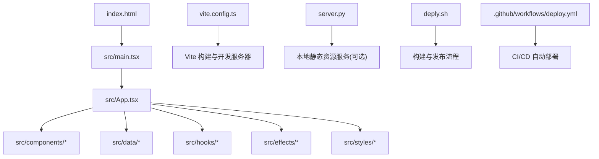
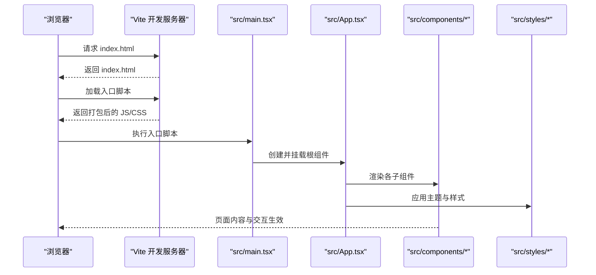

# 快速开始

<cite>
**本文引用的文件**   
- [package.json](file://package.json)
- [vite.config.ts](file://vite.config.ts)
- [tsconfig.json](file://tsconfig.json)
- [tsconfig.app.json](file://tsconfig.app.json)
- [index.html](file://index.html)
- [src/main.tsx](file://src/main.tsx)
- [src/App.tsx](file://src/App.tsx)
- [server.py](file://server.py)
- [deply.sh](file://deply.sh)
- [.github/workflows/deploy.yml](file://.github/workflows/deploy.yml)
- [README.md](file://README.md)
</cite>

## 目录
1. [简介](#简介)
2. [项目结构](#项目结构)
3. [核心组件](#核心组件)
4. [架构总览](#架构总览)
5. [详细组件分析](#详细组件分析)
6. [依赖分析](#依赖分析)
7. [性能考虑](#性能考虑)
8. [故障排除指南](#故障排除指南)
9. [结论](#结论)
10. [附录](#附录) 

## 简介
本指南面向 oo-space 项目的新用户，帮助你从零开始完成环境搭建、依赖安装、开发服务器启动与基本使用。你将了解 Node.js 版本要求、包管理器选择（npm/yarn/pnpm）、开发环境配置，以及完整的命令行操作示例：开发模式启动、构建生产版本、部署脚本使用。通过常见问题排查，确保你能顺利上手并高效迭代。

## 项目结构
oo-space 是一个基于 Vite + React + TypeScript 的前端项目，入口为 index.html，应用根组件由 src/main.tsx 挂载，业务逻辑集中在 src/App.tsx 及 src/components 下的多个组件中。样式采用 CSS/模块化样式组织在 src/styles 下。项目同时提供 Python 本地服务脚本 server.py 与一键部署脚本 deply.sh，并在 .github/workflows/deploy.yml 中定义了 GitHub Actions 的部署流程。

图表来源
- [index.html:1-50](file://index.html#L1-L50)
- [src/main.tsx:1-50](file://src/main.tsx#L1-L50)
- [src/App.tsx:1-50](file://src/App.tsx#L1-L50)
- [vite.config.ts:1-50](file://vite.config.ts#L1-L50)
- [server.py:1-50](file://server.py#L1-L50)
- [deply.sh:1-50](file://deply.sh#L1-L50)
- [.github/workflows/deploy.yml:1-50](file://.github/workflows/deploy.yml#L1-L50)

章节来源
- [package.json:1-100](file://package.json#L1-L100)
- [vite.config.ts:1-100](file://vite.config.ts#L1-L100)
- [tsconfig.json:1-50](file://tsconfig.json#L1-L50)
- [tsconfig.app.json:1-50](file://tsconfig.app.json#L1-L50)
- [index.html:1-50](file://index.html#L1-L50)
- [src/main.tsx:1-50](file://src/main.tsx#L1-L50)
- [src/App.tsx:1-50](file://src/App.tsx#L1-L50)
- [server.py:1-50](file://server.py#L1-L50)
- [deply.sh:1-50](file://deply.sh#L1-L50)
- [.github/workflows/deploy.yml:1-50](file://.github/workflows/deploy.yml#L1-L50)

## 核心组件
- 应用入口与挂载
  - 入口 HTML 文件负责加载运行时脚本与基础样式。
  - main.tsx 初始化 React 应用并挂载到 DOM。
  - App.tsx 作为根组件，组合页面布局与功能模块。
- 组件与数据
  - components 目录包含 UI 组件（如像素头像、记忆卡片、作品展示等）。
  - data 目录集中管理站点内容、季节主题与姿态映射等数据。
  - hooks 目录封装可复用的交互逻辑（点击彩蛋、季节主题切换等）。
  - effects 目录实现特效逻辑（如龙形粒子效果）。
- 样式体系
  - styles 目录按功能与主题拆分样式文件，便于维护与响应式适配。

章节来源
- [src/main.tsx:1-50](file://src/main.tsx#L1-L50)
- [src/App.tsx:1-50](file://src/App.tsx#L1-L50)
- [src/components/HeroSection.tsx:1-50](file://src/components/HeroSection.tsx#L1-L50)
- [src/components/MemoryCard.tsx:1-50](file://src/components/MemoryCard.tsx#L1-L50)
- [src/components/WorksSection.tsx:1-50](file://src/components/WorksSection.tsx#L1-L50)
- [src/data/siteContent.ts:1-50](file://src/data/siteContent.ts#L1-L50)
- [src/data/seasonContent.ts:1-50](file://src/data/seasonContent.ts#L1-L50)
- [src/hooks/useSeasonTheme.ts:1-50](file://src/hooks/useSeasonTheme.ts#L1-L50)
- [src/effects/dragonEffect.ts:1-50](file://src/effects/dragonEffect.ts#L1-L50)
- [src/styles/global.css:1-50](file://src/styles/global.css#L1-L50)

## 架构总览
下图展示了从浏览器到应用运行时的关键路径，以及开发与构建阶段的工具链关系。

图表来源
- [index.html:1-50](file://index.html#L1-L50)
- [src/main.tsx:1-50](file://src/main.tsx#L1-L50)
- [src/App.tsx:1-50](file://src/App.tsx#L1-L50)
- [vite.config.ts:1-50](file://vite.config.ts#L1-L50)

## 详细组件分析
本节聚焦“快速开始”所需的关键步骤与命令，帮助你完成环境搭建、依赖安装、开发服务器启动与构建部署。

### 环境准备与版本要求
- Node.js 版本
  - 建议使用较新的 LTS 版本（例如 18.x 或更高），以确保与 Vite、React、TypeScript 生态兼容。
  - 若遇到构建或插件兼容问题，可通过 nvm 切换 Node 版本后重试。
- 包管理器选择
  - npm：随 Node.js 自带，开箱即用。
  - yarn：适合团队统一依赖锁定与缓存加速。
  - pnpm：磁盘占用更小、安装更快，适合大型前端项目。
  - 任选其一即可，保持团队一致。

章节来源
- [package.json:1-100](file://package.json#L1-L100)
- [vite.config.ts:1-50](file://vite.config.ts#L1-L50)

### 安装依赖
在项目根目录执行以下命令之一（根据你选择的包管理器）：
- 使用 npm：
  - npm install
- 使用 yarn：
  - yarn install
- 使用 pnpm：
  - pnpm install

说明：
- 该过程会读取 package.json 中的依赖声明并安装至 node_modules。
- 如遇网络问题，可配置国内镜像源或使用代理。

章节来源
- [package.json:1-100](file://package.json#L1-L100)

### 启动开发服务器
- 使用 npm：
  - npm run dev
- 使用 yarn：
  - yarn dev
- 使用 pnpm：
  - pnpm dev

说明：
- 该命令由 Vite 驱动，启动热更新开发服务器，默认监听本地端口（常见为 5173）。
- 修改代码后会自动刷新浏览器，提升开发效率。

章节来源
- [package.json:1-100](file://package.json#L1-L100)
- [vite.config.ts:1-50](file://vite.config.ts#L1-L50)

### 构建生产版本
- 使用 npm：
  - npm run build
- 使用 yarn：
  - yarn build
- 使用 pnpm：
  - pnpm build

说明：
- 构建产物通常输出到 dist 目录（具体以 vite.config.ts 配置为准）。
- 构建完成后，可使用任意静态资源服务器托管（如 nginx、Vercel、Netlify 等）。

章节来源
- [package.json:1-100](file://package.json#L1-L100)
- [vite.config.ts:1-50](file://vite.config.ts#L1-L50)

### 本地预览构建产物
- 使用 npm：
  - npm run preview
- 使用 yarn：
  - yarn preview
- 使用 pnpm：
  - pnpm preview

说明：
- 该命令会在本地启动一个静态服务器，用于预览构建后的产物，验证生产环境行为。

章节来源
- [package.json:1-100](file://package.json#L1-L100)

### 使用 Python 本地服务（可选）
如果你希望用 Python 快速提供静态资源服务进行本地调试：
- 在项目根目录执行：
  - python server.py
- 访问提示的本地地址查看页面。

说明：
- server.py 用于简单静态文件服务，适用于快速验证构建结果或资源加载。

章节来源
- [server.py:1-50](file://server.py#L1-L50)

### 部署脚本与 CI/CD
- 一键部署脚本
  - 执行：bash deply.sh
  - 作用：自动化构建与上传/发布流程（具体目标平台取决于脚本实现）。
- GitHub Actions 自动部署
  - 工作流定义位于 .github/workflows/deploy.yml。
  - 推送或合并到指定分支时触发，自动执行构建与部署任务。

章节来源
- [deply.sh:1-50](file://deply.sh#L1-L50)
- [.github/workflows/deploy.yml:1-50](file://.github/workflows/deploy.yml#L1-L50)

### 基本使用方法
- 首次运行
  - 安装依赖后，启动开发服务器，打开浏览器访问本地地址。
- 修改内容
  - 编辑 src/App.tsx 或对应组件文件，保存后浏览器自动刷新。
- 调整样式
  - 在 src/styles 目录下修改样式文件，实时预览效果。
- 添加新页面或路由
  - 在 src/components 新增组件，并在 App.tsx 中引入与渲染。

章节来源
- [src/main.tsx:1-50](file://src/main.tsx#L1-L50)
- [src/App.tsx:1-50](file://src/App.tsx#L1-L50)
- [src/styles/global.css:1-50](file://src/styles/global.css#L1-L50)

## 依赖分析
- 构建与开发工具
  - Vite：提供极速的开发服务器与构建能力。
  - React + ReactDOM：UI 框架与 DOM 绑定。
  - TypeScript：类型检查与编译。
- 配置文件
  - tsconfig.json / tsconfig.app.json：TypeScript 编译选项。
  - vite.config.ts：Vite 构建与开发服务器配置。
- 其他
  - README.md：项目说明与使用说明。

章节来源
- [package.json:1-100](file://package.json#L1-L100)
- [tsconfig.json:1-50](file://tsconfig.json#L1-L50)
- [tsconfig.app.json:1-50](file://tsconfig.app.json#L1-L50)
- [vite.config.ts:1-50](file://vite.config.ts#L1-L50)
- [README.md:1-50](file://README.md#L1-L50)

## 性能考虑
- 开发体验
  - 使用 Vite 的热更新与按需编译，显著提升开发效率。
- 构建优化
  - 合理拆分组件与样式，减少首屏体积。
  - 图片与媒体资源建议压缩与懒加载。
- 运行时性能
  - 避免在渲染过程中执行重型计算，必要时使用 Web Worker。
  - 合理使用 React.memo、useMemo、useCallback 优化重渲染。

[本节为通用指导，不直接分析具体文件]

## 故障排除指南
- 无法安装依赖
  - 检查 Node.js 版本是否符合要求；尝试更换镜像源或代理。
  - 清理缓存后重试：删除 node_modules 与锁文件，重新安装。
- 开发服务器无法启动
  - 确认端口未被占用；检查 vite.config.ts 中的端口与服务配置。
  - 查看终端错误日志，定位缺失依赖或配置错误。
- 构建失败
  - 检查 TypeScript 类型错误与语法问题。
  - 确认所有依赖已正确安装且版本兼容。
- 本地预览无内容
  - 确认构建产物生成成功；检查静态资源路径是否正确。
  - 使用浏览器开发者工具查看网络请求是否 404。
- 部署失败
  - 检查部署脚本权限与环境变量配置。
  - 查看 CI/CD 日志，定位构建或发布阶段错误。

章节来源
- [vite.config.ts:1-50](file://vite.config.ts#L1-L50)
- [tsconfig.json:1-50](file://tsconfig.json#L1-L50)
- [deply.sh:1-50](file://deply.sh#L1-L50)
- [.github/workflows/deploy.yml:1-50](file://.github/workflows/deploy.yml#L1-L50)

## 结论
通过以上步骤，你可以快速完成 oo-space 项目的本地环境搭建、依赖安装、开发服务器启动与构建部署。建议在团队协作中统一 Node.js 版本与包管理器，并使用 CI/CD 自动化构建与发布流程，以提升交付效率与稳定性。

[本节为总结性内容，不直接分析具体文件]

## 附录
- 常用命令速查
  - 安装依赖：npm install / yarn install / pnpm install
  - 开发模式：npm run dev / yarn dev / pnpm dev
  - 构建生产：npm run build / yarn build / pnpm build
  - 本地预览：npm run preview / yarn preview / pnpm preview
  - Python 本地服务：python server.py
  - 一键部署：bash deply.sh

章节来源
- [package.json:1-100](file://package.json#L1-L100)
- [server.py:1-50](file://server.py#L1-L50)
- [deply.sh:1-50](file://deply.sh#L1-L50)