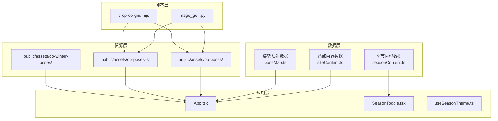
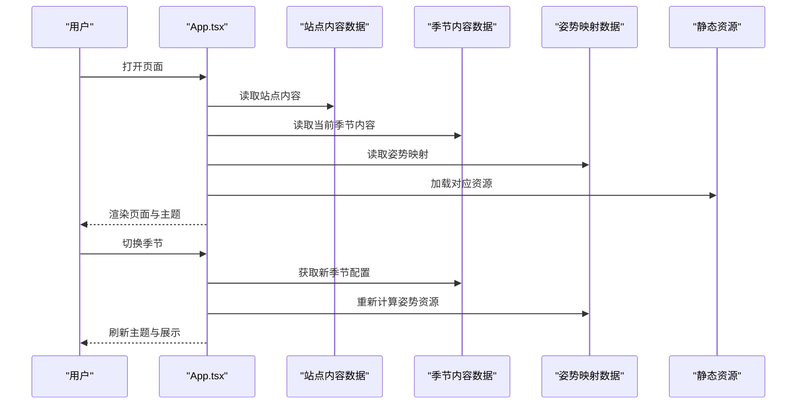
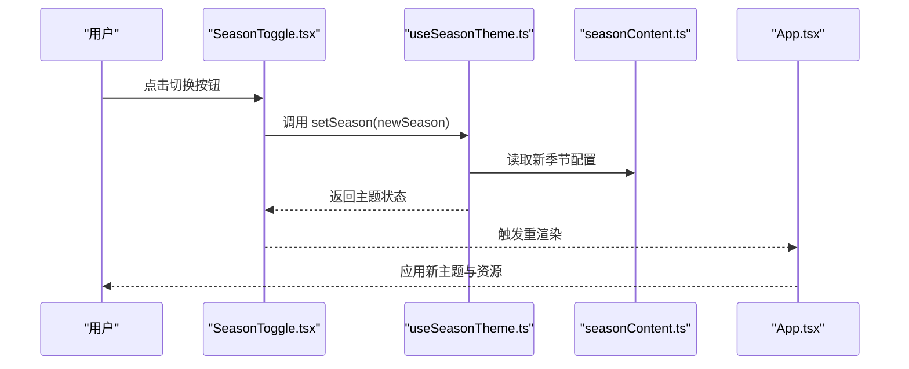
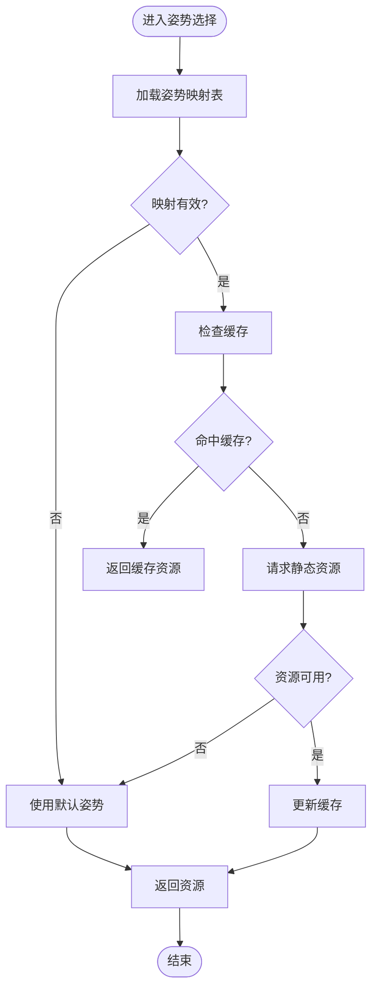
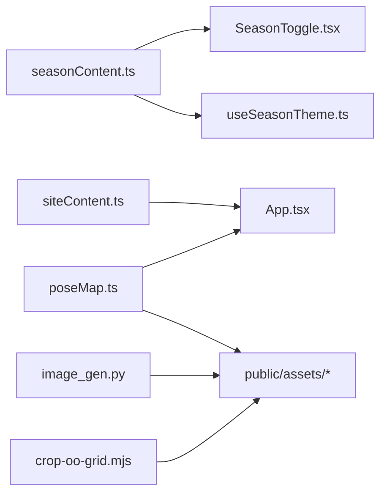

# 数据管理

<cite>
**本文引用的文件**
- [src/data/siteContent.ts](file://src/data/siteContent.ts)
- [src/data/seasonContent.ts](file://src/data/seasonContent.ts)
- [src/data/poseMap.ts](file://src/data/poseMap.ts)
- [src/components/SeasonToggle.tsx](file://src/components/SeasonToggle.tsx)
- [src/hooks/useSeasonTheme.ts](file://src/hooks/useSeasonTheme.ts)
- [src/App.tsx](file://src/App.tsx)
- [public/assets/oo-poses/](file://public/assets/oo-poses/)
- [public/assets/oo-poses-7/](file://public/assets/oo-poses-7/)
- [public/assets/oo-winter-poses/](file://public/assets/oo-winter-poses/)
- [scripts/image_gen.py](file://scripts/image_gen.py)
- [scripts/crop-oo-grid.mjs](file://scripts/crop-oo-grid.mjs)
</cite>

## 目录
1. [简介](#简介)
2. [项目结构](#项目结构)
3. [核心组件](#核心组件)
4. [架构总览](#架构总览)
5. [详细组件分析](#详细组件分析)
6. [依赖关系分析](#依赖关系分析)
7. [性能考虑](#性能考虑)
8. [故障排查指南](#故障排查指南)
9. [结论](#结论)
10. [附录](#附录)

## 简介
本文件为 oo-space 项目的数据管理综合文档，聚焦三类核心数据：站点内容数据、季节内容数据、姿势映射数据。文档从数据结构与用途、实体关系与字段定义、数据验证与业务规则、数据访问模式与缓存策略、性能考量、生命周期与归档、迁移与版本管理、以及安全与隐私等方面进行全面说明，帮助开发者与维护者高效理解和使用这些数据。

## 项目结构
本项目采用前端静态资源与 TypeScript 数据模块分离的组织方式：
- 数据层位于 src/data，包含站点内容、季节内容与姿势映射等结构化数据。
- 视觉资源位于 public/assets，按主题或季节组织图片资源（如 oo-poses、oo-poses-7、oo-winter-poses）。
- 组件与钩子位于 src/components 与 src/hooks，负责读取数据并驱动 UI 渲染与交互。
- 脚本位于 scripts，用于图像生成与网格裁剪等数据处理流程。

图表来源
- [src/data/siteContent.ts](file://src/data/siteContent.ts)
- [src/data/seasonContent.ts](file://src/data/seasonContent.ts)
- [src/data/poseMap.ts](file://src/data/poseMap.ts)
- [src/components/SeasonToggle.tsx](file://src/components/SeasonToggle.tsx)
- [src/hooks/useSeasonTheme.ts](file://src/hooks/useSeasonTheme.ts)
- [src/App.tsx](file://src/App.tsx)
- [public/assets/oo-poses/](file://public/assets/oo-poses/)
- [public/assets/oo-poses-7/](file://public/assets/oo-poses-7/)
- [public/assets/oo-winter-poses/](file://public/assets/oo-winter-poses/)
- [scripts/image_gen.py](file://scripts/image_gen.py)
- [scripts/crop-oo-grid.mjs](file://scripts/crop-oo-grid.mjs)

章节来源
- [src/data/siteContent.ts](file://src/data/siteContent.ts)
- [src/data/seasonContent.ts](file://src/data/seasonContent.ts)
- [src/data/poseMap.ts](file://src/data/poseMap.ts)
- [src/components/SeasonToggle.tsx](file://src/components/SeasonToggle.tsx)
- [src/hooks/useSeasonTheme.ts](file://src/hooks/useSeasonTheme.ts)
- [src/App.tsx](file://src/App.tsx)
- [scripts/image_gen.py](file://scripts/image_gen.py)
- [scripts/crop-oo-grid.mjs](file://scripts/crop-oo-grid.mjs)

## 核心组件
本节对三类核心数据模块进行概述，明确其职责与在应用中的使用位置。

- 站点内容数据（siteContent.ts）
  - 职责：维护站点级展示信息（如标题、描述、导航项、页脚信息等），供页面全局渲染使用。
  - 使用位置：通常在 App 根组件或布局组件中导入，作为页面骨架内容源。
  - 更新频率：较低，随站点文案变更而更新。

- 季节内容数据（seasonContent.ts）
  - 职责：维护不同季节主题的展示内容（如主题名称、配色、装饰元素、活动文案等），配合 SeasonToggle 组件切换主题。
  - 使用位置：SeasonToggle 组件与 useSeasonTheme 钩子读取并驱动主题切换。
  - 更新频率：中等，随季节性活动或主题迭代而更新。

- 姿势映射数据（poseMap.ts）
  - 职责：将“姿势标识”映射到具体资源路径（图片/动画），支撑角色像素风格展示与动态切换。
  - 使用位置：App 组件或其他展示组件根据当前状态选择姿势资源。
  - 更新频率：较高，随素材库扩展与版本迭代而更新。

章节来源
- [src/data/siteContent.ts](file://src/data/siteContent.ts)
- [src/data/seasonContent.ts](file://src/data/seasonContent.ts)
- [src/data/poseMap.ts](file://src/data/poseMap.ts)
- [src/components/SeasonToggle.tsx](file://src/components/SeasonToggle.tsx)
- [src/hooks/useSeasonTheme.ts](file://src/hooks/useSeasonTheme.ts)
- [src/App.tsx](file://src/App.tsx)

## 架构总览
数据流从数据层出发，经组件与钩子消费，最终渲染到用户界面；资源层提供静态资产；脚本层负责素材生产与处理。

图表来源
- [src/App.tsx](file://src/App.tsx)
- [src/data/siteContent.ts](file://src/data/siteContent.ts)
- [src/data/seasonContent.ts](file://src/data/seasonContent.ts)
- [src/data/poseMap.ts](file://src/data/poseMap.ts)
- [src/components/SeasonToggle.tsx](file://src/components/SeasonToggle.tsx)
- [src/hooks/useSeasonTheme.ts](file://src/hooks/useSeasonTheme.ts)

## 详细组件分析

### 站点内容数据（siteContent.ts）
- 结构与用途
  - 通常包含站点元信息、导航条目、页脚信息、SEO 相关文本等。
  - 被 App 或布局组件导入，作为页面基础文案与结构的数据源。
- 字段定义建议
  - 站点标题、副标题、描述、语言设置、版权信息、联系方式等。
  - 导航项：标签、链接、是否可见、排序权重。
- 数据验证规则
  - 必填字段校验（如标题、描述）。
  - 链接格式校验（URL 合法性）。
  - 枚举值校验（如语言代码、导航可见性）。
- 业务规则
  - 导航项按权重排序显示。
  - 多语言支持时，优先选择当前语言配置。
- 数据访问模式
  - 模块导出常量对象，组件直接导入使用。
  - 建议在构建期完成校验，避免运行时错误。
- 缓存策略
  - 静态数据无需缓存，构建产物已固化。
- 性能考虑
  - 保持数据体量精简，避免冗余字段。
  - 按需拆分大对象，减少首屏负载。
- 生命周期与归档
  - 历史版本保留于 Git 分支，废弃字段标记 deprecated。
- 迁移与版本管理
  - 新增字段需兼容旧版渲染逻辑。
  - 通过版本号或特性开关控制差异。
- 安全与隐私
  - 不包含敏感信息，仅公开文案与链接。
  - 外链需遵循安全策略（如白名单）。

章节来源
- [src/data/siteContent.ts](file://src/data/siteContent.ts)
- [src/App.tsx](file://src/App.tsx)

### 季节内容数据（seasonContent.ts）
- 结构与用途
  - 维护不同季节的主题配置（名称、主色、装饰元素、活动文案等）。
  - 配合 SeasonToggle 组件实现主题切换。
- 字段定义建议
  - 季节标识、名称、颜色主题、装饰资源路径、活动文案、启用状态。
- 数据验证规则
  - 季节标识唯一性。
  - 颜色值符合十六进制或命名规范。
  - 资源路径存在性检查。
- 业务规则
  - 默认季节为系统检测或用户上次选择。
  - 禁用季节不可切换。
- 数据访问模式
  - 通过 useSeasonTheme 钩子暴露当前季节配置与切换方法。
  - SeasonToggle 组件调用切换方法触发重渲染。
- 缓存策略
  - 可在浏览器本地存储用户偏好（如 localStorage），提升体验。
- 性能考虑
  - 延迟加载非默认季节的资源。
  - 主题切换时最小化重绘范围。
- 生命周期与归档
  - 过期季节可归档至历史目录，保留引用以便回溯。
- 迁移与版本管理
  - 新增季节需保证向后兼容。
  - 通过版本字段控制渲染差异。
- 安全与隐私
  - 资源路径需校验，防止非法访问。
  - 不收集用户偏好之外的个人信息。

章节来源
- [src/data/seasonContent.ts](file://src/data/seasonContent.ts)
- [src/components/SeasonToggle.tsx](file://src/components/SeasonToggle.tsx)
- [src/hooks/useSeasonTheme.ts](file://src/hooks/useSeasonTheme.ts)

### 姿势映射数据（poseMap.ts）
- 结构与用途
  - 将姿势标识映射到具体资源路径（图片/动画），支撑角色展示。
  - 被 App 或其他展示组件根据状态选择资源。
- 字段定义建议
  - 姿势键名、资源路径、占位图、加载状态、版本标签。
- 数据验证规则
  - 键名唯一性。
  - 资源路径有效性（存在性与格式）。
  - 版本标签一致性。
- 业务规则
  - 默认姿势为系统预设。
  - 资源缺失时回退到占位图。
- 数据访问模式
  - 模块导出映射表，组件按键查找资源。
  - 建议在加载前预取关键资源。
- 缓存策略
  - 利用浏览器缓存与 CDN 加速静态资源。
  - 对热点姿势做内存缓存。
- 性能考虑
  - 按需加载与懒加载大图。
  - 合并请求与压缩资源。
- 生命周期与归档
  - 废弃姿势标记 deprecated，保留映射以兼容旧内容。
- 迁移与版本管理
  - 资源路径变更需同步更新映射。
  - 通过版本字段控制兼容性。
- 安全与隐私
  - 资源路径白名单校验。
  - 禁止执行外部脚本。

章节来源
- [src/data/poseMap.ts](file://src/data/poseMap.ts)
- [src/App.tsx](file://src/App.tsx)
- [public/assets/oo-poses/](file://public/assets/oo-poses/)
- [public/assets/oo-poses-7/](file://public/assets/oo-poses-7/)
- [public/assets/oo-winter-poses/](file://public/assets/oo-winter-poses/)

### 主题切换流程（Sequence）

图表来源
- [src/components/SeasonToggle.tsx](file://src/components/SeasonToggle.tsx)
- [src/hooks/useSeasonTheme.ts](file://src/hooks/useSeasonTheme.ts)
- [src/data/seasonContent.ts](file://src/data/seasonContent.ts)
- [src/App.tsx](file://src/App.tsx)

### 姿势资源选择流程（Flowchart）

图表来源
- [src/data/poseMap.ts](file://src/data/poseMap.ts)
- [src/App.tsx](file://src/App.tsx)

## 依赖关系分析
- 数据层依赖
  - siteContent.ts 独立，无内部依赖。
  - seasonContent.ts 可能被 useSeasonTheme 钩子与 SeasonToggle 组件依赖。
  - poseMap.ts 被 App 或展示组件依赖，指向 public/assets 下的静态资源。
- 组件与钩子依赖
  - App.tsx 依赖 siteContent.ts 与 poseMap.ts。
  - SeasonToggle.tsx 依赖 seasonContent.ts 与 useSeasonTheme.ts。
  - useSeasonTheme.ts 依赖 seasonContent.ts 并提供状态管理。
- 资源与脚本依赖
  - image_gen.py 生成姿势资源，输出到 public/assets/oo-poses* 目录。
  - crop-oo-grid.mjs 对资源进行裁剪与网格化处理。

图表来源
- [src/data/siteContent.ts](file://src/data/siteContent.ts)
- [src/data/seasonContent.ts](file://src/data/seasonContent.ts)
- [src/data/poseMap.ts](file://src/data/poseMap.ts)
- [src/components/SeasonToggle.tsx](file://src/components/SeasonToggle.tsx)
- [src/hooks/useSeasonTheme.ts](file://src/hooks/useSeasonTheme.ts)
- [src/App.tsx](file://src/App.tsx)
- [public/assets/oo-poses/](file://public/assets/oo-poses/)
- [public/assets/oo-poses-7/](file://public/assets/oo-poses-7/)
- [public/assets/oo-winter-poses/](file://public/assets/oo-winter-poses/)
- [scripts/image_gen.py](file://scripts/image_gen.py)
- [scripts/crop-oo-grid.mjs](file://scripts/crop-oo-grid.mjs)

章节来源
- [src/data/siteContent.ts](file://src/data/siteContent.ts)
- [src/data/seasonContent.ts](file://src/data/seasonContent.ts)
- [src/data/poseMap.ts](file://src/data/poseMap.ts)
- [src/components/SeasonToggle.tsx](file://src/components/SeasonToggle.tsx)
- [src/hooks/useSeasonTheme.ts](file://src/hooks/useSeasonTheme.ts)
- [src/App.tsx](file://src/App.tsx)
- [scripts/image_gen.py](file://scripts/image_gen.py)
- [scripts/crop-oo-grid.mjs](file://scripts/crop-oo-grid.mjs)

## 性能考虑
- 构建期优化
  - 使用 Vite 打包与资源压缩，减少体积。
  - 静态资源走 CDN 缓存，提升加载速度。
- 运行时优化
  - 懒加载非首屏资源（如季节资源与姿势大图）。
  - 热点数据内存缓存（如常用姿势映射）。
- 渲染优化
  - 主题切换时最小化重绘范围。
  - 使用虚拟列表或分页加载大量内容。
- 监控与度量
  - 记录资源加载失败率与耗时。
  - 监控主题切换与姿势选择的响应时间。

[本节为通用指导，不直接分析具体文件]

## 故障排查指南
- 常见问题
  - 资源路径错误：检查 poseMap.ts 映射与 public/assets 目录结构一致性。
  - 季节切换无效：确认 seasonContent.ts 配置与 useSeasonTheme 状态更新逻辑。
  - 站点内容未显示：核对 siteContent.ts 字段与 App 渲染逻辑匹配。
- 调试步骤
  - 打开浏览器控制台查看网络请求与错误日志。
  - 使用断点调试数据读取与状态更新流程。
  - 验证资源可用性（404 或跨域问题）。
- 修复建议
  - 统一资源命名规范与路径约定。
  - 增加数据校验与错误边界，提升健壮性。
  - 引入单元测试覆盖关键数据读取与切换逻辑。

章节来源
- [src/data/poseMap.ts](file://src/data/poseMap.ts)
- [src/data/seasonContent.ts](file://src/data/seasonContent.ts)
- [src/data/siteContent.ts](file://src/data/siteContent.ts)
- [src/components/SeasonToggle.tsx](file://src/components/SeasonToggle.tsx)
- [src/hooks/useSeasonTheme.ts](file://src/hooks/useSeasonTheme.ts)
- [src/App.tsx](file://src/App.tsx)

## 结论
通过对站点内容数据、季节内容数据与姿势映射数据的系统化梳理，明确了各自的结构、用途、验证规则与访问模式。结合缓存策略、性能优化与生命周期管理，可为 oo-space 项目提供稳定、可扩展的数据基础。建议在后续迭代中持续完善数据校验、监控与文档，确保数据一致性与用户体验。

[本节为总结性内容，不直接分析具体文件]

## 附录
- 数据字典示例（字段建议）
  - 站点内容：标题、描述、导航项、页脚信息、语言设置。
  - 季节内容：季节标识、名称、颜色主题、装饰资源、活动文案、启用状态。
  - 姿势映射：姿势键名、资源路径、占位图、加载状态、版本标签。
- 版本管理建议
  - 使用语义化版本号管理数据模块。
  - 通过特性开关控制新旧版本兼容。
- 安全与隐私建议
  - 资源路径白名单与输入校验。
  - 不收集敏感个人信息，遵守隐私政策。

[本节为补充信息，不直接分析具体文件]