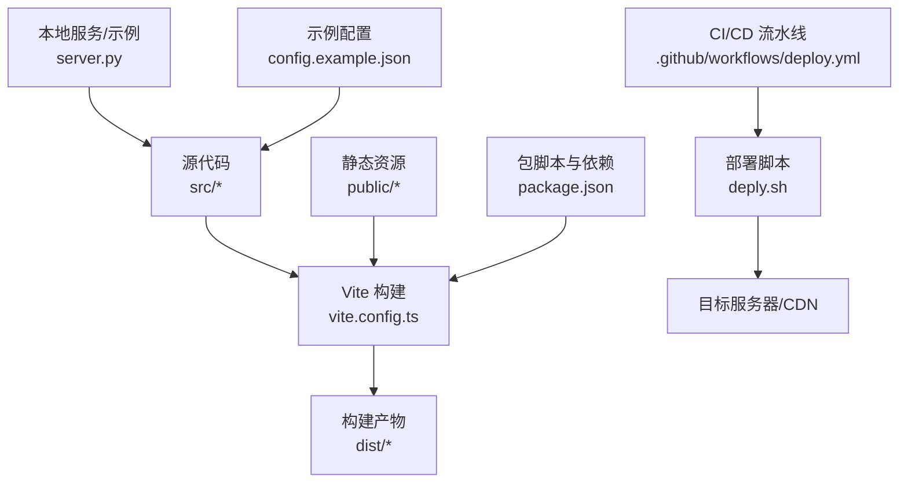
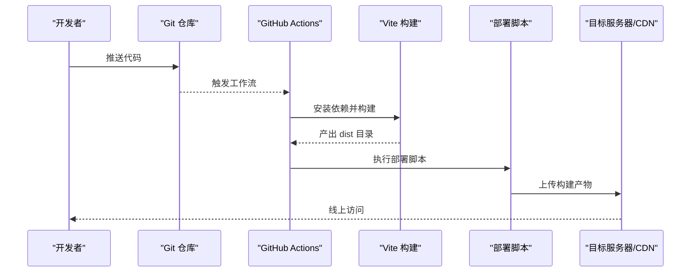
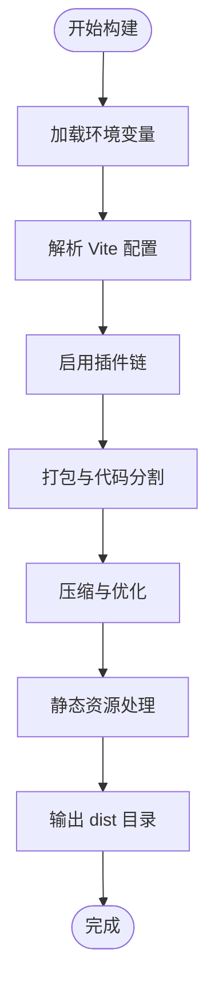
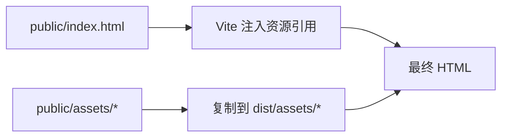
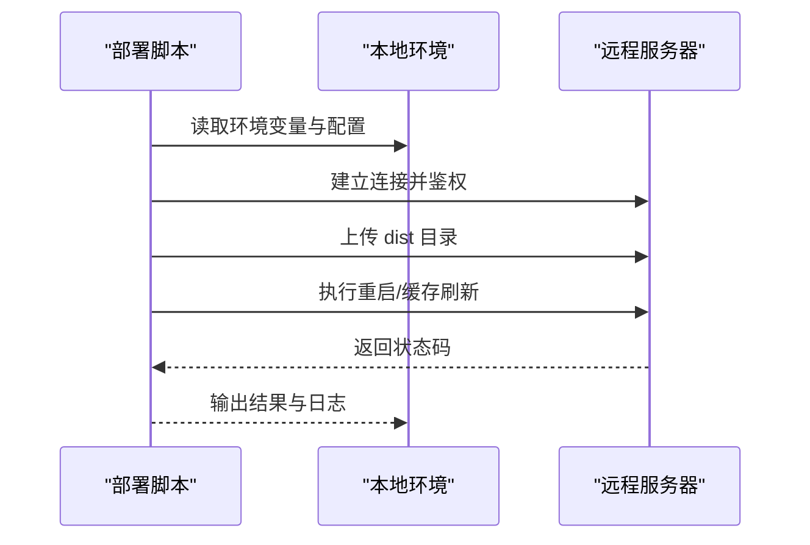
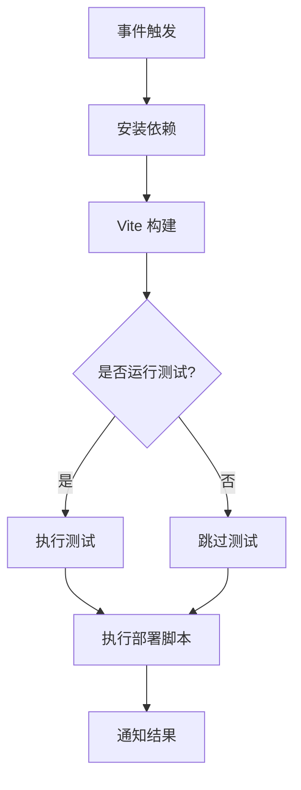
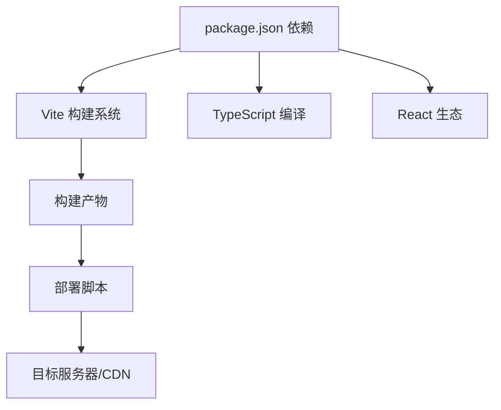

# 构建与部署

<cite>
**本文引用的文件**   
- [vite.config.ts](file://vite.config.ts)
- [package.json](file://package.json)
- [index.html](file://index.html)
- [public/index.html](file://public/index.html)
- [deply.sh](file://deply.sh)
- [.github/workflows/deploy.yml](file://.github/workflows/deploy.yml)
- [server.py](file://server.py)
- [config.example.json](file://config.example.json)
</cite>

## 目录
1. [简介](#简介)
2. [项目结构](#项目结构)
3. [核心组件](#核心组件)
4. [架构总览](#架构总览)
5. [详细组件分析](#详细组件分析)
6. [依赖分析](#依赖分析)
7. [性能考虑](#性能考虑)
8. [故障排除指南](#故障排除指南)
9. [结论](#结论)
10. [附录](#附录)

## 简介
本文件面向 oo-space 项目的构建与部署，覆盖 Vite 构建配置、生产环境优化、静态资源处理、部署脚本使用、服务器配置、CI/CD 流水线设置、环境变量管理、构建产物管理与最佳实践，并提供常见问题的排查方法与多平台适配指南。目标是帮助开发者在不同环境中稳定地构建与发布应用。

## 项目结构
本项目采用 Vite + TypeScript + React 的典型前端工程结构：
- 源码位于 src，包含组件、样式、数据与入口文件。
- 静态资源位于 public，包括 HTML、CSS、JS 与媒体资源。
- 构建配置在 vite.config.ts，打包脚本与命令在 package.json。
- 部署脚本 deply.sh 用于将构建产物上传至目标服务器。
- CI/CD 流水线由 .github/workflows/deploy.yml 定义。
- server.py 提供本地开发或简单服务用途。
- config.example.json 提供示例配置项（如 API 地址等）。

图表来源
- [vite.config.ts](file://vite.config.ts)
- [package.json](file://package.json)
- [public/index.html](file://public/index.html)
- [deply.sh](file://deply.sh)
- [.github/workflows/deploy.yml](file://.github/workflows/deploy.yml)
- [server.py](file://server.py)
- [config.example.json](file://config.example.json)

章节来源
- [vite.config.ts](file://vite.config.ts)
- [package.json](file://package.json)
- [index.html](file://index.html)
- [public/index.html](file://public/index.html)
- [deply.sh](file://deply.sh)
- [.github/workflows/deploy.yml](file://.github/workflows/deploy.yml)
- [server.py](file://server.py)
- [config.example.json](file://config.example.json)

## 核心组件
- Vite 构建配置：集中管理开发/生产模式、路径别名、插件、输出目录、资源处理策略等。
- 包脚本与依赖：定义 build/dev/serve 等命令，声明运行时与构建期依赖。
- 静态资源与 HTML：public 下的资源直接拷贝；HTML 模板通过 Vite 注入构建产物。
- 部署脚本：封装 SSH/SCP 或云 CLI 的上传流程，支持多环境切换。
- CI/CD 流水线：在 GitHub Actions 中执行安装、构建、测试与部署步骤。
- 本地服务：server.py 提供简单的 HTTP 服务，便于本地预览。
- 配置示例：config.example.json 展示可外部化的配置项，便于环境变量注入。

章节来源
- [vite.config.ts](file://vite.config.ts)
- [package.json](file://package.json)
- [public/index.html](file://public/index.html)
- [deply.sh](file://deply.sh)
- [.github/workflows/deploy.yml](file://.github/workflows/deploy.yml)
- [server.py](file://server.py)
- [config.example.json](file://config.example.json)

## 架构总览
下图展示了从代码到线上产物的完整链路：开发者提交代码后，CI 触发构建与部署；本地可通过 Vite 开发服务器快速迭代；生产环境通过静态托管或 CDN 分发。

图表来源
- [.github/workflows/deploy.yml](file://.github/workflows/deploy.yml)
- [vite.config.ts](file://vite.config.ts)
- [deply.sh](file://deply.sh)

## 详细组件分析

### Vite 构建配置与生产优化
- 构建模式与环境变量：通过环境变量区分开发与生产，控制调试信息、日志级别与特性开关。
- 路径别名与模块解析：统一导入路径，提升可读性与维护性。
- 插件与扩展：按需启用压缩、图片优化、字体处理、代码分割等插件。
- 输出目录与文件名策略：设置产物目录、哈希命名、资源内联与外链策略。
- 静态资源处理：public 下资源按原样输出，可按需进行版本化与缓存控制。
- 代理与后端集成：开发阶段配置反向代理，避免跨域问题。
- 构建分析与调试：开启体积分析与错误定位工具。

图表来源
- [vite.config.ts](file://vite.config.ts)

章节来源
- [vite.config.ts](file://vite.config.ts)

### 静态资源处理与 HTML 模板
- public 目录中的文件会被直接复制到构建产物目录，适合放置 favicon、图标、音视频等大资源。
- index.html 作为入口模板，Vite 自动注入构建后的 JS/CSS 资源引用。
- 建议对大体积媒体资源进行懒加载与按需加载，减少首屏体积。

图表来源
- [public/index.html](file://public/index.html)
- [index.html](file://index.html)

章节来源
- [public/index.html](file://public/index.html)
- [index.html](file://index.html)

### 包脚本与依赖管理
- 构建命令：通常包含开发服务器、生产构建、类型检查与打包优化。
- 依赖分类：运行时代码与构建期工具分离，确保最小化生产依赖。
- 脚本扩展：可添加自定义脚本用于资源预处理、校验与清理。

章节来源
- [package.json](file://package.json)

### 部署脚本与服务器配置
- 脚本职责：封装上传逻辑（SSH/SCP 或云 CLI），支持多环境参数切换，失败重试与回滚。
- 服务器要求：具备 Node/Python 环境（如需）、权限与网络可达性。
- 安全建议：密钥与凭据通过环境变量注入，避免硬编码。

图表来源
- [deply.sh](file://deply.sh)

章节来源
- [deply.sh](file://deply.sh)
- [server.py](file://server.py)

### CI/CD 流水线设置
- 触发条件：push 到指定分支或创建 PR 时触发。
- 步骤顺序：安装依赖、构建、可选测试、部署。
- 缓存策略：缓存 node_modules 与构建缓存，加速流水线。
- 凭据管理：通过 GitHub Secrets 注入敏感信息。

图表来源
- [.github/workflows/deploy.yml](file://.github/workflows/deploy.yml)

章节来源
- [.github/workflows/deploy.yml](file://.github/workflows/deploy.yml)

### 环境变量与配置管理
- 环境变量来源：本地 .env、CI Secrets、服务器环境变量。
- 配置项示例：API 地址、功能开关、第三方服务密钥。
- 最佳实践：区分环境与敏感信息，避免泄露；提供默认值与校验。

章节来源
- [config.example.json](file://config.example.json)

## 依赖分析
- 构建期依赖：Vite、TypeScript、React 相关插件与工具。
- 运行时代依：仅包含业务所需库，减少包体。
- 外部集成：CI/CD 平台、服务器访问协议、CDN 或对象存储 SDK。

图表来源
- [package.json](file://package.json)
- [vite.config.ts](file://vite.config.ts)
- [deply.sh](file://deply.sh)

章节来源
- [package.json](file://package.json)
- [vite.config.ts](file://vite.config.ts)
- [deply.sh](file://deply.sh)

## 性能考虑
- 代码分割与懒加载：按路由或组件拆分，减少首屏体积。
- 资源优化：图片压缩、字体子集化、音频视频懒加载。
- 缓存策略：利用浏览器缓存与 CDN 缓存，合理设置版本号与过期时间。
- 构建优化：启用增量构建、并行任务、缓存依赖与中间产物。
- 监控与分析：接入性能监控与错误上报，持续优化用户体验。

[本节为通用指导，不直接分析具体文件]

## 故障排除指南
- 构建失败
  - 检查 Node 版本与依赖安装是否成功。
  - 查看 Vite 构建日志与错误堆栈，定位模块解析或插件问题。
  - 确认环境变量与配置文件是否正确。
- 资源加载 404
  - 检查 public 资源路径与引用方式。
  - 确认构建产物目录结构与部署路径一致。
  - 验证 CDN/服务器缓存是否生效。
- 部署失败
  - 检查服务器权限、网络连通性与密钥配置。
  - 查看部署脚本日志与返回码，必要时增加重试与回滚。
- 运行时错误
  - 打开浏览器控制台与网络面板，定位资源加载与接口调用问题。
  - 检查环境变量注入与 API 地址是否正确。

章节来源
- [vite.config.ts](file://vite.config.ts)
- [deply.sh](file://deply.sh)
- [.github/workflows/deploy.yml](file://.github/workflows/deploy.yml)

## 结论
通过合理的 Vite 构建配置、完善的静态资源处理、健壮的部署脚本与稳定的 CI/CD 流水线，oo-space 项目能够在不同环境下高效构建与发布。遵循本文的最佳实践与排障方法，可显著提升交付质量与运维效率。

[本节为总结，不直接分析具体文件]

## 附录
- 多平台适配要点
  - 静态托管平台（如 Vercel、Netlify）：确保构建命令与输出目录正确，配置环境变量与域名。
  - 云服务器（如 ECS、VM）：准备 Nginx/Apache 静态站点配置，设置 HTTPS 与缓存头。
  - 容器化部署：基于轻量镜像构建，暴露端口并挂载必要配置。
  - CDN 加速：配置源站与缓存规则，启用压缩与 HTTP/2。
- 常用命令参考
  - 本地开发：启动开发服务器与热更新。
  - 构建产物：生成生产构建并分析体积。
  - 部署执行：一键上传与发布。

[本节为补充说明，不直接分析具体文件]