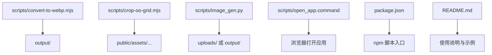
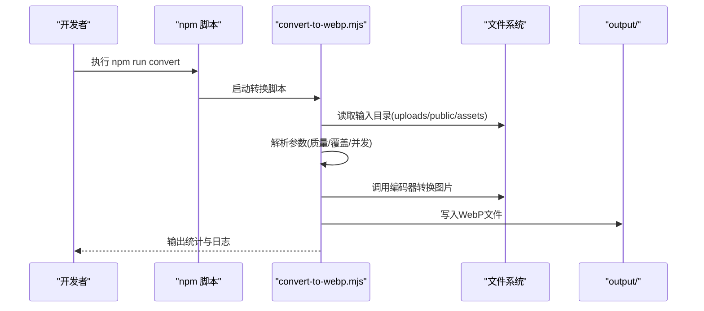
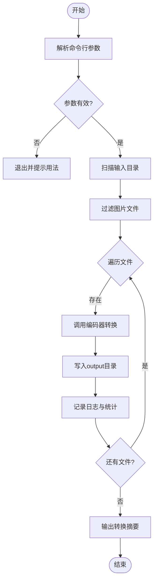
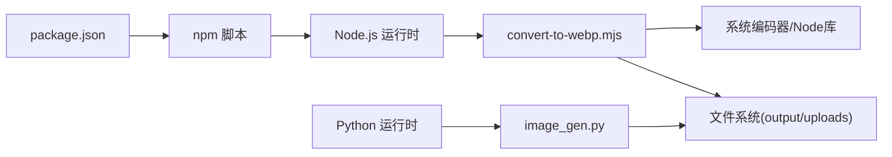

# WebP图片转换脚本

<cite>
**本文档中引用的文件**
- [convert-to-webp.mjs](file://scripts/convert-to-webp.mjs)
- [crop-oo-grid.mjs](file://scripts/crop-oo-grid.mjs)
- [image_gen.py](file://scripts/image_gen.py)
- [open_app.command](file://scripts/open_app.command)
- [package.json](file://package.json)
- [README.md](file://README.md)
</cite>

## 目录
1. [简介](#简介)
2. [项目结构](#项目结构)
3. [核心组件](#核心组件)
4. [架构总览](#架构总览)
5. [详细组件分析](#详细组件分析)
6. [依赖关系分析](#依赖关系分析)
7. [性能考虑](#性能考虑)
8. [故障排查指南](#故障排查指南)
9. [结论](#结论)
10. [附录](#附录)

## 简介
本仓库包含一个用于将图片批量转换为WebP格式的脚本工具，以及配套的图像处理与生成脚本。该工具主要服务于前端资源优化，通过脚本化流程对静态图片进行统一处理，提升页面加载性能并减少带宽占用。同时，仓库还包含一些辅助脚本，如网格裁剪、图像生成等，便于在内容生产与发布前进行预处理。

## 项目结构
- scripts：存放所有脚本，包括WebP转换、裁剪、图像生成及快捷启动命令
- public：静态资源与演示页面
- src：前端源码（React/Vite）
- output：脚本输出目录（由脚本写入）
- uploads：上传或临时输入目录（可由脚本读取）
- 根目录配置：package.json、README.md、部署与工作流相关配置

图表来源
- [convert-to-webp.mjs:1-200](file://scripts/convert-to-webp.mjs#L1-L200)
- [crop-oo-grid.mjs:1-200](file://scripts/crop-oo-grid.mjs#L1-L200)
- [image_gen.py:1-200](file://scripts/image_gen.py#L1-L200)
- [open_app.command:1-50](file://scripts/open_app.command#L1-L50)
- [package.json:1-100](file://package.json#L1-L100)
- [README.md:1-100](file://README.md#L1-L100)

章节来源
- [package.json:1-100](file://package.json#L1-L100)
- [README.md:1-100](file://README.md#L1-L100)

## 核心组件
- WebP转换脚本：负责扫描指定目录的图片，调用系统或库进行格式转换，输出到目标目录，支持质量参数与覆盖策略
- 网格裁剪脚本：用于对素材进行规则化裁剪，便于构建统一的展示网格
- 图像生成脚本：根据配置或模板批量生成图片，常用于占位图或测试素材
- 快捷启动命令：一键打开本地开发应用，便于预览转换结果

章节来源
- [convert-to-webp.mjs:1-200](file://scripts/convert-to-webp.mjs#L1-L200)
- [crop-oo-grid.mjs:1-200](file://scripts/crop-oo-grid.mjs#L1-L200)
- [image_gen.py:1-200](file://scripts/image_gen.py#L1-L200)
- [open_app.command:1-50](file://scripts/open_app.command#L1-L50)

## 架构总览
整体流程以Node.js脚本为核心，结合系统工具或第三方库完成图片处理；Python脚本作为补充，用于更复杂的图像生成任务。输出统一汇聚至output目录，供前端资源使用。

图表来源
- [convert-to-webp.mjs:1-200](file://scripts/convert-to-webp.mjs#L1-L200)
- [package.json:1-100](file://package.json#L1-L100)

## 详细组件分析

### WebP转换脚本（convert-to-webp.mjs）
- 功能要点
  - 递归扫描输入目录，识别常见图片扩展名
  - 按配置设置转换质量、是否保留原图、是否覆盖同名文件
  - 支持并发处理以提升吞吐
  - 输出统计信息（成功/失败数量、大小对比）
- 关键流程
  - 参数解析与校验
  - 目录遍历与文件过滤
  - 调用编码器进行格式转换
  - 写入输出目录并记录日志
- 错误处理
  - 捕获IO异常与编码异常
  - 跳过损坏文件或不支持的格式
  - 提供重试机制或跳过策略

图表来源
- [convert-to-webp.mjs:1-200](file://scripts/convert-to-webp.mjs#L1-L200)

章节来源
- [convert-to-webp.mjs:1-200](file://scripts/convert-to-webp.mjs#L1-L200)

### 网格裁剪脚本（crop-oo-grid.mjs）
- 功能要点
  - 对原始素材进行等尺寸裁剪，确保网格展示一致性
  - 支持批量处理与命名规范
  - 可配置输出路径与覆盖策略
- 适用场景
  - 角色姿势图集、像素风素材的统一化处理
  - 构建响应式网格布局前的预处理

章节来源
- [crop-oo-grid.mjs:1-200](file://scripts/crop-oo-grid.mjs#L1-L200)

### 图像生成脚本（image_gen.py）
- 功能要点
  - 基于模板或配置批量生成图片
  - 可用于占位图、测试数据或自动化流水线
- 适用场景
  - 快速填充资源目录
  - 与CI/CD集成，自动生成静态资源

章节来源
- [image_gen.py:1-200](file://scripts/image_gen.py#L1-L200)

### 快捷启动命令（open_app.command）
- 功能要点
  - 一键打开本地开发应用，便于查看转换效果
- 使用方式
  - 双击或在终端执行，自动调用默认浏览器访问本地服务

章节来源
- [open_app.command:1-50](file://scripts/open_app.command#L1-L50)

## 依赖关系分析
- 运行时依赖
  - Node.js环境（用于mjs脚本）
  - Python环境（用于image_gen.py）
  - 系统级图片编码器（如cwebp）或Node图片库（如sharp）
- 包管理
  - package.json定义npm脚本入口，便于统一调用
- 外部集成
  - GitHub Actions工作流可用于自动化转换与部署

图表来源
- [package.json:1-100](file://package.json#L1-L100)
- [convert-to-webp.mjs:1-200](file://scripts/convert-to-webp.mjs#L1-L200)
- [image_gen.py:1-200](file://scripts/image_gen.py#L1-L200)

章节来源
- [package.json:1-100](file://package.json#L1-L100)

## 性能考虑
- 并发控制
  - 合理设置并发数，避免I/O瓶颈与内存峰值过高
- 编码器选择
  - 优先使用系统级编码器以获得最佳压缩比与速度
- 增量处理
  - 仅处理变更文件，减少重复转换开销
- 缓存策略
  - 对中间产物进行缓存，加速迭代开发

[本节为通用指导，不直接分析具体文件]

## 故障排查指南
- 常见问题
  - 找不到编码器：确认系统已安装cwebp或Node库依赖正确
  - 权限不足：检查输出目录写入权限
  - 文件损坏：跳过无法解码的文件并记录日志
- 调试建议
  - 开启详细日志，定位失败文件与原因
  - 逐步缩小输入目录范围，验证脚本行为
  - 使用单文件模式验证参数有效性

章节来源
- [convert-to-webp.mjs:1-200](file://scripts/convert-to-webp.mjs#L1-L200)

## 结论
本仓库提供了完整的WebP转换与图像处理脚本体系，能够高效地将现有图片资源转换为WebP格式，配合裁剪与生成脚本形成闭环的资源生产流水线。通过合理的参数配置与并发控制，可在保证画质的前提下显著降低资源体积，提升前端加载性能。建议在CI/CD中集成该脚本，实现自动化资源优化与发布。

[本节为总结性内容，不直接分析具体文件]

## 附录
- 使用建议
  - 在开发阶段启用高质量参数，发布时切换为更高压缩比
  - 定期清理output目录，避免冗余文件累积
  - 将常用参数封装为npm脚本，提高复用性
- 参考文件
  - README.md中的使用说明与示例
  - package.json中的脚本定义

章节来源
- [README.md:1-100](file://README.md#L1-L100)
- [package.json:1-100](file://package.json#L1-L100)