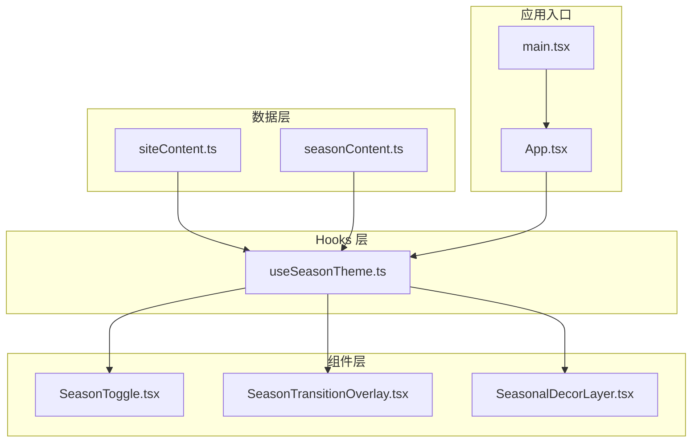
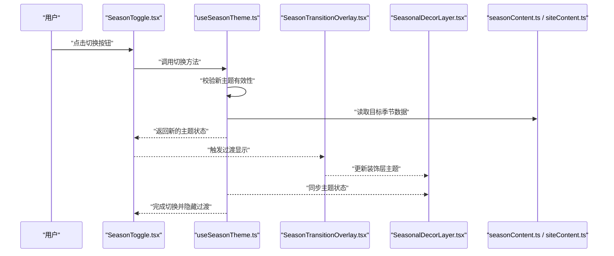
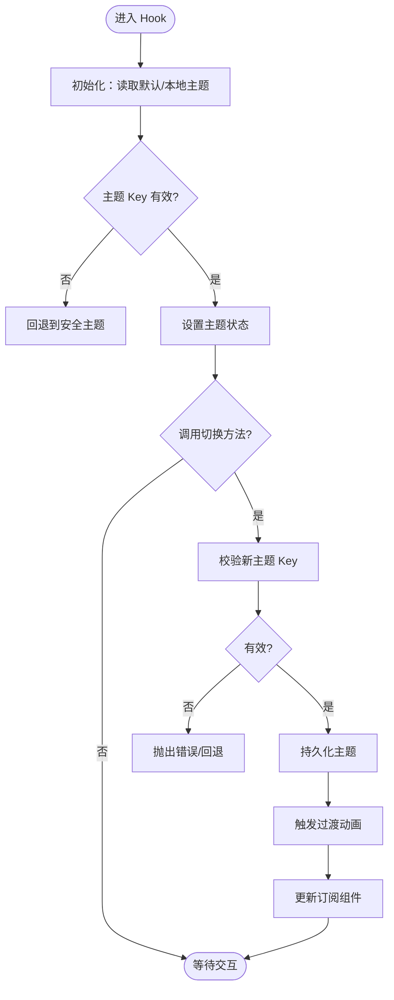
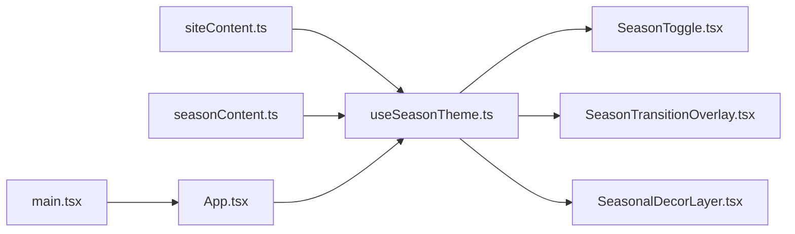

# 数据流管理

<cite>
**本文引用的文件**   
- [src/data/siteContent.ts](file://src/data/siteContent.ts)
- [src/data/seasonContent.ts](file://src/data/seasonContent.ts)
- [src/hooks/useSeasonTheme.ts](file://src/hooks/useSeasonTheme.ts)
- [src/components/SeasonToggle.tsx](file://src/components/SeasonToggle.tsx)
- [src/components/SeasonTransitionOverlay.tsx](file://src/components/SeasonTransitionOverlay.tsx)
- [src/components/SeasonalDecorLayer.tsx](file://src/components/SeasonalDecorLayer.tsx)
- [src/App.tsx](file://src/App.tsx)
- [src/main.tsx](file://src/main.tsx)
</cite>

## 目录
1. [引言](#引言)
2. [项目结构](#项目结构)
3. [核心组件](#核心组件)
4. [架构总览](#架构总览)
5. [详细组件分析](#详细组件分析)
6. [依赖关系分析](#依赖关系分析)
7. [性能考虑](#性能考虑)
8. [故障排查指南](#故障排查指南)
9. [结论](#结论)
10. [附录](#附录)

## 引言
本文件面向 oo-space 项目的数据流管理，聚焦单向数据流设计：从 data 模块到组件的状态传递机制。文档涵盖站点内容数据结构与组织、季节主题数据的动态切换机制（useSeasonTheme）、自定义 hooks 的作用域与生命周期管理、数据验证与错误处理策略、性能优化建议，并提供数据流图与状态变化时序图，帮助读者理解并高效维护该项目的数据流。

## 项目结构
本项目采用“数据层 + Hooks + 组件”的分层组织方式：
- 数据层：siteContent.ts、seasonContent.ts 提供站点内容与季节主题数据
- Hooks 层：useSeasonTheme.ts 封装主题切换逻辑与副作用
- 组件层：SeasonToggle、SeasonTransitionOverlay、SeasonalDecorLayer 等消费主题数据并渲染 UI
- 应用入口：App.tsx、main.tsx 负责挂载与顶层布局

**图表来源** 
- [src/data/siteContent.ts](file://src/data/siteContent.ts)
- [src/data/seasonContent.ts](file://src/data/seasonContent.ts)
- [src/hooks/useSeasonTheme.ts](file://src/hooks/useSeasonTheme.ts)
- [src/components/SeasonToggle.tsx](file://src/components/SeasonToggle.tsx)
- [src/components/SeasonTransitionOverlay.tsx](file://src/components/SeasonTransitionOverlay.tsx)
- [src/components/SeasonalDecorLayer.tsx](file://src/components/SeasonalDecorLayer.tsx)
- [src/App.tsx](file://src/App.tsx)
- [src/main.tsx](file://src/main.tsx)

**章节来源**
- [src/data/siteContent.ts](file://src/data/siteContent.ts)
- [src/data/seasonContent.ts](file://src/data/seasonContent.ts)
- [src/hooks/useSeasonTheme.ts](file://src/hooks/useSeasonTheme.ts)
- [src/components/SeasonToggle.tsx](file://src/components/SeasonToggle.tsx)
- [src/components/SeasonTransitionOverlay.tsx](file://src/components/SeasonTransitionOverlay.tsx)
- [src/components/SeasonalDecorLayer.tsx](file://src/components/SeasonalDecorLayer.tsx)
- [src/App.tsx](file://src/App.tsx)
- [src/main.tsx](file://src/main.tsx)

## 核心组件
- 数据源
  - siteContent.ts：定义站点内容的数据结构与默认值，作为页面文案、导航、区块内容的单一事实来源
  - seasonContent.ts：定义不同季节主题的数据集合，如主题色、装饰元素、过渡动画配置等
- Hook
  - useSeasonTheme.ts：封装当前季节主题状态、切换动作、持久化与校验逻辑，向组件暴露受控的 theme 对象与切换方法
- 组件
  - SeasonToggle.tsx：触发主题切换的用户交互入口
  - SeasonTransitionOverlay.tsx：在主题切换时展示过渡遮罩与动效
  - SeasonalDecorLayer.tsx：根据当前季节主题渲染装饰层（背景粒子、图标等）

这些组件通过单向数据流消费 useSeasonTheme 提供的主题状态，避免直接修改数据源，保证数据可预测性与可追踪性。

**章节来源**
- [src/data/siteContent.ts](file://src/data/siteContent.ts)
- [src/data/seasonContent.ts](file://src/data/seasonContent.ts)
- [src/hooks/useSeasonTheme.ts](file://src/hooks/useSeasonTheme.ts)
- [src/components/SeasonToggle.tsx](file://src/components/SeasonToggle.tsx)
- [src/components/SeasonTransitionOverlay.tsx](file://src/components/SeasonTransitionOverlay.tsx)
- [src/components/SeasonalDecorLayer.tsx](file://src/components/SeasonalDecorLayer.tsx)

## 架构总览
下图展示了从数据层到组件层的单向数据流，以及用户交互触发的状态变更路径。

**图表来源** 
- [src/components/SeasonToggle.tsx](file://src/components/SeasonToggle.tsx)
- [src/hooks/useSeasonTheme.ts](file://src/hooks/useSeasonTheme.ts)
- [src/components/SeasonTransitionOverlay.tsx](file://src/components/SeasonTransitionOverlay.tsx)
- [src/components/SeasonalDecorLayer.tsx](file://src/components/SeasonalDecorLayer.tsx)
- [src/data/seasonContent.ts](file://src/data/seasonContent.ts)
- [src/data/siteContent.ts](file://src/data/siteContent.ts)

## 详细组件分析

### 站点内容数据（siteContent.ts）
- 职责：集中管理站点文案、导航、区块标题与描述等静态或半静态内容
- 结构建议：以类型化的对象或常量数组组织，便于扩展与维护
- 使用方式：由 App 或页面级组件在初始化时读取，不随用户交互频繁变更
- 数据验证：建议在入口处对关键字段进行非空校验，确保渲染稳定性

**章节来源**
- [src/data/siteContent.ts](file://src/data/siteContent.ts)

### 季节主题数据（seasonContent.ts）
- 职责：定义多套季节主题的配置项，包括颜色、装饰资源、过渡时长等
- 结构建议：按主题键名聚合配置，便于通过 key 快速检索
- 使用方式：被 useSeasonTheme 读取，作为切换的目标数据源

**章节来源**
- [src/data/seasonContent.ts](file://src/data/seasonContent.ts)

### 自定义 Hook：useSeasonTheme.ts
- 作用域：在当前组件树内维护当前主题状态与切换方法，避免跨组件直接共享可变状态
- 生命周期：
  - 初始化：读取本地存储或默认主题，校验并设置初始状态
  - 切换：接收新主题 key，执行校验、持久化、触发过渡
  - 清理：在卸载时释放过渡相关副作用（如定时器、事件监听）
- 数据验证：对传入的主题 key 进行白名单校验，防止非法值导致渲染异常
- 错误处理：捕获无效主题、持久化失败等异常，回退到安全主题并记录日志
- 性能优化：使用稳定引用（如 useMemo/useCallback）减少不必要的重渲染；合并多次切换为批量更新

**图表来源** 
- [src/hooks/useSeasonTheme.ts](file://src/hooks/useSeasonTheme.ts)

**章节来源**
- [src/hooks/useSeasonTheme.ts](file://src/hooks/useSeasonTheme.ts)

### 组件：SeasonToggle.tsx
- 职责：提供用户切换季节主题的入口
- 数据流：调用 useSeasonTheme 的切换方法，不直接操作数据源
- 交互反馈：切换成功后可提示或联动过渡层

**章节来源**
- [src/components/SeasonToggle.tsx](file://src/components/SeasonToggle.tsx)

### 组件：SeasonTransitionOverlay.tsx
- 职责：在主题切换期间展示过渡遮罩与动效
- 数据流：订阅 useSeasonTheme 的过渡状态，控制显隐与动画阶段
- 性能：仅在过渡期间渲染，避免常驻开销

**章节来源**
- [src/components/SeasonTransitionOverlay.tsx](file://src/components/SeasonTransitionOverlay.tsx)

### 组件：SeasonalDecorLayer.tsx
- 职责：根据当前季节主题渲染装饰层（背景、粒子、图标等）
- 数据流：订阅 useSeasonTheme 的主题对象，按需加载资源
- 优化：懒加载装饰资源，避免首屏过重

**章节来源**
- [src/components/SeasonalDecorLayer.tsx](file://src/components/SeasonalDecorLayer.tsx)

### 应用入口：App.tsx 与 main.tsx
- App.tsx：组合页面与主题上下文，确保主题状态在组件树中可用
- main.tsx：挂载根组件，初始化全局样式与资源

**章节来源**
- [src/App.tsx](file://src/App.tsx)
- [src/main.tsx](file://src/main.tsx)

## 依赖关系分析
- 数据层依赖：无外部运行时依赖，纯数据定义
- Hook 依赖：依赖 seasonContent.ts 与 siteContent.ts，可能访问本地存储
- 组件依赖：所有主题相关组件依赖 useSeasonTheme，避免直接耦合数据层

**图表来源** 
- [src/data/siteContent.ts](file://src/data/siteContent.ts)
- [src/data/seasonContent.ts](file://src/data/seasonContent.ts)
- [src/hooks/useSeasonTheme.ts](file://src/hooks/useSeasonTheme.ts)
- [src/components/SeasonToggle.tsx](file://src/components/SeasonToggle.tsx)
- [src/components/SeasonTransitionOverlay.tsx](file://src/components/SeasonTransitionOverlay.tsx)
- [src/components/SeasonalDecorLayer.tsx](file://src/components/SeasonalDecorLayer.tsx)
- [src/App.tsx](file://src/App.tsx)
- [src/main.tsx](file://src/main.tsx)

**章节来源**
- [src/data/siteContent.ts](file://src/data/siteContent.ts)
- [src/data/seasonContent.ts](file://src/data/seasonContent.ts)
- [src/hooks/useSeasonTheme.ts](file://src/hooks/useSeasonTheme.ts)
- [src/components/SeasonToggle.tsx](file://src/components/SeasonToggle.tsx)
- [src/components/SeasonTransitionOverlay.tsx](file://src/components/SeasonTransitionOverlay.tsx)
- [src/components/SeasonalDecorLayer.tsx](file://src/components/SeasonalDecorLayer.tsx)
- [src/App.tsx](file://src/App.tsx)
- [src/main.tsx](file://src/main.tsx)

## 性能考虑
- 最小化重渲染
  - 将主题对象拆分为稳定字段或使用 memoization，避免整对象变更导致的级联更新
  - 使用 useCallback 包装切换方法，减少子组件不必要的重新绑定
- 资源懒加载
  - 装饰层资源按需加载，首屏仅加载必要资源
- 过渡动画优化
  - 使用 CSS transform/opacity 等合成属性，避免重排重绘
- 持久化优化
  - 节流写入本地存储，避免频繁 I/O
- 错误边界
  - 在关键渲染分支添加错误边界，防止主题异常导致整页崩溃

[本节为通用指导，无需特定文件来源]

## 故障排查指南
- 常见症状
  - 主题切换后未生效：检查 useSeasonTheme 的校验逻辑与数据源 key 是否匹配
  - 过渡动画卡顿：确认动画属性与资源大小，避免阻塞主线程
  - 本地存储不一致：清理缓存并重置默认主题
- 定位步骤
  - 在 Hook 中打印主题切换前后状态，确认数据流向
  - 在组件中打印订阅到的主题对象，确认更新传播
  - 检查浏览器控制台错误与网络请求
- 恢复策略
  - 回退到安全主题，确保页面可用
  - 记录错误上下文以便后续修复

**章节来源**
- [src/hooks/useSeasonTheme.ts](file://src/hooks/useSeasonTheme.ts)
- [src/components/SeasonTransitionOverlay.tsx](file://src/components/SeasonTransitionOverlay.tsx)

## 结论
通过“数据层 → Hook → 组件”的单向数据流，oo-space 实现了清晰、可预测且易维护的主题管理机制。useSeasonTheme 作为唯一的状态中枢，统一了数据验证、持久化与副作用管理；组件仅消费状态而不直接修改数据，保证了数据一致性。配合合理的性能优化与错误处理策略，可在复杂交互场景下保持流畅体验。

[本节为总结性内容，无需特定文件来源]

## 附录
- 最佳实践
  - 组件间数据共享优先使用 Hook 或轻量上下文，避免全局可变状态
  - 数据层保持不可变更新，必要时使用快照对比减少渲染
  - 对用户输入进行严格校验，尽早失败并给出明确提示
- 扩展建议
  - 为站点内容增加版本化管理，支持 A/B 测试与灰度发布
  - 引入主题预览与热重载，提升开发效率

[本节为概念性内容，无需特定文件来源]