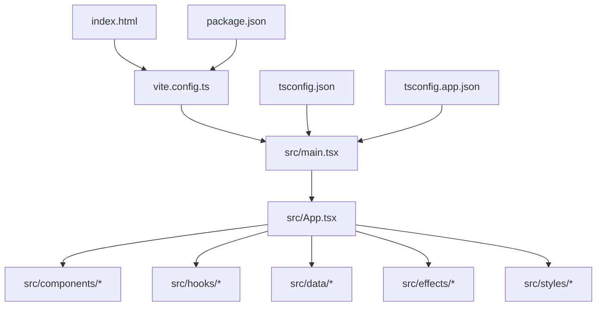
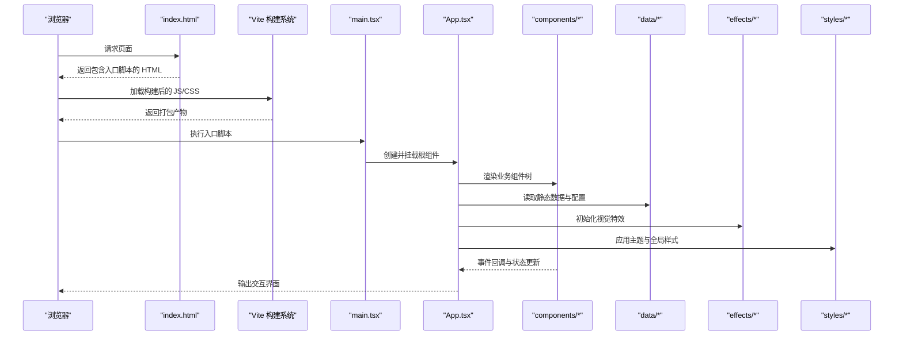
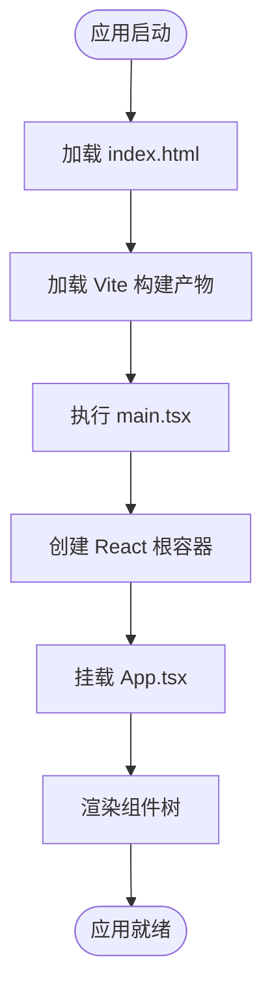
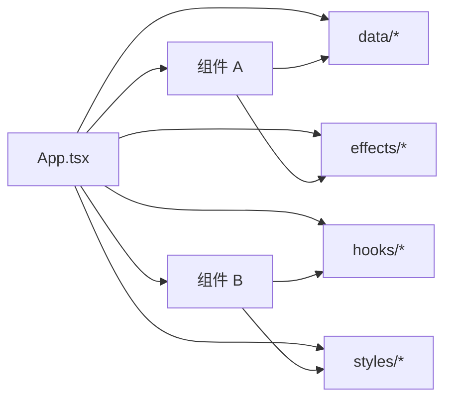
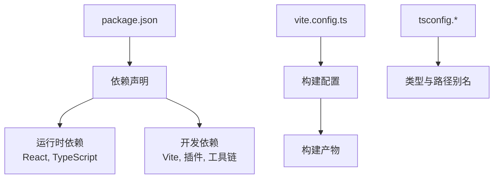

# 整体架构概览

<cite>
**本文档引用的文件**   
- [package.json](file://package.json)
- [vite.config.ts](file://vite.config.ts)
- [tsconfig.json](file://tsconfig.json)
- [tsconfig.app.json](file://tsconfig.app.json)
- [index.html](file://index.html)
- [src/main.tsx](file://src/main.tsx)
- [src/App.tsx](file://src/App.tsx)
</cite>

## 目录
1. [简介](#简介)
2. [项目结构](#项目结构)
3. [核心组件](#核心组件)
4. [架构总览](#架构总览)
5. [详细组件分析](#详细组件分析)
6. [依赖分析](#依赖分析)
7. [性能考虑](#性能考虑)
8. [故障排查指南](#故障排查指南)
9. [结论](#结论)
10. [附录](#附录)

## 简介
本文件为 oo-space 项目的整体架构概览，聚焦于基于 React + TypeScript 的前端应用架构与 Vite 构建体系。文档将说明：
- 技术栈选择与优势（React 18、TypeScript、Vite）
- 模块化组织方式与目录结构
- 应用入口点 main.tsx 与根组件 App.tsx 的初始化流程
- 构建配置与依赖管理要点
- 架构图展示各层关系与数据流向

## 项目结构
项目采用以功能域划分的 src 目录组织方式，结合 Vite 的模块解析与按需打包能力，形成清晰的职责边界：
- src/components：可复用 UI 组件（如头部、内容区块、像素风格元素等）
- src/data：静态数据与内容配置（站点文案、季节内容、姿态映射等）
- src/effects：前端视觉特效逻辑（如龙形粒子效果）
- src/hooks：自定义 Hook（点击彩蛋、季节主题切换等）
- src/styles：样式与主题资源（全局样式、像素风格主题、响应式样式等）
- 根级 index.html 作为页面模板，由 Vite 注入构建产物
- package.json 定义脚本、依赖与开发/生产环境差异
- vite.config.ts 集中管理构建、插件、代理与优化策略
- tsconfig.* 系列文件统一 TypeScript 编译选项与路径别名

图表来源
- [index.html:1-50](file://index.html#L1-L50)
- [vite.config.ts:1-120](file://vite.config.ts#L1-L120)
- [src/main.tsx:1-60](file://src/main.tsx#L1-L60)
- [src/App.tsx:1-120](file://src/App.tsx#L1-L120)

章节来源
- [package.json:1-120](file://package.json#L1-L120)
- [vite.config.ts:1-120](file://vite.config.ts#L1-L120)
- [tsconfig.json:1-60](file://tsconfig.json#L1-L60)
- [tsconfig.app.json:1-60](file://tsconfig.app.json#L1-L60)
- [index.html:1-50](file://index.html#L1-L50)

## 核心组件
- 入口文件 main.tsx：负责创建 React 应用实例、挂载到 DOM、启用严格模式与错误边界（如有），并加载全局样式与主题。
- 根组件 App.tsx：作为应用根节点，组织路由（如有）、布局、主题与全局状态，渲染业务组件树。

初始化流程要点：
- 通过 createRoot 或 ReactDOM.render（取决于版本）创建根容器
- 在 React 18 中推荐使用 StrictMode 提升开发期问题发现能力
- 挂载前确保 DOM 已就绪（DOMContentLoaded 或 HTML 中的 script 位置）
- 按需引入全局样式与字体资源，保证首屏渲染一致性

章节来源
- [src/main.tsx:1-60](file://src/main.tsx#L1-L60)
- [src/App.tsx:1-120](file://src/App.tsx#L1-L120)

## 架构总览
下图展示了从浏览器到应用层的调用链路与数据流向，体现 Vite 构建产物如何被 index.html 引入，再由 main.tsx 启动 React 应用，最终由 App.tsx 组合子组件与数据。

图表来源
- [index.html:1-50](file://index.html#L1-L50)
- [vite.config.ts:1-120](file://vite.config.ts#L1-L120)
- [src/main.tsx:1-60](file://src/main.tsx#L1-L60)
- [src/App.tsx:1-120](file://src/App.tsx#L1-L120)

## 详细组件分析

### 入口与根组件初始化流程
- main.tsx 负责应用启动与挂载，确保 React 18 的并发特性可用，并在必要时注册全局错误处理。
- App.tsx 作为根组件，组织布局、主题、数据源与特效初始化，提供统一的上下文给子组件。

图表来源
- [index.html:1-50](file://index.html#L1-L50)
- [src/main.tsx:1-60](file://src/main.tsx#L1-L60)
- [src/App.tsx:1-120](file://src/App.tsx#L1-L120)

章节来源
- [src/main.tsx:1-60](file://src/main.tsx#L1-L60)
- [src/App.tsx:1-120](file://src/App.tsx#L1-L120)

### 组件与数据流
- components/*：UI 组件按功能划分，关注展示与用户交互，通过 props 接收数据，通过回调向父组件传递事件。
- data/*：静态内容与配置，供组件消费，避免硬编码，便于维护与扩展。
- effects/*：独立特效逻辑，通常通过 Hook 或命令式 API 初始化，与 UI 解耦。
- hooks/*：封装跨组件复用的状态与副作用逻辑，提升代码复用性。
- styles/*：主题与样式分层，支持多主题与响应式适配。

图表来源
- [src/App.tsx:1-120](file://src/App.tsx#L1-L120)
- [src/components/HeroSection.tsx:1-120](file://src/components/HeroSection.tsx#L1-L120)
- [src/components/MemoryGallery.tsx:1-120](file://src/components/MemoryGallery.tsx#L1-L120)
- [src/data/siteContent.ts:1-120](file://src/data/siteContent.ts#L1-L120)
- [src/hooks/useSeasonTheme.ts:1-120](file://src/hooks/useSeasonTheme.ts#L1-L120)
- [src/effects/dragonEffect.ts:1-120](file://src/effects/dragonEffect.ts#L1-L120)
- [src/styles/themes.css:1-120](file://src/styles/themes.css#L1-L120)

章节来源
- [src/App.tsx:1-120](file://src/App.tsx#L1-L120)
- [src/data/siteContent.ts:1-120](file://src/data/siteContent.ts#L1-L120)
- [src/hooks/useSeasonTheme.ts:1-120](file://src/hooks/useSeasonTheme.ts#L1-L120)
- [src/effects/dragonEffect.ts:1-120](file://src/effects/dragonEffect.ts#L1-L120)
- [src/styles/themes.css:1-120](file://src/styles/themes.css#L1-L120)

## 依赖分析
- 运行时依赖：React 18 提供 UI 框架与并发渲染能力；TypeScript 提供类型安全与更好的开发体验；Vite 提供极速开发与构建。
- 构建与工具：Vite 插件生态（如 @vitejs/plugin-react）用于 JSX/TSX 转换与优化；ESLint/Prettier（如有）保障代码质量。
- 资源与样式：CSS 模块化或 CSS-in-JS（视实现而定），配合主题变量与响应式规则。

图表来源
- [package.json:1-120](file://package.json#L1-L120)
- [vite.config.ts:1-120](file://vite.config.ts#L1-L120)
- [tsconfig.json:1-60](file://tsconfig.json#L1-L60)
- [tsconfig.app.json:1-60](file://tsconfig.app.json#L1-L60)

章节来源
- [package.json:1-120](file://package.json#L1-L120)
- [vite.config.ts:1-120](file://vite.config.ts#L1-L120)
- [tsconfig.json:1-60](file://tsconfig.json#L1-L60)
- [tsconfig.app.json:1-60](file://tsconfig.app.json#L1-L60)

## 性能考虑
- 使用 React 18 的并发特性（如 Suspense、useTransition）提升交互流畅度。
- 利用 Vite 的按需加载与代码分割，减少首屏体积。
- 图片与媒体资源进行压缩与懒加载，降低带宽占用。
- 样式与主题变量集中管理，避免重复计算与重绘。
- 对复杂特效（如粒子动画）进行帧率控制与降级策略。

[本节为通用指导，不直接分析具体文件]

## 故障排查指南
- 构建失败：检查 vite.config.ts 插件配置与 Node 版本兼容性；确认依赖安装完整。
- 类型错误：核对 tsconfig.app.json 与 tsconfig.json 的路径别名与编译选项。
- 运行时错误：在 main.tsx 中添加错误边界与日志捕获，定位异常来源。
- 样式冲突：检查 themes.css 与全局样式的优先级与作用域。
- 资源加载失败：确认 public 目录下的静态资源路径与构建后 URL 正确。

章节来源
- [vite.config.ts:1-120](file://vite.config.ts#L1-L120)
- [tsconfig.app.json:1-60](file://tsconfig.app.json#L1-L60)
- [src/main.tsx:1-60](file://src/main.tsx#L1-L60)
- [src/styles/themes.css:1-120](file://src/styles/themes.css#L1-L120)

## 结论
oo-space 项目采用 React 18 + TypeScript + Vite 的现代前端架构，具备高可维护性与优秀开发体验。通过清晰的目录结构与模块化设计，结合 Vite 的高效构建与 React 的并发渲染能力，项目在性能与可扩展性方面表现良好。建议持续优化资源加载与特效性能，完善错误边界与监控，以提升用户体验与稳定性。

[本节为总结性内容，不直接分析具体文件]

## 附录
- 技术栈优势
  - React 18：并发渲染、Suspense、更优的状态管理与生态成熟。
  - TypeScript：类型安全、智能提示、重构友好，降低运行时错误。
  - Vite：极速热更新、按需加载、插件生态丰富，提升开发效率。
- 构建与部署
  - 使用 Vite 构建生产包，结合 CDN 与缓存策略优化分发。
  - 通过 GitHub Actions（如 .github/workflows/deploy.yml）自动化部署流程。

[本节为补充信息，不直接分析具体文件]