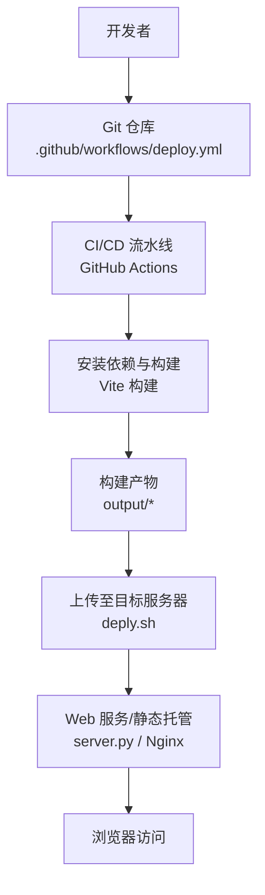
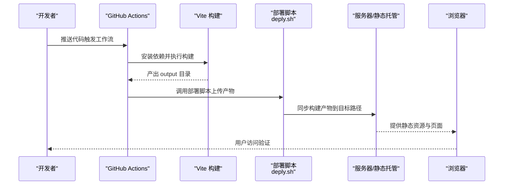
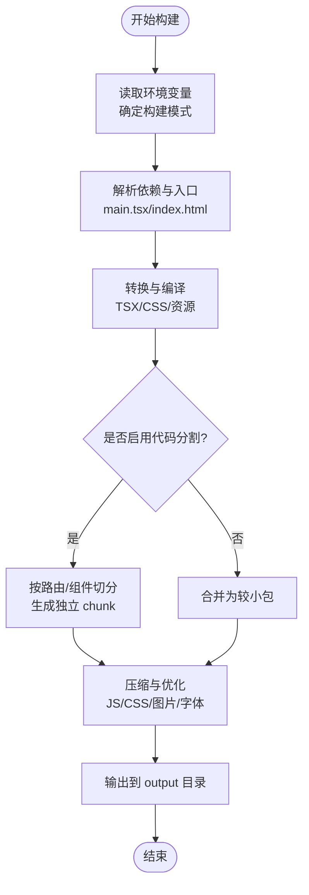
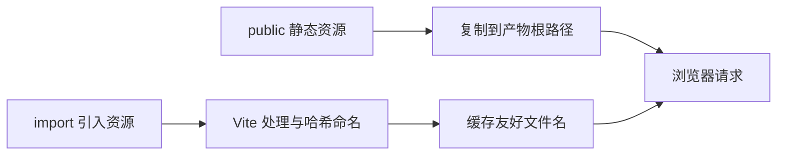
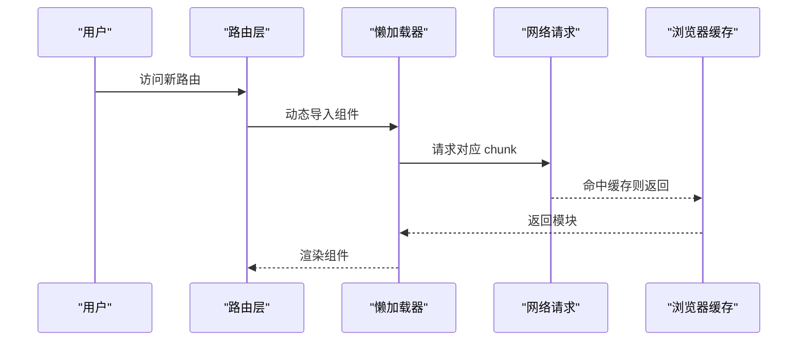
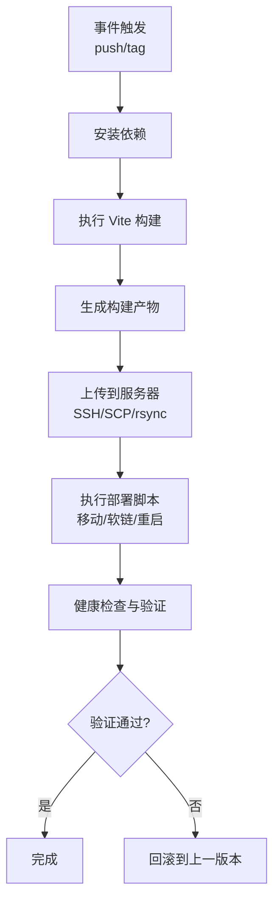
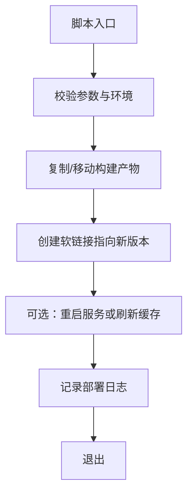
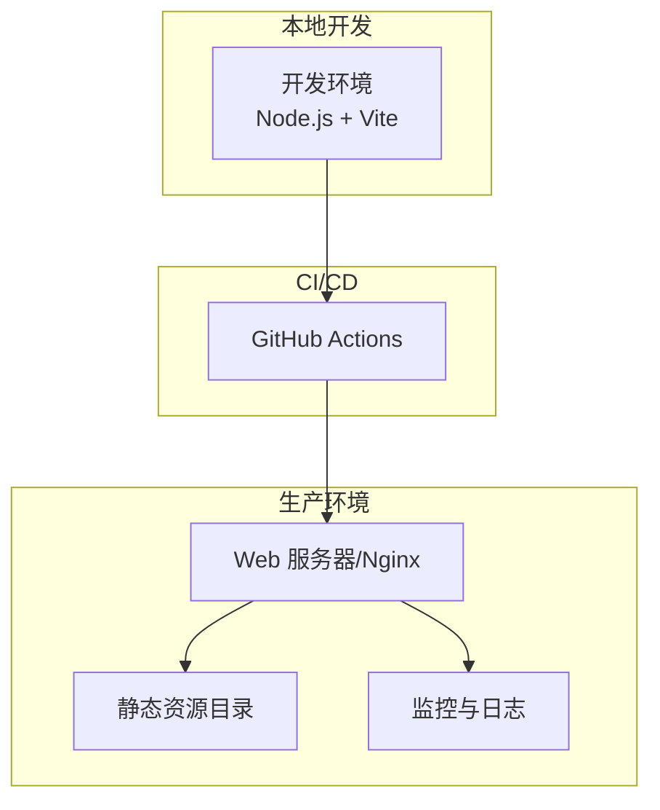

# 构建与部署架构

<cite>
**本文引用的文件**   
- [vite.config.ts](file://vite.config.ts)
- [package.json](file://package.json)
- [.github/workflows/deploy.yml](file://.github/workflows/deploy.yml)
- [deply.sh](file://deply.sh)
- [server.py](file://server.py)
- [index.html](file://index.html)
- [src/main.tsx](file://src/main.tsx)
- [src/App.tsx](file://src/App.tsx)
- [public/index.html](file://public/index.html)
- [public/app.js](file://public/app.js)
- [config.example.json](file://config.example.json)
</cite>

## 目录
1. [简介](#简介)
2. [项目结构](#项目结构)
3. [核心组件](#核心组件)
4. [架构总览](#架构总览)
5. [详细组件分析](#详细组件分析)
6. [依赖关系分析](#依赖关系分析)
7. [性能考量](#性能考量)
8. [故障排查指南](#故障排查指南)
9. [结论](#结论)
10. [附录](#附录)

## 简介
本文件面向 oo-space 项目的构建与部署，系统性说明基于 Vite 的构建配置与优化策略、静态资源处理、代码分割与懒加载机制，以及自动化部署流程（GitHub Actions 工作流与服务器脚本）。同时覆盖开发/生产环境差异、性能监控、错误追踪与日志收集方案，并给出部署架构图、环境依赖说明、版本管理与回滚策略。

## 项目结构
oo-space 采用典型的前端工程化结构：
- 源码位于 src，包含 React 组件、样式、数据与效果逻辑
- 构建产物输出到 output（由构建工具生成）
- 公共静态资源在 public
- 构建与打包通过 Vite 管理，入口为 index.html 与 main.tsx
- 自动化部署通过 GitHub Actions 触发，执行服务器侧脚本完成发布

**图示来源** 
- [.github/workflows/deploy.yml](file://.github/workflows/deploy.yml)
- [vite.config.ts](file://vite.config.ts)
- [deply.sh](file://deply.sh)
- [server.py](file://server.py)

**章节来源**
- [package.json](file://package.json)
- [vite.config.ts](file://vite.config.ts)
- [index.html](file://index.html)
- [src/main.tsx](file://src/main.tsx)
- [src/App.tsx](file://src/App.tsx)

## 核心组件
- 构建系统：Vite（基于 ESBuild/Rollup），提供快速开发与生产构建
- 应用入口：index.html + main.tsx，挂载 React 应用
- 组件体系：src/components 下的业务组件与通用 UI
- 静态资源：public 目录中的图片、样式与脚本
- 部署脚本：deply.sh 负责将构建产物部署到服务器
- CI/CD：.github/workflows/deploy.yml 定义自动化构建与部署流程
- 本地服务：server.py 用于本地或轻量级静态服务

**章节来源**
- [src/main.tsx](file://src/main.tsx)
- [src/App.tsx](file://src/App.tsx)
- [public/index.html](file://public/index.html)
- [public/app.js](file://public/app.js)
- [deply.sh](file://deply.sh)
- [.github/workflows/deploy.yml](file://.github/workflows/deploy.yml)
- [server.py](file://server.py)

## 架构总览
下图展示从代码提交到线上访问的端到端流程，包括构建、产物分发与服务运行。

**图示来源** 
- [.github/workflows/deploy.yml](file://.github/workflows/deploy.yml)
- [vite.config.ts](file://vite.config.ts)
- [deply.sh](file://deply.sh)
- [server.py](file://server.py)

## 详细组件分析

### Vite 构建配置与优化策略
- 构建目标与模式：通过环境变量区分开发与生产模式，启用按需优化
- 输出目录与基础路径：统一产物输出到 output，设置正确的 base 路径以适配部署位置
- 插件生态：可集成压缩、图片优化、字体优化、代码分析等插件提升构建质量
- 代码分割与懒加载：按路由或组件维度进行动态导入，减少首屏体积
- 资源处理：静态资源走 Vite 内置管道，支持哈希命名与缓存策略
- 开发体验：热更新、ESLint、TypeScript 校验与类型检查

**图示来源** 
- [vite.config.ts](file://vite.config.ts)
- [src/main.tsx](file://src/main.tsx)
- [index.html](file://index.html)

**章节来源**
- [vite.config.ts](file://vite.config.ts)
- [package.json](file://package.json)

### 静态资源处理
- 公共资源：public 目录下的文件直接复制到产物根路径，适合 favicon、第三方脚本等
- 动态资源：通过 import 引入的资源会被 Vite 处理，生成带哈希的文件名，利于缓存
- 图片与媒体：建议启用图片优化插件，自动压缩与格式转换
- 样式与主题：CSS 模块化或全局样式统一管理，避免重复加载

**图示来源** 
- [public/index.html](file://public/index.html)
- [public/app.js](file://public/app.js)
- [vite.config.ts](file://vite.config.ts)

**章节来源**
- [public/index.html](file://public/index.html)
- [public/app.js](file://public/app.js)
- [vite.config.ts](file://vite.config.ts)

### 代码分割与懒加载机制
- 路由级分割：对页面级组件使用动态导入，实现路由切换时按需加载
- 组件级分割：对重型组件或第三方库进行懒加载，降低首屏压力
- 预取与预加载：对关键资源使用 prefetch/preload 提示浏览器提前加载
- 构建产物：每个分割块生成独立文件，配合 CDN 与缓存策略提升加载速度

**图示来源** 
- [src/App.tsx](file://src/App.tsx)
- [src/main.tsx](file://src/main.tsx)
- [vite.config.ts](file://vite.config.ts)

**章节来源**
- [src/App.tsx](file://src/App.tsx)
- [src/main.tsx](file://src/main.tsx)
- [vite.config.ts](file://vite.config.ts)

### 自动化部署流程（GitHub Actions）
- 触发条件：push 到指定分支或创建标签时触发
- 构建阶段：安装依赖、执行 Vite 构建、生成产物
- 部署阶段：调用服务器脚本上传产物，重启服务或刷新缓存
- 安全与凭据：通过 Secrets 管理 SSH 密钥或 API Token
- 回滚策略：保留历史版本目录，失败时回滚到上一稳定版本

**图示来源** 
- [.github/workflows/deploy.yml](file://.github/workflows/deploy.yml)
- [deply.sh](file://deply.sh)

**章节来源**
- [.github/workflows/deploy.yml](file://.github/workflows/deploy.yml)
- [deply.sh](file://deply.sh)

### 服务器脚本执行与部署细节
- 脚本职责：接收构建产物，移动到目标目录，必要时重启服务或清理旧版本
- 权限与安全：使用最小权限原则，限制脚本执行范围
- 幂等性：确保多次执行不会产生副作用
- 日志记录：记录关键步骤与错误信息，便于问题定位

**图示来源** 
- [deply.sh](file://deply.sh)

**章节来源**
- [deply.sh](file://deply.sh)

### 开发环境与生产环境差异
- 环境变量：通过 .env.development/.env.production 或命令行参数区分
- 调试开关：开发开启详细日志与 SourceMap，生产关闭以提升性能
- 构建优化：生产启用压缩、Tree Shaking、代码分割与资源优化
- 代理与接口：开发使用本地代理，生产直连后端域名
- 监控与上报：生产启用错误追踪与性能监控，开发仅本地打印

**章节来源**
- [package.json](file://package.json)
- [vite.config.ts](file://vite.config.ts)
- [config.example.json](file://config.example.json)

### 性能监控、错误追踪与日志收集
- 性能监控：接入前端性能 SDK，采集 LCP、FID、CLS 等指标
- 错误追踪：捕获未处理异常与 Promise 拒绝，上报到集中平台
- 日志收集：关键操作与网络请求日志脱敏后上报，便于问题复现
- 告警与看板：设置阈值告警与可视化看板，及时发现问题

[本节为通用实践说明，不直接分析具体文件]

### 部署架构图与环境依赖
- 运行时依赖：Node.js 版本、包管理器（npm/yarn/pnpm）、Vite 版本
- 服务器依赖：Web 服务器（Nginx/Apache）或轻量服务（Python HTTP）
- 网络与安全：HTTPS、CORS、CSP、防火墙规则
- 存储与缓存：CDN、浏览器缓存、服务端缓存策略

**图示来源** 
- [package.json](file://package.json)
- [vite.config.ts](file://vite.config.ts)
- [server.py](file://server.py)

**章节来源**
- [package.json](file://package.json)
- [server.py](file://server.py)

### 版本管理与回滚策略
- 语义化版本：遵循 MAJOR.MINOR.PATCH 规范，标签化管理
- 构建产物命名：包含版本号与哈希，便于识别与回滚
- 灰度发布：逐步放量，观察指标后再全量
- 回滚机制：保留最近 N 个版本，一键切换软链接或配置文件
- 变更审计：记录每次发布的变更内容与影响范围

**章节来源**
- [.github/workflows/deploy.yml](file://.github/workflows/deploy.yml)
- [deply.sh](file://deply.sh)

## 依赖关系分析
- 构建依赖：Vite、TypeScript、React 相关插件与工具链
- 运行时依赖：浏览器兼容性、CDN 资源可用性
- 部署依赖：SSH/SCP/rsync、服务器权限、环境变量
- 监控依赖：第三方 SDK、日志平台、告警通道

**图示来源** 
- [package.json](file://package.json)
- [vite.config.ts](file://vite.config.ts)
- [src/App.tsx](file://src/App.tsx)
- [deply.sh](file://deply.sh)

**章节来源**
- [package.json](file://package.json)
- [vite.config.ts](file://vite.config.ts)
- [src/App.tsx](file://src/App.tsx)
- [deply.sh](file://deply.sh)

## 性能考量
- 首屏优化：减少主包体积，启用代码分割与懒加载
- 资源优化：图片压缩、字体子集化、CSS 精简
- 缓存策略：合理设置 Cache-Control 与 ETag，利用 CDN
- 网络优化：HTTP/2、Gzip/Brotli 压缩、连接复用
- 监控指标：关注 LCP、FID、CLS、TTI 等关键指标

[本节为通用实践说明，不直接分析具体文件]

## 故障排查指南
- 构建失败：检查 Node 版本、依赖安装、环境变量与插件配置
- 部署失败：验证 SSH 权限、脚本执行权限、目标目录写入权限
- 页面空白：检查入口文件、路由配置、资源路径与跨域设置
- 性能问题：使用浏览器开发者工具与性能面板分析瓶颈
- 错误追踪：查看上报的错误信息与堆栈，定位问题源头

**章节来源**
- [.github/workflows/deploy.yml](file://.github/workflows/deploy.yml)
- [deply.sh](file://deply.sh)
- [vite.config.ts](file://vite.config.ts)

## 结论
本架构文档系统化梳理了 oo-space 项目的构建与部署流程，涵盖 Vite 构建优化、静态资源处理、代码分割与懒加载、自动化部署、环境差异、性能监控与错误追踪、版本管理与回滚策略。通过清晰的架构图与流程图，帮助团队理解端到端交付链路，提升构建效率与部署稳定性。

## 附录
- 环境准备：Node.js LTS、包管理器、SSH 客户端
- 常用命令：构建、预览、部署、回滚
- 参考配置：环境变量模板、Nginx 示例、监控 SDK 接入

[本节为补充信息，不直接分析具体文件]