# 架构设计

<cite>
**本文引用的文件**   
- [src/App.tsx](file://src/App.tsx)
- [src/main.tsx](file://src/main.tsx)
- [src/components/HeroSection.tsx](file://src/components/HeroSection.tsx)
- [src/components/OoPixelAvatar.tsx](file://src/components/OoPixelAvatar.tsx)
- [src/components/PixelPrimitives.tsx](file://src/components/PixelPrimitives.tsx)
- [src/data/siteContent.ts](file://src/data/siteContent.ts)
- [src/data/seasonContent.ts](file://src/data/seasonContent.ts)
- [src/hooks/useSeasonTheme.ts](file://src/hooks/useSeasonTheme.ts)
- [src/effects/dragonEffect.ts](file://src/effects/dragonEffect.ts)
- [vite.config.ts](file://vite.config.ts)
- [package.json](file://package.json)
- [server.py](file://server.py)
- [.github/workflows/deploy.yml](file://.github/workflows/deploy.yml)
</cite>

## 目录
1. [简介](#简介)
2. [项目结构](#项目结构)
3. [核心组件](#核心组件)
4. [架构总览](#架构总览)
5. [详细组件分析](#详细组件分析)
6. [依赖分析](#依赖分析)
7. [性能考虑](#性能考虑)
8. [故障排查指南](#故障排查指南)
9. [结论](#结论)
10. [附录](#附录)

## 简介
本架构设计文档面向 oo-space 项目，聚焦于 React 组件化架构、模块化设计与数据流管理。文档从高层视角出发，明确系统边界与集成点，阐述原子-复合-页面三层组件体系（PixelPrimitives -> OoPixelAvatar -> HeroSection），并给出组件交互、数据流向与扩展策略。同时覆盖技术决策、权衡与约束、基础设施需求、可扩展性考量以及部署拓扑，帮助读者快速理解并高效参与开发。

## 项目结构
项目采用基于功能分层的组织方式：
- src/components：按业务与视觉层次划分的 React 组件，包含原子、复合与页面级组件
- src/data：站点内容、季节主题等静态数据源
- src/hooks：可复用状态与副作用逻辑（如季节主题切换）
- src/effects：浏览器端特效实现（如龙形粒子效果）
- src/styles：全局样式、主题与像素风格样式
- 根目录：构建配置、入口脚本、服务端脚本与 CI/CD 工作流

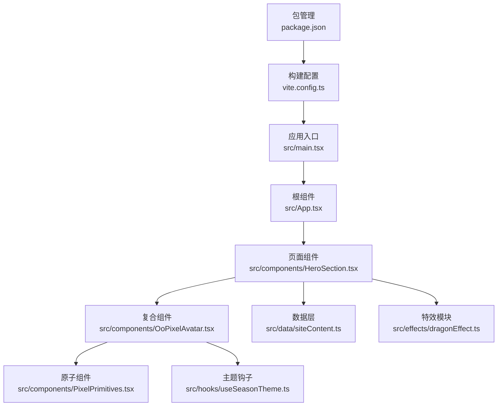

**图表来源** 
- [src/main.tsx](file://src/main.tsx)
- [src/App.tsx](file://src/App.tsx)
- [src/components/HeroSection.tsx](file://src/components/HeroSection.tsx)
- [src/components/OoPixelAvatar.tsx](file://src/components/OoPixelAvatar.tsx)
- [src/components/PixelPrimitives.tsx](file://src/components/PixelPrimitives.tsx)
- [src/data/siteContent.ts](file://src/data/siteContent.ts)
- [src/hooks/useSeasonTheme.ts](file://src/hooks/useSeasonTheme.ts)
- [src/effects/dragonEffect.ts](file://src/effects/dragonEffect.ts)
- [vite.config.ts](file://vite.config.ts)
- [package.json](file://package.json)

**章节来源**
- [src/main.tsx](file://src/main.tsx)
- [src/App.tsx](file://src/App.tsx)
- [vite.config.ts](file://vite.config.ts)
- [package.json](file://package.json)

## 核心组件
- 原子组件（PixelPrimitives）
  - 职责：提供最小粒度的像素风格 UI 元素与渲染能力，确保一致性与可复用性
  - 特点：无外部副作用、纯展示或轻量交互、通过 props 暴露行为
- 复合组件（OoPixelAvatar）
  - 职责：组合多个原子组件，封装角色头像的像素绘制、姿态映射与主题适配
  - 特点：内部维护姿态与主题状态，对外暴露简洁 API；与数据层解耦
- 页面组件（HeroSection）
  - 职责：承载首屏主视觉区域，编排复合组件与特效，聚合站点内容与主题
  - 特点：协调数据流与生命周期，驱动特效挂载与销毁

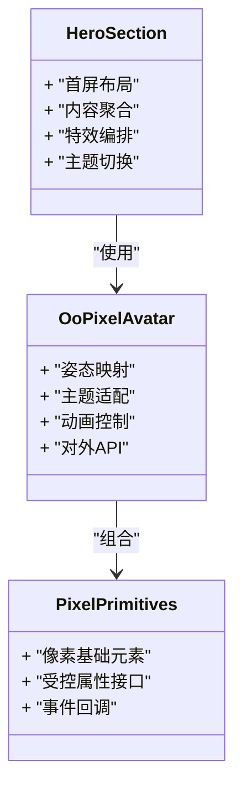

**图表来源** 
- [src/components/PixelPrimitives.tsx](file://src/components/PixelPrimitives.tsx)
- [src/components/OoPixelAvatar.tsx](file://src/components/OoPixelAvatar.tsx)
- [src/components/HeroSection.tsx](file://src/components/HeroSection.tsx)

**章节来源**
- [src/components/PixelPrimitives.tsx](file://src/components/PixelPrimitives.tsx)
- [src/components/OoPixelAvatar.tsx](file://src/components/OoPixelAvatar.tsx)
- [src/components/HeroSection.tsx](file://src/components/HeroSection.tsx)

## 架构总览
oo-space 采用“单向数据流 + 组件分层”的 React 架构模式：
- 数据源（siteContent、seasonContent）作为只读常量，避免在组件内直接修改
- 主题与状态通过自定义 Hook（useSeasonTheme）集中管理，向下透传至组件树
- 特效模块（dragonEffect）以副作用形式挂载到 DOM，遵循 React 生命周期
- 构建与运行由 Vite 驱动，支持热更新与资源优化

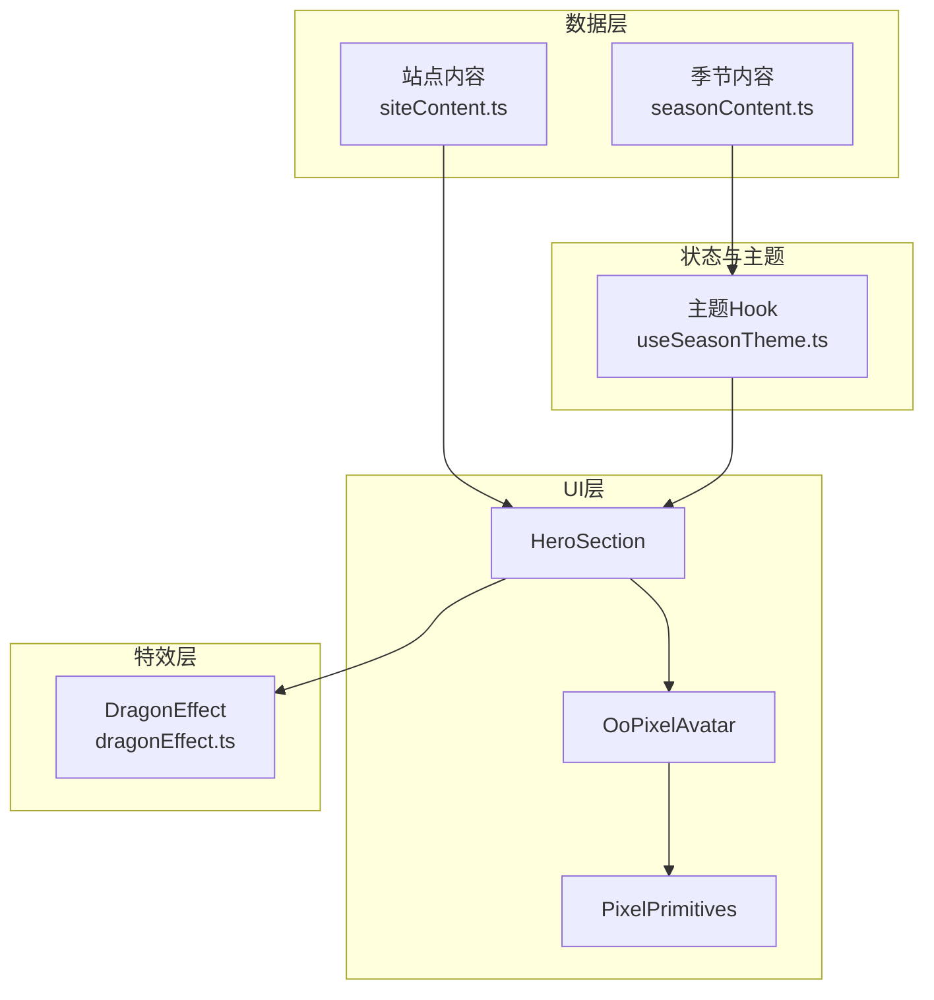

**图表来源** 
- [src/data/siteContent.ts](file://src/data/siteContent.ts)
- [src/data/seasonContent.ts](file://src/data/seasonContent.ts)
- [src/hooks/useSeasonTheme.ts](file://src/hooks/useSeasonTheme.ts)
- [src/components/HeroSection.tsx](file://src/components/HeroSection.tsx)
- [src/components/OoPixelAvatar.tsx](file://src/components/OoPixelAvatar.tsx)
- [src/components/PixelPrimitives.tsx](file://src/components/PixelPrimitives.tsx)
- [src/effects/dragonEffect.ts](file://src/effects/dragonEffect.ts)

**章节来源**
- [src/data/siteContent.ts](file://src/data/siteContent.ts)
- [src/data/seasonContent.ts](file://src/data/seasonContent.ts)
- [src/hooks/useSeasonTheme.ts](file://src/hooks/useSeasonTheme.ts)
- [src/effects/dragonEffect.ts](file://src/effects/dragonEffect.ts)

## 详细组件分析

### 原子组件：PixelPrimitives
- 设计原则
  - 单一职责：每个原子组件仅负责一个像素元素的渲染或交互
  - 受控优先：通过 props 控制外观与行为，避免内部可变状态
  - 类型安全：使用 TypeScript 定义清晰的输入输出契约
- 复杂度与性能
  - 渲染开销低，适合高频复用
  - 建议配合 memo 或 useMemo 减少不必要的重渲染
- 错误处理
  - 对缺失 props 进行默认值与校验
  - 异常路径返回降级 UI

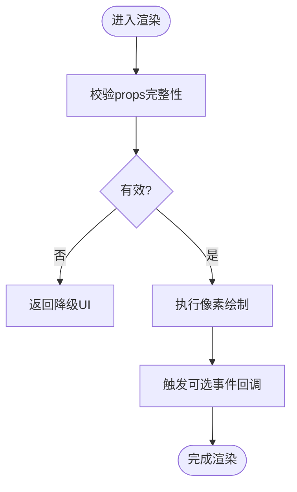

**图表来源** 
- [src/components/PixelPrimitives.tsx](file://src/components/PixelPrimitives.tsx)

**章节来源**
- [src/components/PixelPrimitives.tsx](file://src/components/PixelPrimitives.tsx)

### 复合组件：OoPixelAvatar
- 设计原则
  - 组合优于继承：通过组合 PixelPrimitives 拼装完整头像
  - 姿态映射：将姿态键值映射为具体像素帧或动画序列
  - 主题适配：根据季节主题动态调整颜色与装饰
- 数据流
  - 接收来自父组件的姿态与主题参数
  - 内部维护动画帧索引与播放状态
- 性能优化
  - 使用 useRef 缓存 Canvas 或纹理引用
  - 动画帧节流与 requestAnimationFrame 调度

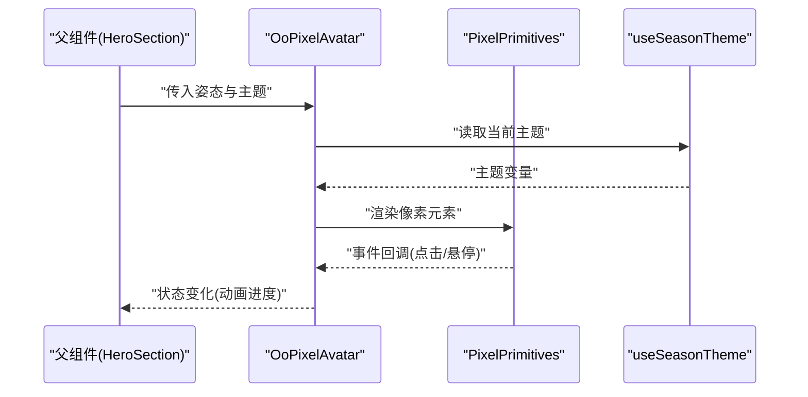

**图表来源** 
- [src/components/OoPixelAvatar.tsx](file://src/components/OoPixelAvatar.tsx)
- [src/components/PixelPrimitives.tsx](file://src/components/PixelPrimitives.tsx)
- [src/hooks/useSeasonTheme.ts](file://src/hooks/useSeasonTheme.ts)

**章节来源**
- [src/components/OoPixelAvatar.tsx](file://src/components/OoPixelAvatar.tsx)
- [src/hooks/useSeasonTheme.ts](file://src/hooks/useSeasonTheme.ts)

### 页面组件：HeroSection
- 设计原则
  - 编排者角色：聚合数据、主题与特效，驱动复合组件渲染
  - 关注点分离：将业务数据与视觉效果解耦
- 数据流
  - 从 siteContent 获取首屏文案与布局信息
  - 通过 useSeasonTheme 订阅主题变更
  - 在 useEffect 中挂载/卸载 dragonEffect
- 生命周期
  - 组件挂载时初始化特效与动画
  - 组件卸载时清理定时器与事件监听

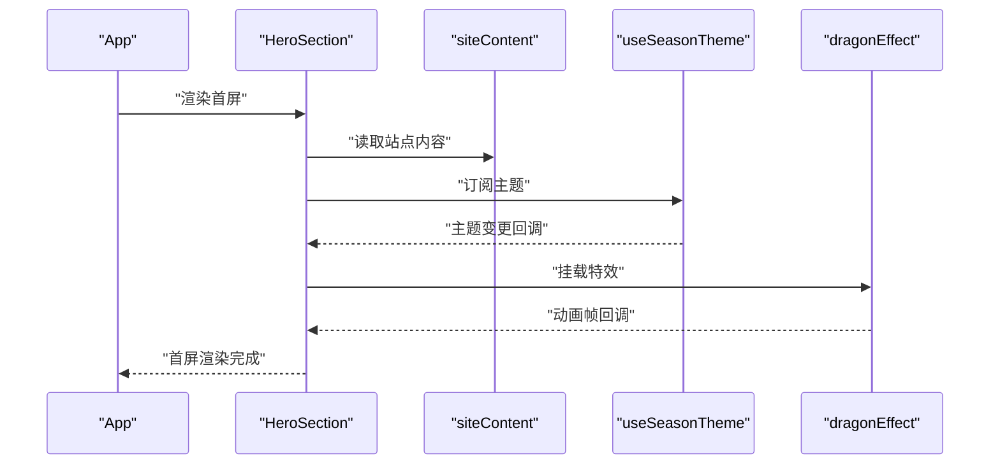

**图表来源** 
- [src/components/HeroSection.tsx](file://src/components/HeroSection.tsx)
- [src/data/siteContent.ts](file://src/data/siteContent.ts)
- [src/hooks/useSeasonTheme.ts](file://src/hooks/useSeasonTheme.ts)
- [src/effects/dragonEffect.ts](file://src/effects/dragonEffect.ts)

**章节来源**
- [src/components/HeroSection.tsx](file://src/components/HeroSection.tsx)
- [src/data/siteContent.ts](file://src/data/siteContent.ts)
- [src/effects/dragonEffect.ts](file://src/effects/dragonEffect.ts)

### 概念总览
以下流程图展示了 oo-space 的高层数据与控制流，不绑定具体代码文件：

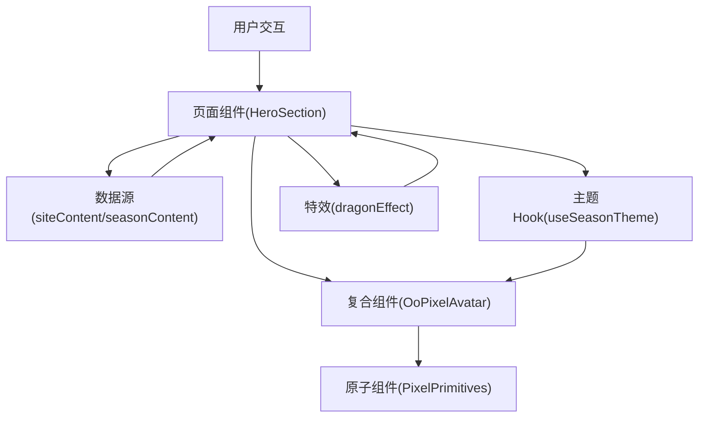

[本图为概念流程，不映射具体源码文件]

## 依赖分析
- 组件耦合
  - HeroSection 依赖 OoPixelAvatar 与特效模块，属于编排层，耦合度适中
  - OoPixelAvatar 依赖 PixelPrimitives 与主题 Hook，职责清晰，耦合度低
  - PixelPrimitives 无外部依赖，内聚性强
- 外部依赖
  - Vite 构建工具链与 React 运行时
  - 浏览器 API（Canvas、requestAnimationFrame、DOM 操作）
- 潜在循环依赖
  - 组件间单向依赖，未发现循环导入风险

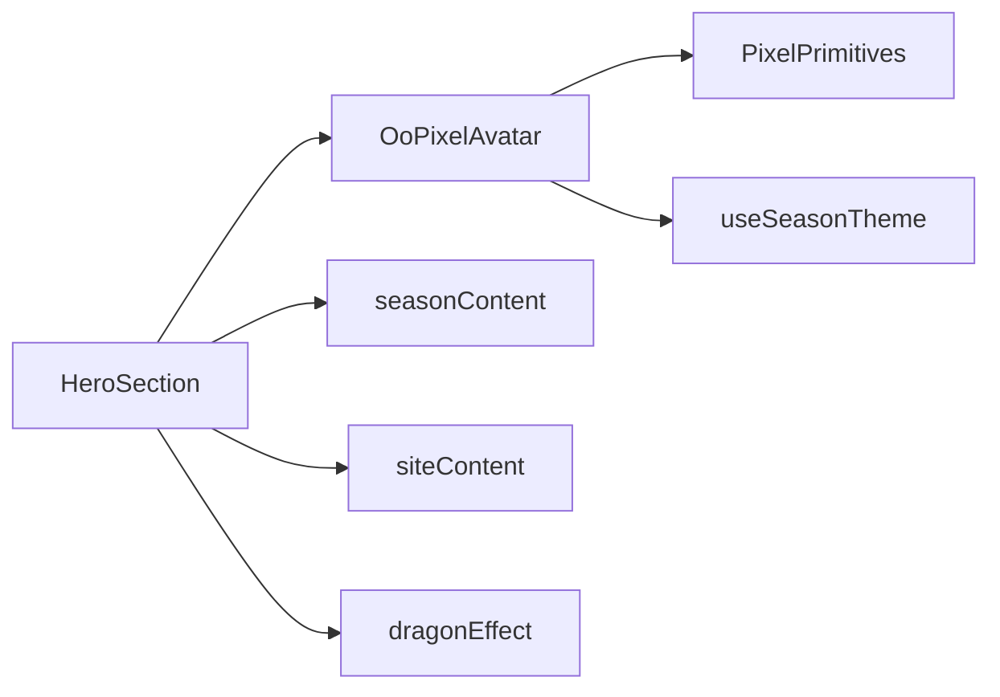

**图表来源** 
- [src/components/HeroSection.tsx](file://src/components/HeroSection.tsx)
- [src/components/OoPixelAvatar.tsx](file://src/components/OoPixelAvatar.tsx)
- [src/components/PixelPrimitives.tsx](file://src/components/PixelPrimitives.tsx)
- [src/data/siteContent.ts](file://src/data/siteContent.ts)
- [src/data/seasonContent.ts](file://src/data/seasonContent.ts)
- [src/hooks/useSeasonTheme.ts](file://src/hooks/useSeasonTheme.ts)
- [src/effects/dragonEffect.ts](file://src/effects/dragonEffect.ts)

**章节来源**
- [src/components/HeroSection.tsx](file://src/components/HeroSection.tsx)
- [src/components/OoPixelAvatar.tsx](file://src/components/OoPixelAvatar.tsx)
- [src/components/PixelPrimitives.tsx](file://src/components/PixelPrimitives.tsx)
- [src/data/siteContent.ts](file://src/data/siteContent.ts)
- [src/data/seasonContent.ts](file://src/data/seasonContent.ts)
- [src/hooks/useSeasonTheme.ts](file://src/hooks/useSeasonTheme.ts)
- [src/effects/dragonEffect.ts](file://src/effects/dragonEffect.ts)

## 性能考虑
- 渲染优化
  - 原子组件尽量保持无状态与不可变 props，必要时使用 React.memo
  - 复合组件对动画帧进行节流，避免每帧全量重渲染
- 资源加载
  - 图片与素材按需懒加载，首屏关键资源预加载
  - 使用 Vite 的代码分割与资源压缩
- 内存与清理
  - 特效模块在组件卸载时释放定时器与事件监听，防止内存泄漏
- 主题切换
  - 主题变量集中管理，避免频繁计算与重复样式生成

[本节为通用指导，不直接分析具体文件]

## 故障排查指南
- 常见问题定位
  - 主题未生效：检查 useSeasonTheme 的订阅与传递链路
  - 特效闪烁或卡顿：确认 requestAnimationFrame 的清理与帧率限制
  - 姿态映射错误：核对 poseMap 与 OoPixelAvatar 的键值对应关系
- 调试建议
  - 在 HeroSection 中打印数据与主题状态，验证数据流
  - 使用浏览器开发者工具的 Performance 面板分析渲染耗时
  - 对 PixelPrimitives 添加边界条件日志，定位渲染异常

**章节来源**
- [src/hooks/useSeasonTheme.ts](file://src/hooks/useSeasonTheme.ts)
- [src/effects/dragonEffect.ts](file://src/effects/dragonEffect.ts)
- [src/components/OoPixelAvatar.tsx](file://src/components/OoPixelAvatar.tsx)
- [src/components/HeroSection.tsx](file://src/components/HeroSection.tsx)

## 结论
oo-space 通过清晰的组件分层与单向数据流实现了高内聚、低耦合的前端架构。原子-复合-页面的层级划分使 UI 具备良好可复用性与可维护性；主题与特效的解耦提升了扩展性。结合 Vite 构建与 CI/CD 流水线，项目在开发与部署效率上具备优势。未来可在状态管理与国际化方面进一步增强，以满足更复杂的业务场景。

[本节为总结，不直接分析具体文件]

## 附录

### 系统上下文图
展示 oo-space 与外部环境的交互边界：

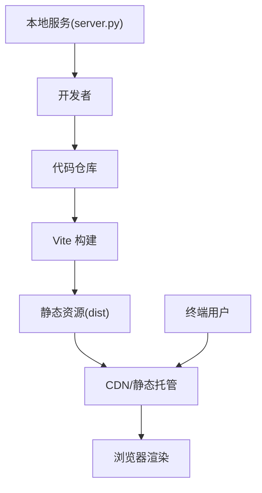

**图表来源** 
- [vite.config.ts](file://vite.config.ts)
- [server.py](file://server.py)
- [.github/workflows/deploy.yml](file://.github/workflows/deploy.yml)

### 组件分解图
进一步细化组件间的依赖与职责：

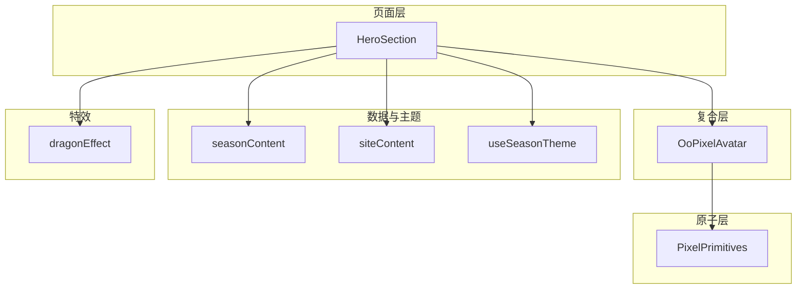

**图表来源** 
- [src/components/HeroSection.tsx](file://src/components/HeroSection.tsx)
- [src/components/OoPixelAvatar.tsx](file://src/components/OoPixelAvatar.tsx)
- [src/components/PixelPrimitives.tsx](file://src/components/PixelPrimitives.tsx)
- [src/data/siteContent.ts](file://src/data/siteContent.ts)
- [src/data/seasonContent.ts](file://src/data/seasonContent.ts)
- [src/hooks/useSeasonTheme.ts](file://src/hooks/useSeasonTheme.ts)
- [src/effects/dragonEffect.ts](file://src/effects/dragonEffect.ts)

### 部署拓扑
- 开发环境
  - 本地服务器（server.py）提供静态资源与简单后端能力
  - Vite 提供热更新与开发体验
- 生产环境
  - CI/CD（GitHub Actions）自动构建与发布
  - 静态资源托管至 CDN，提升全球访问速度

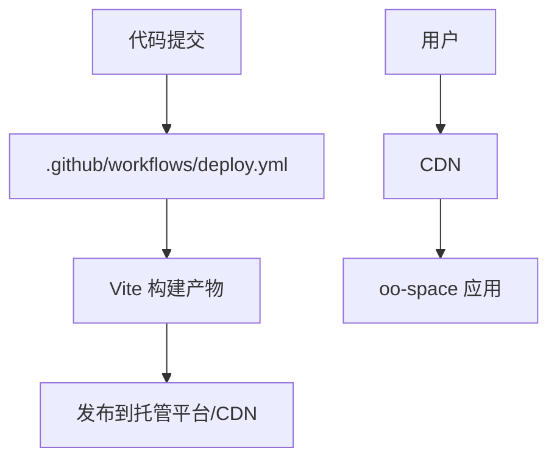

**图表来源** 
- [.github/workflows/deploy.yml](file://.github/workflows/deploy.yml)
- [vite.config.ts](file://vite.config.ts)

**章节来源**
- [server.py](file://server.py)
- [.github/workflows/deploy.yml](file://.github/workflows/deploy.yml)
- [vite.config.ts](file://vite.config.ts)