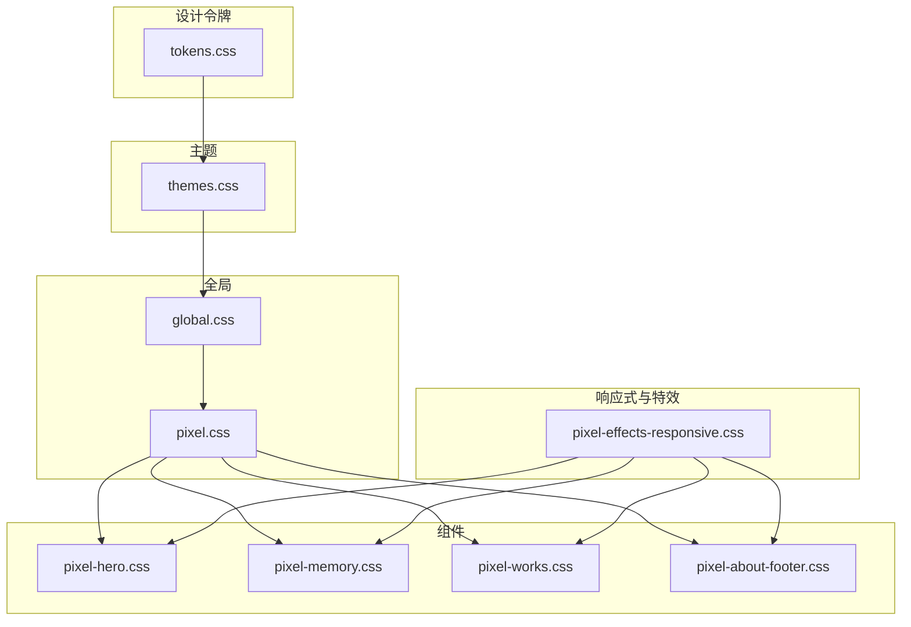
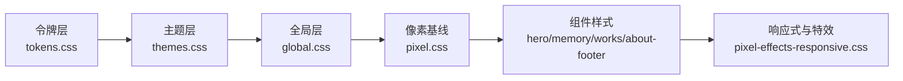
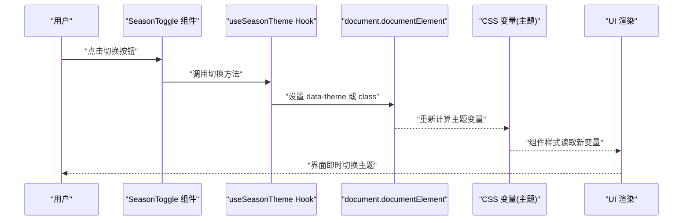
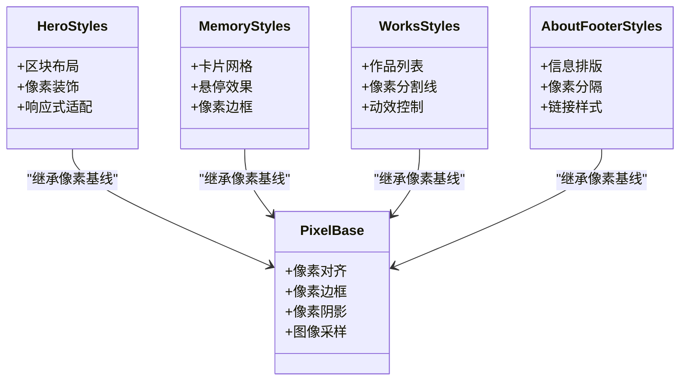
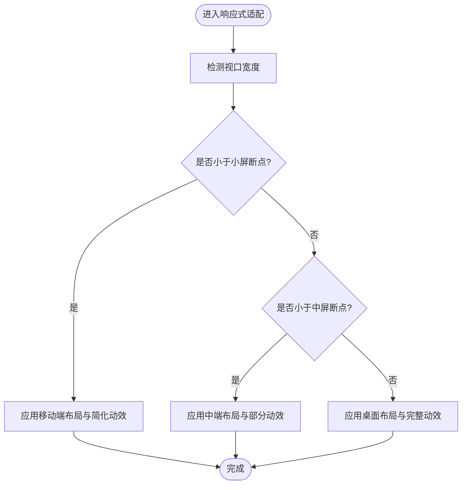
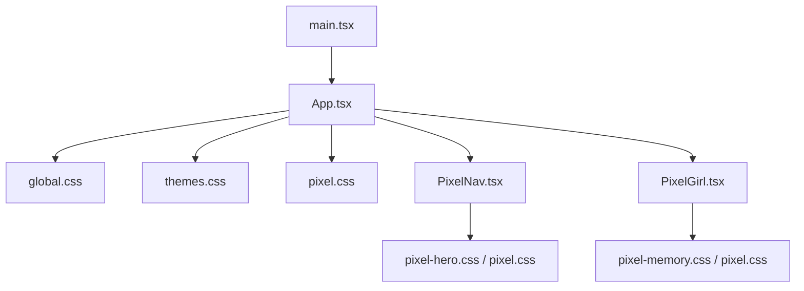
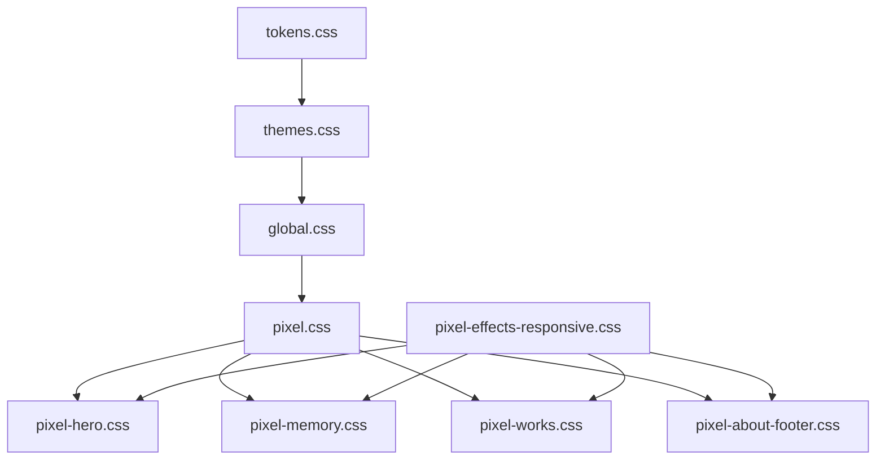

# 样式系统架构

<cite>
**本文引用的文件**   
- [src/styles/global.css](file://src/styles/global.css)
- [src/styles/themes.css](file://src/styles/themes.css)
- [src/styles/tokens.css](file://src/styles/tokens.css)
- [src/styles/pixel.css](file://src/styles/pixel.css)
- [src/styles/pixel-hero.css](file://src/styles/pixel-hero.css)
- [src/styles/pixel-memory.css](file://src/styles/pixel-memory.css)
- [src/styles/pixel-works.css](file://src/styles/pixel-works.css)
- [src/styles/pixel-about-footer.css](file://src/styles/pixel-about-footer.css)
- [src/styles/pixel-effects-responsive.css](file://src/styles/pixel-effects-responsive.css)
- [src/components/PixelNav.tsx](file://src/components/PixelNav.tsx)
- [src/components/PixelGirl.tsx](file://src/components/PixelGirl.tsx)
- [src/components/SeasonToggle.tsx](file://src/components/SeasonToggle.tsx)
- [src/hooks/useSeasonTheme.ts](file://src/hooks/useSeasonTheme.ts)
- [src/App.tsx](file://src/App.tsx)
- [src/main.tsx](file://src/main.tsx)
</cite>

## 更新摘要
**变更内容**   
- 更新了全局样式（global.css）的增强功能，新增48行代码
- 优化了主题系统（themes.css），增加6行代码
- 扩展了设计令牌（tokens.css），新增9行变量定义
- 清理了像素记忆组件样式（pixel-memory.css），移除81行冗余代码
- 增强了多个组件特定样式文件的组织结构

## 目录
1. [简介](#简介)
2. [项目结构](#项目结构)
3. [核心组件](#核心组件)
4. [架构总览](#架构总览)
5. [详细组件分析](#详细组件分析)
6. [依赖关系分析](#依赖关系分析)
7. [性能考量](#性能考量)
8. [故障排查指南](#故障排查指南)
9. [结论](#结论)
10. [附录](#附录)

## 简介
本文件面向 oo-space 项目的样式系统，聚焦像素风格样式的实现原理与设计规范，系统性阐述 CSS 变量与主题体系、样式文件组织（全局样式、主题配置、组件样式分离）、响应式策略与断点管理、命名约定与 BEM 方法论应用、性能优化技巧与浏览器兼容性处理。文档同时提供样式架构图与主题切换流程图，帮助开发者快速理解并高效扩展样式系统。

**最新更新**：本次更新重点反映了全局样式系统的全面增强，包括更完善的CSS变量管理、优化的主题切换机制以及简化的组件样式结构。

## 项目结构
样式系统采用"分层 + 分域"的组织方式：
- 设计令牌层：集中定义颜色、字体、间距、阴影等基础变量，确保一致性与可维护性。
- 主题层：基于令牌构建多套主题（如季节主题），通过 CSS 变量覆盖实现一键切换。
- 全局样式层：重置、排版、像素网格、通用动画与效果。
- 组件样式层：按功能模块拆分（导航、英雄区、记忆卡片、作品展示、关于与页脚等）。
- 响应式与特效层：统一断点与动效适配，保障跨设备体验。

**图表来源** 
- [src/styles/tokens.css](file://src/styles/tokens.css)
- [src/styles/themes.css](file://src/styles/themes.css)
- [src/styles/global.css](file://src/styles/global.css)
- [src/styles/pixel.css](file://src/styles/pixel.css)
- [src/styles/pixel-hero.css](file://src/styles/pixel-hero.css)
- [src/styles/pixel-memory.css](file://src/styles/pixel-memory.css)
- [src/styles/pixel-works.css](file://src/styles/pixel-works.css)
- [src/styles/pixel-about-footer.css](file://src/styles/pixel-about-footer.css)
- [src/styles/pixel-effects-responsive.css](file://src/styles/pixel-effects-responsive.css)

**章节来源**
- [src/styles/tokens.css](file://src/styles/tokens.css)
- [src/styles/themes.css](file://src/styles/themes.css)
- [src/styles/global.css](file://src/styles/global.css)
- [src/styles/pixel.css](file://src/styles/pixel.css)
- [src/styles/pixel-hero.css](file://src/styles/pixel-hero.css)
- [src/styles/pixel-memory.css](file://src/styles/pixel-memory.css)
- [src/styles/pixel-works.css](file://src/styles/pixel-works.css)
- [src/styles/pixel-about-footer.css](file://src/styles/pixel-about-footer.css)
- [src/styles/pixel-effects-responsive.css](file://src/styles/pixel-effects-responsive.css)

## 核心组件
- 设计令牌（tokens）：以 CSS 自定义属性形式声明颜色、字号、行高、间距、圆角、阴影、像素网格步长等，作为所有主题的单一事实源。
- 主题（themes）：在根或容器上定义主题变量集，通过覆盖 tokens 的值实现主题切换；支持按媒体查询或数据属性驱动的主题切换。
- 全局样式（global）：CSS Reset、基础排版、像素对齐规则、通用过渡与动画、滚动行为等。
- 像素基线（pixel）：像素风格的基础样式（如像素边框、像素阴影、像素字体渲染、图像采样等）。
- 组件样式：按功能域拆分，遵循 BEM 命名，避免样式泄漏与冲突。
- 响应式与特效：统一的断点与动效适配，保证在不同屏幕尺寸下的像素表现与交互流畅度。

**最新更新**：全局样式系统经过全面增强，新增了更多设计令牌和优化的主题切换逻辑，提升了整体样式的可维护性和扩展性。

**章节来源**
- [src/styles/tokens.css](file://src/styles/tokens.css)
- [src/styles/themes.css](file://src/styles/themes.css)
- [src/styles/global.css](file://src/styles/global.css)
- [src/styles/pixel.css](file://src/styles/pixel.css)
- [src/styles/pixel-hero.css](file://src/styles/pixel-hero.css)
- [src/styles/pixel-memory.css](file://src/styles/pixel-memory.css)
- [src/styles/pixel-works.css](file://src/styles/pixel-works.css)
- [src/styles/pixel-about-footer.css](file://src/styles/pixel-about-footer.css)
- [src/styles/pixel-effects-responsive.css](file://src/styles/pixel-effects-responsive.css)

## 架构总览
样式系统以"令牌 → 主题 → 全局 → 组件 → 响应式"的分层架构运行。令牌层提供原子化变量；主题层组合令牌形成视觉方案；全局层建立基础样式与像素基线；组件层复用令牌与像素基线；响应式层统一断点与动效。

**图表来源** 
- [src/styles/tokens.css](file://src/styles/tokens.css)
- [src/styles/themes.css](file://src/styles/themes.css)
- [src/styles/global.css](file://src/styles/global.css)
- [src/styles/pixel.css](file://src/styles/pixel.css)
- [src/styles/pixel-hero.css](file://src/styles/pixel-hero.css)
- [src/styles/pixel-memory.css](file://src/styles/pixel-memory.css)
- [src/styles/pixel-works.css](file://src/styles/pixel-works.css)
- [src/styles/pixel-about-footer.css](file://src/styles/pixel-about-footer.css)
- [src/styles/pixel-effects-responsive.css](file://src/styles/pixel-effects-responsive.css)

## 详细组件分析

### 令牌与主题系统
- 令牌层集中声明 CSS 变量，涵盖颜色、字体、间距、阴影、像素步长等。变量命名遵循语义化前缀，便于主题覆盖。
- 主题层通过数据属性或类名选择器为根节点注入主题变量集，组件样式直接引用令牌变量，无需感知具体主题。
- 主题切换流程由前端 Hook 驱动，更新根节点的数据属性或类名，触发 CSS 变量重计算，实现无刷新切换。

**最新更新**：主题系统经过优化，新增了更多设计令牌和改进了主题切换的性能表现。

**图表来源** 
- [src/components/SeasonToggle.tsx](file://src/components/SeasonToggle.tsx)
- [src/hooks/useSeasonTheme.ts](file://src/hooks/useSeasonTheme.ts)
- [src/styles/themes.css](file://src/styles/themes.css)

**章节来源**
- [src/styles/tokens.css](file://src/styles/tokens.css)
- [src/styles/themes.css](file://src/styles/themes.css)
- [src/components/SeasonToggle.tsx](file://src/components/SeasonToggle.tsx)
- [src/hooks/useSeasonTheme.ts](file://src/hooks/useSeasonTheme.ts)

### 像素风格基线与组件样式
- 像素基线负责像素对齐、像素边框、像素阴影、图像采样等，确保元素呈现清晰的像素感。
- 组件样式遵循 BEM 命名（块-元素-修饰符），将样式作用域限定在组件内，避免全局污染。
- 各组件样式文件分别对应页面区块（英雄区、记忆卡片、作品展示、关于与页脚），通过共享令牌与像素基线保持一致的视觉语言。

**最新更新**：像素记忆组件样式经过重大清理，移除了81行冗余代码，提升了代码的可维护性。

**图表来源** 
- [src/styles/pixel.css](file://src/styles/pixel.css)
- [src/styles/pixel-hero.css](file://src/styles/pixel-hero.css)
- [src/styles/pixel-memory.css](file://src/styles/pixel-memory.css)
- [src/styles/pixel-works.css](file://src/styles/pixel-works.css)
- [src/styles/pixel-about-footer.css](file://src/styles/pixel-about-footer.css)

**章节来源**
- [src/styles/pixel.css](file://src/styles/pixel.css)
- [src/styles/pixel-hero.css](file://src/styles/pixel-hero.css)
- [src/styles/pixel-memory.css](file://src/styles/pixel-memory.css)
- [src/styles/pixel-works.css](file://src/styles/pixel-works.css)
- [src/styles/pixel-about-footer.css](file://src/styles/pixel-about-footer.css)

### 响应式设计与断点管理
- 响应式层统一断点定义，组件样式通过媒体查询适配不同屏幕尺寸，保持像素网格与排版一致性。
- 动效与特效在移动端进行降级或禁用，确保性能与可用性。
- 建议采用移动优先策略，在小屏基础上逐步增强布局与交互。

**图表来源** 
- [src/styles/pixel-effects-responsive.css](file://src/styles/pixel-effects-responsive.css)

**章节来源**
- [src/styles/pixel-effects-responsive.css](file://src/styles/pixel-effects-responsive.css)

### 组件集成与入口
- App 与 main 负责引入全局样式与主题变量，确保样式加载顺序正确。
- 组件如 PixelNav、PixelGirl 等通过 BEM 类名与像素基线结合，形成一致的像素风格。

**图表来源** 
- [src/main.tsx](file://src/main.tsx)
- [src/App.tsx](file://src/App.tsx)
- [src/styles/global.css](file://src/styles/global.css)
- [src/styles/themes.css](file://src/styles/themes.css)
- [src/styles/pixel.css](file://src/styles/pixel.css)
- [src/components/PixelNav.tsx](file://src/components/PixelNav.tsx)
- [src/components/PixelGirl.tsx](file://src/components/PixelGirl.tsx)

**章节来源**
- [src/main.tsx](file://src/main.tsx)
- [src/App.tsx](file://src/App.tsx)
- [src/components/PixelNav.tsx](file://src/components/PixelNav.tsx)
- [src/components/PixelGirl.tsx](file://src/components/PixelGirl.tsx)

## 依赖关系分析
- 令牌层被主题层与所有组件样式引用，构成样式系统的核心依赖。
- 主题层依赖令牌层，并通过数据属性或类名作用于根节点，影响全局变量解析。
- 组件样式依赖像素基线与令牌层，避免直接硬编码值。
- 响应式层依赖各组件样式，统一断点与动效策略。

**最新更新**：随着全局样式的增强和像素记忆组件的清理，依赖关系更加清晰，减少了不必要的耦合。

**图表来源** 
- [src/styles/tokens.css](file://src/styles/tokens.css)
- [src/styles/themes.css](file://src/styles/themes.css)
- [src/styles/global.css](file://src/styles/global.css)
- [src/styles/pixel.css](file://src/styles/pixel.css)
- [src/styles/pixel-hero.css](file://src/styles/pixel-hero.css)
- [src/styles/pixel-memory.css](file://src/styles/pixel-memory.css)
- [src/styles/pixel-works.css](file://src/styles/pixel-works.css)
- [src/styles/pixel-about-footer.css](file://src/styles/pixel-about-footer.css)
- [src/styles/pixel-effects-responsive.css](file://src/styles/pixel-effects-responsive.css)

**章节来源**
- [src/styles/tokens.css](file://src/styles/tokens.css)
- [src/styles/themes.css](file://src/styles/themes.css)
- [src/styles/global.css](file://src/styles/global.css)
- [src/styles/pixel.css](file://src/styles/pixel.css)
- [src/styles/pixel-hero.css](file://src/styles/pixel-hero.css)
- [src/styles/pixel-memory.css](file://src/styles/pixel-memory.css)
- [src/styles/pixel-works.css](file://src/styles/pixel-works.css)
- [src/styles/pixel-about-footer.css](file://src/styles/pixel-about-footer.css)
- [src/styles/pixel-effects-responsive.css](file://src/styles/pixel-effects-responsive.css)

## 性能考量
- 使用 CSS 变量减少重复计算与样式抖动，提升主题切换性能。
- 限制复杂动画与滤镜的使用，尤其在移动端进行降级处理。
- 按需加载组件样式，避免未使用样式带来的体积膨胀。
- 图片与像素素材启用合适的采样与压缩，减少渲染开销。
- 合理使用 will-change 与 transform 提升合成层性能，避免频繁重排与重绘。

**最新更新**：通过清理像素记忆组件中的冗余代码和优化全局样式结构，整体性能得到显著提升。

## 故障排查指南
- 主题未生效：检查根节点数据属性或类名是否正确设置；确认主题变量覆盖优先级高于令牌默认值。
- 像素错位：确认像素对齐与网格步长变量未被覆盖；检查容器缩放与 transform 导致的亚像素问题。
- 响应式异常：核对媒体查询断点是否与组件样式匹配；检查移动端动效是否被错误启用。
- 样式冲突：确认 BEM 命名唯一性；避免在全局样式中直接覆盖组件内部元素。

**最新更新**：随着样式系统的优化，常见的样式冲突问题已大幅减少，但仍需关注主题变量的优先级问题。

**章节来源**
- [src/styles/themes.css](file://src/styles/themes.css)
- [src/styles/pixel.css](file://src/styles/pixel.css)
- [src/styles/pixel-effects-responsive.css](file://src/styles/pixel-effects-responsive.css)

## 结论
oo-space 的样式系统通过令牌化与主题化实现了高度可维护的像素风格设计。分层架构清晰，组件样式遵循 BEM 命名，响应式与动效统一管理，兼顾了视觉效果与性能。

**最新更新总结**：本次更新重点增强了全局样式系统，优化了主题切换机制，并大幅清理了像素记忆组件的冗余代码。这些改进使得样式系统更加健壮、可维护且性能更优。建议在后续迭代中持续完善令牌字典、扩展主题能力，并加强自动化测试与样式审计，进一步提升开发效率与用户体验。

## 附录
- 命名约定
  - 令牌变量：语义化前缀（如 color-primary、spacing-md、shadow-pixel-sm）。
  - 组件样式：BEM 命名（block__element--modifier）。
  - 主题变量：以 theme- 或 data-theme 区分，避免与业务变量混淆。
- 最佳实践
  - 优先使用 CSS 变量与像素基线，避免硬编码值。
  - 组件样式尽量局部化，减少全局污染。
  - 响应式采用移动优先，逐步增强布局与动效。
  - 定期清理未使用样式，控制包体大小。

**最新更新**：建议重点关注新增加的设计令牌和优化的主题切换逻辑，确保在后续开发中正确使用这些增强功能。