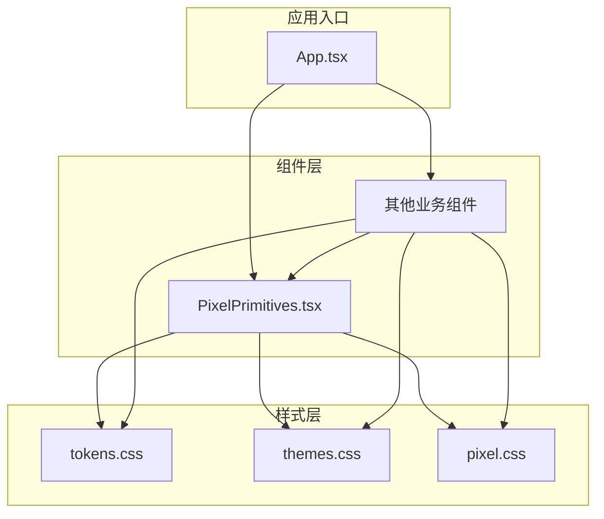
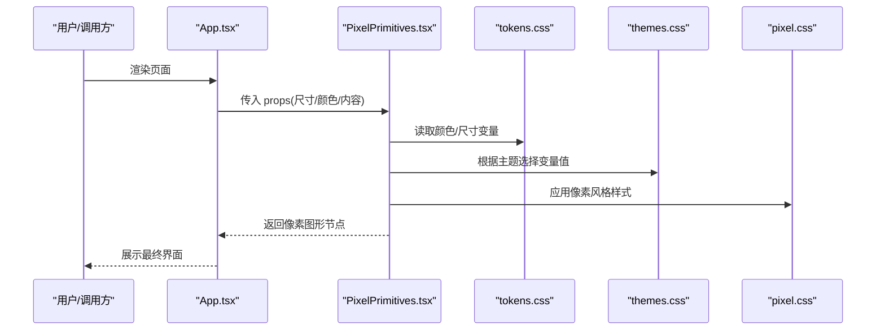
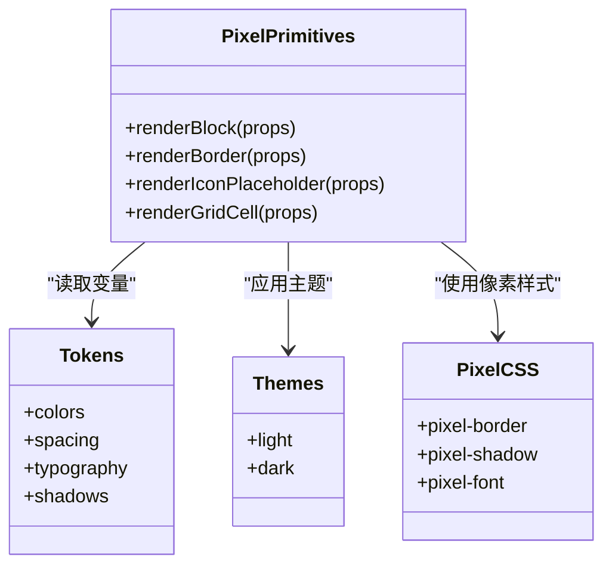
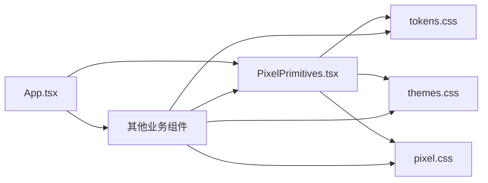

# 原子组件

<cite>
**本文引用的文件**   
- [src/components/PixelPrimitives.tsx](file://src/components/PixelPrimitives.tsx)
- [src/styles/tokens.css](file://src/styles/tokens.css)
- [src/styles/themes.css](file://src/styles/themes.css)
- [src/styles/pixel.css](file://src/styles/pixel.css)
- [src/App.tsx](file://src/App.tsx)
- [package.json](file://package.json)
</cite>

## 目录
1. [简介](#简介)
2. [项目结构](#项目结构)
3. [核心组件](#核心组件)
4. [架构总览](#架构总览)
5. [详细组件分析](#详细组件分析)
6. [依赖关系分析](#依赖关系分析)
7. [性能考量](#性能考量)
8. [故障排查指南](#故障排查指南)
9. [结论](#结论)
10. [附录](#附录)

## 简介
本文件面向 oo-space 项目的原子组件体系，重点围绕 PixelPrimitives 组件的设计原则与实现细节展开。文档将系统阐述像素风格的基础图形元素、颜色系统与尺寸规范、样式变量组织方式，以及原子组件的不可变性设计、props 接口定义与复用策略。同时提供使用示例与最佳实践，并给出扩展新原子组件以保持一致性的方法。

## 项目结构
本项目采用 React + TypeScript 构建，UI 层由多个像素风格的组件构成，样式通过 CSS 变量与主题文件统一管理。PixelPrimitives 作为基础原子组件，负责提供像素化的几何形状、图标占位与通用布局单元，供上层业务组件组合使用。

图表来源
- [src/App.tsx](file://src/App.tsx)
- [src/components/PixelPrimitives.tsx](file://src/components/PixelPrimitives.tsx)
- [src/styles/tokens.css](file://src/styles/tokens.css)
- [src/styles/themes.css](file://src/styles/themes.css)
- [src/styles/pixel.css](file://src/styles/pixel.css)

章节来源
- [src/App.tsx](file://src/App.tsx)
- [package.json](file://package.json)

## 核心组件
PixelPrimitives 是像素风格 UI 的“原子”集合，承担以下职责：
- 提供像素化基础图形（如方块、线条、圆角块等）
- 暴露统一的尺寸与间距规范
- 基于 CSS 变量管理颜色与主题切换
- 保持 props 不可变性与最小化副作用

设计要点
- 不可变性：组件不修改外部状态，所有行为由 props 驱动
- 单一职责：每个子图元只负责一种视觉形态
- 可组合性：通过 props 组合出复杂像素图形
- 主题化：颜色与尺寸通过 tokens 与 themes 统一管控

章节来源
- [src/components/PixelPrimitives.tsx](file://src/components/PixelPrimitives.tsx)
- [src/styles/tokens.css](file://src/styles/tokens.css)
- [src/styles/themes.css](file://src/styles/themes.css)

## 架构总览
PixelPrimitives 与样式系统形成清晰的解耦关系：组件仅消费 CSS 变量，不直接持有具体色值或尺寸常量。主题切换通过覆盖 CSS 变量实现，保证一致性与可维护性。

图表来源
- [src/App.tsx](file://src/App.tsx)
- [src/components/PixelPrimitives.tsx](file://src/components/PixelPrimitives.tsx)
- [src/styles/tokens.css](file://src/styles/tokens.css)
- [src/styles/themes.css](file://src/styles/themes.css)
- [src/styles/pixel.css](file://src/styles/pixel.css)

## 详细组件分析

### PixelPrimitives 组件分析
PixelPrimitives 将像素风格抽象为若干可复用的基础图元，并通过 props 控制其外观与行为。

- 设计原则
  - 不可变数据流：所有视觉差异由 props 决定，避免内部可变状态
  - 最小 API：仅暴露必要的尺寸、颜色、对齐与边距参数
  - 语义化命名：组件名与属性名清晰表达用途
  - 样式外置：颜色与尺寸来自 tokens 与 themes，组件内不硬编码

- 关键能力
  - 像素块：用于绘制像素画、分隔线、背景纹理等
  - 像素边框：带像素锯齿感的边框与描边
  - 像素图标占位：统一尺寸的图标容器，便于替换真实图标
  - 像素网格辅助：用于对齐与布局的参考线或占位格

- 尺寸与间距规范
  - 基于 CSS 变量的栅格单位，确保跨组件一致性
  - 常用尺寸档位（如 4px、8px、16px、24px、32px）在 tokens 中统一定义
  - 间距遵循倍数规则，避免随意取值

- 颜色系统
  - 主色、辅色、强调色、中性色、成功/警告/错误语义色均在 tokens 中声明
  - 明暗主题通过 themes 覆盖变量值，组件自动适配
  - 对比度与可访问性要求纳入颜色选择约束

- 样式变量与主题
  - tokens.css：定义全局变量（颜色、字号、行高、间距、阴影等）
  - themes.css：按主题覆盖变量（如 light/dark 模式）
  - pixel.css：像素风格专用样式（锯齿描边、像素化滤镜、字体等）

- Props 接口约定
  - 尺寸类：width、height、size、gap、padding、margin
  - 颜色类：color、bgColor、borderColor、accentColor
  - 形态类：rounded、bordered、dashed、solid、outline
  - 内容类：children、aria-label、role
  - 事件类：onClick、onMouseEnter、onMouseLeave（按需暴露）
  - 无障碍类：aria-*、data-* 透传

- 不可变性与复用策略
  - 组件内部不产生副作用，所有渲染由 props 驱动
  - 通过组合而非继承扩展功能，避免深层嵌套
  - 对样式进行分层：通用样式在 pixel.css，主题在 themes.css，变量在 tokens.css

图表来源
- [src/components/PixelPrimitives.tsx](file://src/components/PixelPrimitives.tsx)
- [src/styles/tokens.css](file://src/styles/tokens.css)
- [src/styles/themes.css](file://src/styles/themes.css)
- [src/styles/pixel.css](file://src/styles/pixel.css)

章节来源
- [src/components/PixelPrimitives.tsx](file://src/components/PixelPrimitives.tsx)
- [src/styles/tokens.css](file://src/styles/tokens.css)
- [src/styles/themes.css](file://src/styles/themes.css)
- [src/styles/pixel.css](file://src/styles/pixel.css)

### 使用示例与最佳实践
- 基本用法
  - 使用像素块绘制分隔线或背景纹理
  - 使用像素边框为卡片或按钮增加复古感
  - 使用图标占位容器统一图标尺寸与对齐
- 主题切换
  - 通过切换主题类名或根节点属性，使组件自动应用新的颜色与对比度
- 可访问性
  - 为交互元素设置 aria-label 与 role
  - 确保颜色对比度满足 WCAG 标准
- 性能优化
  - 避免在高频渲染路径中创建新对象作为 props
  - 使用稳定的 key 值提升列表渲染性能
- 代码组织
  - 将重复使用的像素组合封装为更高层组件
  - 保持 props 最小化，必要时通过默认值简化调用

章节来源
- [src/components/PixelPrimitives.tsx](file://src/components/PixelPrimitives.tsx)
- [src/styles/tokens.css](file://src/styles/tokens.css)
- [src/styles/themes.css](file://src/styles/themes.css)
- [src/styles/pixel.css](file://src/styles/pixel.css)

### 扩展新原子组件的方法
- 明确职责
  - 新增组件应聚焦单一视觉形态或行为
- 遵循规范
  - 尺寸与间距使用 tokens 中的变量
  - 颜色使用 themes 提供的语义色
  - 像素风格样式放在 pixel.css
- 接口设计
  - 保持 props 不可变且最小化
  - 支持无障碍属性透传
- 测试与验证
  - 在不同主题下验证显示效果
  - 检查对比度与键盘可达性
- 文档更新
  - 为新组件补充使用示例与注意事项

章节来源
- [src/components/PixelPrimitives.tsx](file://src/components/PixelPrimitives.tsx)
- [src/styles/tokens.css](file://src/styles/tokens.css)
- [src/styles/themes.css](file://src/styles/themes.css)
- [src/styles/pixel.css](file://src/styles/pixel.css)

## 依赖关系分析
PixelPrimitives 依赖样式层提供的变量与像素风格样式，被上层组件组合使用。整体依赖方向清晰，无循环依赖。

图表来源
- [src/App.tsx](file://src/App.tsx)
- [src/components/PixelPrimitives.tsx](file://src/components/PixelPrimitives.tsx)
- [src/styles/tokens.css](file://src/styles/tokens.css)
- [src/styles/themes.css](file://src/styles/themes.css)
- [src/styles/pixel.css](file://src/styles/pixel.css)

章节来源
- [src/App.tsx](file://src/App.tsx)
- [src/components/PixelPrimitives.tsx](file://src/components/PixelPrimitives.tsx)
- [src/styles/tokens.css](file://src/styles/tokens.css)
- [src/styles/themes.css](file://src/styles/themes.css)
- [src/styles/pixel.css](file://src/styles/pixel.css)

## 性能考量
- 减少重排与重绘：尽量使用 CSS 变量与 transform 动画，避免频繁修改布局属性
- 稳定 props：避免在渲染函数中创建新对象或数组作为 props
- 懒加载与按需引入：仅在需要时加载大型资源或特效
- 主题切换优化：通过根节点切换主题类名，批量更新 CSS 变量，减少 JS 计算

[本节为通用指导，不涉及具体文件分析]

## 故障排查指南
- 颜色不一致
  - 检查是否使用了正确的语义色变量
  - 确认当前主题是否正确应用
- 尺寸错位
  - 核对 spacing 与 typography 变量是否被覆盖
  - 检查父容器的 box-sizing 与 padding/margin
- 像素风格异常
  - 确认 pixel.css 已正确引入
  - 检查浏览器缩放与字体渲染设置
- 可访问性问题
  - 为交互元素添加 aria-label 与 role
  - 验证键盘导航顺序与焦点样式

章节来源
- [src/styles/tokens.css](file://src/styles/tokens.css)
- [src/styles/themes.css](file://src/styles/themes.css)
- [src/styles/pixel.css](file://src/styles/pixel.css)

## 结论
PixelPrimitives 通过不可变的 props 接口、统一的 CSS 变量与主题系统，构建了稳定、可组合、易扩展的像素风格原子组件体系。遵循本文档的设计原则与最佳实践，可在保持设计一致性的前提下快速迭代与扩展新的原子组件。

[本节为总结性内容，不涉及具体文件分析]

## 附录
- 术语说明
  - 原子组件：最小粒度的 UI 单元，具备单一职责与高复用性
  - 不可变性：组件不修改外部状态，所有行为由 props 驱动
  - 主题：通过覆盖 CSS 变量实现的整体外观切换方案
- 相关工具与环境
  - React + TypeScript
  - Vite 构建
  - CSS 变量与主题管理

章节来源
- [package.json](file://package.json)