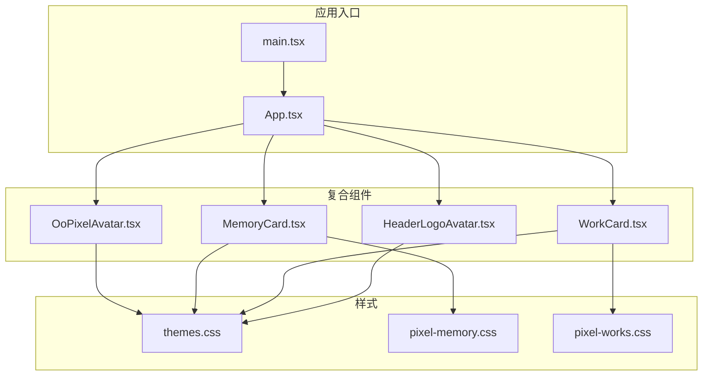
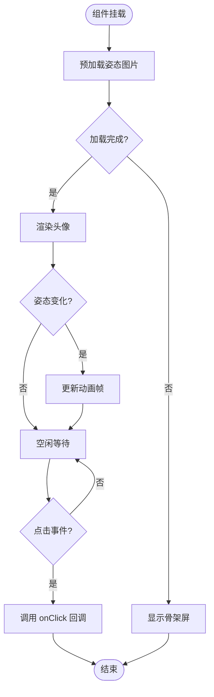
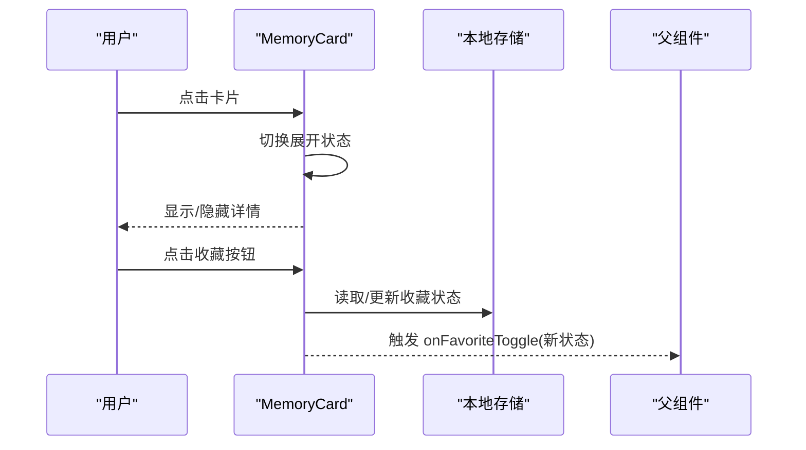
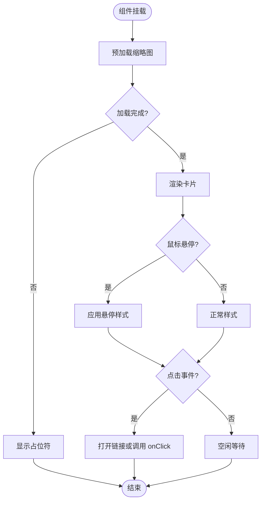
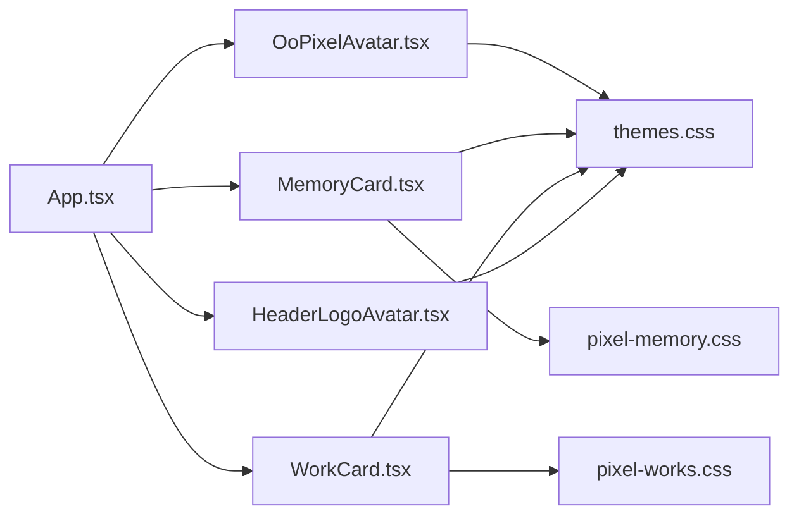

# 复合组件

<cite>
**本文引用的文件**   
- [OoPixelAvatar.tsx](file://src/components/OoPixelAvatar.tsx)
- [MemoryCard.tsx](file://src/components/MemoryCard.tsx)
- [WorkCard.tsx](file://src/components/WorkCard.tsx)
- [HeaderLogoAvatar.tsx](file://src/components/HeaderLogoAvatar.tsx)
- [themes.css](file://src/styles/themes.css)
- [pixel-memory.css](file://src/styles/pixel-memory.css)
- [pixel-works.css](file://src/styles/pixel-works.css)
- [App.tsx](file://src/App.tsx)
- [main.tsx](file://src/main.tsx)
</cite>

## 目录
1. [简介](#简介)
2. [项目结构](#项目结构)
3. [核心组件](#核心组件)
4. [架构总览](#架构总览)
5. [详细组件分析](#详细组件分析)
6. [依赖关系分析](#依赖关系分析)
7. [性能考量](#性能考量)
8. [故障排查指南](#故障排查指南)
9. [结论](#结论)
10. [附录](#附录)

## 简介
本文件面向 oo-space 项目的复合组件，聚焦 OoPixelAvatar、MemoryCard、WorkCard、HeaderLogoAvatar 四个组件。文档从系统架构、组件组合模式、状态管理、事件处理与生命周期、Props 接口与校验、插槽使用、主题定制、集成示例与最佳实践等维度进行系统化说明，帮助读者快速理解并高效使用这些复合组件。

## 项目结构
- 组件位于 src/components，样式位于 src/styles，应用入口为 src/App.tsx 与 src/main.tsx。
- 复合组件通过组合基础 UI 元素与业务逻辑实现复杂交互；样式采用模块化 CSS，配合主题变量支持多主题切换。



图表来源
- [main.tsx](file://src/main.tsx)
- [App.tsx](file://src/App.tsx)
- [OoPixelAvatar.tsx](file://src/components/OoPixelAvatar.tsx)
- [MemoryCard.tsx](file://src/components/MemoryCard.tsx)
- [WorkCard.tsx](file://src/components/WorkCard.tsx)
- [HeaderLogoAvatar.tsx](file://src/components/HeaderLogoAvatar.tsx)
- [themes.css](file://src/styles/themes.css)
- [pixel-memory.css](file://src/styles/pixel-memory.css)
- [pixel-works.css](file://src/styles/pixel-works.css)

章节来源
- [main.tsx](file://src/main.tsx)
- [App.tsx](file://src/App.tsx)

## 核心组件
本节概述四个复合组件的职责与协作方式：
- OoPixelAvatar：像素风头像展示组件，支持多种姿态、表情与动画，常用于页面头部或卡片内嵌头像。
- MemoryCard：记忆卡片组件，用于展示图片、标题、描述与时间线信息，支持点击展开详情与收藏交互。
- WorkCard：作品卡片组件，用于展示项目名称、技术栈、链接与缩略图，支持悬停效果与跳转。
- HeaderLogoAvatar：头部 Logo 头像组件，用于导航栏或页头区域的品牌标识与用户头像展示。

章节来源
- [OoPixelAvatar.tsx](file://src/components/OoPixelAvatar.tsx)
- [MemoryCard.tsx](file://src/components/MemoryCard.tsx)
- [WorkCard.tsx](file://src/components/WorkCard.tsx)
- [HeaderLogoAvatar.tsx](file://src/components/HeaderLogoAvatar.tsx)

## 架构总览
复合组件的通用架构遵循“数据驱动 + 事件回调”的模式：
- 数据层：通过 props 传入配置（如头像 URL、记忆条目、作品信息等）。
- 表现层：基于主题变量与样式模块渲染 UI。
- 行为层：内部状态管理（如展开/收起、加载态、错误态）与事件处理（点击、悬停、键盘操作）。
- 生命周期：组件挂载时初始化资源（如图片预加载），卸载时清理监听器与定时器。

```mermaid
classDiagram
class OoPixelAvatar {
+props : 头像配置
+state : 加载状态, 姿态索引
+methods : 切换姿态, 预加载图片
+events : onClick, onPoseChange
}
class MemoryCard {
+props : 记忆条目数据
+state : 展开状态, 收藏状态
+methods : 切换展开, 切换收藏
+events : onClick, onFavoriteToggle
}
class WorkCard {
+props : 作品数据
+state : 悬停状态, 加载状态
+methods : 打开链接, 预加载缩略图
+events : onClick, onMouseEnter, onMouseLeave
}
class HeaderLogoAvatar {
+props : Logo/头像配置
+state : 加载状态
+methods : 预加载资源
+events : onClick
}
OoPixelAvatar --> "uses theme variables" : themes.css
MemoryCard --> "uses memory styles" : pixel-memory.css
WorkCard --> "uses works styles" : pixel-works.css
HeaderLogoAvatar --> "uses theme variables" : themes.css
```

图表来源
- [OoPixelAvatar.tsx](file://src/components/OoPixelAvatar.tsx)
- [MemoryCard.tsx](file://src/components/MemoryCard.tsx)
- [WorkCard.tsx](file://src/components/WorkCard.tsx)
- [HeaderLogoAvatar.tsx](file://src/components/HeaderLogoAvatar.tsx)
- [themes.css](file://src/styles/themes.css)
- [pixel-memory.css](file://src/styles/pixel-memory.css)
- [pixel-works.css](file://src/styles/pixel-works.css)

## 详细组件分析

### OoPixelAvatar 组件
- 职责：展示像素风格头像，支持姿态切换与动画。
- 组合模式：组合基础图像元素与动画容器，根据姿态索引渲染不同帧。
- 状态管理：
  - 加载状态：控制骨架屏与错误提示。
  - 姿态索引：当前显示的姿态帧。
- 事件处理：
  - onClick：触发外部回调（如打开详情）。
  - onPoseChange：姿态变化时通知父组件。
- 生命周期：
  - 挂载：预加载姿态图片资源。
  - 更新：姿态索引变化时重新计算动画帧。
  - 卸载：清理定时器与事件监听。
- Props 接口（建议）：
  - src：头像图片地址（必填）
  - poses：姿态数组（可选，默认空）
  - size：尺寸（可选，默认中号）
  - animated：是否启用动画（可选，默认开启）
  - onClick：点击回调（可选）
  - onPoseChange：姿态变化回调（可选）
- 插槽使用：支持自定义内容插槽以嵌入额外 UI（如标签、徽章）。
- 主题支持：通过 CSS 变量控制颜色、边框与阴影。



图表来源
- [OoPixelAvatar.tsx](file://src/components/OoPixelAvatar.tsx)

章节来源
- [OoPixelAvatar.tsx](file://src/components/OoPixelAvatar.tsx)

### MemoryCard 组件
- 职责：展示记忆条目（图片、标题、描述、时间），支持展开详情与收藏。
- 组合模式：组合图片容器、文本区块与操作按钮。
- 状态管理：
  - 展开状态：控制详情区域的显示/隐藏。
  - 收藏状态：本地存储收藏标记。
- 事件处理：
  - onClick：切换展开/收起。
  - onFavoriteToggle：收藏状态变更回调。
- 生命周期：
  - 挂载：读取本地收藏状态。
  - 更新：收藏状态变化时同步本地存储。
  - 卸载：清理监听器。
- Props 接口（建议）：
  - image：图片地址（必填）
  - title：标题（必填）
  - description：描述（可选）
  - date：日期（可选）
  - favorite：是否已收藏（可选，默认 false）
  - onFavoriteToggle：收藏切换回调（可选）
- 插槽使用：支持在底部区域插入自定义操作按钮。
- 主题支持：使用 pixel-memory.css 与 themes.css 变量控制布局与配色。



图表来源
- [MemoryCard.tsx](file://src/components/MemoryCard.tsx)

章节来源
- [MemoryCard.tsx](file://src/components/MemoryCard.tsx)
- [pixel-memory.css](file://src/styles/pixel-memory.css)
- [themes.css](file://src/styles/themes.css)

### WorkCard 组件
- 职责：展示作品信息（名称、技术栈、链接、缩略图），支持悬停效果与跳转。
- 组合模式：组合缩略图、标题、标签列表与链接按钮。
- 状态管理：
  - 悬停状态：控制高亮与阴影。
  - 加载状态：控制缩略图占位符。
- 事件处理：
  - onClick：打开作品链接。
  - onMouseEnter/onMouseLeave：控制悬停样式。
- 生命周期：
  - 挂载：预加载缩略图。
  - 更新：链接或数据变化时刷新显示。
  - 卸载：清理事件监听。
- Props 接口（建议）：
  - title：作品标题（必填）
  - thumbnail：缩略图地址（必填）
  - tags：技术栈标签数组（可选）
  - link：跳转链接（可选）
  - onClick：点击回调（可选）
- 插槽使用：支持在标题下方插入自定义描述或备注。
- 主题支持：使用 pixel-works.css 与 themes.css 变量控制布局与配色。



图表来源
- [WorkCard.tsx](file://src/components/WorkCard.tsx)

章节来源
- [WorkCard.tsx](file://src/components/WorkCard.tsx)
- [pixel-works.css](file://src/styles/pixel-works.css)
- [themes.css](file://src/styles/themes.css)

### HeaderLogoAvatar 组件
- 职责：在头部区域展示品牌 Logo 或用户头像。
- 组合模式：组合图像元素与可选的徽标指示器。
- 状态管理：
  - 加载状态：控制占位符与错误提示。
- 事件处理：
  - onClick：触发导航或菜单切换。
- 生命周期：
  - 挂载：预加载资源。
  - 卸载：清理监听器。
- Props 接口（建议）：
  - src：Logo/头像地址（必填）
  - alt：替代文本（必填）
  - size：尺寸（可选，默认小号）
  - onClick：点击回调（可选）
- 插槽使用：支持在右侧插入下拉菜单或设置图标。
- 主题支持：通过 themes.css 变量控制边框、阴影与背景色。

章节来源
- [HeaderLogoAvatar.tsx](file://src/components/HeaderLogoAvatar.tsx)
- [themes.css](file://src/styles/themes.css)

## 依赖关系分析
- 组件间耦合度低，主要通过 props 与事件回调通信。
- 样式依赖 themes.css 提供全局主题变量，各组件样式模块独立维护。
- 无直接循环依赖，组件可独立复用。



图表来源
- [App.tsx](file://src/App.tsx)
- [OoPixelAvatar.tsx](file://src/components/OoPixelAvatar.tsx)
- [MemoryCard.tsx](file://src/components/MemoryCard.tsx)
- [WorkCard.tsx](file://src/components/WorkCard.tsx)
- [HeaderLogoAvatar.tsx](file://src/components/HeaderLogoAvatar.tsx)
- [themes.css](file://src/styles/themes.css)
- [pixel-memory.css](file://src/styles/pixel-memory.css)
- [pixel-works.css](file://src/styles/pixel-works.css)

章节来源
- [App.tsx](file://src/App.tsx)

## 性能考量
- 图片预加载：在组件挂载时预加载关键资源，减少首次渲染延迟。
- 懒加载：对非首屏内容使用懒加载策略。
- 事件去抖：对频繁触发的事件（如滚动、输入）进行去抖处理。
- 样式优化：避免重绘与回流，合理使用 CSS 变量与硬件加速。

## 故障排查指南
- 图片加载失败：检查 src 路径是否正确，添加错误占位符与重试机制。
- 状态不同步：确保本地存储与组件状态一致，监听 storage 事件。
- 样式错乱：确认主题变量定义完整，检查 CSS 模块引入顺序。
- 事件未触发：验证事件绑定与作用域，避免冒泡冲突。

## 结论
OoPixelAvatar、MemoryCard、WorkCard、HeaderLogoAvatar 四个复合组件通过清晰的组合模式、健壮的状态管理与灵活的主题支持，实现了丰富的用户界面功能。遵循本文档的接口规范与最佳实践，可快速集成与扩展这些组件以满足多样化业务需求。

## 附录
- 集成步骤：
  1. 在 App.tsx 中导入所需组件。
  2. 准备 props 数据（如头像 URL、记忆条目、作品信息）。
  3. 将组件渲染到目标位置，并根据需要绑定事件回调。
  4. 通过 themes.css 调整主题变量以匹配设计稿。
- 示例路径参考：
  - 头像组件使用：[OoPixelAvatar.tsx](file://src/components/OoPixelAvatar.tsx)
  - 记忆卡片使用：[MemoryCard.tsx](file://src/components/MemoryCard.tsx)
  - 作品卡片使用：[WorkCard.tsx](file://src/components/WorkCard.tsx)
  - 头部头像使用：[HeaderLogoAvatar.tsx](file://src/components/HeaderLogoAvatar.tsx)