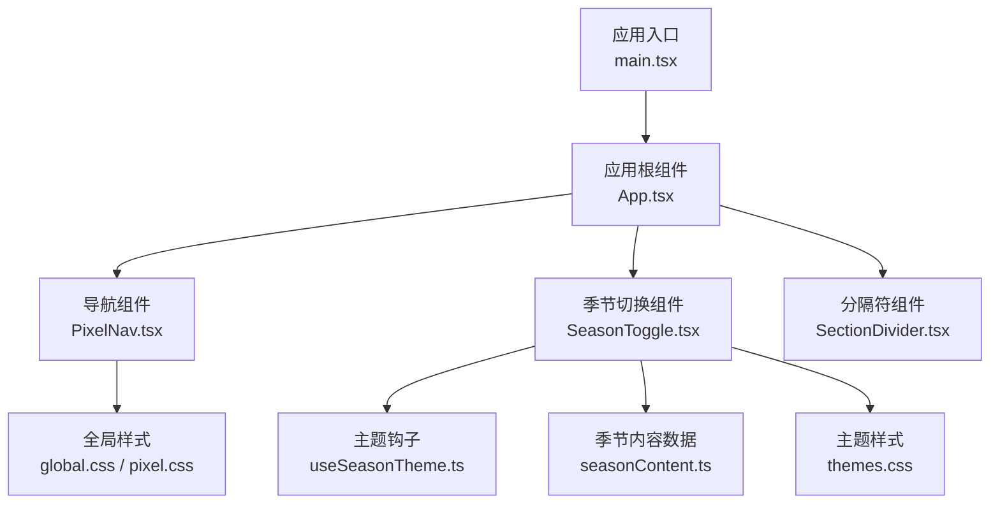
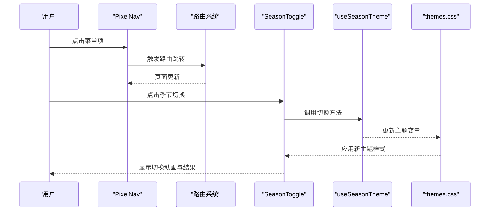
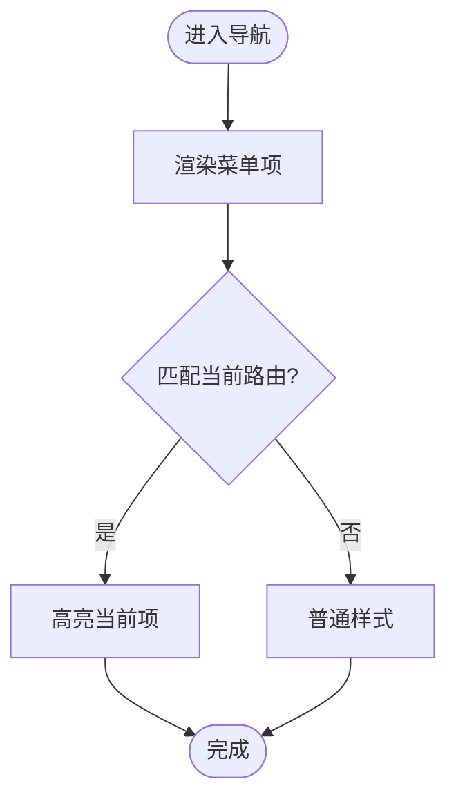
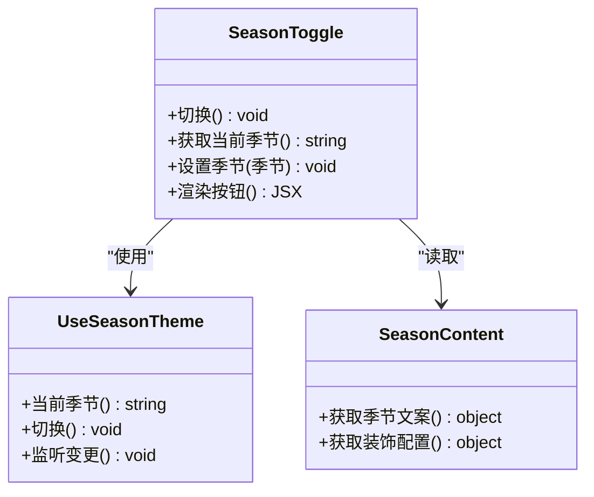
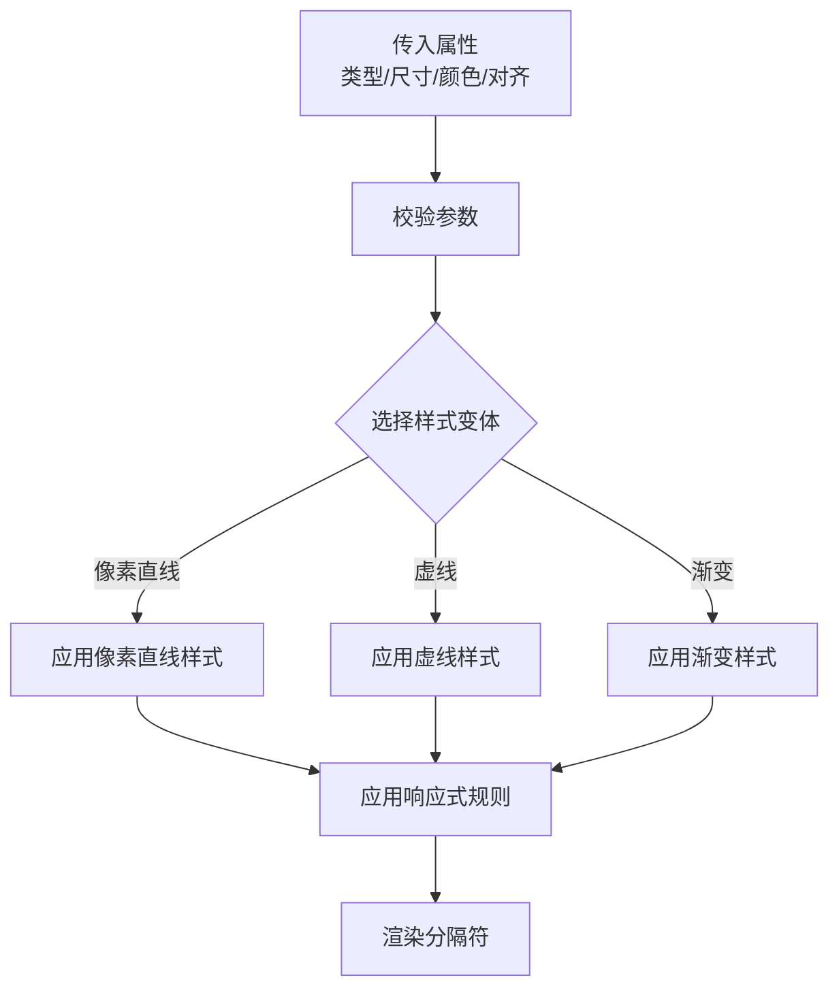
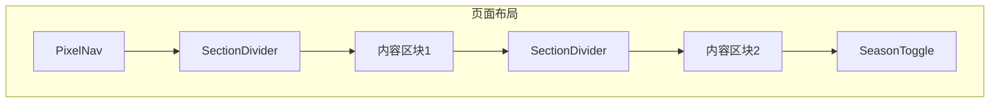
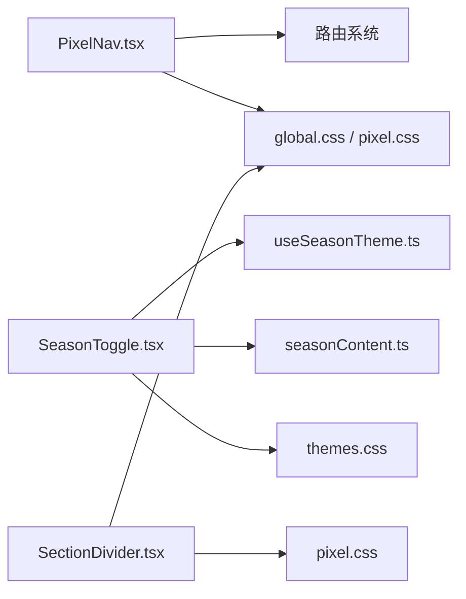

# 布局组件

<cite>
**本文引用的文件**   
- [PixelNav.tsx](file://src/components/PixelNav.tsx)
- [SeasonToggle.tsx](file://src/components/SeasonToggle.tsx)
- [SectionDivider.tsx](file://src/components/SectionDivider.tsx)
- [App.tsx](file://src/App.tsx)
- [main.tsx](file://src/main.tsx)
- [useSeasonTheme.ts](file://src/hooks/useSeasonTheme.ts)
- [seasonContent.ts](file://src/data/seasonContent.ts)
- [themes.css](file://src/styles/themes.css)
- [pixel.css](file://src/styles/pixel.css)
- [global.css](file://src/styles/global.css)
</cite>

## 目录
1. [简介](#简介)
2. [项目结构](#项目结构)
3. [核心组件](#核心组件)
4. [架构总览](#架构总览)
5. [详细组件分析](#详细组件分析)
6. [依赖关系分析](#依赖关系分析)
7. [性能考虑](#性能考虑)
8. [故障排查指南](#故障排查指南)
9. [结论](#结论)
10. [附录](#附录)

## 简介
本章节面向 oo-space 项目的布局组件，重点覆盖以下三类：
- 导航组件 PixelNav：负责顶部导航、路由集成、菜单管理与移动端适配。
- 季节切换组件 SeasonToggle：管理主题状态与切换动画，配合全局主题样式实现视觉切换。
- 分隔符组件 SectionDivider：提供多种样式变体与自定义选项，用于内容区块的视觉分隔。

文档将系统性阐述这些组件的结构设计、响应式适配策略、组合模式与嵌套使用场景，帮助读者快速理解并正确使用。

## 项目结构
布局相关代码主要位于 src/components 下，主题与样式在 src/styles，数据与钩子在 src/data 与 src/hooks。应用入口通过 App.tsx 组织页面与路由，main.tsx 完成初始化挂载。

图表来源
- [main.tsx](file://src/main.tsx)
- [App.tsx](file://src/App.tsx)
- [PixelNav.tsx](file://src/components/PixelNav.tsx)
- [SeasonToggle.tsx](file://src/components/SeasonToggle.tsx)
- [SectionDivider.tsx](file://src/components/SectionDivider.tsx)
- [useSeasonTheme.ts](file://src/hooks/useSeasonTheme.ts)
- [seasonContent.ts](file://src/data/seasonContent.ts)
- [global.css](file://src/styles/global.css)
- [pixel.css](file://src/styles/pixel.css)
- [themes.css](file://src/styles/themes.css)

章节来源
- [main.tsx](file://src/main.tsx)
- [App.tsx](file://src/App.tsx)

## 核心组件
- PixelNav：作为站点导航入口，集成路由跳转、菜单项渲染与移动端折叠交互；支持响应式断点与可访问性优化。
- SeasonToggle：暴露切换按钮与状态控制，驱动主题变量与过渡动画，结合季节内容数据更新界面文案或装饰层。
- SectionDivider：提供多种分割线样式（如像素风格、渐变、虚线等），支持尺寸、颜色、对齐方式等自定义属性。

章节来源
- [PixelNav.tsx](file://src/components/PixelNav.tsx)
- [SeasonToggle.tsx](file://src/components/SeasonToggle.tsx)
- [SectionDivider.tsx](file://src/components/SectionDivider.tsx)

## 架构总览
整体采用“组件 + 钩子 + 样式”的分层模式：
- 组件层：PixelNav、SeasonToggle、SectionDivider 负责 UI 与交互。
- 逻辑层：useSeasonTheme 管理主题状态与切换逻辑；seasonContent 提供季节性文案与配置。
- 样式层：themes.css 定义主题变量，pixel.css 与 global.css 提供基础像素风格与全局规则。

图表来源
- [PixelNav.tsx](file://src/components/PixelNav.tsx)
- [SeasonToggle.tsx](file://src/components/SeasonToggle.tsx)
- [useSeasonTheme.ts](file://src/hooks/useSeasonTheme.ts)
- [themes.css](file://src/styles/themes.css)

## 详细组件分析

### 导航组件 PixelNav
- 结构与职责
  - 渲染导航栏容器、Logo、菜单列表与移动端折叠按钮。
  - 根据当前路由高亮对应菜单项。
  - 处理移动端展开/收起逻辑，确保在小屏设备上的可用性。
- 路由集成
  - 与路由系统对接，点击菜单项时执行跳转，并同步高亮状态。
  - 支持外链与内部路由的统一处理。
- 菜单管理
  - 菜单项通常以数据驱动的方式渲染，便于扩展与维护。
  - 支持分组、图标、提示文本等元信息。
- 移动端适配
  - 基于断点的响应式布局，小屏隐藏主菜单，展示汉堡按钮。
  - 展开面板具备遮罩与滚动锁定，提升交互体验。
- 可访问性
  - 为关键元素添加语义化标签与键盘导航支持。
  - 焦点管理与屏幕阅读器友好。

图表来源
- [PixelNav.tsx](file://src/components/PixelNav.tsx)

章节来源
- [PixelNav.tsx](file://src/components/PixelNav.tsx)

### 季节切换组件 SeasonToggle
- 状态管理
  - 通过 useSeasonTheme 钩子维护当前季节主题与切换状态。
  - 切换时更新主题变量，驱动 CSS 变量与类名变化。
- 动画效果
  - 切换过程中播放过渡动画（如淡入淡出、滑动或粒子效果）。
  - 动画时长与缓动函数可通过配置调整。
- 数据联动
  - 读取 seasonContent 中的季节文案与装饰配置，动态更新界面内容。
- 组合模式
  - 可与装饰层（如 SeasonalDecorLayer）组合，增强季节氛围。
  - 支持与其他主题开关组件并列使用。

图表来源
- [SeasonToggle.tsx](file://src/components/SeasonToggle.tsx)
- [useSeasonTheme.ts](file://src/hooks/useSeasonTheme.ts)
- [seasonContent.ts](file://src/data/seasonContent.ts)

章节来源
- [SeasonToggle.tsx](file://src/components/SeasonToggle.tsx)
- [useSeasonTheme.ts](file://src/hooks/useSeasonTheme.ts)
- [seasonContent.ts](file://src/data/seasonContent.ts)

### 分隔符组件 SectionDivider
- 样式变体
  - 像素风格直线、虚线、渐变线、带图标装饰等。
  - 支持水平与垂直方向。
- 自定义选项
  - 尺寸：高度、长度、间距。
  - 颜色：继承主题色或自定义色值。
  - 对齐：居中、左对齐、右对齐。
- 响应式适配
  - 在不同断点下自动调整尺寸与可见性。
  - 移动端可隐藏或简化为最小分割线。
- 组合使用
  - 与卡片、段落、图片等元素组合，形成清晰的区块边界。
  - 可在长页面中多次重复使用，保持视觉一致性。

图表来源
- [SectionDivider.tsx](file://src/components/SectionDivider.tsx)
- [pixel.css](file://src/styles/pixel.css)
- [global.css](file://src/styles/global.css)

章节来源
- [SectionDivider.tsx](file://src/components/SectionDivider.tsx)
- [pixel.css](file://src/styles/pixel.css)
- [global.css](file://src/styles/global.css)

### 组合模式与嵌套使用场景
- 导航与内容区
  - 将 PixelNav 置于页面顶部，下方按 SectionDivider 划分内容区块，每个区块内放置业务组件。
- 季节主题贯穿
  - 在 App 层级引入 SeasonToggle，使全站跟随季节主题变化；各组件通过主题变量自动适配。
- 嵌套示例
  - 在某个分区内再次使用 SectionDivider 进行子区块划分，形成多级视觉层次。
  - 在移动端，PixelNav 折叠后，SeasonToggle 可移至底部固定位置，保证操作可达性。

[此图为概念性布局示意，不直接映射具体源码文件]

## 依赖关系分析
- 组件间耦合
  - SeasonToggle 依赖 useSeasonTheme 与 seasonContent，与 themes.css 紧密关联。
  - PixelNav 依赖路由系统与全局样式，与 App.tsx 的组织方式相关。
  - SectionDivider 依赖像素与全局样式，强调样式复用。
- 外部依赖
  - 路由库（由 App.tsx 与 main.tsx 初始化）。
  - 样式系统（CSS 变量与像素风格规范）。

图表来源
- [PixelNav.tsx](file://src/components/PixelNav.tsx)
- [SeasonToggle.tsx](file://src/components/SeasonToggle.tsx)
- [SectionDivider.tsx](file://src/components/SectionDivider.tsx)
- [useSeasonTheme.ts](file://src/hooks/useSeasonTheme.ts)
- [seasonContent.ts](file://src/data/seasonContent.ts)
- [themes.css](file://src/styles/themes.css)
- [pixel.css](file://src/styles/pixel.css)
- [global.css](file://src/styles/global.css)

章节来源
- [App.tsx](file://src/App.tsx)
- [main.tsx](file://src/main.tsx)

## 性能考虑
- 减少重绘与回流
  - 主题切换尽量通过 CSS 变量与类名切换，避免频繁修改 DOM 样式。
  - 导航菜单项渲染应使用稳定键值，避免不必要的重新计算。
- 动画优化
  - 使用 GPU 加速的属性（如 transform、opacity）进行过渡。
  - 控制动画时长与复杂度，避免在低端设备上卡顿。
- 资源加载
  - 按需加载季节装饰资源，避免首屏过大。
  - 图片与图标使用懒加载与缓存策略。

[本节为通用指导，不直接分析具体文件]

## 故障排查指南
- 导航无法跳转
  - 检查路由配置是否正确注册，菜单项链接是否有效。
  - 确认移动端折叠状态未阻止点击事件。
- 主题切换无效
  - 验证 useSeasonTheme 的状态更新是否被正确触发。
  - 检查 themes.css 中变量名是否与组件期望一致。
- 分隔符样式异常
  - 确认传入的样式变体名称是否存在。
  - 检查全局样式是否被其他规则覆盖。

章节来源
- [PixelNav.tsx](file://src/components/PixelNav.tsx)
- [SeasonToggle.tsx](file://src/components/SeasonToggle.tsx)
- [SectionDivider.tsx](file://src/components/SectionDivider.tsx)
- [useSeasonTheme.ts](file://src/hooks/useSeasonTheme.ts)
- [themes.css](file://src/styles/themes.css)
- [pixel.css](file://src/styles/pixel.css)
- [global.css](file://src/styles/global.css)

## 结论
PixelNav、SeasonToggle 与 SectionDivider 构成了 oo-space 的核心布局体系：
- PixelNav 提供稳定的导航与路由集成，兼顾移动端体验。
- SeasonToggle 通过主题钩子与样式变量实现无缝切换与动画。
- SectionDivider 以灵活的样式变体满足多场景分隔需求。
三者协同工作，形成清晰、可扩展且响应式的页面结构。

[本节为总结性内容，不直接分析具体文件]

## 附录
- 最佳实践建议
  - 在新增菜单项时，统一在数据源中维护，避免硬编码。
  - 主题变量命名遵循语义化，便于维护与扩展。
  - 分隔符样式应保持与设计系统一致，避免随意定制。
- 常见问题速查
  - 路由跳转失败：核对路由路径与组件注册。
  - 主题不生效：检查变量注入顺序与优先级。
  - 移动端布局错乱：确认断点与媒体查询设置。

[本节为补充说明，不直接分析具体文件]