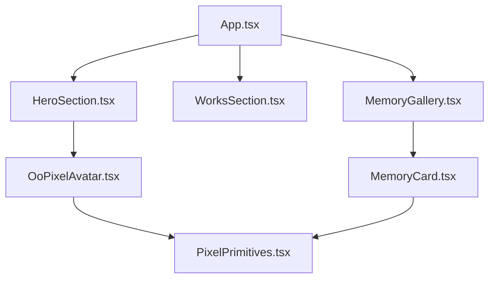
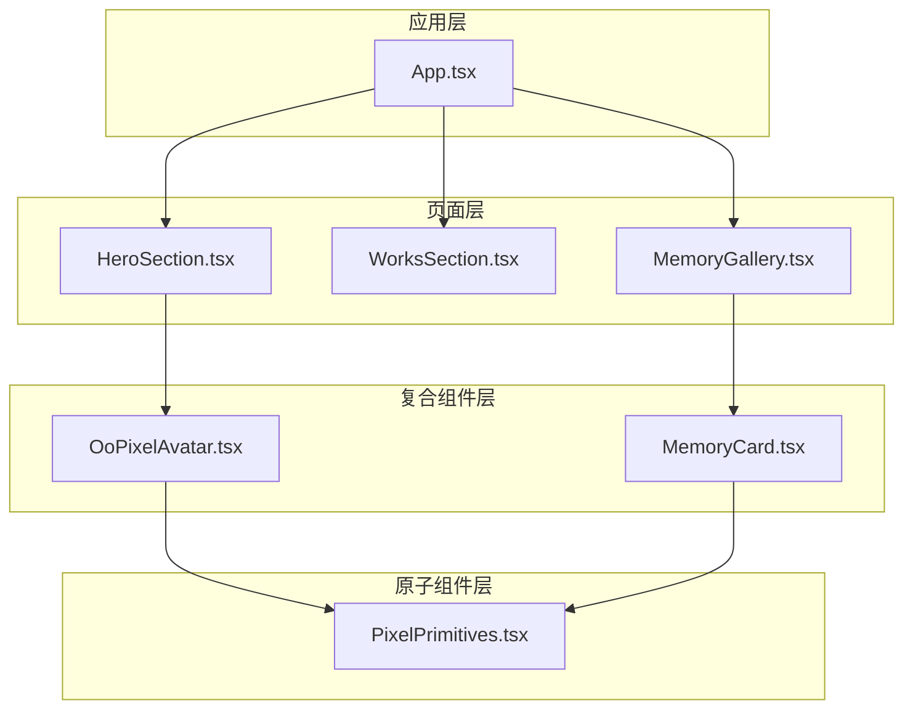
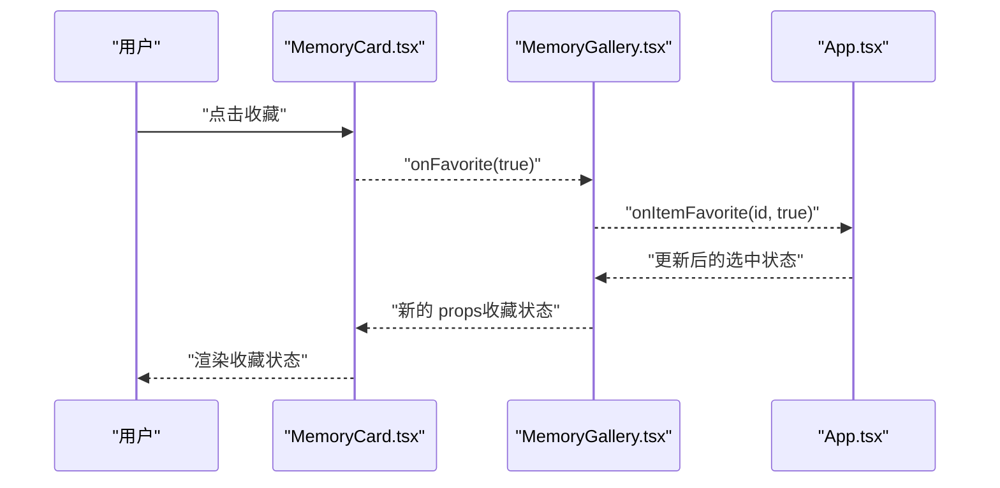
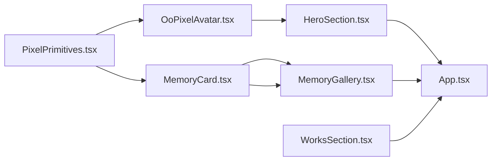

# 组件层次结构

<cite>
**本文引用的文件**   
- [src/components/PixelPrimitives.tsx](file://src/components/PixelPrimitives.tsx)
- [src/components/OoPixelAvatar.tsx](file://src/components/OoPixelAvatar.tsx)
- [src/components/MemoryCard.tsx](file://src/components/MemoryCard.tsx)
- [src/components/HeroSection.tsx](file://src/components/HeroSection.tsx)
- [src/components/WorksSection.tsx](file://src/components/WorksSection.tsx)
- [src/components/MemoryGallery.tsx](file://src/components/MemoryGallery.tsx)
- [src/App.tsx](file://src/App.tsx)
- [src/main.tsx](file://src/main.tsx)
- [package.json](file://package.json)
</cite>

## 目录
1. [简介](#简介)
2. [项目结构](#项目结构)
3. [核心组件](#核心组件)
4. [架构总览](#架构总览)
5. [详细组件分析](#详细组件分析)
6. [依赖关系分析](#依赖关系分析)
7. [性能考量](#性能考量)
8. [故障排查指南](#故障排查指南)
9. [结论](#结论)
10. [附录](#附录)

## 简介
本文件面向 oo-space 项目的组件层次结构，聚焦以下目标：
- 原子组件（PixelPrimitives）的设计原则与复用策略
- 复合组件（OoPixelAvatar、MemoryCard）如何组合基础能力实现复杂功能
- 页面级组件（HeroSection、WorksSection、MemoryGallery）的职责划分与组织方式
- 组件间通信模式：props 传递、事件处理、状态提升
- 组件继承关系图与使用示例
- 可测试性与可维护性设计建议

## 项目结构
- 组件位于 src/components，按职责分为原子、复合与页面级三类
- 数据与主题位于 src/data 与 src/styles，供组件消费
- 应用入口为 src/main.tsx，根组件为 src/App.tsx
- 构建与运行由 package.json 管理



图表来源
- [src/App.tsx](file://src/App.tsx)
- [src/components/HeroSection.tsx](file://src/components/HeroSection.tsx)
- [src/components/WorksSection.tsx](file://src/components/WorksSection.tsx)
- [src/components/MemoryGallery.tsx](file://src/components/MemoryGallery.tsx)
- [src/components/OoPixelAvatar.tsx](file://src/components/OoPixelAvatar.tsx)
- [src/components/MemoryCard.tsx](file://src/components/MemoryCard.tsx)
- [src/components/PixelPrimitives.tsx](file://src/components/PixelPrimitives.tsx)

章节来源
- [package.json](file://package.json)
- [src/main.tsx](file://src/main.tsx)
- [src/App.tsx](file://src/App.tsx)

## 核心组件
本节从“原子—复合—页面”三层视角梳理组件职责与协作方式。

- 原子组件（PixelPrimitives）
  - 职责：提供像素风格的基础绘制单元（如像素块、像素边框、像素图标等），统一视觉语言与尺寸规范
  - 设计原则：无副作用、纯展示、强类型 props、可配置主题色与尺寸、避免业务逻辑
  - 复用策略：通过 props 控制形态与样式；对外暴露最小 API；内部不持有状态

- 复合组件（OoPixelAvatar、MemoryCard）
  - OoPixelAvatar：组合像素头像的骨架、表情、姿态、装饰层，支持主题切换与交互反馈
  - MemoryCard：组合像素卡片容器、标题、内容区、操作按钮，支持展开/折叠、点击事件

- 页面级组件（HeroSection、WorksSection、MemoryGallery）
  - HeroSection：首屏区域，承载品牌信息、主视觉与引导行为
  - WorksSection：作品列表区，聚合多个 WorkCard 或类似条目
  - MemoryGallery：记忆画廊，聚合多个 MemoryCard 并管理布局与交互

章节来源
- [src/components/PixelPrimitives.tsx](file://src/components/PixelPrimitives.tsx)
- [src/components/OoPixelAvatar.tsx](file://src/components/OoPixelAvatar.tsx)
- [src/components/MemoryCard.tsx](file://src/components/MemoryCard.tsx)
- [src/components/HeroSection.tsx](file://src/components/HeroSection.tsx)
- [src/components/WorksSection.tsx](file://src/components/WorksSection.tsx)
- [src/components/MemoryGallery.tsx](file://src/components/MemoryGallery.tsx)

## 架构总览
下图展示了从 App 到各页面组件及底层原子组件的调用关系，体现“自上而下组合、自下而上复用”的分层架构。



图表来源
- [src/App.tsx](file://src/App.tsx)
- [src/components/HeroSection.tsx](file://src/components/HeroSection.tsx)
- [src/components/WorksSection.tsx](file://src/components/WorksSection.tsx)
- [src/components/MemoryGallery.tsx](file://src/components/MemoryGallery.tsx)
- [src/components/OoPixelAvatar.tsx](file://src/components/OoPixelAvatar.tsx)
- [src/components/MemoryCard.tsx](file://src/components/MemoryCard.tsx)
- [src/components/PixelPrimitives.tsx](file://src/components/PixelPrimitives.tsx)

## 详细组件分析

### 原子组件：PixelPrimitives
- 设计原则
  - 单一职责：仅负责像素风格的图形渲染
  - 纯函数式：相同 props 产生相同输出，便于单元测试与快照测试
  - 主题化：通过 props 注入颜色、尺寸、间距等变量
- 复用策略
  - 以“像素块/像素边框/像素图标”等为基础单元，组合成更复杂的 UI
  - 对外暴露稳定接口，内部实现可替换
- 可测试性
  - 基于 props 的输入输出断言
  - 可使用快照测试验证像素渲染一致性
- 可维护性
  - 集中样式与尺寸常量，减少重复
  - 严格 TypeScript 类型定义，降低误用风险

章节来源
- [src/components/PixelPrimitives.tsx](file://src/components/PixelPrimitives.tsx)

### 复合组件：OoPixelAvatar
- 职责
  - 组合像素头像的各部分（头部、身体、表情、装饰）
  - 管理头像的主题切换、姿态切换与交互反馈
- 组合方式
  - 通过 props 传入主题、姿态、表情等配置
  - 内部组合 PixelPrimitives 完成像素绘制
- 通信模式
  - 向下传递 props（主题、姿态、尺寸）
  - 向上抛出事件（如点击、切换姿态）
- 可测试性
  - 模拟不同 props 组合，断言渲染结果
  - 事件冒泡可通过回调参数进行验证

章节来源
- [src/components/OoPixelAvatar.tsx](file://src/components/OoPixelAvatar.tsx)
- [src/components/PixelPrimitives.tsx](file://src/components/PixelPrimitives.tsx)

### 复合组件：MemoryCard
- 职责
  - 展示单条记忆项（标题、摘要、操作按钮）
  - 支持展开/折叠、点击跳转或收藏等操作
- 组合方式
  - 使用 PixelPrimitives 绘制像素边框、分割线、图标等
- 通信模式
  - 接收数据与回调（onToggle、onClick 等）
  - 将用户操作通过回调向父组件上报
- 可测试性
  - 模拟用户交互，断言回调是否被调用
  - 校验不同数据下的渲染差异

章节来源
- [src/components/MemoryCard.tsx](file://src/components/MemoryCard.tsx)
- [src/components/PixelPrimitives.tsx](file://src/components/PixelPrimitives.tsx)

### 页面级组件：HeroSection
- 职责
  - 首屏信息展示与主要行动点
  - 集成 OoPixelAvatar 作为主视觉元素
- 组织方式
  - 接收站点文案、主题配置等 props
  - 通过事件回调与上层 App 交互（如切换主题）
- 可测试性
  - 断言关键文案与主视觉是否存在
  - 模拟点击事件，验证回调触发

章节来源
- [src/components/HeroSection.tsx](file://src/components/HeroSection.tsx)
- [src/components/OoPixelAvatar.tsx](file://src/components/OoPixelAvatar.tsx)

### 页面级组件：WorksSection
- 职责
  - 聚合作品条目，提供列表展示与筛选/排序能力
- 组织方式
  - 接收作品数据与交互回调
  - 内部可组合 WorkCard 等子组件（若存在）
- 可测试性
  - 断言列表渲染数量与顺序
  - 模拟筛选/排序操作，验证数据流

章节来源
- [src/components/WorksSection.tsx](file://src/components/WorksSection.tsx)

### 页面级组件：MemoryGallery
- 职责
  - 聚合多条 MemoryCard，提供网格布局与批量交互
- 组织方式
  - 管理选中状态、批量操作等
  - 通过事件回调与 App 同步状态
- 可测试性
  - 断言卡片数量与布局
  - 模拟选择/取消选择，验证状态变化

章节来源
- [src/components/MemoryGallery.tsx](file://src/components/MemoryGallery.tsx)
- [src/components/MemoryCard.tsx](file://src/components/MemoryCard.tsx)

### 组件通信模式
- Props 传递
  - 父组件通过 props 向子组件传递数据与回调
  - 原子组件仅接受展示型 props，保持无状态
- 事件处理
  - 子组件通过回调函数向父组件上报事件（如 onClick、onChange）
  - 页面级组件可将事件继续上抛至 App
- 状态提升
  - 跨组件共享的状态提升到最近的共同父组件（如 App）
  - 通过 props 与回调维持单向数据流



图表来源
- [src/components/MemoryCard.tsx](file://src/components/MemoryCard.tsx)
- [src/components/MemoryGallery.tsx](file://src/components/MemoryGallery.tsx)
- [src/App.tsx](file://src/App.tsx)

### 组件继承关系图
由于本项目采用 React + TypeScript，组件之间多为组合而非继承。下图以“组合关系”表达实际依赖：

```mermaid
classDiagram
class PixelPrimitives {
"+像素块"
"+像素边框"
"+像素图标"
}
class OoPixelAvatar {
"+主题"
"+姿态"
"+表情"
}
class MemoryCard {
"+标题"
"+摘要"
"+操作"
}
class HeroSection {
"+文案"
"+主视觉"
}
class WorksSection {
"+作品列表"
"+筛选"
}
class MemoryGallery {
"+卡片集合"
"+布局"
}
OoPixelAvatar --> PixelPrimitives : "组合"
MemoryCard --> PixelPrimitives : "组合"
HeroSection --> OoPixelAvatar : "组合"
MemoryGallery --> MemoryCard : "组合"
WorksSection --> "WorkCard*" : "组合"
```

图表来源
- [src/components/PixelPrimitives.tsx](file://src/components/PixelPrimitives.tsx)
- [src/components/OoPixelAvatar.tsx](file://src/components/OoPixelAvatar.tsx)
- [src/components/MemoryCard.tsx](file://src/components/MemoryCard.tsx)
- [src/components/HeroSection.tsx](file://src/components/HeroSection.tsx)
- [src/components/WorksSection.tsx](file://src/components/WorksSection.tsx)
- [src/components/MemoryGallery.tsx](file://src/components/MemoryGallery.tsx)

### 使用示例（路径指引）
- 在页面中引入并使用原子组件
  - 参考：[src/components/PixelPrimitives.tsx](file://src/components/PixelPrimitives.tsx)
- 组合头像组件
  - 参考：[src/components/OoPixelAvatar.tsx](file://src/components/OoPixelAvatar.tsx)
- 展示记忆卡片
  - 参考：[src/components/MemoryCard.tsx](file://src/components/MemoryCard.tsx)
- 搭建首屏区域
  - 参考：[src/components/HeroSection.tsx](file://src/components/HeroSection.tsx)
- 聚合作品列表
  - 参考：[src/components/WorksSection.tsx](file://src/components/WorksSection.tsx)
- 聚合记忆画廊
  - 参考：[src/components/MemoryGallery.tsx](file://src/components/MemoryGallery.tsx)
- 应用入口与挂载
  - 参考：[src/main.tsx](file://src/main.tsx)、[src/App.tsx](file://src/App.tsx)

## 依赖关系分析
- 直接依赖
  - 页面级组件依赖复合组件
  - 复合组件依赖原子组件
- 间接依赖
  - 样式与主题通过全局 CSS 或 tokens 注入
  - 数据通过 props 或 hooks 注入
- 潜在循环依赖
  - 当前分层清晰，未见循环导入迹象
- 外部依赖
  - React、TypeScript、Vite 等由 package.json 管理



图表来源
- [src/components/PixelPrimitives.tsx](file://src/components/PixelPrimitives.tsx)
- [src/components/OoPixelAvatar.tsx](file://src/components/OoPixelAvatar.tsx)
- [src/components/MemoryCard.tsx](file://src/components/MemoryCard.tsx)
- [src/components/HeroSection.tsx](file://src/components/HeroSection.tsx)
- [src/components/WorksSection.tsx](file://src/components/WorksSection.tsx)
- [src/components/MemoryGallery.tsx](file://src/components/MemoryGallery.tsx)
- [src/App.tsx](file://src/App.tsx)

章节来源
- [package.json](file://package.json)

## 性能考量
- 渲染优化
  - 原子组件保持纯展示，避免不必要的重渲染
  - 复合组件对大数据集进行分页或虚拟滚动（如需要）
- 资源加载
  - 图片与动画按需加载，避免首屏阻塞
- 状态管理
  - 尽量将状态提升至最近父组件，减少重复状态
- 样式与主题
  - 使用 CSS 变量与主题 token，减少运行时计算

## 故障排查指南
- 常见问题
  - 组件未渲染：检查 props 是否正确传入与类型匹配
  - 事件未触发：确认回调是否绑定且未被覆盖
  - 主题不一致：检查主题变量与样式覆盖优先级
- 调试建议
  - 使用浏览器开发者工具查看组件树与 props
  - 在关键回调处打印日志，追踪事件流
  - 对原子组件进行快照测试，快速定位渲染回归

## 结论
oo-space 的组件体系遵循“原子—复合—页面”的分层架构，强调组合优于继承、单向数据流与高内聚低耦合。PixelPrimitives 提供统一的像素风格基础能力，OoPixelAvatar 与 MemoryCard 在其之上组合出可复用的业务组件，页面级组件则专注于布局与编排。通过明确的 props 与事件契约，组件具备良好可测试性与可维护性，便于后续扩展与重构。

## 附录
- 术语表
  - 原子组件：不可再分的最小 UI 单元
  - 复合组件：由原子组件组合而成的业务组件
  - 页面级组件：负责页面结构与布局的容器组件
- 最佳实践
  - 为每个组件编写清晰的 props 类型与默认值
  - 将可复用逻辑抽取为 hooks 或工具函数
  - 使用命名约定统一组件导出与引用