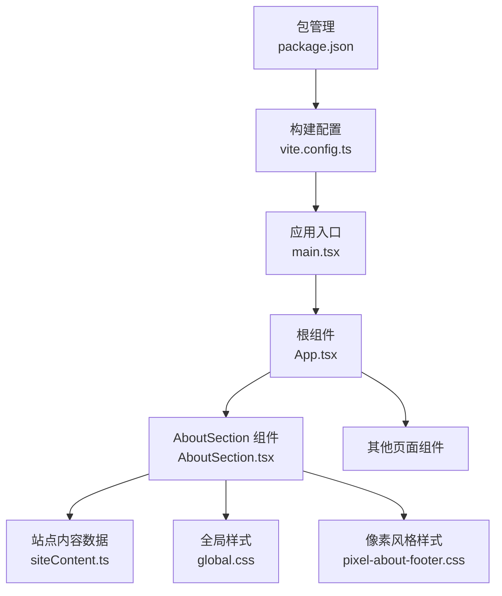
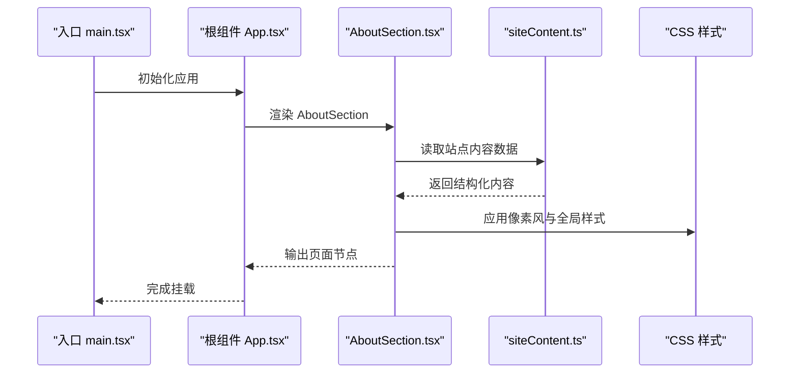
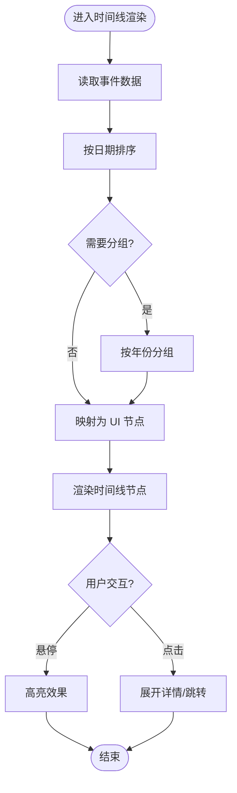
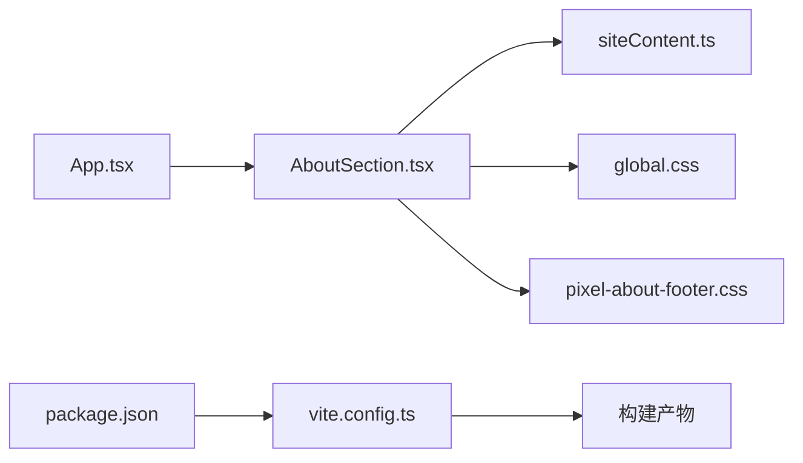

# AboutSection 关于页面

<cite>
**本文档引用的文件**   
- [AboutSection.tsx](file://src/components/AboutSection.tsx)
- [siteContent.ts](file://src/data/siteContent.ts)
- [App.tsx](file://src/App.tsx)
- [main.tsx](file://src/main.tsx)
- [global.css](file://src/styles/global.css)
- [pixel-about-footer.css](file://src/styles/pixel-about-footer.css)
- [package.json](file://package.json)
- [vite.config.ts](file://vite.config.ts)
</cite>

## 目录
1. [简介](#简介)
2. [项目结构](#项目结构)
3. [核心组件](#核心组件)
4. [架构总览](#架构总览)
5. [详细组件分析](#详细组件分析)
6. [依赖关系分析](#依赖关系分析)
7. [性能考量](#性能考量)
8. [故障排查指南](#故障排查指南)
9. [结论](#结论)
10. [附录](#附录)

## 简介
本文件为 AboutSection 关于页面组件的完整技术文档，面向开发者与内容编辑人员。文档围绕以下目标展开：
- 个人介绍内容的组织结构、时间线展示与技能标签系统
- 内容数据的动态加载、版本管理与多语言支持
- 社交链接集成、联系方式展示与互动元素实现
- 内容编辑工作流、SEO 元数据配置与社交媒体分享优化
- 内容更新指南、模板定制与扩展开发示例

## 项目结构
AboutSection 位于 src/components 下，作为独立可复用组件；其内容数据来源于 src/data/siteContent.ts；样式由全局样式与像素风格主题共同驱动；应用入口在 src/App.tsx 中组合各 Section 组件并挂载到 DOM。

图表来源
- [main.tsx:1-50](file://src/main.tsx#L1-L50)
- [App.tsx:1-120](file://src/App.tsx#L1-L120)
- [AboutSection.tsx:1-200](file://src/components/AboutSection.tsx#L1-L200)
- [siteContent.ts:1-200](file://src/data/siteContent.ts#L1-L200)
- [global.css:1-200](file://src/styles/global.css#L1-L200)
- [pixel-about-footer.css:1-200](file://src/styles/pixel-about-footer.css#L1-L200)
- [vite.config.ts:1-120](file://vite.config.ts#L1-L120)
- [package.json:1-120](file://package.json#L1-L120)

章节来源
- [main.tsx:1-50](file://src/main.tsx#L1-L50)
- [App.tsx:1-120](file://src/App.tsx#L1-L120)
- [AboutSection.tsx:1-200](file://src/components/AboutSection.tsx#L1-L200)
- [siteContent.ts:1-200](file://src/data/siteContent.ts#L1-L200)
- [global.css:1-200](file://src/styles/global.css#L1-L200)
- [pixel-about-footer.css:1-200](file://src/styles/pixel-about-footer.css#L1-L200)
- [vite.config.ts:1-120](file://vite.config.ts#L1-L120)
- [package.json:1-120](file://package.json#L1-L120)

## 核心组件
AboutSection 负责渲染“关于我”页面的主体内容，包括：
- 个人简介区块（头像、标题、摘要）
- 时间线（经历、里程碑事件）
- 技能标签（分类、等级或状态）
- 社交链接与联系方式
- 互动元素（如点击反馈、动画触发）

组件职责边界清晰，数据通过 siteContent.ts 提供，样式遵循像素风主题与全局 CSS 变量。

章节来源
- [AboutSection.tsx:1-200](file://src/components/AboutSection.tsx#L1-L200)
- [siteContent.ts:1-200](file://src/data/siteContent.ts#L1-L200)

## 架构总览
本节从数据流与渲染流程角度说明 AboutSection 的工作方式。

图表来源
- [main.tsx:1-50](file://src/main.tsx#L1-L50)
- [App.tsx:1-120](file://src/App.tsx#L1-L120)
- [AboutSection.tsx:1-200](file://src/components/AboutSection.tsx#L1-L200)
- [siteContent.ts:1-200](file://src/data/siteContent.ts#L1-L200)
- [global.css:1-200](file://src/styles/global.css#L1-L200)
- [pixel-about-footer.css:1-200](file://src/styles/pixel-about-footer.css#L1-L200)

## 详细组件分析

### 数据结构与组织
- 个人简介：包含头像、姓名、职位、一句话简介等字段
- 时间线：按年份/月份排序的事件列表，含标题、描述、链接、图片等
- 技能标签：以分类维度组织，每个技能具备名称、图标、熟练度或状态
- 社交链接：平台名称、URL、图标、是否可见等
- 联系方式：邮箱、电话、表单提交地址等

建议的数据模型要点：
- 使用强类型定义，确保字段完整性与一致性
- 时间线事件需支持排序与过滤
- 技能标签支持分组与筛选
- 社交链接与联系方式支持开关控制

章节来源
- [siteContent.ts:1-200](file://src/data/siteContent.ts#L1-L200)

### 时间线展示逻辑
时间线渲染通常遵循以下步骤：
- 获取原始事件数组
- 按日期字段排序（升序或降序）
- 可选：按年份分组或添加分隔符
- 映射为 UI 节点，处理空值与异常数据
- 交互：悬停高亮、点击展开详情、外链跳转

图表来源
- [AboutSection.tsx:1-200](file://src/components/AboutSection.tsx#L1-L200)

章节来源
- [AboutSection.tsx:1-200](file://src/components/AboutSection.tsx#L1-L200)

### 技能标签系统
技能标签模块应支持：
- 分类显示（前端、后端、设计、工具等）
- 熟练度可视化（进度条、星级、徽章）
- 筛选与搜索（按关键词或类别）
- 响应式布局（网格/卡片）

实现要点：
- 将技能数据扁平化与分组并存，便于不同视图切换
- 使用语义化标签与无障碍属性（aria-*）
- 避免过度动画影响性能

章节来源
- [AboutSection.tsx:1-200](file://src/components/AboutSection.tsx#L1-L200)

### 社交链接与联系方式
- 社交链接：统一图标库、外部链接安全策略（rel="noopener noreferrer"）、打开方式（新窗口）
- 联系方式：邮箱加密显示、防爬虫策略、表单校验与提交反馈
- 可访问性：键盘导航、屏幕阅读器友好

章节来源
- [AboutSection.tsx:1-200](file://src/components/AboutSection.tsx#L1-L200)

### 互动元素实现
常见互动包括：
- 滚动触发动画（淡入、滑入）
- 点击反馈（涟漪、缩放）
- 主题切换（明暗模式）
- 彩蛋与隐藏内容

实现建议：
- 使用 IntersectionObserver 减少重排重绘
- 动画尽量使用 transform 与 opacity
- 对复杂交互进行降级处理

章节来源
- [AboutSection.tsx:1-200](file://src/components/AboutSection.tsx#L1-L200)

### 内容数据的动态加载与版本管理
- 动态加载：可通过 API 或静态 JSON 注入，支持缓存与增量更新
- 版本管理：为内容数据增加版本号或时间戳，便于回滚与灰度发布
- 多语言支持：基于键值映射的语言包，运行时切换语言

建议流程：
- 启动时拉取最新内容数据
- 对比本地缓存与远端版本
- 失败时回退至默认内容
- 切换语言时重新渲染相关区域

章节来源
- [siteContent.ts:1-200](file://src/data/siteContent.ts#L1-L200)

### SEO 元数据与社交媒体分享优化
- 基础 SEO：title、description、keywords、canonical
- Open Graph 与 Twitter Card：og:title、og:description、og:image、twitter:card
- 结构化数据：JSON-LD 描述人物与作品
- 预渲染与 SSR：提升首屏与抓取质量

实施要点：
- 在页面头部动态注入 meta 标签
- 图片资源使用绝对 URL 与合适尺寸
- 验证分享预览效果

章节来源
- [AboutSection.tsx:1-200](file://src/components/AboutSection.tsx#L1-L200)

### 内容编辑工作流
- 内容源：推荐 Markdown + YAML Frontmatter 或 JSON 数据文件
- 校验：引入 schema 校验，确保字段完整与格式正确
- 预览：本地开发服务器实时预览
- 发布：CI/CD 自动构建与部署

最佳实践：
- 使用 Git 分支管理内容变更
- 代码审查与自动化测试
- 回滚策略与备份机制

章节来源
- [siteContent.ts:1-200](file://src/data/siteContent.ts#L1-L200)

### 模板定制与扩展开发
- 模板化：将 AboutSection 拆分为子组件（简介、时间线、技能、社交）
- 主题化：通过 CSS 变量与主题文件快速换肤
- 插件化：允许第三方扩展技能标签或时间线事件

扩展示例：
- 新增“项目亮点”区块，复用时间线渲染逻辑
- 接入评论系统或访客留言
- 增加多角色档案切换

章节来源
- [AboutSection.tsx:1-200](file://src/components/AboutSection.tsx#L1-L200)

## 依赖关系分析
AboutSection 的依赖主要包括：
- 数据层：siteContent.ts
- 样式层：global.css、pixel-about-footer.css
- 应用层：App.tsx 组合与路由
- 构建层：vite.config.ts、package.json

图表来源
- [App.tsx:1-120](file://src/App.tsx#L1-L120)
- [AboutSection.tsx:1-200](file://src/components/AboutSection.tsx#L1-L200)
- [siteContent.ts:1-200](file://src/data/siteContent.ts#L1-L200)
- [global.css:1-200](file://src/styles/global.css#L1-L200)
- [pixel-about-footer.css:1-200](file://src/styles/pixel-about-footer.css#L1-L200)
- [vite.config.ts:1-120](file://vite.config.ts#L1-L120)
- [package.json:1-120](file://package.json#L1-L120)

章节来源
- [App.tsx:1-120](file://src/App.tsx#L1-L120)
- [AboutSection.tsx:1-200](file://src/components/AboutSection.tsx#L1-L200)
- [siteContent.ts:1-200](file://src/data/siteContent.ts#L1-L200)
- [global.css:1-200](file://src/styles/global.css#L1-L200)
- [pixel-about-footer.css:1-200](file://src/styles/pixel-about-footer.css#L1-L200)
- [vite.config.ts:1-120](file://vite.config.ts#L1-L120)
- [package.json:1-120](file://package.json#L1-L120)

## 性能考量
- 懒加载：按需加载时间线与技能数据，减少首屏体积
- 虚拟化：长列表使用虚拟滚动
- 图片优化：WebP/AVIF、懒加载、尺寸适配
- 动画优化：使用 GPU 加速属性，避免强制同步布局
- 缓存策略：HTTP 缓存与服务端缓存结合

[本节为通用指导，不直接分析具体文件]

## 故障排查指南
常见问题与解决思路：
- 数据加载失败：检查网络请求、CORS、API 可用性；启用降级数据
- 样式错乱：确认 CSS 变量与主题文件加载顺序；清理浏览器缓存
- 交互无响应：检查事件绑定与作用域；禁用冲突脚本
- SEO 不生效：验证 meta 标签注入时机；使用搜索引擎工具检测

章节来源
- [AboutSection.tsx:1-200](file://src/components/AboutSection.tsx#L1-L200)
- [global.css:1-200](file://src/styles/global.css#L1-L200)
- [pixel-about-footer.css:1-200](file://src/styles/pixel-about-footer.css#L1-L200)

## 结论
AboutSection 组件以清晰的数据结构与模块化设计为基础，配合像素风样式与全局主题，实现了丰富的个人介绍页面能力。通过动态加载、版本管理与多语言支持，能够满足持续迭代与国际化需求。建议在后续开发中强化可访问性、SEO 与性能优化，并完善内容编辑与发布流水线。

[本节为总结性内容，不直接分析具体文件]

## 附录
- 内容更新指南
  - 修改 siteContent.ts 中的对应字段，保持类型一致
  - 使用本地预览验证效果，再进行合并与发布
- 模板定制步骤
  - 拆分子组件，抽取公共样式与逻辑
  - 通过 CSS 变量覆盖主题色与间距
- 扩展开发示例
  - 新增“项目亮点”区块，复用时间线渲染函数
  - 接入第三方评论 SDK，注意隐私与安全策略

[本节为补充信息，不直接分析具体文件]