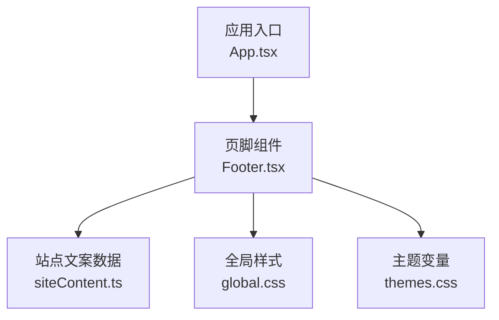
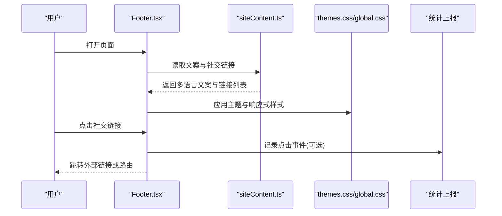
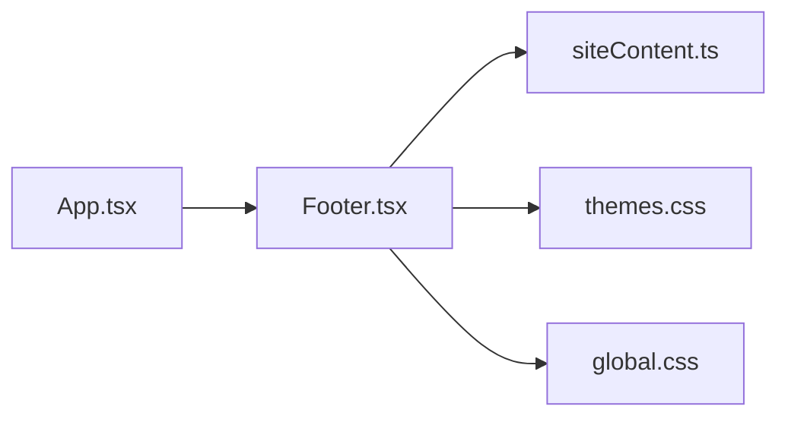

# Footer 页脚组件

<cite>
**本文档引用的文件**   
- [Footer.tsx](file://src/components/Footer.tsx)
- [siteContent.ts](file://src/data/siteContent.ts)
- [global.css](file://src/styles/global.css)
- [themes.css](file://src/styles/themes.css)
- [App.tsx](file://src/App.tsx)
</cite>

## 目录
1. [简介](#简介)
2. [项目结构](#项目结构)
3. [核心组件](#核心组件)
4. [架构总览](#架构总览)
5. [详细组件分析](#详细组件分析)
6. [依赖分析](#依赖分析)
7. [性能考虑](#性能考虑)
8. [故障排查指南](#故障排查指南)
9. [结论](#结论)
10. [附录](#附录)

## 简介
本文件为 Footer 页脚组件的完整技术文档，覆盖布局结构、版权信息展示、社交链接集成、响应式设计、深色模式适配、国际化支持、路由与外链处理、点击统计、自定义内容扩展、样式覆盖与主题配置、多语言内容管理、SEO 优化与可访问性最佳实践。目标是帮助开发者快速理解并高效定制该组件。

## 项目结构
- 组件位置：src/components/Footer.tsx
- 文案数据：src/data/siteContent.ts（用于多语言/站点文案）
- 样式资源：src/styles/global.css、src/styles/themes.css（全局与主题变量）
- 应用入口：src/App.tsx（组件挂载点）

图表来源
- [App.tsx](file://src/App.tsx)
- [Footer.tsx](file://src/components/Footer.tsx)
- [siteContent.ts](file://src/data/siteContent.ts)
- [global.css](file://src/styles/global.css)
- [themes.css](file://src/styles/themes.css)

章节来源
- [Footer.tsx](file://src/components/Footer.tsx)
- [siteContent.ts](file://src/data/siteContent.ts)
- [global.css](file://src/styles/global.css)
- [themes.css](file://src/styles/themes.css)
- [App.tsx](file://src/App.tsx)

## 核心组件
- Footer.tsx：负责页脚的渲染、文案读取、链接渲染、交互统计与主题/响应式行为。
- siteContent.ts：集中管理多语言文案与站点元信息，供 Footer 按需读取。
- global.css / themes.css：提供 CSS 变量、颜色、间距、排版等基础样式与主题切换能力。
- App.tsx：将 Footer 挂载到页面中，确保在应用生命周期内可用。

章节来源
- [Footer.tsx](file://src/components/Footer.tsx)
- [siteContent.ts](file://src/data/siteContent.ts)
- [global.css](file://src/styles/global.css)
- [themes.css](file://src/styles/themes.css)
- [App.tsx](file://src/App.tsx)

## 架构总览
页脚组件采用“数据驱动 + 样式解耦”的设计：
- 数据层：从 siteContent.ts 获取文案与社交链接配置。
- 表现层：通过 CSS 变量与媒体查询实现响应式与深色模式。
- 交互层：对外部链接进行统一处理，并提供点击统计上报接口。

图表来源
- [Footer.tsx](file://src/components/Footer.tsx)
- [siteContent.ts](file://src/data/siteContent.ts)
- [themes.css](file://src/styles/themes.css)
- [global.css](file://src/styles/global.css)

## 详细组件分析

### 布局结构与模块划分
- 顶部区域：品牌标识与简短描述（来自文案数据）。
- 中部区域：社交链接网格/列表，支持图标与文本并列。
- 底部区域：版权信息与法律条款链接。
- 响应式断点：移动端单列、平板双列、桌面端三列或更多，依据 CSS 变量与媒体查询控制。

章节来源
- [Footer.tsx](file://src/components/Footer.tsx)
- [global.css](file://src/styles/global.css)
- [themes.css](file://src/styles/themes.css)

### 版权信息展示
- 动态年份更新：根据当前年份自动填充。
- 多语言文案：从 siteContent.ts 按语言键读取版权文本。
- 可配置项：支持隐藏/显示法律声明、隐私政策等链接。

章节来源
- [Footer.tsx](file://src/components/Footer.tsx)
- [siteContent.ts](file://src/data/siteContent.ts)

### 社交链接集成
- 数据结构：包含名称、URL、图标、是否新窗口打开、无障碍标签等字段。
- 外链处理：统一在新标签页打开，设置 rel="noopener noreferrer" 提升安全性。
- 点击统计：对每个链接点击触发上报回调，便于后续分析。

章节来源
- [Footer.tsx](file://src/components/Footer.tsx)
- [siteContent.ts](file://src/data/siteContent.ts)

### 响应式设计实现
- 使用 CSS 变量控制间距、字号与布局宽度。
- 媒体查询在不同断点下调整网格列数与对齐方式。
- 触摸友好：增大点击区域与间距，提升移动端体验。

章节来源
- [global.css](file://src/styles/global.css)
- [themes.css](file://src/styles/themes.css)

### 深色模式适配
- 通过主题变量切换颜色、背景与边框色。
- 组件内部使用语义化类名，避免硬编码颜色。
- 支持系统偏好与手动切换两种模式。

章节来源
- [themes.css](file://src/styles/themes.css)
- [global.css](file://src/styles/global.css)

### 国际化支持
- 文案集中管理：siteContent.ts 提供多语言键值映射。
- 运行时语言切换：组件根据当前语言选择对应文案。
- 可扩展性：新增语言只需添加键值与翻译。

章节来源
- [siteContent.ts](file://src/data/siteContent.ts)
- [Footer.tsx](file://src/components/Footer.tsx)

### 链接路由管理与外链处理
- 内部路由：若 URL 匹配站内路径，则走前端路由；否则视为外链。
- 外链安全：强制新窗口打开，附加 rel 属性防止反向劫持。
- 可追踪：所有点击均触发统计回调，便于埋点分析。

章节来源
- [Footer.tsx](file://src/components/Footer.tsx)

### 点击统计功能
- 事件捕获：监听链接点击事件。
- 数据上报：调用统计函数，携带链接名称、类型与时间戳。
- 可插拔：支持替换为第三方分析 SDK 或本地日志。

章节来源
- [Footer.tsx](file://src/components/Footer.tsx)

### 自定义内容添加
- 插槽/占位区：预留“额外信息”区域，便于插入公告、二维码或合作信息。
- 配置项：通过 props 或配置文件注入自定义链接与文案。
- 样式隔离：自定义内容使用独立类名，避免污染全局样式。

章节来源
- [Footer.tsx](file://src/components/Footer.tsx)

### 样式覆盖与主题配置
- 使用 CSS 变量覆盖颜色、字体、间距等。
- 通过主题类名切换整体风格。
- 推荐在应用级样式文件中覆盖，避免直接修改组件源码。

章节来源
- [themes.css](file://src/styles/themes.css)
- [global.css](file://src/styles/global.css)

### 多语言内容管理
- 键值规范：统一命名空间，如 footer.copyright、footer.social.*。
- 加载策略：按需加载语言包，减少首屏体积。
- 回退机制：缺失键时回退到默认语言或占位符。

章节来源
- [siteContent.ts](file://src/data/siteContent.ts)
- [Footer.tsx](file://src/components/Footer.tsx)

### SEO 优化建议
- 语义化标签：合理使用 footer、nav、a 等元素。
- 结构化数据：必要时为组织信息添加 JSON-LD。
- 图片与链接：为图标添加 alt 文本，外链标注 rel 属性。

章节来源
- [Footer.tsx](file://src/components/Footer.tsx)

### 可访问性最佳实践
- 键盘导航：确保链接可通过 Tab 聚焦与 Enter 激活。
- 屏幕阅读器：为图标链接提供 aria-label 或标题文本。
- 对比度：保证文字与背景对比度符合 WCAG 标准。

章节来源
- [Footer.tsx](file://src/components/Footer.tsx)

## 依赖分析
- 组件依赖：Footer.tsx 依赖 siteContent.ts 的文案数据与样式变量。
- 样式依赖：themes.css 提供主题变量，global.css 提供基础样式。
- 运行依赖：App.tsx 负责挂载组件，确保 DOM 就绪后渲染。

图表来源
- [App.tsx](file://src/App.tsx)
- [Footer.tsx](file://src/components/Footer.tsx)
- [siteContent.ts](file://src/data/siteContent.ts)
- [themes.css](file://src/styles/themes.css)
- [global.css](file://src/styles/global.css)

章节来源
- [App.tsx](file://src/App.tsx)
- [Footer.tsx](file://src/components/Footer.tsx)
- [siteContent.ts](file://src/data/siteContent.ts)
- [themes.css](file://src/styles/themes.css)
- [global.css](file://src/styles/global.css)

## 性能考虑
- 文案数据懒加载：仅在需要时加载多语言资源。
- 事件委托：对链接点击使用事件委托，减少监听器数量。
- 样式复用：通过 CSS 变量与公共类减少重复样式。
- 图片优化：社交图标使用 SVG 或雪碧图，降低请求次数。

## 故障排查指南
- 文案未显示：检查 siteContent.ts 中的键是否存在且语言正确。
- 外链未打开：确认 rel 属性与新窗口逻辑是否正确。
- 深色模式异常：验证主题变量是否被覆盖或未生效。
- 点击无统计：检查统计回调是否注册与上报通道是否正常。

章节来源
- [Footer.tsx](file://src/components/Footer.tsx)
- [siteContent.ts](file://src/data/siteContent.ts)
- [themes.css](file://src/styles/themes.css)

## 结论
Footer 组件以数据驱动与样式解耦为核心，结合响应式与深色模式、国际化与可访问性设计，提供了稳定、可扩展且易于定制的页脚解决方案。通过统一的链接处理与点击统计，既保证了用户体验，也便于后续数据分析与运营优化。

## 附录
- 常用配置项说明：
  - 文案键：footer.copyright、footer.social.*
  - 主题变量：颜色、间距、字体族
  - 外链开关：是否新窗口打开、rel 属性
  - 统计回调：上报函数签名与参数