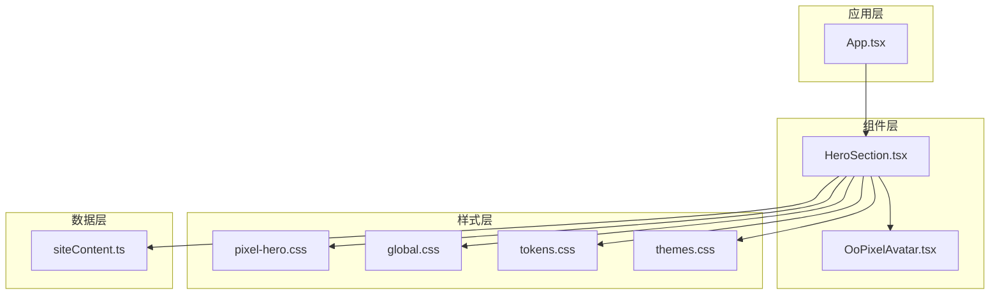
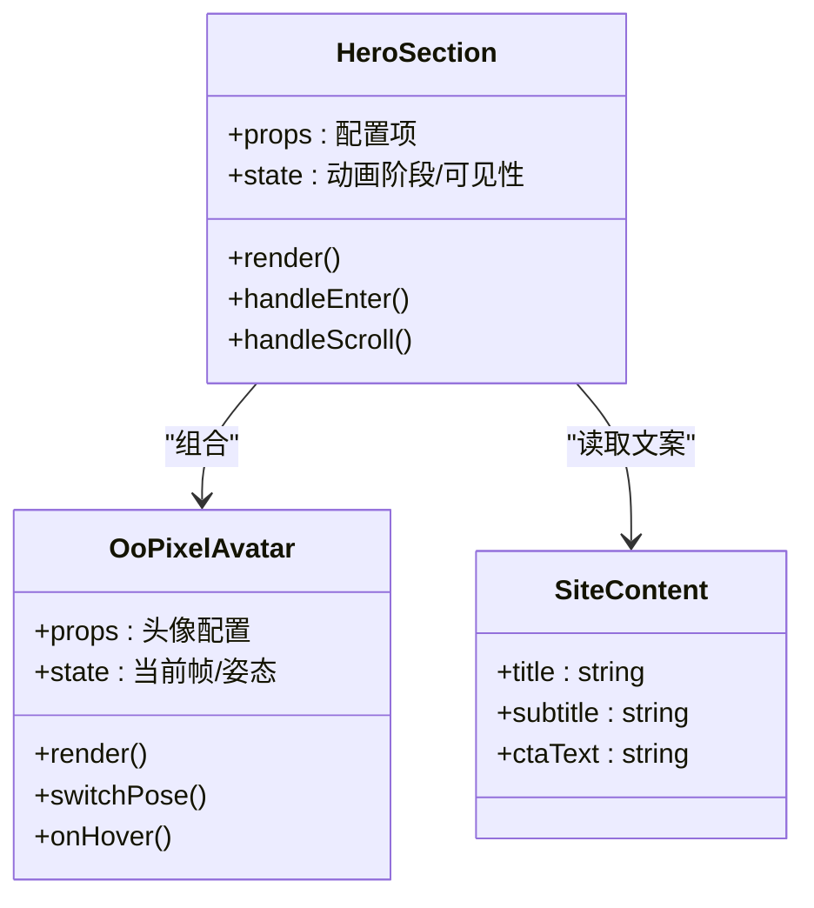
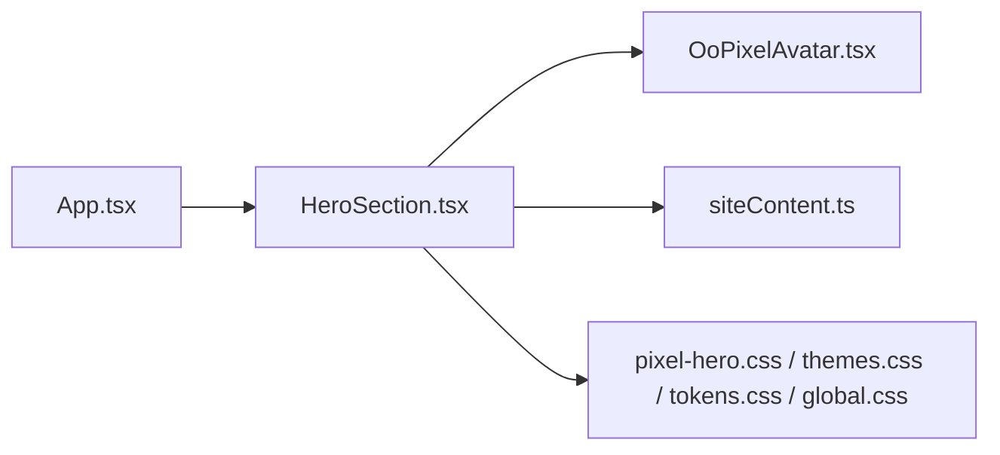

# HeroSection 首屏组件

<cite>
**本文引用的文件**   
- [HeroSection.tsx](file://src/components/HeroSection.tsx)
- [OoPixelAvatar.tsx](file://src/components/OoPixelAvatar.tsx)
- [pixel-hero.css](file://src/styles/pixel-hero.css)
- [themes.css](file://src/styles/themes.css)
- [tokens.css](file://src/styles/tokens.css)
- [global.css](file://src/styles/global.css)
- [siteContent.ts](file://src/data/siteContent.ts)
- [App.tsx](file://src/App.tsx)
</cite>

## 目录
1. [简介](#简介)
2. [项目结构](#项目结构)
3. [核心组件](#核心组件)
4. [架构总览](#架构总览)
5. [详细组件分析](#详细组件分析)
6. [依赖分析](#依赖分析)
7. [性能考虑](#性能考虑)
8. [故障排查指南](#故障排查指南)
9. [结论](#结论)
10. [附录](#附录)

## 简介
本文件为 HeroSection 首屏展示组件的完整技术文档，面向前端开发者与内容运营人员。文档覆盖视觉设计、动画效果、交互逻辑、像素风格头像展示、标题动画与背景特效的实现细节；并给出状态管理、性能优化策略、响应式适配方案、自定义配置选项、主题支持与扩展指南。同时提供实际使用模式与与其他页面组件的集成方式说明。

## 项目结构
HeroSection 位于 src/components 下，样式集中在 src/styles 中，文本与文案数据由 src/data 提供，整体通过 App.tsx 挂载到应用入口。

图表来源
- [App.tsx](file://src/App.tsx)
- [HeroSection.tsx](file://src/components/HeroSection.tsx)
- [OoPixelAvatar.tsx](file://src/components/OoPixelAvatar.tsx)
- [pixel-hero.css](file://src/styles/pixel-hero.css)
- [global.css](file://src/styles/global.css)
- [tokens.css](file://src/styles/tokens.css)
- [themes.css](file://src/styles/themes.css)
- [siteContent.ts](file://src/data/siteContent.ts)

章节来源
- [App.tsx](file://src/App.tsx)
- [HeroSection.tsx](file://src/components/HeroSection.tsx)
- [OoPixelAvatar.tsx](file://src/components/OoPixelAvatar.tsx)
- [pixel-hero.css](file://src/styles/pixel-hero.css)
- [themes.css](file://src/styles/themes.css)
- [tokens.css](file://src/styles/tokens.css)
- [global.css](file://src/styles/global.css)
- [siteContent.ts](file://src/data/siteContent.ts)

## 核心组件
- HeroSection：首屏容器，负责布局、文案渲染、背景特效与入场动画控制，以及与 OoPixelAvatar 的组合。
- OoPixelAvatar：像素风格头像组件，支持多帧/姿态切换、缩放与微动效。
- 样式系统：基于 tokens 与 themes 的变量体系，配合 pixel-hero.css 实现像素风与首屏专属样式。
- 数据源：siteContent.ts 提供标题、副标题、按钮文案等可配置内容。

章节来源
- [HeroSection.tsx](file://src/components/HeroSection.tsx)
- [OoPixelAvatar.tsx](file://src/components/OoPixelAvatar.tsx)
- [pixel-hero.css](file://src/styles/pixel-hero.css)
- [themes.css](file://src/styles/themes.css)
- [tokens.css](file://src/styles/tokens.css)
- [siteContent.ts](file://src/data/siteContent.ts)

## 架构总览
HeroSection 采用“组件 + 样式变量 + 数据驱动”的轻量架构：
- 组件层：HeroSection 组合 OoPixelAvatar，统一处理首屏布局与动画时序。
- 样式层：通过 CSS 变量（tokens）与主题（themes）实现明暗/季节主题切换，像素网格与描边由 pixel-hero.css 定义。
- 数据层：从 siteContent.ts 读取文案，便于内容与代码解耦。

图表来源
- [HeroSection.tsx](file://src/components/HeroSection.tsx)
- [OoPixelAvatar.tsx](file://src/components/OoPixelAvatar.tsx)
- [siteContent.ts](file://src/data/siteContent.ts)

## 详细组件分析

### HeroSection 组件
- 职责
  - 首屏布局与层级：标题、副标题、CTA 按钮、像素头像与背景特效层。
  - 动画控制：入场淡入、标题逐字/行动画、头像弹跳或缩放、背景粒子/光晕过渡。
  - 交互逻辑：滚动监听触发二次动画、鼠标悬停反馈、点击 CTA 跳转。
  - 主题与响应式：根据 CSS 变量切换主题，按断点调整排版与间距。
- 关键实现要点
  - 使用 CSS 变量驱动颜色、字号、间距与像素描边宽度。
  - 通过类名切换控制动画阶段（如进入、进行中、完成）。
  - 将 siteContent.ts 中的文案注入到标题与按钮中，保持内容可配置。
  - 与 OoPixelAvatar 协作，传递头像尺寸、姿态映射与动画参数。
- 性能优化
  - 动画优先使用 transform 与 opacity，避免重排。
  - 对背景特效进行节流/去抖与按需启用（低性能设备降级）。
  - 图片资源懒加载与预加载策略结合。
- 响应式适配
  - 小屏优先：单列布局，头像放大居中，标题字号自适应。
  - 大屏增强：左右分栏，背景特效展开，增加视差与粒子密度。

章节来源
- [HeroSection.tsx](file://src/components/HeroSection.tsx)
- [pixel-hero.css](file://src/styles/pixel-hero.css)
- [themes.css](file://src/styles/themes.css)
- [tokens.css](file://src/styles/tokens.css)
- [siteContent.ts](file://src/data/siteContent.ts)

### OoPixelAvatar 像素头像
- 职责
  - 渲染像素风格头像，支持多帧/姿态切换与微动效（呼吸、摇摆、缩放）。
  - 对外暴露切换姿态、播放帧序列、悬停反馈等方法。
- 关键实现要点
  - 姿态映射：依据 poseMap 或内部映射表选择对应帧集。
  - 动画循环：requestAnimationFrame 或 CSS 动画驱动帧切换。
  - 性能：使用 sprite sheet 或预缓存帧，减少绘制抖动。
- 交互与可访问性
  - 键盘可达：Tab 聚焦，Enter/Space 触发切换。
  - 语义化标签：aria-label 描述当前姿态或动作。

章节来源
- [OoPixelAvatar.tsx](file://src/components/OoPixelAvatar.tsx)
- [siteContent.ts](file://src/data/siteContent.ts)

### 样式系统与主题
- 变量体系
  - tokens.css：定义基础色板、字号阶梯、间距、像素描边宽度、阴影与圆角。
  - themes.css：在 tokens 基础上定义明/暗或季节主题变量，供组件消费。
  - global.css：全局重置、字体与基础动画缓动函数。
- 首屏样式
  - pixel-hero.css：首屏布局、标题排版、头像占位、背景特效层与动画关键帧。
- 主题切换
  - 通过根节点切换 data-theme 或类名，CSS 变量自动生效，无需重新渲染。

章节来源
- [tokens.css](file://src/styles/tokens.css)
- [themes.css](file://src/styles/themes.css)
- [global.css](file://src/styles/global.css)
- [pixel-hero.css](file://src/styles/pixel-hero.css)

### 数据与文案
- siteContent.ts 提供标题、副标题、CTA 文案等，便于非技术人员维护。
- HeroSection 在初始化时读取并注入到 DOM，确保内容与样式分离。

章节来源
- [siteContent.ts](file://src/data/siteContent.ts)

## 依赖分析
- 组件内聚
  - HeroSection 仅依赖 OoPixelAvatar 与站点文案数据，耦合度低。
- 外部依赖
  - 样式依赖 CSS 变量与动画关键帧，无运行时 JS 库强依赖。
- 可能的循环依赖
  - 组件间单向依赖，未见循环引用。

图表来源
- [App.tsx](file://src/App.tsx)
- [HeroSection.tsx](file://src/components/HeroSection.tsx)
- [OoPixelAvatar.tsx](file://src/components/OoPixelAvatar.tsx)
- [siteContent.ts](file://src/data/siteContent.ts)
- [pixel-hero.css](file://src/styles/pixel-hero.css)
- [themes.css](file://src/styles/themes.css)
- [tokens.css](file://src/styles/tokens.css)
- [global.css](file://src/styles/global.css)

## 性能考虑
- 渲染与动画
  - 使用 transform/opacity 动画，避免 layout thrashing。
  - 首屏关键路径最小化：延迟非关键脚本，预加载必要图片。
- 资源优化
  - 像素头像使用 sprite sheet 或压缩 PNG/WebP，按需加载。
  - 背景特效在低端设备上降级为静态图或简化粒子。
- 事件与监听
  - 滚动与鼠标事件使用节流/防抖，降低主线程压力。
- 内存与生命周期
  - 组件卸载时清理定时器与事件监听，防止泄漏。

[本节为通用指导，不直接分析具体文件]

## 故障排查指南
- 头像不显示或闪烁
  - 检查图片路径与格式，确认 sprite sheet 切片尺寸正确。
  - 查看控制台是否有跨域或加载失败错误。
- 动画卡顿
  - 关闭复杂背景特效，观察是否改善。
  - 检查是否存在频繁重排操作（如修改 width/height/top/left）。
- 主题无效
  - 确认根节点已设置正确的 data-theme 或类名。
  - 检查 CSS 变量是否被覆盖或未正确继承。
- 文案未更新
  - 确认 siteContent.ts 导出键名与 HeroSection 读取一致。
  - 检查构建产物是否包含最新数据文件。

章节来源
- [pixel-hero.css](file://src/styles/pixel-hero.css)
- [themes.css](file://src/styles/themes.css)
- [siteContent.ts](file://src/data/siteContent.ts)

## 结论
HeroSection 以简洁的组件结构与清晰的样式变量体系，实现了像素风格的视觉表现与流畅的首屏动画。通过数据驱动的文案与主题切换，兼顾了可维护性与扩展性。建议在生产环境开启资源懒加载与特效降级，以获得更稳定的性能体验。

[本节为总结性内容，不直接分析具体文件]

## 附录

### 自定义配置选项
- 文案配置（siteContent.ts）
  - title：主标题
  - subtitle：副标题
  - ctaText：主按钮文案
- 主题配置（themes.css）
  - 定义明/暗或季节主题的变量集合，通过根节点切换生效。
- 头像配置（OoPixelAvatar）
  - 尺寸、姿态映射、动画速度、悬停反馈强度。

章节来源
- [siteContent.ts](file://src/data/siteContent.ts)
- [themes.css](file://src/styles/themes.css)
- [OoPixelAvatar.tsx](file://src/components/OoPixelAvatar.tsx)

### 主题支持与扩展指南
- 新增主题
  - 在 themes.css 中添加新主题变量集，并在根节点切换 data-theme。
- 扩展像素风格
  - 在 pixel-hero.css 中新增像素描边、网格与阴影变量，配合 tokens.css 统一管理。
- 扩展头像姿态
  - 在 OoPixelAvatar 中追加姿态映射与帧序列，确保资源路径正确。

章节来源
- [themes.css](file://src/styles/themes.css)
- [pixel-hero.css](file://src/styles/pixel-hero.css)
- [tokens.css](file://src/styles/tokens.css)
- [OoPixelAvatar.tsx](file://src/components/OoPixelAvatar.tsx)

### 使用模式与集成示例
- 在 App.tsx 中引入并渲染 HeroSection，确保站点数据与主题变量可用。
- 典型用法
  - 传入文案对象至 HeroSection，使其渲染标题与 CTA。
  - 配置 OoPixelAvatar 的尺寸与姿态，实现像素头像展示。
  - 通过 CSS 变量切换主题，实现明暗/季节主题一键切换。

章节来源
- [App.tsx](file://src/App.tsx)
- [HeroSection.tsx](file://src/components/HeroSection.tsx)
- [OoPixelAvatar.tsx](file://src/components/OoPixelAvatar.tsx)
- [siteContent.ts](file://src/data/siteContent.ts)
- [themes.css](file://src/styles/themes.css)