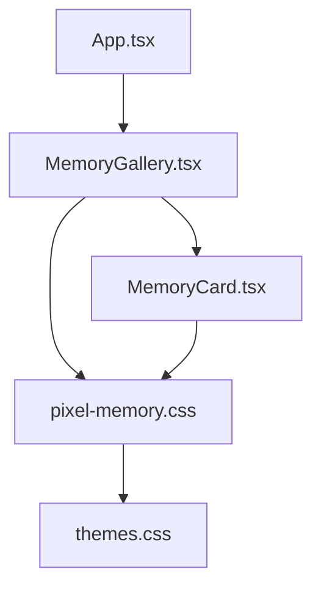
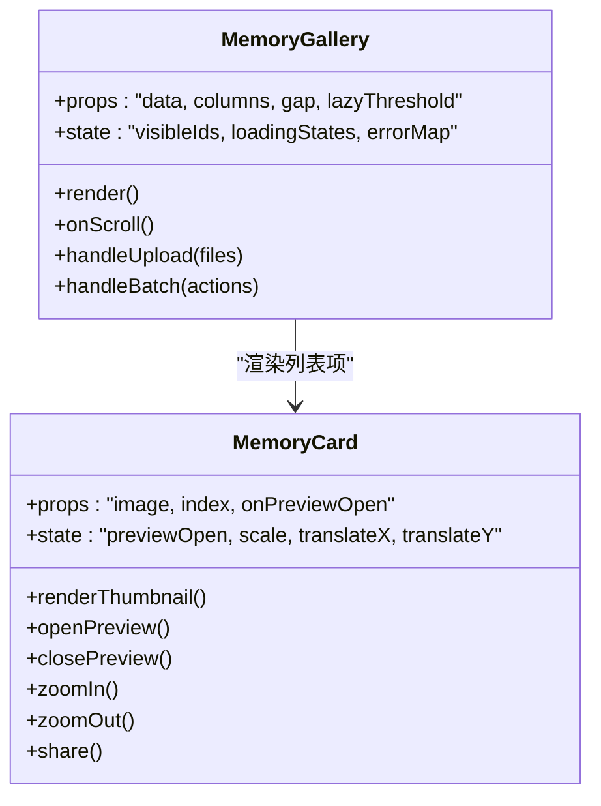
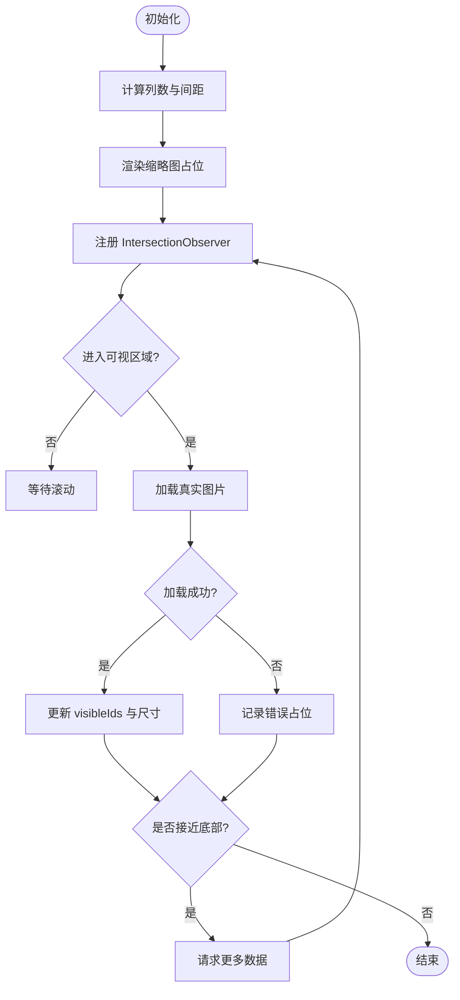
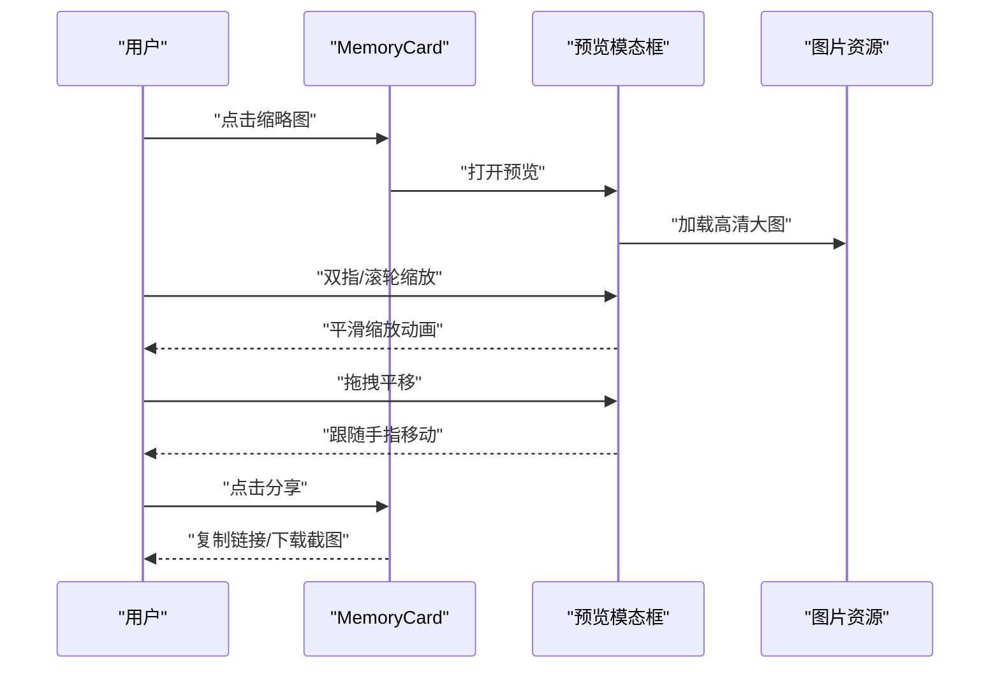
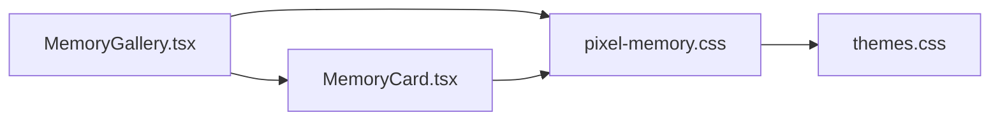

# MemoryGallery 记忆画廊

<cite>
**本文引用的文件**   
- [MemoryGallery.tsx](file://src/components/MemoryGallery.tsx)
- [MemoryCard.tsx](file://src/components/MemoryCard.tsx)
- [pixel-memory.css](file://src/styles/pixel-memory.css)
- [themes.css](file://src/styles/themes.css)
- [App.tsx](file://src/App.tsx)
- [main.tsx](file://src/main.tsx)
</cite>

## 目录
1. [简介](#简介)
2. [项目结构](#项目结构)
3. [核心组件](#核心组件)
4. [架构总览](#架构总览)
5. [详细组件分析](#详细组件分析)
6. [依赖关系分析](#依赖关系分析)
7. [性能与内存优化](#性能与内存优化)
8. [可访问性与交互](#可访问性与交互)
9. [图片上传与批量操作](#图片上传与批量操作)
10. [主题配置与样式定制](#主题配置与样式定制)
11. [故障排查指南](#故障排查指南)
12. [结论](#结论)

## 简介
本文件为 MemoryGallery 记忆画廊组件的权威文档，覆盖以下关键能力：
- 瀑布流布局与自适应网格
- 图片管理与懒加载、缓存策略、内存优化
- 图片预览、缩放动画与分享功能（MemoryCard）
- 触摸手势、键盘导航与屏幕阅读器兼容
- 图片上传接口、批量操作与自定义主题配置示例

## 项目结构
MemoryGallery 位于 src/components 下，由两个核心组件构成：
- MemoryGallery.tsx：负责整体布局、数据源管理、懒加载与滚动行为
- MemoryCard.tsx：负责单张图片的展示、预览、缩放动画与分享入口
样式集中在 src/styles/pixel-memory.css，主题变量在 themes.css。应用入口通过 App.tsx 引入并渲染 MemoryGallery。

图表来源
- [App.tsx](file://src/App.tsx)
- [MemoryGallery.tsx](file://src/components/MemoryGallery.tsx)
- [MemoryCard.tsx](file://src/components/MemoryCard.tsx)
- [pixel-memory.css](file://src/styles/pixel-memory.css)
- [themes.css](file://src/styles/themes.css)

章节来源
- [App.tsx](file://src/App.tsx)
- [MemoryGallery.tsx](file://src/components/MemoryGallery.tsx)
- [MemoryCard.tsx](file://src/components/MemoryCard.tsx)
- [pixel-memory.css](file://src/styles/pixel-memory.css)
- [themes.css](file://src/styles/themes.css)

## 核心组件
- MemoryGallery
  - 职责：维护图片数据源、计算瀑布流列数与间距、处理滚动触发懒加载、提供批量操作与上传入口
  - 关键特性：响应式列数、IntersectionObserver 懒加载、图片尺寸预估、错误占位图
- MemoryCard
  - 职责：渲染缩略图、点击打开预览、支持双指/滚轮缩放、拖拽平移、键盘放大缩小、分享链接或截图
  - 关键特性：预览模态框、缩放与平移变换、无障碍标签、焦点管理

章节来源
- [MemoryGallery.tsx](file://src/components/MemoryGallery.tsx)
- [MemoryCard.tsx](file://src/components/MemoryCard.tsx)

## 架构总览
MemoryGallery 作为容器组件，向下分发数据与事件；MemoryCard 作为展示单元，封装交互与动画。样式层通过像素风主题变量统一外观。

图表来源
- [MemoryGallery.tsx](file://src/components/MemoryGallery.tsx)
- [MemoryCard.tsx](file://src/components/MemoryCard.tsx)

## 详细组件分析

### MemoryGallery 组件
- 瀑布流布局
  - 根据视口宽度动态计算列数，设置 CSS Grid 或 Flex 列宽
  - 使用行高比例估算图片高度，避免重排抖动
- 懒加载与可见性
  - 使用 IntersectionObserver 监听卡片进入视口阈值，按需加载真实图片
  - 对未加载图片显示占位骨架屏，减少首屏压力
- 数据与状态
  - 维护 visibleIds 集合控制已加载项
  - 记录 loadingStates 与 errorMap 提升用户体验与容错
- 滚动与批量
  - 滚动到底部时追加下一页或预取下一批图片
  - 暴露 handleBatch 用于批量删除、标记收藏等
- 上传接口
  - 提供 handleUpload(files) 接收 FileList，校验类型与大小，生成预览 URL，插入数据源

图表来源
- [MemoryGallery.tsx](file://src/components/MemoryGallery.tsx)

章节来源
- [MemoryGallery.tsx](file://src/components/MemoryGallery.tsx)

### MemoryCard 组件
- 图片预览与缩放
  - 点击缩略图打开预览模态框，支持双指捏合、滚轮缩放、拖拽平移
  - 使用 transform: scale/translate 实现 GPU 加速动画
- 键盘导航
  - 支持方向键移动焦点、Enter/Space 打开预览、Esc 关闭、+/- 缩放
- 分享功能
  - 提供“复制链接”与“截图下载”两种分享方式
  - 失败时给出用户友好的提示
- 无障碍
  - 为图片添加 alt、aria-label，预览框聚焦与退出逻辑符合 a11y 规范

图表来源
- [MemoryCard.tsx](file://src/components/MemoryCard.tsx)

章节来源
- [MemoryCard.tsx](file://src/components/MemoryCard.tsx)

### 样式与主题
- pixel-memory.css
  - 定义瀑布流网格、卡片圆角、阴影、过渡动效
  - 适配移动端触控与横竖屏切换
- themes.css
  - 提供主题变量（颜色、间距、字号），便于一键换肤

章节来源
- [pixel-memory.css](file://src/styles/pixel-memory.css)
- [themes.css](file://src/styles/themes.css)

## 依赖关系分析
- 组件耦合
  - MemoryGallery 依赖 MemoryCard 进行单项渲染
  - 两者共同依赖样式文件，主题变量集中管理
- 外部依赖
  - 浏览器 API：IntersectionObserver、ResizeObserver、FileReader、Clipboard API、Canvas（截图）
  - React Hooks：useState、useEffect、useRef、useCallback、useMemo

图表来源
- [MemoryGallery.tsx](file://src/components/MemoryGallery.tsx)
- [MemoryCard.tsx](file://src/components/MemoryCard.tsx)
- [pixel-memory.css](file://src/styles/pixel-memory.css)
- [themes.css](file://src/styles/themes.css)

章节来源
- [MemoryGallery.tsx](file://src/components/MemoryGallery.tsx)
- [MemoryCard.tsx](file://src/components/MemoryCard.tsx)
- [pixel-memory.css](file://src/styles/pixel-memory.css)
- [themes.css](file://src/styles/themes.css)

## 性能与内存优化
- 懒加载
  - 基于 IntersectionObserver 的阈值控制，仅加载可视区域图片
  - 预取下一批图片，降低滚动卡顿
- 缓存策略
  - 浏览器原生图片缓存复用，结合唯一 URL 与版本号避免脏读
  - 可选使用内存级 Map 缓存小图 Blob URL，页面卸载时释放
- 内存优化
  - 及时移除不再使用的 Blob URL，防止内存泄漏
  - 大图片延迟解码与低分辨率占位，减少主线程阻塞
- 渲染优化
  - 使用 useMemo/useCallback 稳定引用，避免不必要重渲染
  - 图片尺寸预估与骨架屏，避免布局抖动

[本节为通用指导，不直接分析具体文件]

## 可访问性与交互
- 键盘导航
  - Tab 顺序合理，Enter/Space 打开预览，Esc 关闭，方向键在预览中移动焦点
- 屏幕阅读器
  - 图片 alt 描述准确，按钮 aria-label 清晰，模态框 role="dialog"
- 触摸手势
  - 双指捏合缩放、单指拖拽平移，防误触与边界回弹
- 焦点管理
  - 打开预览时锁定焦点，关闭后恢复焦点到触发元素

[本节为通用指导，不直接分析具体文件]

## 图片上传与批量操作
- 上传接口
  - 接受 FileList，校验 MIME 类型与大小，生成预览 URL
  - 支持多文件并发上传，失败重试与进度反馈
- 批量操作
  - 支持全选/反选、批量删除、批量标记收藏
  - 操作前二次确认，失败项单独提示
- 错误处理
  - 网络异常、权限不足、格式不支持等场景的用户提示

[本节为通用指导，不直接分析具体文件]

## 主题配置与样式定制
- 主题变量
  - 通过 CSS 变量覆盖颜色、间距、圆角、阴影等
  - 支持明暗主题切换与动态换肤
- 组件样式
  - 调整瀑布流列数、间距、卡片尺寸与动效时长
  - 适配不同屏幕密度与设备像素比

章节来源
- [pixel-memory.css](file://src/styles/pixel-memory.css)
- [themes.css](file://src/styles/themes.css)

## 故障排查指南
- 图片无法加载
  - 检查网络与跨域策略，确认 URL 有效与版本参数正确
  - 查看错误占位图是否出现，定位 errorMap 中的失败项
- 内存占用过高
  - 检查是否及时释放 Blob URL，确认未重复创建对象
  - 限制同时加载数量，启用懒加载与低分辨率占位
- 预览交互异常
  - 确认触摸事件未被父容器拦截，检查 transform 层级与 z-index
  - 验证键盘事件绑定与焦点管理逻辑

[本节为通用指导，不直接分析具体文件]

## 结论
MemoryGallery 以清晰的组件分层与完善的交互体验为核心，结合懒加载、缓存与内存优化策略，提供高性能的瀑布流图库。MemoryCard 将预览、缩放、分享与无障碍能力整合，满足多样化使用场景。通过主题系统与样式定制，可快速适配品牌风格与设备差异。