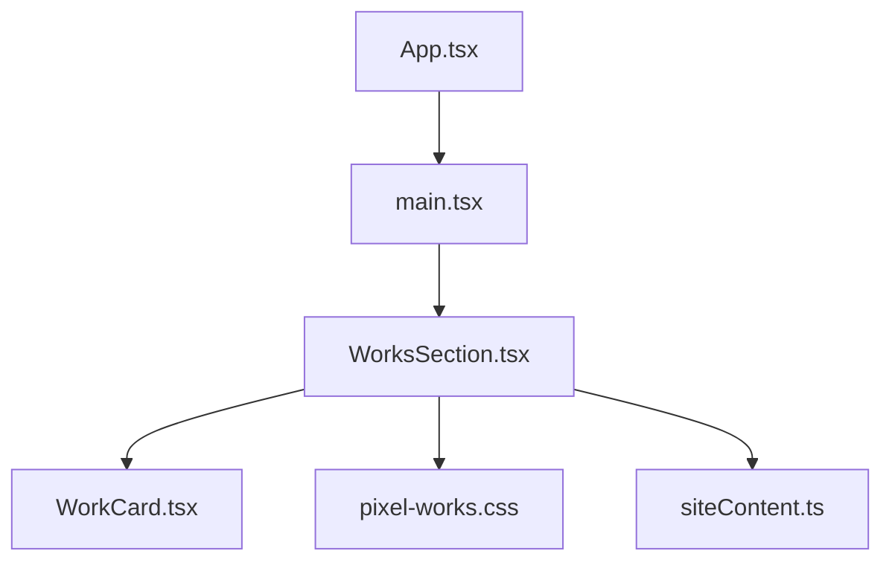
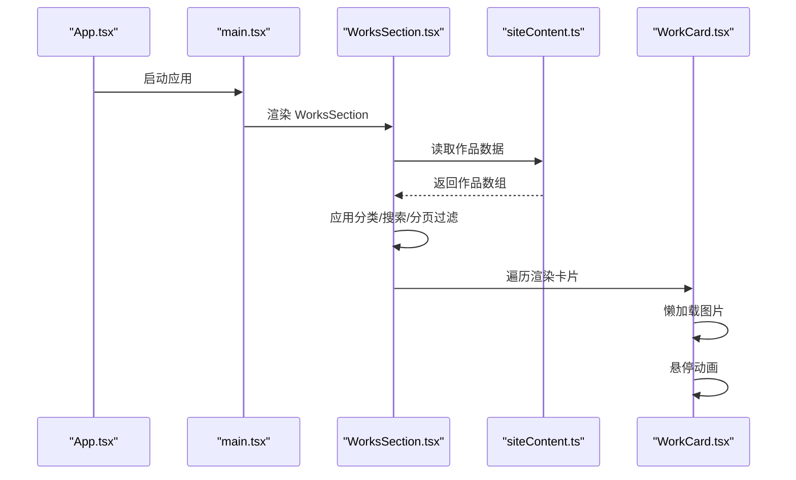
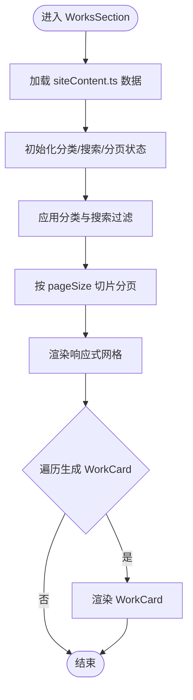
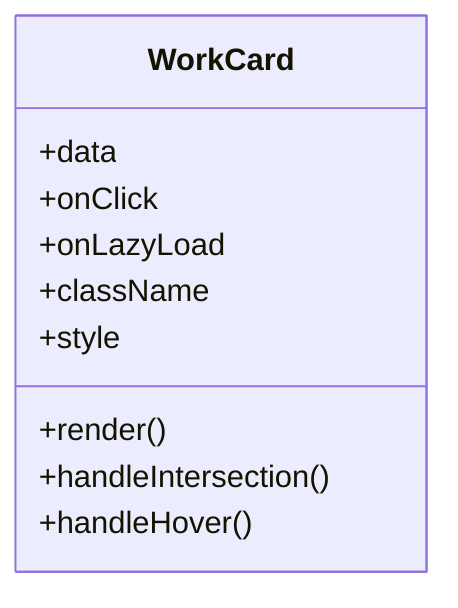
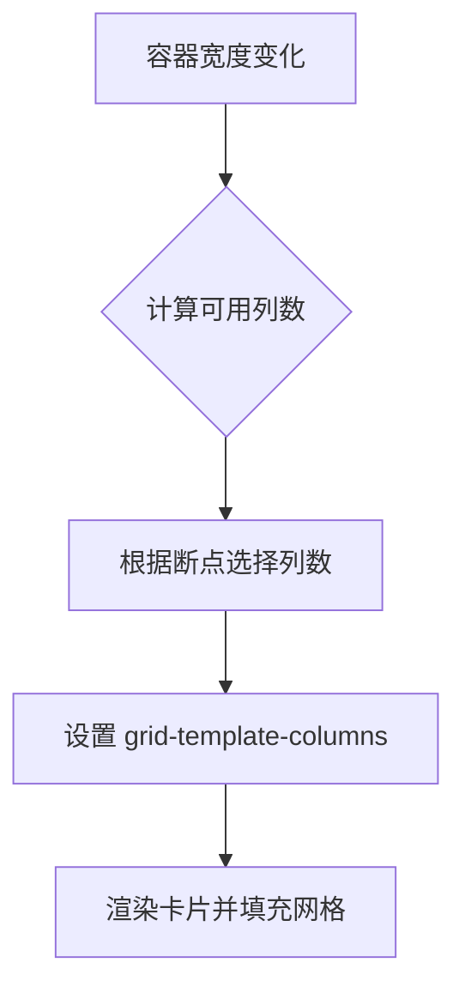
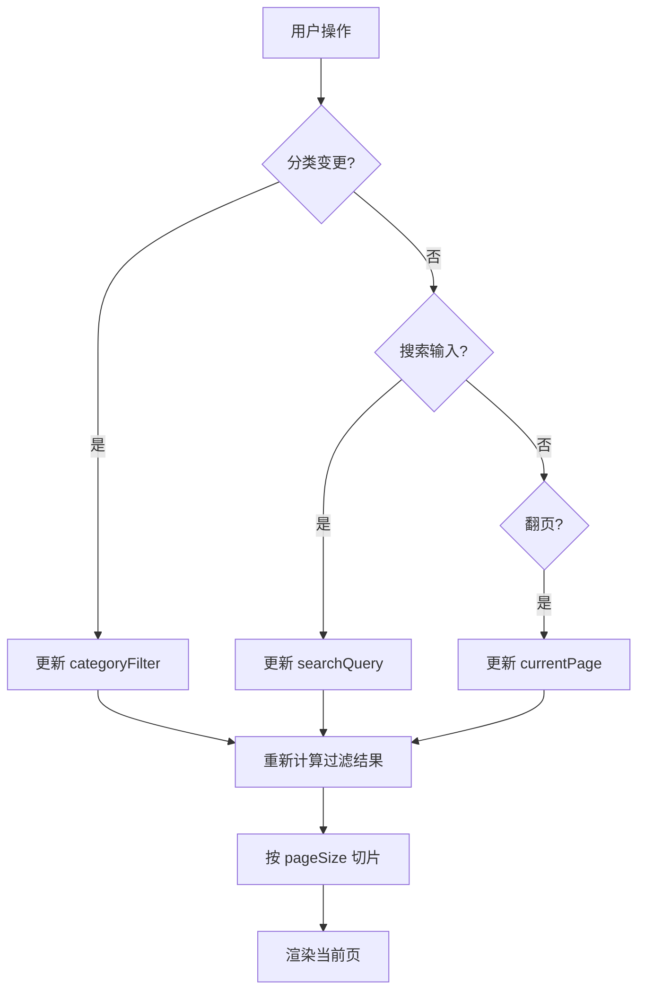
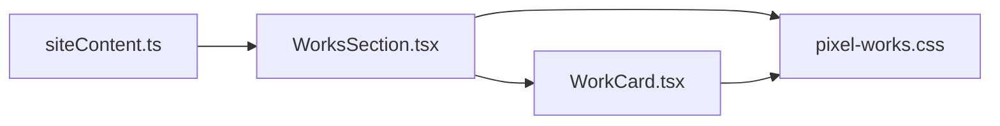

# WorksSection 作品展示区

<cite>
**本文引用的文件**   
- [WorksSection.tsx](file://src/components/WorksSection.tsx)
- [WorkCard.tsx](file://src/components/WorkCard.tsx)
- [pixel-works.css](file://src/styles/pixel-works.css)
- [siteContent.ts](file://src/data/siteContent.ts)
- [App.tsx](file://src/App.tsx)
- [main.tsx](file://src/main.tsx)
</cite>

## 目录
1. [简介](#简介)
2. [项目结构](#项目结构)
3. [核心组件](#核心组件)
4. [架构总览](#架构总览)
5. [详细组件分析](#详细组件分析)
6. [依赖关系分析](#依赖关系分析)
7. [性能考量](#性能考量)
8. [故障排查指南](#故障排查指南)
9. [结论](#结论)
10. [附录](#附录) 

## 简介
本文件为“作品展示区”（WorksSection）组件的完整技术文档，覆盖以下主题：
- 作品卡片的数据结构与渲染流程
- 布局算法与响应式网格实现
- 分类筛选、搜索与分页逻辑
- WorkCard 子组件的属性配置、图片懒加载与悬停动画
- SEO 优化与可访问性支持
- 数据绑定示例、样式覆盖方法与性能优化建议

该组件用于在站点中集中展示作品集，提供按类别筛选、关键词搜索、分页浏览等能力，并以响应式网格适配不同屏幕尺寸。

## 项目结构
与作品展示区相关的代码主要分布在以下位置：
- 组件层：src/components/WorksSection.tsx、src/components/WorkCard.tsx
- 样式层：src/styles/pixel-works.css
- 数据层：src/data/siteContent.ts（站点内容/作品数据源）
- 应用入口：src/App.tsx、src/main.tsx（组件挂载与初始化）

图表来源 
- [App.tsx](file://src/App.tsx)
- [main.tsx](file://src/main.tsx)
- [WorksSection.tsx](file://src/components/WorksSection.tsx)
- [WorkCard.tsx](file://src/components/WorkCard.tsx)
- [pixel-works.css](file://src/styles/pixel-works.css)
- [siteContent.ts](file://src/data/siteContent.ts)

章节来源
- [WorksSection.tsx](file://src/components/WorksSection.tsx)
- [WorkCard.tsx](file://src/components/WorkCard.tsx)
- [pixel-works.css](file://src/styles/pixel-works.css)
- [siteContent.ts](file://src/data/siteContent.ts)
- [App.tsx](file://src/App.tsx)
- [main.tsx](file://src/main.tsx)

## 核心组件
- WorksSection：负责作品列表的聚合、筛选、搜索、分页与网格布局；向下分发数据给 WorkCard。
- WorkCard：单个作品卡片的展示单元，包含封面图、标题、摘要、标签、链接等，并处理图片懒加载与悬停动效。

章节来源
- [WorksSection.tsx](file://src/components/WorksSection.tsx)
- [WorkCard.tsx](file://src/components/WorkCard.tsx)

## 架构总览
整体交互流程如下：
- 应用启动后，App 或 main 将 WorksSection 挂载到页面。
- WorksSection 从 siteContent.ts 获取作品数据，维护本地状态（当前分类、搜索词、页码）。
- 根据筛选条件计算可见数据集，并按分页规则切片。
- 使用 CSS Grid 构建响应式网格，每个单元格渲染一个 WorkCard。
- WorkCard 按需懒加载图片，并在鼠标悬停时触发动画效果。

图表来源 
- [App.tsx](file://src/App.tsx)
- [main.tsx](file://src/main.tsx)
- [WorksSection.tsx](file://src/components/WorksSection.tsx)
- [WorkCard.tsx](file://src/components/WorkCard.tsx)
- [siteContent.ts](file://src/data/siteContent.ts)

## 详细组件分析

### 数据结构定义（作品项）
- 字段建议（以实际实现为准）：
  - id：唯一标识
  - title：标题
  - description：描述/摘要
  - coverUrl：封面图 URL
  - category：分类（如插画、设计、摄影等）
  - tags：标签数组
  - link：外链或详情页路由
  - createdAt/updatedAt：时间戳（可选）
- 数据来源：
  - 静态数据：siteContent.ts 导出作品数组
  - 动态数据：可扩展为 API 接口（后续演进）

章节来源
- [siteContent.ts](file://src/data/siteContent.ts)

### WorksSection 组件
职责与功能：
- 数据接入：从 siteContent.ts 导入作品数据
- 状态管理：
  - 当前分类（categoryFilter）
  - 搜索关键词（searchQuery）
  - 当前页码（currentPage）
  - 每页条数（pageSize）
- 过滤与排序：
  - 按分类过滤
  - 按关键词匹配标题/描述/标签
  - 可选：按时间倒序
- 分页：
  - 基于过滤后的结果进行切片
  - 提供上一页/下一页与页码指示
- 布局：
  - 使用 CSS Grid 实现响应式网格
  - 通过媒体查询调整列数与间距
- 可访问性：
  - 为筛选控件提供 aria-label
  - 为卡片添加语义化标签与键盘导航支持
- SEO：
  - 为封面图设置 alt 文本
  - 为标题使用合适的 heading 层级
  - 为外链提供 target="_blank" rel="noopener noreferrer"

图表来源 
- [WorksSection.tsx](file://src/components/WorksSection.tsx)
- [siteContent.ts](file://src/data/siteContent.ts)

章节来源
- [WorksSection.tsx](file://src/components/WorksSection.tsx)
- [pixel-works.css](file://src/styles/pixel-works.css)

### WorkCard 子组件
属性配置（建议）：
- data：作品对象（见数据结构）
- onClick：点击回调（打开详情或外链）
- onLazyLoad：图片加载完成回调（可选）
- className：自定义类名（便于样式覆盖）
- style：内联样式（可选）

图片懒加载：
- 使用 IntersectionObserver 监听可视区域
- 仅在进入视口时加载真实 src，避免首屏阻塞
- 占位图与加载态过渡，提升感知性能

悬停动画：
- 使用 CSS transform/transition 实现缩放、阴影、位移等效果
- 控制动画时长与缓动函数，保证流畅度
- 在移动端禁用或降级复杂动画以提升体验

图表来源 
- [WorkCard.tsx](file://src/components/WorkCard.tsx)

章节来源
- [WorkCard.tsx](file://src/components/WorkCard.tsx)
- [pixel-works.css](file://src/styles/pixel-works.css)

### 布局算法与响应式网格
- 基础网格：CSS Grid 容器，auto-fill/auto-fit 配合 minmax 实现自适应列数
- 断点策略：
  - 小屏：单列或双列
  - 中屏：三列
  - 大屏：四列及以上
- 间距与对齐：统一 gap、padding、border-radius
- 图片比例：固定宽高比容器，防止重排抖动

图表来源 
- [pixel-works.css](file://src/styles/pixel-works.css)

章节来源
- [pixel-works.css](file://src/styles/pixel-works.css)

### 分类筛选、搜索与分页逻辑
- 分类筛选：
  - 下拉或按钮组切换 categoryFilter
  - 过滤数据：item.category === filter
- 搜索：
  - 输入框实时监听 searchQuery
  - 匹配规则：title/description/tags 包含关键词（忽略大小写）
- 分页：
  - pageSize 默认值（如 12）
  - 计算 start/end 索引，slice 得到当前页数据
  - 边界检查：首页/末页禁用或提示

图表来源 
- [WorksSection.tsx](file://src/components/WorksSection.tsx)

章节来源
- [WorksSection.tsx](file://src/components/WorksSection.tsx)

### SEO 优化与可访问性
- SEO：
  - 封面图 alt 描述准确
  - 标题层级合理（h2/h3）
  - 外链 rel="noopener noreferrer"
  - 结构化数据（可选）：JSON-LD 标记作品集合
- 可访问性：
  - 筛选控件 aria-label
  - 卡片 focusable 与键盘事件支持
  - 对比度与字体大小满足无障碍标准

章节来源
- [WorksSection.tsx](file://src/components/WorksSection.tsx)
- [WorkCard.tsx](file://src/components/WorkCard.tsx)

### 数据绑定示例
- 数据源：从 siteContent.ts 导入作品数组
- 绑定方式：
  - 将数据映射为 WorksSection 的 props/state
  - 工作流：数据 -> 过滤 -> 分页 -> 渲染
- 扩展：
  - 替换为 API 调用，增加 loading/error 状态
  - 缓存策略：localStorage 或内存缓存

章节来源
- [siteContent.ts](file://src/data/siteContent.ts)
- [WorksSection.tsx](file://src/components/WorksSection.tsx)

### 自定义样式覆盖
- 覆盖网格列数与间距：修改 pixel-works.css 中的断点与 grid 变量
- 覆盖卡片样式：通过 className 注入自定义样式
- 主题色与动效：在 CSS 变量或主题文件中调整颜色、阴影、过渡时长

章节来源
- [pixel-works.css](file://src/styles/pixel-works.css)
- [WorkCard.tsx](file://src/components/WorkCard.tsx)

### 性能优化建议
- 图片懒加载：IntersectionObserver 延迟加载非可视图片
- 虚拟滚动：当数据量较大时，仅渲染可视区域卡片
- 防抖搜索：对搜索输入进行防抖，减少频繁过滤
- 分页预取：提前加载下一页数据至缓存
- 资源压缩：图片 WebP/AVIF，启用 HTTP 缓存与 CDN
- 动画降级：移动端降低动画复杂度或关闭

章节来源
- [WorkCard.tsx](file://src/components/WorkCard.tsx)
- [WorksSection.tsx](file://src/components/WorksSection.tsx)

## 依赖关系分析
- WorksSection 依赖：
  - siteContent.ts：作品数据
  - pixel-works.css：样式与布局
  - React Hooks：useState/useEffect/useMemo/useCallback（具体实现以源码为准）
- WorkCard 依赖：
  - IntersectionObserver：懒加载
  - CSS 过渡：悬停动画

图表来源 
- [siteContent.ts](file://src/data/siteContent.ts)
- [WorksSection.tsx](file://src/components/WorksSection.tsx)
- [WorkCard.tsx](file://src/components/WorkCard.tsx)
- [pixel-works.css](file://src/styles/pixel-works.css)

章节来源
- [WorksSection.tsx](file://src/components/WorksSection.tsx)
- [WorkCard.tsx](file://src/components/WorkCard.tsx)
- [siteContent.ts](file://src/data/siteContent.ts)
- [pixel-works.css](file://src/styles/pixel-works.css)

## 性能考量
- 首屏渲染：
  - 限制初始渲染数量（分页）
  - 图片懒加载避免阻塞
- 交互性能：
  - 搜索防抖
  - 动画使用 GPU 加速（transform/opacity）
- 内存占用：
  - 及时清理 IntersectionObserver 监听
  - 避免不必要的状态更新

[本节为通用指导，不直接分析具体文件]

## 故障排查指南
- 图片未加载：
  - 检查懒加载 observer 是否被销毁
  - 确认图片路径与跨域策略
- 筛选无效：
  - 检查分类字段名称与大小写
  - 确认过滤逻辑与数据一致性
- 搜索无结果：
  - 检查关键词匹配规则（大小写、空格、特殊字符）
  - 确认搜索字段范围（标题/描述/标签）
- 分页异常：
  - 校验 pageSize 与数据长度
  - 检查边界条件（首页/末页）
- 样式错乱：
  - 检查 CSS 变量与断点
  - 确认自定义样式优先级

章节来源
- [WorksSection.tsx](file://src/components/WorksSection.tsx)
- [WorkCard.tsx](file://src/components/WorkCard.tsx)
- [pixel-works.css](file://src/styles/pixel-works.css)

## 结论
WorksSection 与 WorkCard 共同构建了高效、可访问且易于定制的作品展示模块。通过清晰的数据流、响应式网格与懒加载机制，能够在多端设备上提供流畅的浏览体验。结合 SEO 与可访问性最佳实践，可进一步提升站点的可发现性与包容性。

[本节为总结性内容，不直接分析具体文件]

## 附录
- 扩展方向：
  - 引入后端 API 与缓存层
  - 增加收藏/分享功能
  - 支持更多筛选维度（标签、时间范围）
- 参考文件：
  - 组件与样式：WorksSection.tsx、WorkCard.tsx、pixel-works.css
  - 数据源：siteContent.ts
  - 应用入口：App.tsx、main.tsx

[本节为补充信息，不直接分析具体文件]