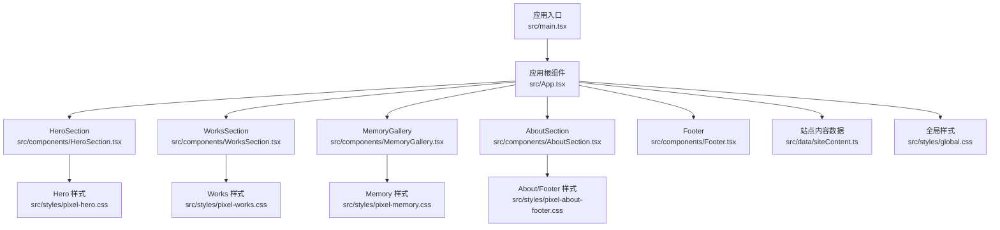
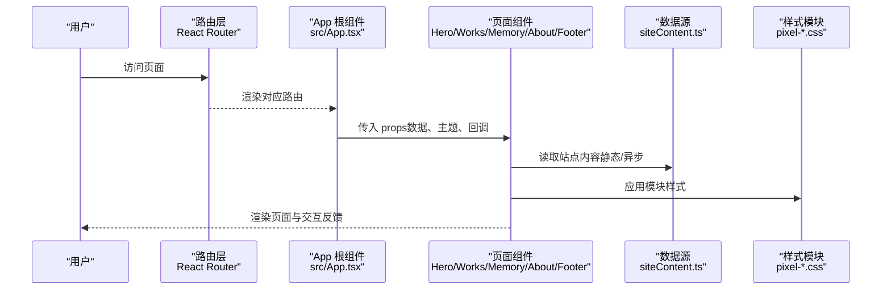
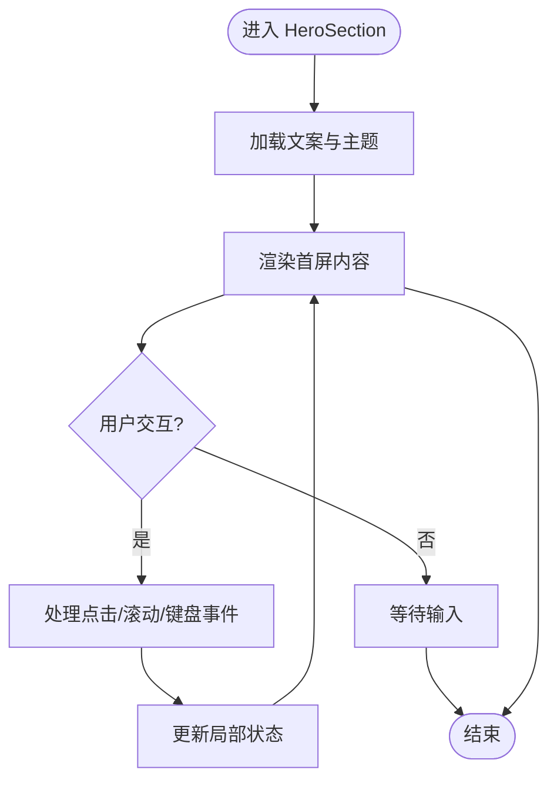
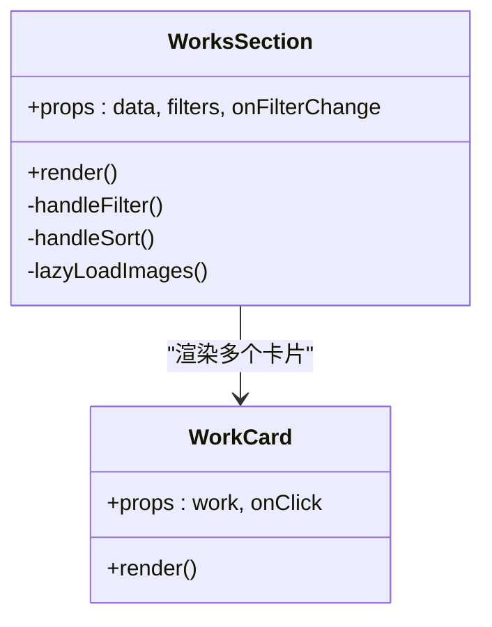
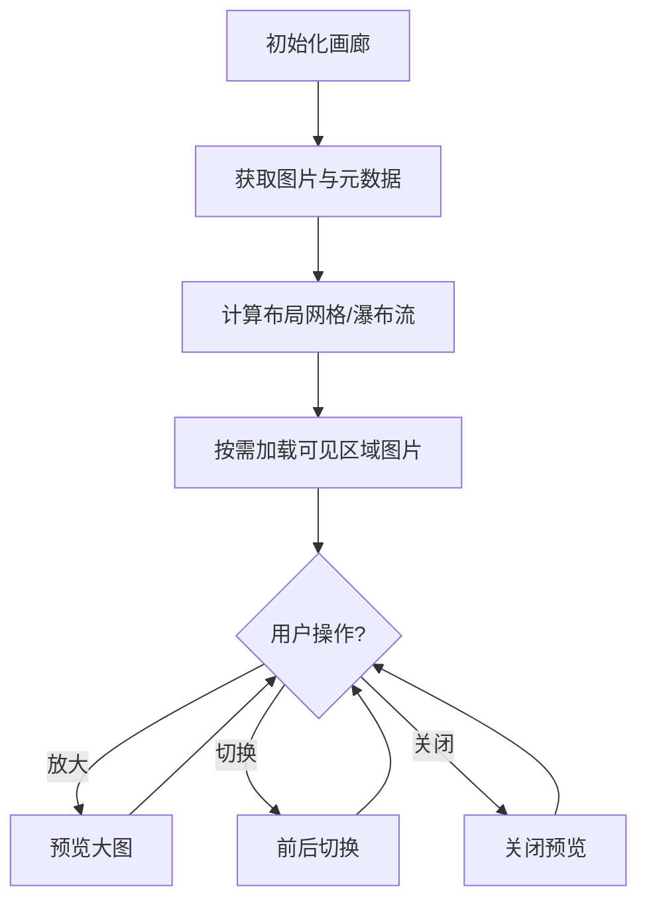
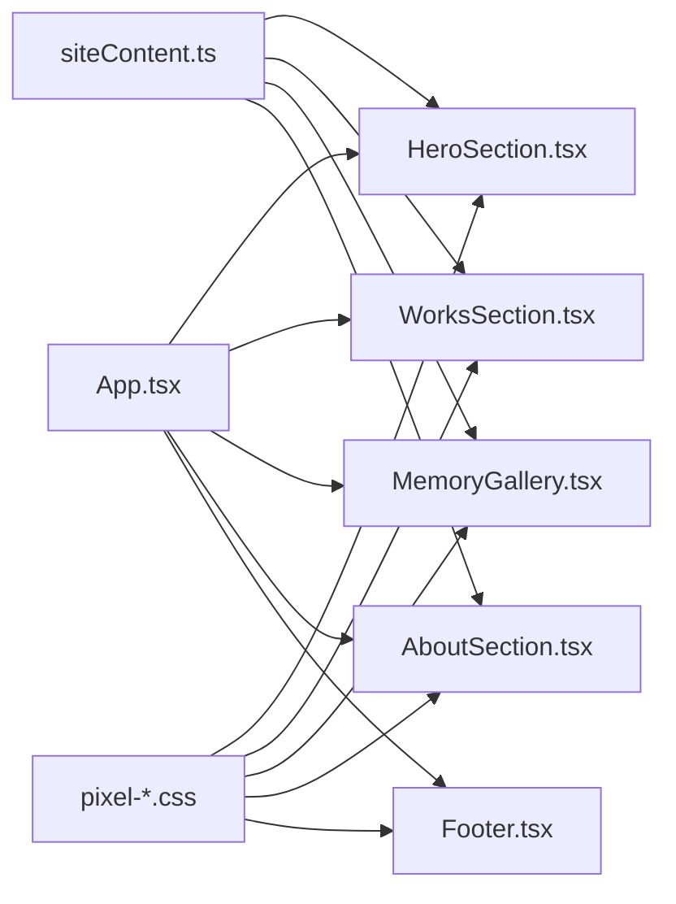

# 页面组件

<cite>
**本文引用的文件**   
- [src/components/HeroSection.tsx](file://src/components/HeroSection.tsx)
- [src/components/WorksSection.tsx](file://src/components/WorksSection.tsx)
- [src/components/MemoryGallery.tsx](file://src/components/MemoryGallery.tsx)
- [src/components/AboutSection.tsx](file://src/components/AboutSection.tsx)
- [src/components/Footer.tsx](file://src/components/Footer.tsx)
- [src/App.tsx](file://src/App.tsx)
- [src/main.tsx](file://src/main.tsx)
- [src/data/siteContent.ts](file://src/data/siteContent.ts)
- [src/styles/global.css](file://src/styles/global.css)
- [src/styles/pixel-hero.css](file://src/styles/pixel-hero.css)
- [src/styles/pixel-works.css](file://src/styles/pixel-works.css)
- [src/styles/pixel-memory.css](file://src/styles/pixel-memory.css)
- [src/styles/pixel-about-footer.css](file://src/styles/pixel-about-footer.css)
- [vite.config.ts](file://vite.config.ts)
</cite>

## 目录
1. [简介](#简介)
2. [项目结构](#项目结构)
3. [核心组件](#核心组件)
4. [架构总览](#架构总览)
5. [详细组件分析](#详细组件分析)
6. [依赖关系分析](#依赖关系分析)
7. [性能考虑](#性能考虑)
8. [故障排查指南](#故障排查指南)
9. [结论](#结论)
10. [附录](#附录)

## 简介
本文件面向 oo-space 项目的页面级组件，系统性梳理 HeroSection、WorksSection、MemoryGallery、AboutSection、Footer 等组件的组织结构与职责划分，解释数据流管理、状态提升模式以及与子组件的通信机制。同时覆盖路由集成、懒加载优化与性能考量，并给出响应式设计、SEO 优化与可访问性支持的最佳实践，以及页面布局扩展指南。

## 项目结构
- 组件层：页面级组件集中在 src/components，按功能模块拆分（如作品展示、记忆画廊、关于页、页脚等）。
- 数据层：站点文案与内容配置位于 src/data，供页面组件消费。
- 样式层：全局与主题样式位于 src/styles，按模块拆分 CSS，便于维护与按需引入。
- 应用入口：src/main.tsx 负责初始化应用；src/App.tsx 组织页面与路由。
- 构建配置：vite.config.ts 控制打包策略与懒加载行为。

图表来源
- [src/main.tsx](file://src/main.tsx)
- [src/App.tsx](file://src/App.tsx)
- [src/components/HeroSection.tsx](file://src/components/HeroSection.tsx)
- [src/components/WorksSection.tsx](file://src/components/WorksSection.tsx)
- [src/components/MemoryGallery.tsx](file://src/components/MemoryGallery.tsx)
- [src/components/AboutSection.tsx](file://src/components/AboutSection.tsx)
- [src/components/Footer.tsx](file://src/components/Footer.tsx)
- [src/data/siteContent.ts](file://src/data/siteContent.ts)
- [src/styles/global.css](file://src/styles/global.css)
- [src/styles/pixel-hero.css](file://src/styles/pixel-hero.css)
- [src/styles/pixel-works.css](file://src/styles/pixel-works.css)
- [src/styles/pixel-memory.css](file://src/styles/pixel-memory.css)
- [src/styles/pixel-about-footer.css](file://src/styles/pixel-about-footer.css)

章节来源
- [src/main.tsx](file://src/main.tsx)
- [src/App.tsx](file://src/App.tsx)
- [src/data/siteContent.ts](file://src/data/siteContent.ts)
- [src/styles/global.css](file://src/styles/global.css)

## 核心组件
- HeroSection：首屏视觉区，承载品牌信息、主标题与引导交互，强调视觉冲击与快速加载。
- WorksSection：作品展示区，采用卡片网格布局，支持筛选、排序与懒加载图片。
- MemoryGallery：记忆画廊，以瀑布流或网格形式呈现图片与说明，注重浏览体验与性能。
- AboutSection：关于页区块，介绍团队/作者背景、技能栈与联系方式。
- Footer：页脚信息，包含版权、链接与社交图标等。

职责边界
- 页面组件仅负责“展示与用户交互”，业务数据通过 props 或 hooks 注入。
- 复杂逻辑下沉到自定义 hooks 或工具函数，保持组件轻量。
- 样式按模块拆分，避免全局污染。

章节来源
- [src/components/HeroSection.tsx](file://src/components/HeroSection.tsx)
- [src/components/WorksSection.tsx](file://src/components/WorksSection.tsx)
- [src/components/MemoryGallery.tsx](file://src/components/MemoryGallery.tsx)
- [src/components/AboutSection.tsx](file://src/components/AboutSection.tsx)
- [src/components/Footer.tsx](file://src/components/Footer.tsx)

## 架构总览
页面级组件由 App 统一编排，数据从 siteContent 注入，样式按模块隔离。路由与懒加载由 Vite 与 React Router 协作完成，确保首屏最小化与按需加载。

图表来源
- [src/App.tsx](file://src/App.tsx)
- [src/data/siteContent.ts](file://src/data/siteContent.ts)
- [src/styles/pixel-hero.css](file://src/styles/pixel-hero.css)
- [src/styles/pixel-works.css](file://src/styles/pixel-works.css)
- [src/styles/pixel-memory.css](file://src/styles/pixel-memory.css)
- [src/styles/pixel-about-footer.css](file://src/styles/pixel-about-footer.css)

## 详细组件分析

### HeroSection
- 职责：首屏品牌展示、主标题、副标题、CTA 按钮与背景动画占位。
- 数据流：接收主题、文案与事件回调；必要时从 siteContent 获取默认值。
- 交互：点击跳转、滚动定位、键盘可达性与焦点管理。
- 性能：首屏关键资源内联或预加载，避免阻塞渲染。
- 可访问性：语义化标签、aria-label、对比度与焦点可见性。

章节来源
- [src/components/HeroSection.tsx](file://src/components/HeroSection.tsx)
- [src/styles/pixel-hero.css](file://src/styles/pixel-hero.css)

### WorksSection
- 职责：作品列表展示、筛选与分页/懒加载。
- 数据流：从 siteContent 获取作品数据；通过 props 暴露筛选条件与排序回调。
- 交互：筛选、排序、点击打开详情；虚拟滚动或 IntersectionObserver 实现懒加载。
- 性能：图片懒加载、分块渲染、防抖节流搜索。
- 可访问性：表格/列表语义、键盘导航、ARIA 描述。

图表来源
- [src/components/WorksSection.tsx](file://src/components/WorksSection.tsx)
- [src/components/WorkCard.tsx](file://src/components/WorkCard.tsx)

章节来源
- [src/components/WorksSection.tsx](file://src/components/WorksSection.tsx)
- [src/styles/pixel-works.css](file://src/styles/pixel-works.css)

### MemoryGallery
- 职责：记忆图片画廊，支持网格/瀑布流布局与轻预览。
- 数据流：接收图片集合与元数据；可选懒加载与缩略图缓存。
- 交互：点击放大、左右切换、键盘导航与屏幕阅读器友好。
- 性能：图片尺寸适配、延迟加载、去抖动缩放。
- 可访问性：alt 文本、焦点顺序、高对比度模式兼容。

章节来源
- [src/components/MemoryGallery.tsx](file://src/components/MemoryGallery.tsx)
- [src/styles/pixel-memory.css](file://src/styles/pixel-memory.css)

### AboutSection
- 职责：关于页内容展示，包括简介、技能、经历与联系方式。
- 数据流：从 siteContent 读取文案；支持主题切换。
- 交互：锚点导航、展开/折叠详情。
- 性能：分段加载长内容，避免首屏过重。
- 可访问性：标题层级清晰、语义化段落、键盘可达。

章节来源
- [src/components/AboutSection.tsx](file://src/components/AboutSection.tsx)
- [src/styles/pixel-about-footer.css](file://src/styles/pixel-about-footer.css)

### Footer
- 职责：页脚信息展示，包含版权、链接与社交图标。
- 数据流：静态文案为主，可通过 props 扩展。
- 交互：外链跳转、社交媒体图标点击。
- 性能：无重计算，轻量渲染。
- 可访问性：链接 aria-label、目标新窗口提示。

章节来源
- [src/components/Footer.tsx](file://src/components/Footer.tsx)
- [src/styles/pixel-about-footer.css](file://src/styles/pixel-about-footer.css)

## 依赖关系分析
- 组件耦合：页面组件之间低耦合，通过 App 编排与 props 传递数据。
- 数据依赖：统一从 siteContent 获取，避免硬编码。
- 样式依赖：按模块 CSS 文件隔离，减少冲突。
- 构建依赖：Vite 提供懒加载与代码分割。

图表来源
- [src/App.tsx](file://src/App.tsx)
- [src/components/HeroSection.tsx](file://src/components/HeroSection.tsx)
- [src/components/WorksSection.tsx](file://src/components/WorksSection.tsx)
- [src/components/MemoryGallery.tsx](file://src/components/MemoryGallery.tsx)
- [src/components/AboutSection.tsx](file://src/components/AboutSection.tsx)
- [src/components/Footer.tsx](file://src/components/Footer.tsx)
- [src/data/siteContent.ts](file://src/data/siteContent.ts)
- [src/styles/pixel-hero.css](file://src/styles/pixel-hero.css)
- [src/styles/pixel-works.css](file://src/styles/pixel-works.css)
- [src/styles/pixel-memory.css](file://src/styles/pixel-memory.css)
- [src/styles/pixel-about-footer.css](file://src/styles/pixel-about-footer.css)

章节来源
- [src/App.tsx](file://src/App.tsx)
- [src/data/siteContent.ts](file://src/data/siteContent.ts)

## 性能考虑
- 首屏优化：
  - 关键 CSS 内联，非关键样式按需加载。
  - 首屏图片使用 WebP/AVIF 与尺寸适配。
  - 预加载关键字体与图标。
- 懒加载与分块：
  - 使用 React.lazy 与 Suspense 对路由与重型组件进行懒加载。
  - 图片懒加载与 IntersectionObserver 结合。
- 渲染优化：
  - 列表项使用稳定 key，避免不必要的重渲染。
  - 搜索与筛选使用防抖/节流。
- 内存与网络：
  - 图片缓存与去重。
  - 合理设置缓存头与 CDN。

[本节为通用指导，不直接分析具体文件]

## 故障排查指南
- 路由问题：
  - 检查路由定义与懒加载是否正确。
  - 确认动态导入路径与命名导出。
- 样式冲突：
  - 检查模块 CSS 是否被全局覆盖。
  - 使用浏览器开发者工具定位样式优先级。
- 性能回退：
  - 开启性能面板观察长任务与重排。
  - 检查图片体积与懒加载触发时机。
- 可访问性问题：
  - 验证键盘导航与焦点顺序。
  - 使用辅助技术测试朗读顺序。

章节来源
- [src/App.tsx](file://src/App.tsx)
- [src/styles/global.css](file://src/styles/global.css)

## 结论
通过对 HeroSection、WorksSection、MemoryGallery、AboutSection、Footer 的职责划分与数据流设计，项目实现了清晰的页面级组件架构。配合 Vite 的懒加载与模块化样式，保证了良好的性能与可维护性。遵循响应式、SEO 与可访问性最佳实践，可为用户提供一致且友好的体验。

[本节为总结性内容，不直接分析具体文件]

## 附录

### 路由集成与懒加载
- 在 App 中定义路由，将页面组件作为懒加载单元。
- 使用 React.lazy 包裹组件，并通过 Suspense 提供加载态。
- 为每个路由添加合适的 meta 信息（标题、描述），利于 SEO。

章节来源
- [src/App.tsx](file://src/App.tsx)
- [vite.config.ts](file://vite.config.ts)

### 响应式设计实现
- 使用媒体查询与弹性布局实现多端适配。
- 图片与容器采用相对单位与比例约束。
- 针对小屏设备简化交互与隐藏次要元素。

章节来源
- [src/styles/global.css](file://src/styles/global.css)
- [src/styles/pixel-hero.css](file://src/styles/pixel-hero.css)
- [src/styles/pixel-works.css](file://src/styles/pixel-works.css)
- [src/styles/pixel-memory.css](file://src/styles/pixel-memory.css)
- [src/styles/pixel-about-footer.css](file://src/styles/pixel-about-footer.css)

### SEO 优化
- 页面标题与描述通过 meta 标签设置。
- 结构化数据（JSON-LD）用于增强搜索引擎理解。
- 图片 alt 文本与语义化标签提升可读性。

章节来源
- [src/App.tsx](file://src/App.tsx)

### 可访问性支持
- 语义化 HTML 与正确的 ARIA 属性。
- 键盘可达性与焦点可见性。
- 色彩对比度与高对比度模式兼容。

章节来源
- [src/components/HeroSection.tsx](file://src/components/HeroSection.tsx)
- [src/components/WorksSection.tsx](file://src/components/WorksSection.tsx)
- [src/components/MemoryGallery.tsx](file://src/components/MemoryGallery.tsx)
- [src/components/AboutSection.tsx](file://src/components/AboutSection.tsx)
- [src/components/Footer.tsx](file://src/components/Footer.tsx)

### 页面布局最佳实践
- 使用栅格系统保证对齐与间距一致性。
- 重要内容优先渲染，避免布局抖动。
- 分离内容与样式，便于复用与维护。

[本节为通用指导，不直接分析具体文件]

### 扩展指南
- 新增页面组件：
  - 在 components 下创建新组件，定义 props 与交互。
  - 在 App 中添加路由并懒加载。
  - 在 siteContent 中补充数据。
  - 新增样式模块并在组件中引入。
- 数据扩展：
  - 在 siteContent 中增加字段，保持类型安全。
  - 为组件提供默认值与校验。
- 样式扩展：
  - 遵循现有命名规范与模块化原则。
  - 使用 tokens 与变量保持一致性。

章节来源
- [src/components/HeroSection.tsx](file://src/components/HeroSection.tsx)
- [src/components/WorksSection.tsx](file://src/components/WorksSection.tsx)
- [src/components/MemoryGallery.tsx](file://src/components/MemoryGallery.tsx)
- [src/components/AboutSection.tsx](file://src/components/AboutSection.tsx)
- [src/components/Footer.tsx](file://src/components/Footer.tsx)
- [src/data/siteContent.ts](file://src/data/siteContent.ts)
- [src/styles/global.css](file://src/styles/global.css)