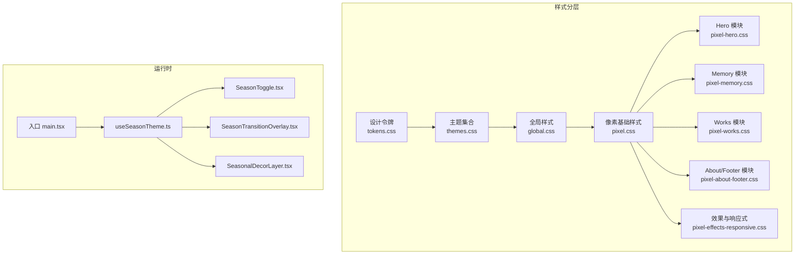
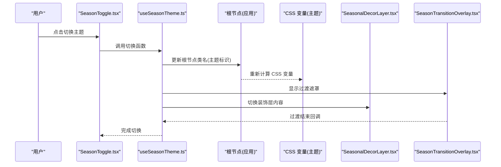
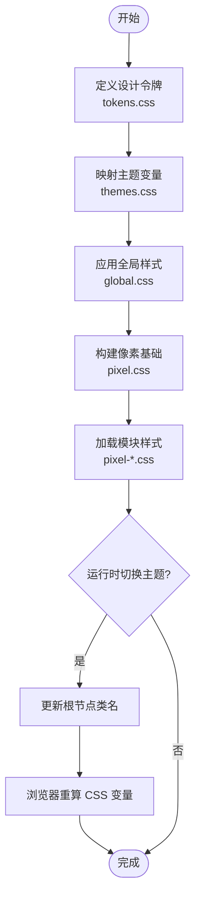
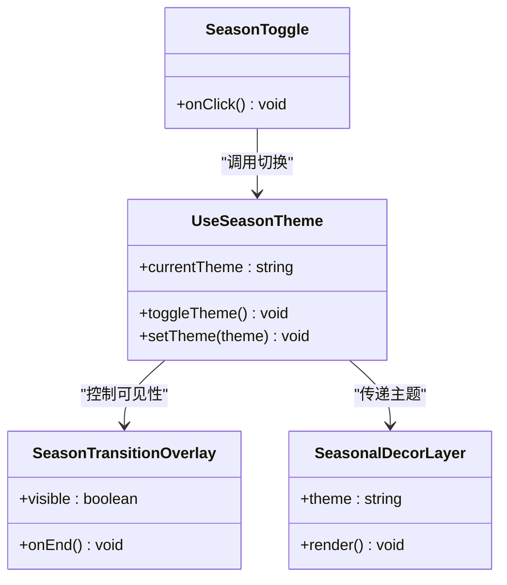
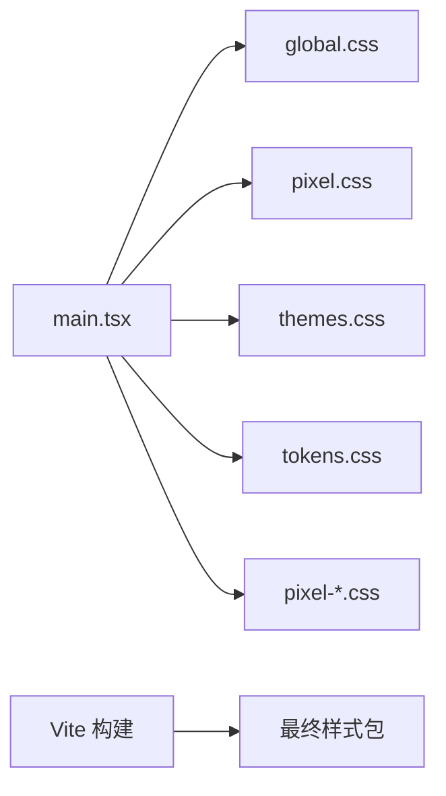

# 样式系统

<cite>
**本文档引用的文件**   
- [src/styles/tokens.css](file://src/styles/tokens.css)
- [src/styles/themes.css](file://src/styles/themes.css)
- [src/styles/global.css](file://src/styles/global.css)
- [src/styles/pixel.css](file://src/styles/pixel.css)
- [src/styles/pixel-hero.css](file://src/styles/pixel-hero.css)
- [src/styles/pixel-memory.css](file://src/styles/pixel-memory.css)
- [src/styles/pixel-works.css](file://src/styles/pixel-works.css)
- [src/styles/pixel-about-footer.css](file://src/styles/pixel-about-footer.css)
- [src/styles/pixel-effects-responsive.css](file://src/styles/pixel-effects-responsive.css)
- [src/hooks/useSeasonTheme.ts](file://src/hooks/useSeasonTheme.ts)
- [src/components/SeasonToggle.tsx](file://src/components/SeasonToggle.tsx)
- [src/components/SeasonTransitionOverlay.tsx](file://src/components/SeasonTransitionOverlay.tsx)
- [src/components/SeasonalDecorLayer.tsx](file://src/components/SeasonalDecorLayer.tsx)
- [src/main.tsx](file://src/main.tsx)
- [package.json](file://package.json)
- [vite.config.ts](file://vite.config.ts)
</cite>

## 目录
1. [简介](#简介)
2. [项目结构](#项目结构)
3. [核心组件](#核心组件)
4. [架构总览](#架构总览)
5. [详细组件分析](#详细组件分析)
6. [依赖分析](#依赖分析)
7. [性能考虑](#性能考虑)
8. [故障排查指南](#故障排查指南)
9. [结论](#结论)
10. [附录](#附录)

## 简介
本文件为 oo-space 项目的样式系统提供全面文档，覆盖像素风格基础样式、主题配置、全局样式与各模块样式文件的职责与协作关系。重点说明 CSS 变量体系、主题切换机制、响应式设计策略，并给出样式组织原则、命名约定、最佳实践、自定义主题创建指南、样式覆盖方法与性能优化技巧，以及跨浏览器兼容性与样式冲突解决方案。

## 项目结构
样式系统采用“分层 + 分模块”的组织方式：
- 设计令牌层（tokens）：集中定义颜色、字体、间距、圆角、阴影等原子化变量。
- 主题层（themes）：基于令牌定义多套主题（如季节主题），通过 CSS 变量在运行时切换。
- 全局层（global）：重置、基础排版、通用布局与动画基线。
- 像素基础层（pixel）：像素风栅格、边框、按钮、卡片等基础 UI 元素。
- 模块层（按页面/功能拆分）：Hero、Memory、Works、About/Footer、Effects/Responsive 等。
- 运行时钩子与组件：useSeasonTheme 管理主题状态；SeasonToggle、SeasonTransitionOverlay、SeasonalDecorLayer 负责交互与视觉过渡。

图表来源
- [src/styles/tokens.css](file://src/styles/tokens.css)
- [src/styles/themes.css](file://src/styles/themes.css)
- [src/styles/global.css](file://src/styles/global.css)
- [src/styles/pixel.css](file://src/styles/pixel.css)
- [src/styles/pixel-hero.css](file://src/styles/pixel-hero.css)
- [src/styles/pixel-memory.css](file://src/styles/pixel-memory.css)
- [src/styles/pixel-works.css](file://src/styles/pixel-works.css)
- [src/styles/pixel-about-footer.css](file://src/styles/pixel-about-footer.css)
- [src/styles/pixel-effects-responsive.css](file://src/styles/pixel-effects-responsive.css)
- [src/hooks/useSeasonTheme.ts](file://src/hooks/useSeasonTheme.ts)
- [src/components/SeasonToggle.tsx](file://src/components/SeasonToggle.tsx)
- [src/components/SeasonTransitionOverlay.tsx](file://src/components/SeasonTransitionOverlay.tsx)
- [src/components/SeasonalDecorLayer.tsx](file://src/components/SeasonalDecorLayer.tsx)
- [src/main.tsx](file://src/main.tsx)

章节来源
- [src/styles/tokens.css](file://src/styles/tokens.css)
- [src/styles/themes.css](file://src/styles/themes.css)
- [src/styles/global.css](file://src/styles/global.css)
- [src/styles/pixel.css](file://src/styles/pixel.css)
- [src/styles/pixel-hero.css](file://src/styles/pixel-hero.css)
- [src/styles/pixel-memory.css](file://src/styles/pixel-memory.css)
- [src/styles/pixel-works.css](file://src/styles/pixel-works.css)
- [src/styles/pixel-about-footer.css](file://src/styles/pixel-about-footer.css)
- [src/styles/pixel-effects-responsive.css](file://src/styles/pixel-effects-responsive.css)
- [src/hooks/useSeasonTheme.ts](file://src/hooks/useSeasonTheme.ts)
- [src/components/SeasonToggle.tsx](file://src/components/SeasonToggle.tsx)
- [src/components/SeasonTransitionOverlay.tsx](file://src/components/SeasonTransitionOverlay.tsx)
- [src/components/SeasonalDecorLayer.tsx](file://src/components/SeasonalDecorLayer.tsx)
- [src/main.tsx](file://src/main.tsx)

## 核心组件
- 设计令牌（tokens.css）
  - 作用：集中声明颜色、字号、行高、间距、圆角、阴影、断点等原子变量，作为所有样式的唯一数据源。
  - 关键点：使用 CSS 自定义属性（变量）命名规范统一，便于主题扩展与替换。
- 主题（themes.css）
  - 作用：基于 tokens 定义多套主题（例如不同季节主题），通过根节点或容器节点上的类名切换变量值。
  - 关键点：主题变量需与 tokens 一一对应，确保可组合与可继承。
- 全局样式（global.css）
  - 作用：CSS Reset、基础排版、滚动条、焦点态、通用动画与工具类。
  - 关键点：避免过度具体选择器，保持低耦合。
- 像素基础（pixel.css）
  - 作用：像素风栅格、边框、按钮、卡片、列表等基础 UI 的样式实现。
  - 关键点：严格遵循像素对齐与锯齿友好渲染策略。
- 模块样式（各 pixel-*.css）
  - 作用：按页面/功能划分样式，复用像素基础与主题变量。
  - 关键点：模块内只关注自身结构与交互，不污染全局。
- 效果与响应式（pixel-effects-responsive.css）
  - 作用：媒体查询、动效、过渡、性能友好的动画策略。
  - 关键点：优先使用 transform/opacity 提升合成效率。
- 运行时主题控制（useSeasonTheme.ts、SeasonToggle.tsx、SeasonTransitionOverlay.tsx、SeasonalDecorLayer.tsx）
  - 作用：维护当前主题状态，切换时更新 DOM 类名，触发过渡与装饰层变化。
  - 关键点：与 CSS 变量联动，保证切换平滑且无闪烁。

章节来源
- [src/styles/tokens.css](file://src/styles/tokens.css)
- [src/styles/themes.css](file://src/styles/themes.css)
- [src/styles/global.css](file://src/styles/global.css)
- [src/styles/pixel.css](file://src/styles/pixel.css)
- [src/styles/pixel-hero.css](file://src/styles/pixel-hero.css)
- [src/styles/pixel-memory.css](file://src/styles/pixel-memory.css)
- [src/styles/pixel-works.css](file://src/styles/pixel-works.css)
- [src/styles/pixel-about-footer.css](file://src/styles/pixel-about-footer.css)
- [src/styles/pixel-effects-responsive.css](file://src/styles/pixel-effects-responsive.css)
- [src/hooks/useSeasonTheme.ts](file://src/hooks/useSeasonTheme.ts)
- [src/components/SeasonToggle.tsx](file://src/components/SeasonToggle.tsx)
- [src/components/SeasonTransitionOverlay.tsx](file://src/components/SeasonTransitionOverlay.tsx)
- [src/components/SeasonalDecorLayer.tsx](file://src/components/SeasonalDecorLayer.tsx)

## 架构总览
样式系统以 CSS 变量为核心，结合 React 运行时状态，形成“令牌 → 主题 → 全局 → 基础 → 模块 → 效果/响应式”的清晰链路。主题切换通过更新根节点类名驱动变量重算，配合过渡动画与装饰层，实现无缝体验。

图表来源
- [src/components/SeasonToggle.tsx](file://src/components/SeasonToggle.tsx)
- [src/hooks/useSeasonTheme.ts](file://src/hooks/useSeasonTheme.ts)
- [src/styles/themes.css](file://src/styles/themes.css)
- [src/components/SeasonalDecorLayer.tsx](file://src/components/SeasonalDecorLayer.tsx)
- [src/components/SeasonTransitionOverlay.tsx](file://src/components/SeasonTransitionOverlay.tsx)

## 详细组件分析

### 设计令牌与主题系统
- 令牌（tokens.css）
  - 建议包含：颜色族（主色、中性色、语义色）、字号阶梯、行高、间距尺度、圆角、阴影、断点、动效时长与缓动。
  - 命名约定：语义化前缀（如 --color-primary、--space-md、--radius-sm）。
- 主题（themes.css）
  - 建议包含：每套主题的变量映射（如 --theme-bg、--theme-text、--theme-accent）。
  - 切换机制：在根节点添加/移除主题类名，变量值随之改变。
- 变量优先级与作用域
  - 局部覆盖优于全局；模块级变量可覆盖基础变量，但应避免破坏一致性。

图表来源
- [src/styles/tokens.css](file://src/styles/tokens.css)
- [src/styles/themes.css](file://src/styles/themes.css)
- [src/styles/global.css](file://src/styles/global.css)
- [src/styles/pixel.css](file://src/styles/pixel.css)
- [src/styles/pixel-hero.css](file://src/styles/pixel-hero.css)
- [src/styles/pixel-memory.css](file://src/styles/pixel-memory.css)
- [src/styles/pixel-works.css](file://src/styles/pixel-works.css)
- [src/styles/pixel-about-footer.css](file://src/styles/pixel-about-footer.css)

章节来源
- [src/styles/tokens.css](file://src/styles/tokens.css)
- [src/styles/themes.css](file://src/styles/themes.css)

### 像素风格基础样式
- 目标：统一的像素网格、边框、阴影与字体渲染，确保复古像素感与可读性。
- 要点：
  - 使用固定像素单位与整数缩放，避免亚像素模糊。
  - 强调硬边与块状结构，减少不必要的圆角与渐变。
  - 通过变量控制尺寸与间距，保持主题一致性。

章节来源
- [src/styles/pixel.css](file://src/styles/pixel.css)

### 模块样式（Hero / Memory / Works / About & Footer）
- Hero（pixel-hero.css）
  - 聚焦首屏视觉与信息层级，适配像素风标题与背景。
- Memory（pixel-memory.css）
  - 记忆卡片与画廊布局，强调网格与悬停反馈。
- Works（pixel-works.css）
  - 作品展示卡片与列表，注重信息密度与可读性。
- About & Footer（pixel-about-footer.css）
  - 关于页与页脚布局，统一链接与版权信息样式。

章节来源
- [src/styles/pixel-hero.css](file://src/styles/pixel-hero.css)
- [src/styles/pixel-memory.css](file://src/styles/pixel-memory.css)
- [src/styles/pixel-works.css](file://src/styles/pixel-works.css)
- [src/styles/pixel-about-footer.css](file://src/styles/pixel-about-footer.css)

### 效果与响应式
- 媒体查询：按断点调整布局与字号，确保移动端可用性。
- 动效：优先 transform/opacity，减少重排重绘。
- 性能：合并关键路径样式，避免长链选择器。

章节来源
- [src/styles/pixel-effects-responsive.css](file://src/styles/pixel-effects-responsive.css)

### 主题切换运行时
- useSeasonTheme.ts
  - 管理当前主题状态，提供切换 API，持久化偏好（可选）。
- SeasonToggle.tsx
  - 提供切换入口（按钮/开关），调用主题切换逻辑。
- SeasonTransitionOverlay.tsx
  - 切换期间显示遮罩与过渡动画，避免闪烁。
- SeasonalDecorLayer.tsx
  - 根据主题动态渲染装饰层（粒子、背景元素等）。

图表来源
- [src/hooks/useSeasonTheme.ts](file://src/hooks/useSeasonTheme.ts)
- [src/components/SeasonToggle.tsx](file://src/components/SeasonToggle.tsx)
- [src/components/SeasonTransitionOverlay.tsx](file://src/components/SeasonTransitionOverlay.tsx)
- [src/components/SeasonalDecorLayer.tsx](file://src/components/SeasonalDecorLayer.tsx)

章节来源
- [src/hooks/useSeasonTheme.ts](file://src/hooks/useSeasonTheme.ts)
- [src/components/SeasonToggle.tsx](file://src/components/SeasonToggle.tsx)
- [src/components/SeasonTransitionOverlay.tsx](file://src/components/SeasonTransitionOverlay.tsx)
- [src/components/SeasonalDecorLayer.tsx](file://src/components/SeasonalDecorLayer.tsx)

## 依赖分析
- 样式加载顺序
  - 入口 main.tsx 引入全局与模块样式，确保令牌与主题先于模块样式加载。
- 构建与打包
  - Vite 按需处理 CSS，支持 CSS 变量与模块化导入。
- 外部依赖
  - package.json 中可能包含与样式相关的插件或工具（如 PostCSS、Autoprefixer）。

图表来源
- [src/main.tsx](file://src/main.tsx)
- [src/styles/global.css](file://src/styles/global.css)
- [src/styles/pixel.css](file://src/styles/pixel.css)
- [src/styles/themes.css](file://src/styles/themes.css)
- [src/styles/tokens.css](file://src/styles/tokens.css)
- [src/styles/pixel-hero.css](file://src/styles/pixel-hero.css)
- [src/styles/pixel-memory.css](file://src/styles/pixel-memory.css)
- [src/styles/pixel-works.css](file://src/styles/pixel-works.css)
- [src/styles/pixel-about-footer.css](file://src/styles/pixel-about-footer.css)
- [package.json](file://package.json)
- [vite.config.ts](file://vite.config.ts)

章节来源
- [src/main.tsx](file://src/main.tsx)
- [package.json](file://package.json)
- [vite.config.ts](file://vite.config.ts)

## 性能考虑
- 变量与主题
  - 将频繁切换的样式抽象为 CSS 变量，避免大量 DOM 操作。
  - 主题切换仅更新类名，由浏览器高效重算变量。
- 渲染与动画
  - 优先使用 transform/opacity 进行动画，减少布局抖动。
  - 限制同时运行的动画数量，必要时使用 will-change 提示。
- 样式体积
  - 利用 Vite 的按需加载与 Tree Shaking，剔除未使用样式。
  - 避免过深选择器与重复规则。
- 资源与图片
  - 像素图使用合适分辨率与格式，启用缓存与懒加载。

[本节为通用指导，无需特定文件引用]

## 故障排查指南
- 主题切换无效
  - 检查根节点是否成功添加/移除主题类名。
  - 确认 themes.css 中的变量键名与 tokens.css 一致。
- 样式覆盖不生效
  - 检查加载顺序：令牌与主题应在模块样式之前。
  - 避免过高的特异性导致覆盖失败。
- 像素模糊或错位
  - 确保使用整数像素与合适的缩放比例。
  - 检查父容器是否存在 transform 导致的亚像素问题。
- 响应式异常
  - 核对媒体查询断点是否与设备宽度匹配。
  - 检查是否被全局或模块样式意外覆盖。
- 动画卡顿
  - 将动画属性改为 transform/opacity。
  - 减少复杂滤镜与阴影。

章节来源
- [src/styles/themes.css](file://src/styles/themes.css)
- [src/styles/tokens.css](file://src/styles/tokens.css)
- [src/styles/pixel-effects-responsive.css](file://src/styles/pixel-effects-responsive.css)

## 结论
oo-space 的样式系统以 CSS 变量为核心，通过清晰的层次与模块划分，实现了灵活的像素风格与主题切换能力。遵循令牌化、模块化与响应式策略，可在保证一致性的同时提升可维护性与性能。建议在新增模块时严格遵循命名约定与覆盖规则，并持续优化动画与资源以提升用户体验。

[本节为总结，无需特定文件引用]

## 附录

### 自定义主题创建指南
- 步骤
  - 在 tokens.css 中补充或扩展所需变量（颜色、字号、间距等）。
  - 在 themes.css 中新增主题映射，确保键名与 tokens 对应。
  - 在运行时通过 useSeasonTheme 切换新主题类名。
  - 如需装饰效果，更新 SeasonalDecorLayer 的主题分支。
- 注意事项
  - 保持对比度与可访问性。
  - 验证在不同设备与浏览器下的表现。

章节来源
- [src/styles/tokens.css](file://src/styles/tokens.css)
- [src/styles/themes.css](file://src/styles/themes.css)
- [src/hooks/useSeasonTheme.ts](file://src/hooks/useSeasonTheme.ts)
- [src/components/SeasonalDecorLayer.tsx](file://src/components/SeasonalDecorLayer.tsx)

### 样式覆盖方法
- 推荐方式
  - 使用更具体的模块选择器覆盖基础样式。
  - 通过 CSS 变量在局部作用域覆盖主题值。
- 避免方式
  - 不要使用 !important 滥用。
  - 避免直接修改 tokens 影响全局。

章节来源
- [src/styles/pixel.css](file://src/styles/pixel.css)
- [src/styles/themes.css](file://src/styles/themes.css)

### 命名约定与最佳实践
- 命名
  - 令牌：--token-*（语义化前缀）
  - 主题：--theme-*（与令牌一一对应）
  - 模块：pixel-<module>-*（BEM 或类似约定）
- 最佳实践
  - 单一职责：每个文件只做一件事。
  - 变量优先：尽量用变量替代硬编码值。
  - 可测试：为关键样式编写回归用例（视觉快照）。

章节来源
- [src/styles/tokens.css](file://src/styles/tokens.css)
- [src/styles/themes.css](file://src/styles/themes.css)
- [src/styles/pixel.css](file://src/styles/pixel.css)

### 跨浏览器兼容性
- 建议
  - 使用 Autoprefixer 自动补全前缀。
  - 对 CSS 变量与媒体查询进行兼容性检测。
  - 降级策略：在不支持的浏览器上回退到静态主题。

章节来源
- [package.json](file://package.json)
- [vite.config.ts](file://vite.config.ts)

### 样式冲突解决方案
- 定位冲突
  - 使用开发者工具查看最终计算样式与来源文件。
- 解决策略
  - 提高选择器特异性或使用作用域类名。
  - 调整加载顺序，确保模块样式后于基础样式。
  - 将冲突样式抽取为独立模块，避免相互干扰。

章节来源
- [src/styles/global.css](file://src/styles/global.css)
- [src/styles/pixel.css](file://src/styles/pixel.css)
- [src/styles/pixel-hero.css](file://src/styles/pixel-hero.css)
- [src/styles/pixel-memory.css](file://src/styles/pixel-memory.css)
- [src/styles/pixel-works.css](file://src/styles/pixel-works.css)
- [src/styles/pixel-about-footer.css](file://src/styles/pixel-about-footer.css)