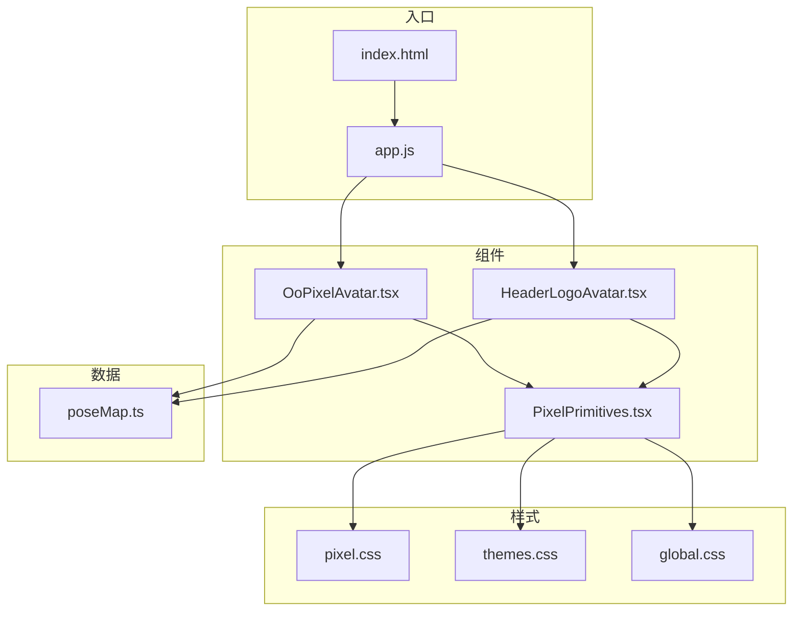
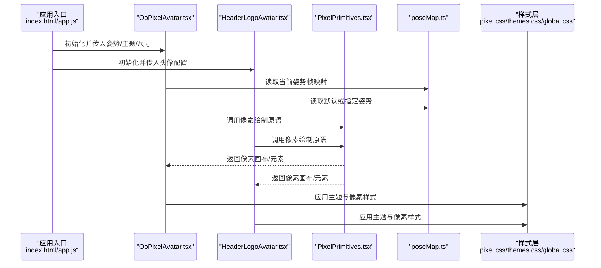
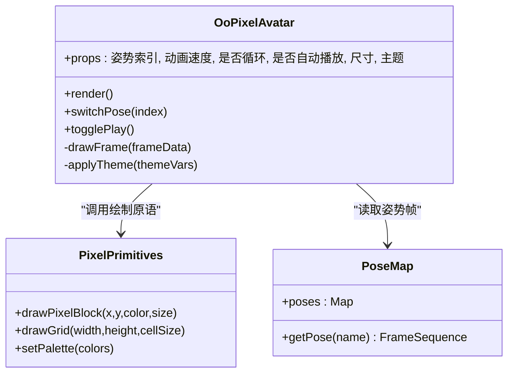
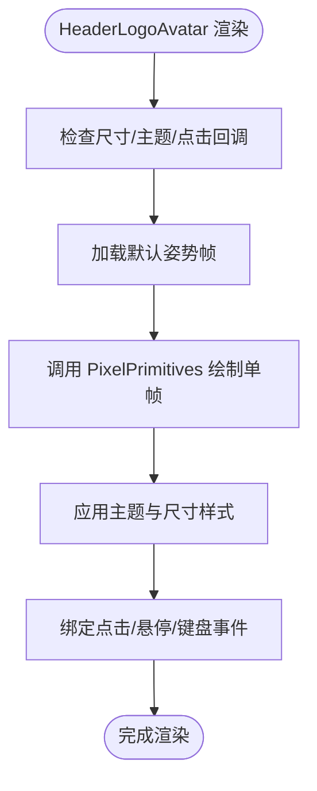
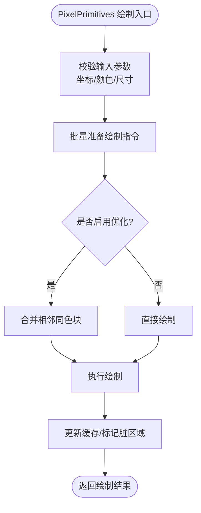
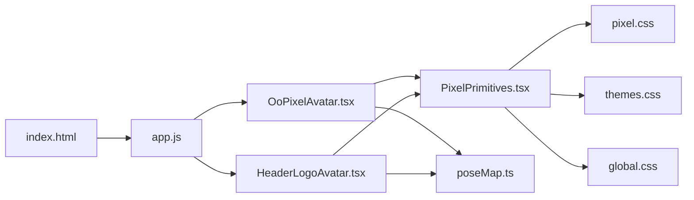

# 像素头像组件

<cite>
**本文引用的文件**   
- [OoPixelAvatar.tsx](file://src/components/OoPixelAvatar.tsx)
- [HeaderLogoAvatar.tsx](file://src/components/HeaderLogoAvatar.tsx)
- [PixelPrimitives.tsx](file://src/components/PixelPrimitives.tsx)
- [poseMap.ts](file://src/data/poseMap.ts)
- [pixel.css](file://src/styles/pixel.css)
- [themes.css](file://src/styles/themes.css)
- [global.css](file://src/styles/global.css)
- [index.html](file://public/index.html)
- [app.js](file://public/app.js)
</cite>

## 目录
1. [简介](#简介)
2. [项目结构](#项目结构)
3. [核心组件](#核心组件)
4. [架构总览](#架构总览)
5. [详细组件分析](#详细组件分析)
6. [依赖关系分析](#依赖关系分析)
7. [性能考虑](#性能考虑)
8. [故障排查指南](#故障排查指南)
9. [结论](#结论)
10. [附录](#附录)

## 简介
本文件面向 oo-space 项目的像素头像相关 UI 组件，系统性说明 OoPixelAvatar、HeaderLogoAvatar 与 PixelPrimitives 的视觉外观、行为模式与交互方式。文档涵盖像素风格头像的渲染机制、姿势映射系统与动画效果，提供属性配置、自定义选项与样式覆盖方法，并给出集成示例路径、数据结构规范、性能优化策略以及跨浏览器与移动端适配建议。

## 项目结构
像素头像相关代码主要分布在以下位置：
- 组件层：src/components 下的 OoPixelAvatar.tsx、HeaderLogoAvatar.tsx、PixelPrimitives.tsx
- 数据层：src/data/poseMap.ts（姿势映射表）
- 样式层：src/styles/pixel.css、themes.css、global.css
- 入口与资源：public/index.html、public/app.js

图表来源
- [OoPixelAvatar.tsx](file://src/components/OoPixelAvatar.tsx)
- [HeaderLogoAvatar.tsx](file://src/components/HeaderLogoAvatar.tsx)
- [PixelPrimitives.tsx](file://src/components/PixelPrimitives.tsx)
- [poseMap.ts](file://src/data/poseMap.ts)
- [pixel.css](file://src/styles/pixel.css)
- [themes.css](file://src/styles/themes.css)
- [global.css](file://src/styles/global.css)
- [index.html](file://public/index.html)
- [app.js](file://public/app.js)

章节来源
- [OoPixelAvatar.tsx](file://src/components/OoPixelAvatar.tsx)
- [HeaderLogoAvatar.tsx](file://src/components/HeaderLogoAvatar.tsx)
- [PixelPrimitives.tsx](file://src/components/PixelPrimitives.tsx)
- [poseMap.ts](file://src/data/poseMap.ts)
- [pixel.css](file://src/styles/pixel.css)
- [themes.css](file://src/styles/themes.css)
- [global.css](file://src/styles/global.css)
- [index.html](file://public/index.html)
- [app.js](file://public/app.js)

## 核心组件
本节概述三个核心组件的职责与协作关系：
- OoPixelAvatar：负责像素头像的整体展示、姿势切换、动画控制与主题适配。
- HeaderLogoAvatar：用于头部 Logo 区域的像素头像，强调尺寸、对齐与可点击交互。
- PixelPrimitives：底层像素绘制原语，提供像素块、网格、颜色与帧序列等基础能力。

章节来源
- [OoPixelAvatar.tsx](file://src/components/OoPixelAvatar.tsx)
- [HeaderLogoAvatar.tsx](file://src/components/HeaderLogoAvatar.tsx)
- [PixelPrimitives.tsx](file://src/components/PixelPrimitives.tsx)

## 架构总览
像素头像渲染采用“数据驱动 + 原语绘制”的架构：
- 数据层 poseMap.ts 定义姿势到像素帧的映射。
- 组件层通过 OoPixelAvatar 与 HeaderLogoAvatar 消费姿势数据，驱动 PixelPrimitives 进行像素级绘制。
- 样式层通过 pixel.css、themes.css、global.css 统一像素风格与主题变量。
- 入口 index.html 与 app.js 完成应用初始化与组件挂载。

图表来源
- [index.html](file://public/index.html)
- [app.js](file://public/app.js)
- [OoPixelAvatar.tsx](file://src/components/OoPixelAvatar.tsx)
- [HeaderLogoAvatar.tsx](file://src/components/HeaderLogoAvatar.tsx)
- [PixelPrimitives.tsx](file://src/components/PixelPrimitives.tsx)
- [poseMap.ts](file://src/data/poseMap.ts)
- [pixel.css](file://src/styles/pixel.css)
- [themes.css](file://src/styles/themes.css)
- [global.css](file://src/styles/global.css)

## 详细组件分析

### OoPixelAvatar 组件
职责与特性：
- 支持多姿势切换与自动播放，具备暂停/继续、循环与过渡动画。
- 根据主题变量动态调整像素颜色与背景。
- 响应式尺寸与容器自适应，支持点击触发事件回调。
- 通过 props 暴露姿势索引、动画速度、是否循环、是否自动播放等配置项。

交互模式：
- 鼠标悬停高亮边框或阴影，点击切换下一姿势或触发特效。
- 键盘可达性：方向键切换姿势，空格键暂停/继续。

渲染机制：
- 基于 poseMap 的姿势帧序列，逐帧调用 PixelPrimitives 绘制像素块。
- 使用 requestAnimationFrame 或 CSS 动画实现平滑过渡。

样式覆盖：
- 通过 CSS 变量覆盖像素色板、网格大小、圆角与阴影。
- 支持在父容器内以类名选择器覆盖特定实例样式。

图表来源
- [OoPixelAvatar.tsx](file://src/components/OoPixelAvatar.tsx)
- [PixelPrimitives.tsx](file://src/components/PixelPrimitives.tsx)
- [poseMap.ts](file://src/data/poseMap.ts)

章节来源
- [OoPixelAvatar.tsx](file://src/components/OoPixelAvatar.tsx)
- [poseMap.ts](file://src/data/poseMap.ts)
- [pixel.css](file://src/styles/pixel.css)
- [themes.css](file://src/styles/themes.css)

### HeaderLogoAvatar 组件
职责与特性：
- 用于头部导航或页面标题旁的像素头像，强调紧凑布局与品牌一致性。
- 支持点击跳转或打开菜单，具备焦点管理与无障碍标签。
- 尺寸较小，通常固定宽高比，避免重绘开销。

交互模式：
- 点击触发路由跳转或弹窗；悬停显示提示文本。
- 支持键盘 Enter/Space 激活。

渲染机制：
- 复用 OoPixelAvatar 的核心逻辑，但简化动画与姿势切换，默认静态姿势。
- 通过 PixelPrimitives 快速绘制单帧像素图。

样式覆盖：
- 通过 CSS 变量与类名覆盖图标尺寸、边框与阴影。
- 与主题系统联动，确保明暗主题一致。

图表来源
- [HeaderLogoAvatar.tsx](file://src/components/HeaderLogoAvatar.tsx)
- [PixelPrimitives.tsx](file://src/components/PixelPrimitives.tsx)
- [poseMap.ts](file://src/data/poseMap.ts)

章节来源
- [HeaderLogoAvatar.tsx](file://src/components/HeaderLogoAvatar.tsx)
- [pixel.css](file://src/styles/pixel.css)
- [themes.css](file://src/styles/themes.css)

### PixelPrimitives 组件
职责与特性：
- 提供像素绘制的基础能力：像素块绘制、网格生成、调色板设置、帧序列处理。
- 支持批量绘制与增量更新，减少重绘成本。
- 暴露统一的 API 供上层组件调用，屏蔽底层 Canvas/SVG 差异。

数据结构与算法：
- 像素块坐标与颜色数组，按行优先顺序绘制。
- 帧序列为二维数组或扁平化缓冲，支持插值与淡入淡出。
- 调色板映射将语义颜色转换为实际像素色值。

性能优化：
- 使用离屏缓存与脏矩形更新，仅重绘变化区域。
- 合并相邻同色像素块，降低绘制调用次数。

图表来源
- [PixelPrimitives.tsx](file://src/components/PixelPrimitives.tsx)

章节来源
- [PixelPrimitives.tsx](file://src/components/PixelPrimitives.tsx)

## 依赖关系分析
组件间依赖关系如下：
- OoPixelAvatar 与 HeaderLogoAvatar 均依赖 PixelPrimitives 进行像素绘制。
- 两者都依赖 poseMap.ts 获取姿势帧数据。
- 样式由 pixel.css、themes.css、global.css 统一管理，确保一致的像素风格与主题变量。
- 入口 index.html 与 app.js 负责初始化与挂载组件。

图表来源
- [OoPixelAvatar.tsx](file://src/components/OoPixelAvatar.tsx)
- [HeaderLogoAvatar.tsx](file://src/components/HeaderLogoAvatar.tsx)
- [PixelPrimitives.tsx](file://src/components/PixelPrimitives.tsx)
- [poseMap.ts](file://src/data/poseMap.ts)
- [pixel.css](file://src/styles/pixel.css)
- [themes.css](file://src/styles/themes.css)
- [global.css](file://src/styles/global.css)
- [index.html](file://public/index.html)
- [app.js](file://public/app.js)

章节来源
- [OoPixelAvatar.tsx](file://src/components/OoPixelAvatar.tsx)
- [HeaderLogoAvatar.tsx](file://src/components/HeaderLogoAvatar.tsx)
- [PixelPrimitives.tsx](file://src/components/PixelPrimitives.tsx)
- [poseMap.ts](file://src/data/poseMap.ts)
- [pixel.css](file://src/styles/pixel.css)
- [themes.css](file://src/styles/themes.css)
- [global.css](file://src/styles/global.css)
- [index.html](file://public/index.html)
- [app.js](file://public/app.js)

## 性能考虑
- 绘制优化：使用离屏缓存与脏矩形更新，避免全量重绘；合并相邻同色像素块以减少绘制调用。
- 动画优化：限制帧率与过渡时长，移动端优先使用 CSS 动画而非 JS 动画。
- 内存管理：及时释放不再使用的帧缓冲与纹理，避免内存泄漏。
- 懒加载：仅在可见区域内渲染像素头像，滚动进入视口时再加载。
- 主题切换：批量更新 CSS 变量，避免频繁 DOM 操作。

[本节为通用指导，不直接分析具体文件]

## 故障排查指南
常见问题与解决思路：
- 像素模糊或锯齿：检查 CSS 的 image-rendering 与缩放比例，确保像素对齐。
- 动画卡顿：降低帧率或关闭复杂过渡，启用硬件加速。
- 主题不生效：确认 CSS 变量已正确注入，检查选择器优先级。
- 移动端触摸无响应：确保事件委托与点击区域足够大，添加 touch-action 样式。
- 姿势切换异常：核对 poseMap 中姿势名称与帧序列格式是否正确。

章节来源
- [pixel.css](file://src/styles/pixel.css)
- [themes.css](file://src/styles/themes.css)
- [global.css](file://src/styles/global.css)
- [poseMap.ts](file://src/data/poseMap.ts)

## 结论
OoPixelAvatar、HeaderLogoAvatar 与 PixelPrimitives 共同构建了 oo-space 项目的像素头像体系。通过数据驱动的姿势映射与底层像素原语绘制，实现了高性能、可定制且跨平台一致的像素风格体验。遵循本文档的配置与优化建议，可在不同设备与浏览器上获得稳定表现。

[本节为总结性内容，不直接分析具体文件]

## 附录

### 组件属性配置参考
- OoPixelAvatar
  - 姿势索引：整数，表示当前显示的姿势序号
  - 动画速度：数值，控制帧切换间隔
  - 是否循环：布尔，决定是否循环播放
  - 是否自动播放：布尔，启动时是否自动播放
  - 尺寸：字符串或对象，定义宽高与缩放
  - 主题：对象，包含颜色变量与背景
- HeaderLogoAvatar
  - 尺寸：固定或响应式尺寸
  - 点击回调：函数，处理点击事件
  - 提示文本：字符串，悬停显示
  - 主题：继承全局主题变量
- PixelPrimitives
  - 像素块数组：坐标与颜色信息
  - 网格尺寸：单元格大小与行列数
  - 调色板：语义颜色到实际色值的映射

章节来源
- [OoPixelAvatar.tsx](file://src/components/OoPixelAvatar.tsx)
- [HeaderLogoAvatar.tsx](file://src/components/HeaderLogoAvatar.tsx)
- [PixelPrimitives.tsx](file://src/components/PixelPrimitives.tsx)

### 像素艺术数据结构与姿势映射表
- 像素块数据结构：包含 x、y、color、size 字段，描述单个像素块的位置、颜色与尺寸。
- 帧序列：二维数组或扁平化缓冲，按行优先顺序存储像素块。
- 姿势映射表：以姿势名称为键，值为帧序列数组，支持动态加载与缓存。

章节来源
- [poseMap.ts](file://src/data/poseMap.ts)
- [PixelPrimitives.tsx](file://src/components/PixelPrimitives.tsx)

### 集成与使用示例路径
- 在应用中引入 OoPixelAvatar 与 HeaderLogoAvatar，并通过 props 配置姿势、主题与尺寸。
- 在样式文件中定义 CSS 变量以覆盖像素色板与网格样式。
- 在 poseMap.ts 中添加新的姿势帧数据，并在组件中引用。

章节来源
- [index.html](file://public/index.html)
- [app.js](file://public/app.js)
- [OoPixelAvatar.tsx](file://src/components/OoPixelAvatar.tsx)
- [HeaderLogoAvatar.tsx](file://src/components/HeaderLogoAvatar.tsx)
- [poseMap.ts](file://src/data/poseMap.ts)
- [pixel.css](file://src/styles/pixel.css)
- [themes.css](file://src/styles/themes.css)

### 跨浏览器兼容性与移动端适配
- 兼容性：确保 Canvas 与 CSS 变量在所有目标浏览器中可用，必要时提供降级方案。
- 移动端：禁用不必要的动画，增大点击区域，优化触摸事件处理。
- 性能：使用 will-change 与 transform 提升渲染性能，避免重排与重绘。

章节来源
- [pixel.css](file://src/styles/pixel.css)
- [global.css](file://src/styles/global.css)
- [app.js](file://public/app.js)