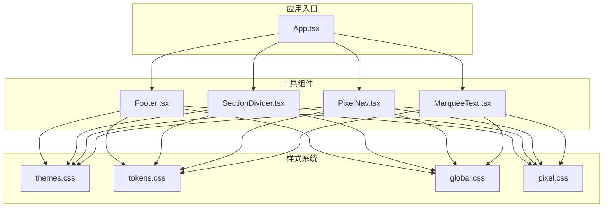
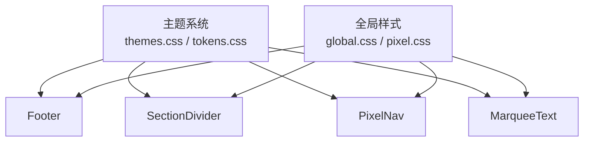
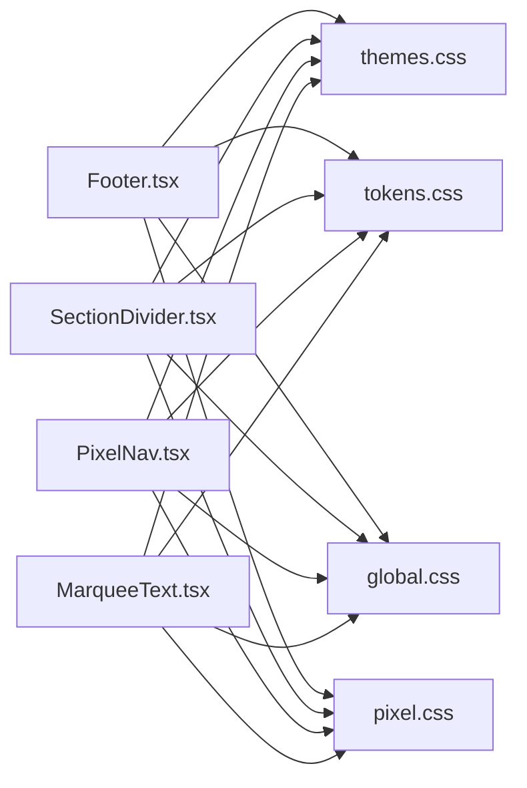

# 工具组件

<cite>
**本文档引用的文件**   
- [Footer.tsx](file://src/components/Footer.tsx)
- [SectionDivider.tsx](file://src/components/SectionDivider.tsx)
- [PixelNav.tsx](file://src/components/PixelNav.tsx)
- [MarqueeText.tsx](file://src/components/MarqueeText.tsx)
- [themes.css](file://src/styles/themes.css)
- [tokens.css](file://src/styles/tokens.css)
- [global.css](file://src/styles/global.css)
- [pixel.css](file://src/styles/pixel.css)
- [App.tsx](file://src/App.tsx)
</cite>

## 目录
1. [简介](#简介)
2. [项目结构](#项目结构)
3. [核心组件](#核心组件)
4. [架构总览](#架构总览)
5. [详细组件分析](#详细组件分析)
6. [依赖分析](#依赖分析)
7. [性能考虑](#性能考虑)
8. [故障排查指南](#故障排查指南)
9. [结论](#结论)
10. [附录](#附录)

## 简介
本文件为 oo-space 项目的工具类 UI 组件提供系统化文档，覆盖以下四个组件：
- Footer（页脚）
- SectionDivider（区块分隔符）
- PixelNav（像素导航）
- MarqueeText（滚动文字）

文档将详细说明各组件的功能特性、样式定制选项、主题支持、可访问性实现、组合模式与集成方式，并提供响应式设计指导与性能优化建议。同时给出常见使用场景与代码示例路径，帮助读者快速上手并高效扩展。

## 项目结构
本项目采用按功能模块组织的前端工程结构，UI 组件集中于 src/components，样式集中在 src/styles。上述四个工具组件均位于 components 目录下，并通过 App.tsx 作为入口进行组合与渲染。主题与令牌分别由 themes.css 与 tokens.css 管理，全局样式与像素风格样式由 global.css 与 pixel.css 统一维护。

图表来源
- [App.tsx](file://src/App.tsx)
- [Footer.tsx](file://src/components/Footer.tsx)
- [SectionDivider.tsx](file://src/components/SectionDivider.tsx)
- [PixelNav.tsx](file://src/components/PixelNav.tsx)
- [MarqueeText.tsx](file://src/components/MarqueeText.tsx)
- [themes.css](file://src/styles/themes.css)
- [tokens.css](file://src/styles/tokens.css)
- [global.css](file://src/styles/global.css)
- [pixel.css](file://src/styles/pixel.css)

章节来源
- [App.tsx](file://src/App.tsx)
- [Footer.tsx](file://src/components/Footer.tsx)
- [SectionDivider.tsx](file://src/components/SectionDivider.tsx)
- [PixelNav.tsx](file://src/components/PixelNav.tsx)
- [MarqueeText.tsx](file://src/components/MarqueeText.tsx)
- [themes.css](file://src/styles/themes.css)
- [tokens.css](file://src/styles/tokens.css)
- [global.css](file://src/styles/global.css)
- [pixel.css](file://src/styles/pixel.css)

## 核心组件
本节概述四个工具组件的职责与共性设计原则：
- Footer：站点底部信息展示，包含版权、链接、社交图标等；支持主题切换与响应式布局。
- SectionDivider：用于内容区块之间的视觉分隔，提供多种分割样式与动画效果。
- PixelNav：像素风格的导航栏，支持菜单项、选中态、键盘导航与无障碍标签。
- MarqueeText：滚动文字组件，支持循环滚动、速度控制、暂停交互与可读性增强。

章节来源
- [Footer.tsx](file://src/components/Footer.tsx)
- [SectionDivider.tsx](file://src/components/SectionDivider.tsx)
- [PixelNav.tsx](file://src/components/PixelNav.tsx)
- [MarqueeText.tsx](file://src/components/MarqueeText.tsx)

## 架构总览
四个工具组件遵循统一的样式与主题体系，通过 CSS 变量与令牌驱动外观与行为。组件之间保持低耦合，便于在页面中自由组合。主题系统通过 CSS 变量集中管理颜色、间距、字体等，确保一致性与可维护性。

图表来源
- [themes.css](file://src/styles/themes.css)
- [tokens.css](file://src/styles/tokens.css)
- [global.css](file://src/styles/global.css)
- [pixel.css](file://src/styles/pixel.css)
- [Footer.tsx](file://src/components/Footer.tsx)
- [SectionDivider.tsx](file://src/components/SectionDivider.tsx)
- [PixelNav.tsx](file://src/components/PixelNav.tsx)
- [MarqueeText.tsx](file://src/components/MarqueeText.tsx)

## 详细组件分析

### Footer（页脚）
- 功能特性
  - 展示版权信息与站点链接
  - 支持社交图标与外部链接
  - 适配移动端与桌面端的布局差异
  - 支持主题切换（亮色/暗色）
- 样式定制
  - 通过 CSS 变量调整背景色、文本色、间距与边框
  - 可使用 tokens 中的间距与字体令牌保持一致性
  - 支持自定义链接样式与悬停效果
- 主题支持
  - 基于 themes.css 的变量映射，自动跟随主题切换
  - 可通过覆盖变量实现品牌化定制
- 可访问性
  - 语义化 HTML 结构（footer、nav、ul/li、a）
  - 为图标添加 aria-label，确保屏幕阅读器可读
  - 键盘可达性与焦点可见性
- 组合模式与集成
  - 与 App.tsx 组合，置于页面底部
  - 可与导航组件配合形成完整的站点框架
- 响应式设计
  - 使用媒体查询与弹性布局适配不同屏幕尺寸
  - 在小屏设备上堆叠排列，提升可读性
- 性能优化
  - 避免重绘与回流，合理使用 will-change
  - 图片资源懒加载与压缩

章节来源
- [Footer.tsx](file://src/components/Footer.tsx)
- [themes.css](file://src/styles/themes.css)
- [tokens.css](file://src/styles/tokens.css)
- [global.css](file://src/styles/global.css)
- [pixel.css](file://src/styles/pixel.css)

### SectionDivider（区块分隔符）
- 功能特性
  - 提供水平或垂直分隔线
  - 支持虚线、渐变、像素风格等多种样式
  - 可选动画过渡效果（淡入、滑动）
- 样式定制
  - 通过 tokens 控制厚度、颜色、间距
  - 支持自定义装饰元素（点、菱形、像素块）
- 主题支持
  - 自动继承主题变量，保证对比度与一致性
- 可访问性
  - 使用 role="separator" 与 aria-orientation 描述方向
  - 避免仅用颜色传达信息，提供足够对比度
- 组合模式与集成
  - 插入到内容区块之间，提升信息层次
  - 与卡片、列表、段落等组件协同工作
- 响应式设计
  - 根据视口宽度调整分隔线长度与装饰密度
- 性能优化
  - 减少不必要的 DOM 节点与复杂滤镜
  - 动画使用 transform 与 opacity 提升性能

章节来源
- [SectionDivider.tsx](file://src/components/SectionDivider.tsx)
- [themes.css](file://src/styles/themes.css)
- [tokens.css](file://src/styles/tokens.css)
- [global.css](file://src/styles/global.css)
- [pixel.css](file://src/styles/pixel.css)

### PixelNav（像素导航）
- 功能特性
  - 像素风格的导航菜单，支持多级菜单
  - 选中态高亮与悬停反馈
  - 键盘导航（上下左右与回车确认）
- 样式定制
  - 通过 tokens 配置像素网格、颜色与阴影
  - 支持自定义菜单项图标与动效
- 主题支持
  - 基于主题变量动态切换配色与对比度
- 可访问性
  - 使用 nav、ul、li、button/a 语义化结构
  - aria-current 标记当前页面，aria-expanded 展开状态
  - 焦点管理与 Tab 顺序合理
- 组合模式与集成
  - 与路由系统集成，点击后跳转对应页面
  - 与 Header 或其他容器组件组合
- 响应式设计
  - 小屏设备折叠为汉堡菜单，支持手势操作
- 性能优化
  - 菜单项按需渲染，避免长列表卡顿
  - 使用事件委托减少监听器数量

章节来源
- [PixelNav.tsx](file://src/components/PixelNav.tsx)
- [themes.css](file://src/styles/themes.css)
- [tokens.css](file://src/styles/tokens.css)
- [global.css](file://src/styles/global.css)
- [pixel.css](file://src/styles/pixel.css)

### MarqueeText（滚动文字）
- 功能特性
  - 支持单行或多行滚动文字
  - 可配置滚动速度、方向与循环策略
  - 鼠标悬停暂停、点击展开详情
- 样式定制
  - 通过 tokens 设置字号、行高、颜色与间距
  - 支持像素风格描边与阴影
- 主题支持
  - 自动适配主题变量，确保可读性
- 可访问性
  - 提供 aria-live 区域播报滚动内容
  - 支持键盘暂停/恢复，满足运动敏感用户
- 组合模式与集成
  - 与公告栏、新闻流、提示条等场景结合
  - 可嵌套于容器组件中，受父级布局影响
- 响应式设计
  - 根据视口宽度调整滚动速度与显示行数
- 性能优化
  - 使用 requestAnimationFrame 平滑滚动
  - 避免频繁 DOM 操作，必要时使用虚拟滚动

章节来源
- [MarqueeText.tsx](file://src/components/MarqueeText.tsx)
- [themes.css](file://src/styles/themes.css)
- [tokens.css](file://src/styles/tokens.css)
- [global.css](file://src/styles/global.css)
- [pixel.css](file://src/styles/pixel.css)

## 依赖分析
四个组件共同依赖主题系统与全局样式，彼此之间无直接耦合，便于独立开发与测试。组件内部可能依赖 hooks 或工具函数，但对外暴露稳定的 API。

图表来源
- [Footer.tsx](file://src/components/Footer.tsx)
- [SectionDivider.tsx](file://src/components/SectionDivider.tsx)
- [PixelNav.tsx](file://src/components/PixelNav.tsx)
- [MarqueeText.tsx](file://src/components/MarqueeText.tsx)
- [themes.css](file://src/styles/themes.css)
- [tokens.css](file://src/styles/tokens.css)
- [global.css](file://src/styles/global.css)
- [pixel.css](file://src/styles/pixel.css)

章节来源
- [Footer.tsx](file://src/components/Footer.tsx)
- [SectionDivider.tsx](file://src/components/SectionDivider.tsx)
- [PixelNav.tsx](file://src/components/PixelNav.tsx)
- [MarqueeText.tsx](file://src/components/MarqueeText.tsx)
- [themes.css](file://src/styles/themes.css)
- [tokens.css](file://src/styles/tokens.css)
- [global.css](file://src/styles/global.css)
- [pixel.css](file://src/styles/pixel.css)

## 性能考虑
- 渲染性能
  - 避免在滚动或动画过程中触发重排，优先使用 transform 与 opacity
  - 对长列表或大量文本使用虚拟滚动或分页加载
- 样式性能
  - 使用 CSS 变量集中管理主题，减少重复计算
  - 避免过深的选择器层级与复杂滤镜
- 交互性能
  - 事件处理使用节流与防抖，降低高频回调开销
  - 键盘导航与焦点管理需保持流畅，避免阻塞主线程
- 资源优化
  - 图片与图标使用 SVG 或雪碧图，减少请求数
  - 启用浏览器缓存与 CDN 加速静态资源

[本节为通用性能指导，不直接分析具体文件]

## 故障排查指南
- 主题未生效
  - 检查 CSS 变量是否正确注入与覆盖
  - 确认组件是否使用了正确的主题命名空间
- 可访问性问题
  - 验证语义化标签与 ARIA 属性是否完整
  - 使用屏幕阅读器测试导航与滚动行为
- 响应式异常
  - 检查媒体查询断点是否与项目规范一致
  - 确认 Flex/Grid 布局在不同视口下的表现
- 性能卡顿
  - 使用性能面板定位重排与重绘热点
  - 优化动画帧率与 DOM 操作频率

章节来源
- [themes.css](file://src/styles/themes.css)
- [tokens.css](file://src/styles/tokens.css)
- [global.css](file://src/styles/global.css)
- [pixel.css](file://src/styles/pixel.css)

## 结论
Footer、SectionDivider、PixelNav 与 MarqueeText 四个工具组件构成了 oo-space 项目中基础且关键的 UI 能力。它们共享主题与样式体系，具备良好的可访问性与响应式支持。通过合理的组合与集成，可以在不同业务场景中快速构建一致的像素风格界面。建议在开发中遵循本指南的样式定制、可访问性与性能优化实践，以提升用户体验与可维护性。

[本节为总结性内容，不直接分析具体文件]

## 附录
- 常见使用场景
  - Footer：站点底部展示版权、联系方式与社交链接
  - SectionDivider：文章段落、卡片列表之间的视觉分隔
  - PixelNav：顶部导航栏，支持菜单切换与路由跳转
  - MarqueeText：公告栏、新闻滚动、提示信息轮播
- 代码示例路径
  - Footer 示例：[Footer.tsx](file://src/components/Footer.tsx)
  - SectionDivider 示例：[SectionDivider.tsx](file://src/components/SectionDivider.tsx)
  - PixelNav 示例：[PixelNav.tsx](file://src/components/PixelNav.tsx)
  - MarqueeText 示例：[MarqueeText.tsx](file://src/components/MarqueeText.tsx)
  - 主题与令牌：[themes.css](file://src/styles/themes.css)、[tokens.css](file://src/styles/tokens.css)
  - 全局与像素样式：[global.css](file://src/styles/global.css)、[pixel.css](file://src/styles/pixel.css)
  - 应用入口组合：[App.tsx](file://src/App.tsx)

[本节为附录信息，不直接分析具体文件]