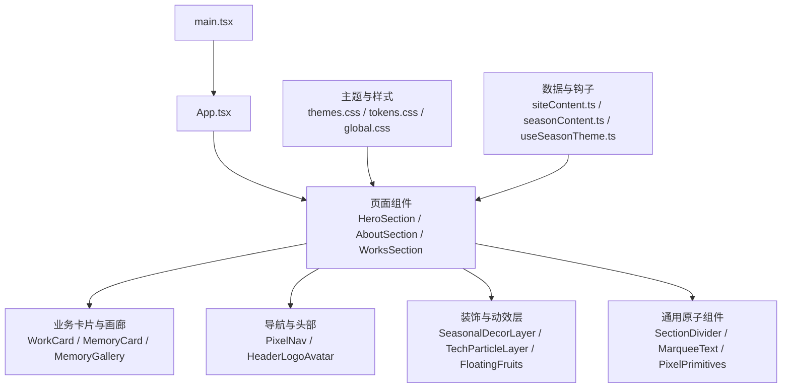
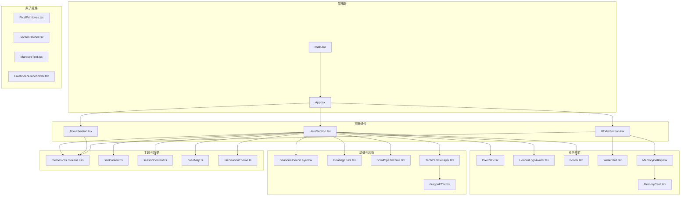
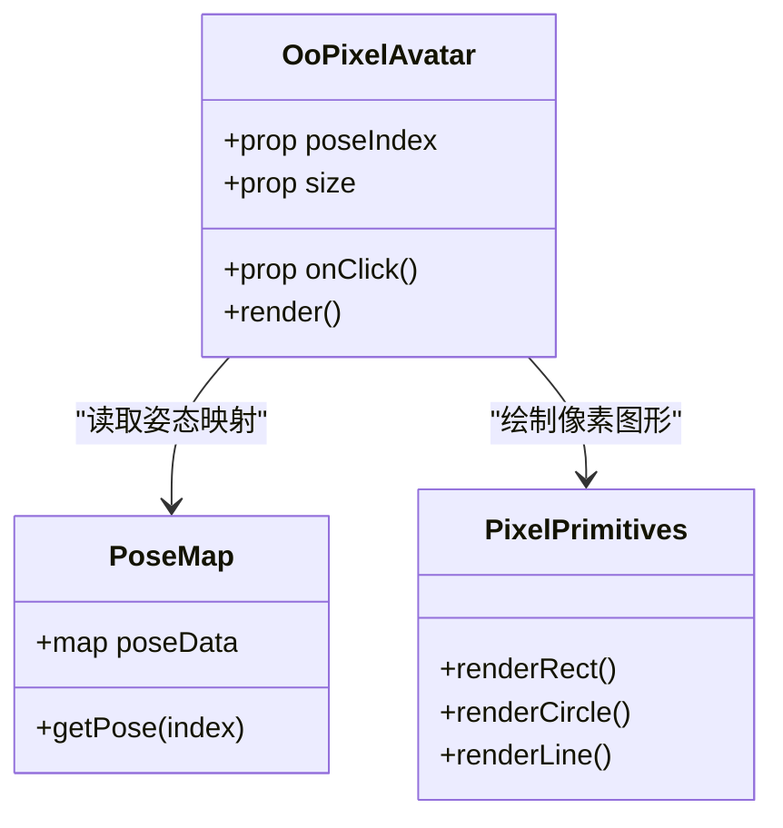
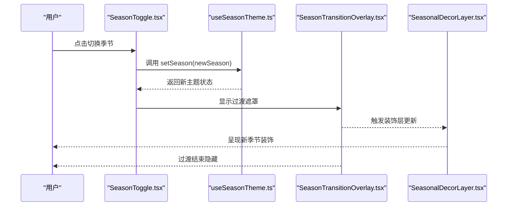
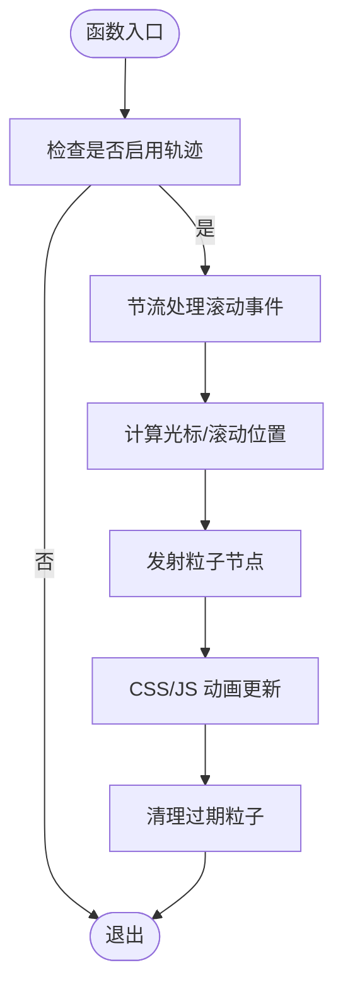
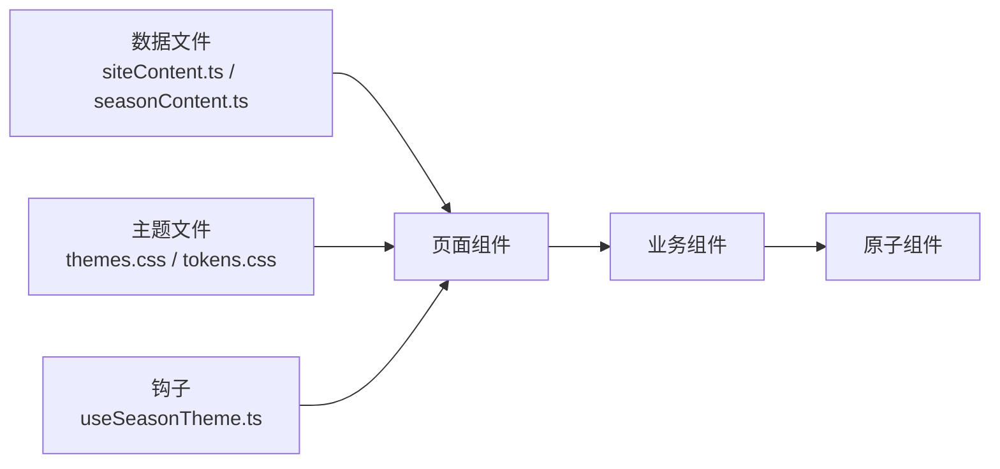
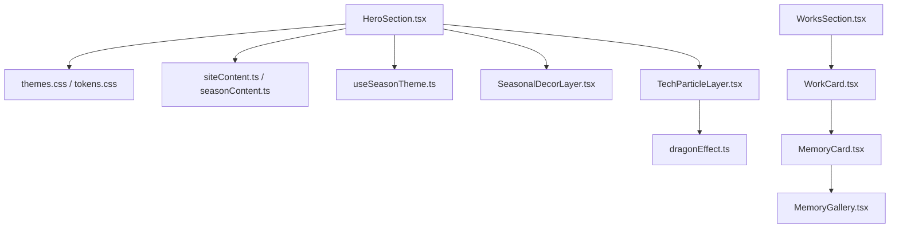

# 核心组件

<cite>
**本文引用的文件**   
- [App.tsx](file://src/App.tsx)
- [main.tsx](file://src/main.tsx)
- [OoPixelAvatar.tsx](file://src/components/OoPixelAvatar.tsx)
- [PixelGirl.tsx](file://src/components/PixelGirl.tsx)
- [MemoryCard.tsx](file://src/components/MemoryCard.tsx)
- [MemoryGallery.tsx](file://src/components/MemoryGallery.tsx)
- [HeroSection.tsx](file://src/components/HeroSection.tsx)
- [AboutSection.tsx](file://src/components/AboutSection.tsx)
- [WorksSection.tsx](file://src/components/WorksSection.tsx)
- [WorkCard.tsx](file://src/components/WorkCard.tsx)
- [PixelNav.tsx](file://src/components/PixelNav.tsx)
- [HeaderLogoAvatar.tsx](file://src/components/HeaderLogoAvatar.tsx)
- [Footer.tsx](file://src/components/Footer.tsx)
- [MarqueeText.tsx](file://src/components/MarqueeText.tsx)
- [SeasonToggle.tsx](file://src/components/SeasonToggle.tsx)
- [SeasonTransitionOverlay.tsx](file://src/components/SeasonTransitionOverlay.tsx)
- [SeasonalDecorLayer.tsx](file://src/components/SeasonalDecorLayer.tsx)
- [FloatingFruits.tsx](file://src/components/FloatingFruits.tsx)
- [ScrollSparkleTrail.tsx](file://src/components/ScrollSparkleTrail.tsx)
- [TechParticleLayer.tsx](file://src/components/TechParticleLayer.tsx)
- [SectionDivider.tsx](file://src/components/SectionDivider.tsx)
- [PixelPrimitives.tsx](file://src/components/PixelPrimitives.tsx)
- [PixelVideoPlaceholder.tsx](file://src/components/PixelVideo占位符.tsx)
- [useEasterEggClick.ts](file://src/hooks/useEasterEggClick.ts)
- [useSeasonTheme.ts](file://src/hooks/useSeasonTheme.ts)
- [dragonEffect.ts](file://src/effects/dragonEffect.ts)
- [global.css](file://src/styles/global.css)
- [themes.css](file://src/styles/themes.css)
- [tokens.css](file://src/styles/tokens.css)
- [pixel.css](file://src/styles/pixel.css)
- [pixel-hero.css](file://src/styles/pixel-hero.css)
- [pixel-memory.css](file://src/styles/pixel-memory.css)
- [pixel-works.css](file://src/styles/pixel-works.css)
- [siteContent.ts](file://src/data/siteContent.ts)
- [seasonContent.ts](file://src/data/seasonContent.ts)
- [poseMap.ts](file://src/data/poseMap.ts)
</cite>

## 目录
1. [简介](#简介)
2. [项目结构](#项目结构)
3. [核心组件](#核心组件)
4. [架构总览](#架构总览)
5. [详细组件分析](#详细组件分析)
6. [依赖分析](#依赖分析)
7. [性能考虑](#性能考虑)
8. [故障排查指南](#故障排查指南)
9. [结论](#结论)
10. [附录](#附录)

## 简介
本文件为 oo-space 项目的核心 UI 组件文档，聚焦于像素风格与季节主题交互的页面级与原子级组件。内容涵盖：
- 视觉外观、行为与用户交互模式
- 属性（props）、事件、插槽与自定义选项
- 响应式设计与可访问性合规指导
- 组件状态、动画与过渡效果
- 样式自定义与主题支持
- 跨浏览器兼容性与性能优化
- 组件组合模式与与其他 UI 元素的集成

## 项目结构
项目采用 React + TypeScript 技术栈，组件按功能划分在 src/components 下，样式集中在 src/styles，数据与主题配置位于 src/data 与 hooks。入口文件为 main.tsx，应用根组件为 App.tsx。

图表来源
- [main.tsx:1-50](file://src/main.tsx#L1-L50)
- [App.tsx:1-120](file://src/App.tsx#L1-L120)
- [HeroSection.tsx:1-120](file://src/components/HeroSection.tsx#L1-L120)
- [AboutSection.tsx:1-120](file://src/components/AboutSection.tsx#L1-L120)
- [WorksSection.tsx:1-120](file://src/components/WorksSection.tsx#L1-L120)
- [themes.css:1-120](file://src/styles/themes.css#L1-L120)
- [tokens.css:1-120](file://src/styles/tokens.css#L1-L120)
- [global.css:1-120](file://src/styles/global.css#L1-L120)
- [siteContent.ts:1-120](file://src/data/siteContent.ts#L1-L120)
- [seasonContent.ts:1-120](file://src/data/seasonContent.ts#L1-L120)

章节来源
- [main.tsx:1-50](file://src/main.tsx#L1-L50)
- [App.tsx:1-120](file://src/App.tsx#L1-L120)

## 核心组件
本节概述各核心组件的职责、外观与交互要点，并给出属性、事件、插槽与主题的说明路径。

- HeroSection（首屏区域）
  - 职责：展示主标题、副标题、引导按钮与背景装饰；承载季节切换入口与粒子特效层。
  - 交互：点击触发季节切换、滚动进入其他区块、鼠标悬停高亮。
  - 主题：跟随全局主题变量，支持明暗与季节配色。
  - 参考实现路径：[HeroSection.tsx](file://src/components/HeroSection.tsx)

- AboutSection（关于区）
  - 职责：介绍作者/团队信息、技能标签与时间线。
  - 交互：展开/收起详情、键盘可达。
  - 参考实现路径：[AboutSection.tsx](file://src/components/AboutSection.tsx)

- WorksSection（作品区）
  - 职责：以网格或瀑布流展示作品卡片。
  - 交互：筛选、排序、点击跳转详情。
  - 参考实现路径：[WorksSection.tsx](file://src/components/WorksSection.tsx)

- WorkCard（作品卡片）
  - 职责：展示作品封面、标题、摘要与标签。
  - 交互：悬停放大、点击打开详情模态框。
  - 参考实现路径：[WorkCard.tsx](file://src/components/WorkCard.tsx)

- MemoryCard（记忆卡片）
  - 职责：展示图片与简短描述，支持翻转或缩放查看。
  - 交互：点击预览大图、左右滑动翻页。
  - 参考实现路径：[MemoryCard.tsx](file://src/components/MemoryCard.tsx)

- MemoryGallery（记忆画廊）
  - 职责：聚合多张 MemoryCard，提供浏览体验。
  - 交互：懒加载、缩略图导航、全屏预览。
  - 参考实现路径：[MemoryGallery.tsx](file://src/components/MemoryGallery.tsx)

- OoPixelAvatar（OO 像素头像）
  - 职责：渲染像素风格的头像与姿态映射。
  - 交互：点击切换姿态、hover 提示。
  - 参考实现路径：[OoPixelAvatar.tsx](file://src/components/OoPixelAvatar.tsx)、[poseMap.ts](file://src/data/poseMap.ts)

- PixelGirl（像素女孩）
  - 职责：展示角色动画帧序列，支持循环播放与暂停。
  - 交互：点击控制播放/暂停，拖拽调整速度。
  - 参考实现路径：[PixelGirl.tsx](file://src/components/PixelGirl.tsx)

- PixelNav（像素导航）
  - 职责：顶部导航栏，包含 Logo、菜单项与移动端汉堡菜单。
  - 交互：锚点跳转、滚动高亮当前节、移动端展开收起。
  - 参考实现路径：[PixelNav.tsx](file://src/components/PixelNav.tsx)

- HeaderLogoAvatar（头部 Logo 与头像）
  - 职责：头部左侧品牌标识与头像组合。
  - 交互：点击头像弹出菜单或跳转个人页。
  - 参考实现路径：[HeaderLogoAvatar.tsx](file://src/components/HeaderLogoAvatar.tsx)

- Footer（页脚）
  - 职责：版权信息、社交链接与快速导航。
  - 交互：外链跳转、回到顶部。
  - 参考实现路径：[Footer.tsx](file://src/components/Footer.tsx)

- MarqueeText（跑马灯文本）
  - 职责：横向滚动展示标语或关键词。
  - 交互：悬停暂停、点击跳转。
  - 参考实现路径：[MarqueeText.tsx](file://src/components/MarqueeText.tsx)

- SeasonToggle（季节切换开关）
  - 职责：切换站点季节主题（春/夏/秋/冬）。
  - 交互：点击切换、键盘操作、持久化选择。
  - 参考实现路径：[SeasonToggle.tsx](file://src/components/SeasonToggle.tsx)、[useSeasonTheme.ts](file://src/hooks/useSeasonTheme.ts)

- SeasonTransitionOverlay（季节过渡遮罩）
  - 职责：切换主题时的全屏过渡动画。
  - 交互：自动播放后隐藏，支持跳过。
  - 参考实现路径：[SeasonTransitionOverlay.tsx](file://src/components/SeasonTransitionOverlay.tsx)

- SeasonalDecorLayer（季节装饰层）
  - 职责：叠加季节性装饰元素（雪花、花瓣等）。
  - 交互：根据主题动态显示/隐藏。
  - 参考实现路径：[SeasonalDecorLayer.tsx](file://src/components/SeasonalDecorLayer.tsx)

- FloatingFruits（浮动水果）
  - 职责：随机浮动的装饰元素，增强氛围感。
  - 交互：鼠标靠近轻微位移。
  - 参考实现路径：[FloatingFruits.tsx](file://src/components/FloatingFruits.tsx)

- ScrollSparkleTrail（滚动闪光轨迹）
  - 职责：滚动时生成粒子轨迹。
  - 交互：随滚动位置更新，节流优化。
  - 参考实现路径：[ScrollSparkleTrail.tsx](file://src/components/ScrollSparkleTrail.tsx)

- TechParticleLayer（科技粒子层）
  - 职责：Canvas/WebGL 粒子背景。
  - 交互：鼠标移动影响粒子运动。
  - 参考实现路径：[TechParticleLayer.tsx](file://src/components/TechParticleLayer.tsx)、[dragonEffect.ts](file://src/effects/dragonEffect.ts)

- SectionDivider（区块分隔线）
  - 职责：视觉分隔不同区块。
  - 交互：无或轻量 hover。
  - 参考实现路径：[SectionDivider.tsx](file://src/components/SectionDivider.tsx)

- PixelPrimitives（像素基础图形）
  - 职责：提供像素风格的矩形、圆形、线条等基础图形。
  - 交互：作为组合基元被上层组件复用。
  - 参考实现路径：[PixelPrimitives.tsx](file://src/components/PixelPrimitives.tsx)

- PixelVideoPlaceholder（像素视频占位符）
  - 职责：视频未就绪时的占位展示。
  - 交互：点击尝试加载或重试。
  - 参考实现路径：[PixelVideoPlaceholder.tsx](file://src/components/PixelVideo占位符.tsx)

章节来源
- [HeroSection.tsx:1-120](file://src/components/HeroSection.tsx#L1-L120)
- [AboutSection.tsx:1-120](file://src/components/AboutSection.tsx#L1-L120)
- [WorksSection.tsx:1-120](file://src/components/WorksSection.tsx#L1-L120)
- [WorkCard.tsx:1-120](file://src/components/WorkCard.tsx#L1-L120)
- [MemoryCard.tsx:1-120](file://src/components/MemoryCard.tsx#L1-L120)
- [MemoryGallery.tsx:1-120](file://src/components/MemoryGallery.tsx#L1-L120)
- [OoPixelAvatar.tsx:1-120](file://src/components/OoPixelAvatar.tsx#L1-L120)
- [PixelGirl.tsx:1-120](file://src/components/PixelGirl.tsx#L1-L120)
- [PixelNav.tsx:1-120](file://src/components/PixelNav.tsx#L1-L120)
- [HeaderLogoAvatar.tsx:1-120](file://src/components/HeaderLogoAvatar.tsx#L1-L120)
- [Footer.tsx:1-120](file://src/components/Footer.tsx#L1-L120)
- [MarqueeText.tsx:1-120](file://src/components/MarqueeText.tsx#L1-L120)
- [SeasonToggle.tsx:1-120](file://src/components/SeasonToggle.tsx#L1-L120)
- [SeasonTransitionOverlay.tsx:1-120](file://src/components/SeasonTransitionOverlay.tsx#L1-L120)
- [SeasonalDecorLayer.tsx:1-120](file://src/components/SeasonalDecorLayer.tsx#L1-L120)
- [FloatingFruits.tsx:1-120](file://src/components/FloatingFruits.tsx#L1-L120)
- [ScrollSparkleTrail.tsx:1-120](file://src/components/ScrollSparkleTrail.tsx#L1-L120)
- [TechParticleLayer.tsx:1-120](file://src/components/TechParticleLayer.tsx#L1-L120)
- [SectionDivider.tsx:1-120](file://src/components/SectionDivider.tsx#L1-L120)
- [PixelPrimitives.tsx:1-120](file://src/components/PixelPrimitives.tsx#L1-L120)
- [PixelVideoPlaceholder.tsx:1-120](file://src/components/PixelVideo占位符.tsx#L1-L120)
- [useSeasonTheme.ts:1-120](file://src/hooks/useSeasonTheme.ts#L1-L120)
- [dragonEffect.ts:1-120](file://src/effects/dragonEffect.ts#L1-L120)

## 架构总览
整体采用“页面组件 → 业务卡片/画廊 → 原子组件”的分层结构，配合主题与数据驱动渲染。

图表来源
- [App.tsx:1-120](file://src/App.tsx#L1-L120)
- [HeroSection.tsx:1-120](file://src/components/HeroSection.tsx#L1-L120)
- [AboutSection.tsx:1-120](file://src/components/AboutSection.tsx#L1-L120)
- [WorksSection.tsx:1-120](file://src/components/WorksSection.tsx#L1-L120)
- [PixelNav.tsx:1-120](file://src/components/PixelNav.tsx#L1-L120)
- [HeaderLogoAvatar.tsx:1-120](file://src/components/HeaderLogoAvatar.tsx#L1-L120)
- [Footer.tsx:1-120](file://src/components/Footer.tsx#L1-L120)
- [WorkCard.tsx:1-120](file://src/components/WorkCard.tsx#L1-L120)
- [MemoryGallery.tsx:1-120](file://src/components/MemoryGallery.tsx#L1-L120)
- [MemoryCard.tsx:1-120](file://src/components/MemoryCard.tsx#L1-L120)
- [SeasonalDecorLayer.tsx:1-120](file://src/components/SeasonalDecorLayer.tsx#L1-L120)
- [FloatingFruits.tsx:1-120](file://src/components/FloatingFruits.tsx#L1-L120)
- [ScrollSparkleTrail.tsx:1-120](file://src/components/ScrollSparkleTrail.tsx#L1-L120)
- [TechParticleLayer.tsx:1-120](file://src/components/TechParticleLayer.tsx#L1-L120)
- [dragonEffect.ts:1-120](file://src/effects/dragonEffect.ts#L1-L120)
- [themes.css:1-120](file://src/styles/themes.css#L1-L120)
- [tokens.css:1-120](file://src/styles/tokens.css#L1-L120)
- [siteContent.ts:1-120](file://src/data/siteContent.ts#L1-L120)
- [seasonContent.ts:1-120](file://src/data/seasonContent.ts#L1-L120)
- [poseMap.ts:1-120](file://src/data/poseMap.ts#L1-L120)

## 详细组件分析

### 组件类关系图（示例：头像与姿态）

图表来源
- [OoPixelAvatar.tsx:1-120](file://src/components/OoPixelAvatar.tsx#L1-L120)
- [poseMap.ts:1-120](file://src/data/poseMap.ts#L1-L120)
- [PixelPrimitives.tsx:1-120](file://src/components/PixelPrimitives.tsx#L1-L120)

章节来源
- [OoPixelAvatar.tsx:1-120](file://src/components/OoPixelAvatar.tsx#L1-L120)
- [poseMap.ts:1-120](file://src/data/poseMap.ts#L1-L120)
- [PixelPrimitives.tsx:1-120](file://src/components/PixelPrimitives.tsx#L1-L120)

### API/服务调用流程（示例：季节切换）

图表来源
- [SeasonToggle.tsx:1-120](file://src/components/SeasonToggle.tsx#L1-L120)
- [useSeasonTheme.ts:1-120](file://src/hooks/useSeasonTheme.ts#L1-L120)
- [SeasonTransitionOverlay.tsx:1-120](file://src/components/SeasonTransitionOverlay.tsx#L1-L120)
- [SeasonalDecorLayer.tsx:1-120](file://src/components/SeasonalDecorLayer.tsx#L1-L120)

章节来源
- [SeasonToggle.tsx:1-120](file://src/components/SeasonToggle.tsx#L1-L120)
- [useSeasonTheme.ts:1-120](file://src/hooks/useSeasonTheme.ts#L1-L120)
- [SeasonTransitionOverlay.tsx:1-120](file://src/components/SeasonTransitionOverlay.tsx#L1-L120)
- [SeasonalDecorLayer.tsx:1-120](file://src/components/SeasonalDecorLayer.tsx#L1-L120)

### 复杂逻辑流程图（示例：滚动闪光轨迹）

图表来源
- [ScrollSparkleTrail.tsx:1-120](file://src/components/ScrollSparkleTrail.tsx#L1-L120)

章节来源
- [ScrollSparkleTrail.tsx:1-120](file://src/components/ScrollSparkleTrail.tsx#L1-L120)

### 概念总览（非代码映射）
- 组件分层：页面组件负责布局与编排，业务组件封装具体交互，原子组件提供最小可复用单元。
- 主题系统：通过 CSS 变量与主题文件集中管理颜色、字体、间距与动效参数。
- 数据驱动：站点内容与季节内容通过数据文件注入，避免硬编码。

[本图为概念示意，不直接映射到具体源码文件]

## 依赖分析
组件间耦合度较低，主要通过 props 与上下文传递主题与数据。关键依赖如下：
- 页面组件依赖主题与数据源
- 业务组件依赖原子组件与动效层
- 动效层依赖 Canvas/WebGL 与事件监听

图表来源
- [HeroSection.tsx:1-120](file://src/components/HeroSection.tsx#L1-L120)
- [themes.css:1-120](file://src/styles/themes.css#L1-L120)
- [tokens.css:1-120](file://src/styles/tokens.css#L1-L120)
- [siteContent.ts:1-120](file://src/data/siteContent.ts#L1-L120)
- [seasonContent.ts:1-120](file://src/data/seasonContent.ts#L1-L120)
- [useSeasonTheme.ts:1-120](file://src/hooks/useSeasonTheme.ts#L1-L120)
- [SeasonalDecorLayer.tsx:1-120](file://src/components/SeasonalDecorLayer.tsx#L1-L120)
- [TechParticleLayer.tsx:1-120](file://src/components/TechParticleLayer.tsx#L1-L120)
- [dragonEffect.ts:1-120](file://src/effects/dragonEffect.ts#L1-L120)
- [WorksSection.tsx:1-120](file://src/components/WorksSection.tsx#L1-L120)
- [WorkCard.tsx:1-120](file://src/components/WorkCard.tsx#L1-L120)
- [MemoryCard.tsx:1-120](file://src/components/MemoryCard.tsx#L1-L120)
- [MemoryGallery.tsx:1-120](file://src/components/MemoryGallery.tsx#L1-L120)

章节来源
- [HeroSection.tsx:1-120](file://src/components/HeroSection.tsx#L1-L120)
- [WorksSection.tsx:1-120](file://src/components/WorksSection.tsx#L1-L120)
- [TechParticleLayer.tsx:1-120](file://src/components/TechParticleLayer.tsx#L1-L120)
- [dragonEffect.ts:1-120](file://src/effects/dragonEffect.ts#L1-L120)

## 性能考虑
- 列表与画廊
  - 使用虚拟滚动或分页加载减少初始渲染压力
  - 图片懒加载与按需解码，优先低分辨率占位
- 动画与粒子
  - 将重计算放入 requestAnimationFrame，避免主线程阻塞
  - 对滚动与鼠标事件进行节流/防抖
  - 在低端设备上降级为 CSS 动画或关闭粒子层
- 主题切换
  - 使用 CSS 变量切换，避免全量重绘
  - 过渡遮罩短时长，允许用户跳过
- 资源与缓存
  - 静态资源开启强缓存与 CDN
  - 字体与图标预加载，减少闪烁

[本节为通用建议，不直接分析具体文件]

## 故障排查指南
- 主题未生效
  - 检查 themes.css 与 tokens.css 中变量是否正确定义与覆盖
  - 确认 useSeasonTheme.ts 的状态更新与持久化逻辑
- 粒子层卡顿
  - 降低粒子数量与更新频率
  - 检测设备性能，必要时禁用 TechParticleLayer
- 图片加载失败
  - 检查网络与跨域策略
  - 增加错误占位与重试机制
- 键盘可达性问题
  - 确保所有交互元素具备 tabindex 与 aria-* 属性
  - 验证焦点顺序与可见焦点样式

章节来源
- [themes.css:1-120](file://src/styles/themes.css#L1-L120)
- [tokens.css:1-120](file://src/styles/tokens.css#L1-L120)
- [useSeasonTheme.ts:1-120](file://src/hooks/useSeasonTheme.ts#L1-L120)
- [TechParticleLayer.tsx:1-120](file://src/components/TechParticleLayer.tsx#L1-L120)

## 结论
oo-space 的核心组件体系以清晰的层次结构与主题驱动为核心，结合丰富的像素风格与季节主题交互，提供了良好的用户体验与扩展性。通过合理的性能优化与可访问性实践，可在多设备与多浏览器环境下稳定运行。建议在后续迭代中持续完善组件 API 文档与测试用例，提升可维护性与健壮性。

[本节为总结性内容，不直接分析具体文件]

## 附录
- 响应式设计指导
  - 使用相对单位与媒体查询适配不同屏幕
  - 栅格布局与弹性布局结合，保证内容可读性
- 可访问性合规
  - 语义化 HTML 与正确的 ARIA 标注
  - 色彩对比度符合 WCAG 标准
  - 键盘导航与屏幕阅读器友好
- 样式自定义与主题支持
  - 通过 CSS 变量与主题文件集中管理
  - 提供覆盖类名与配置项，便于二次开发
- 跨浏览器兼容性
  - 针对旧版浏览器提供降级方案
  - 使用 Polyfill 与特性检测保障功能可用
- 组件组合模式
  - 页面组件编排业务组件，业务组件组合原子组件
  - 通过 props、事件回调与插槽实现松耦合

[本节为通用指导，不直接分析具体文件]