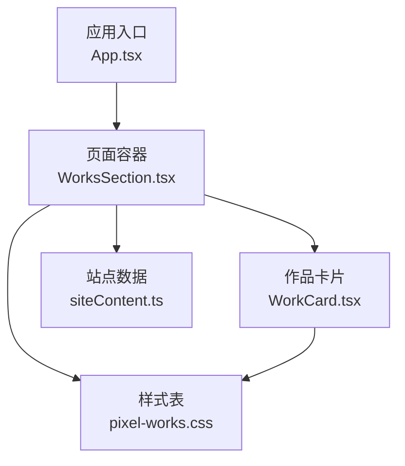
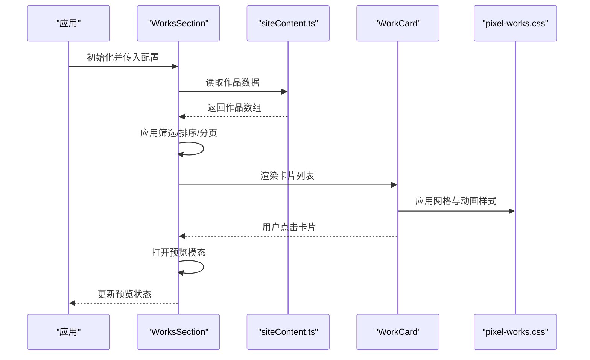
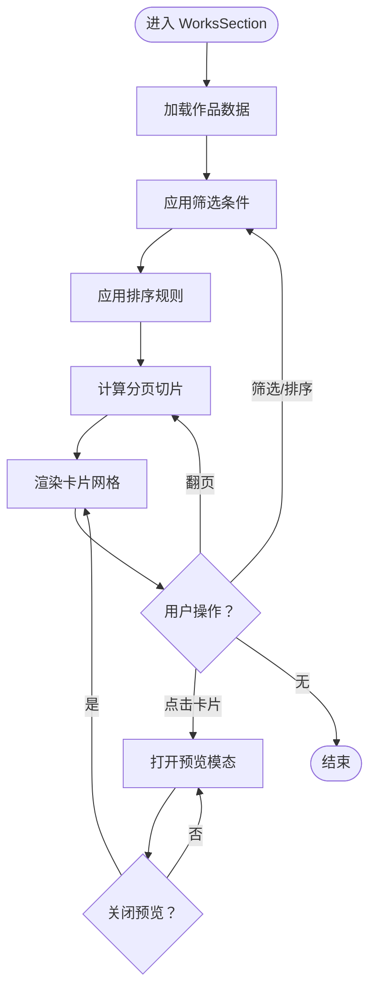
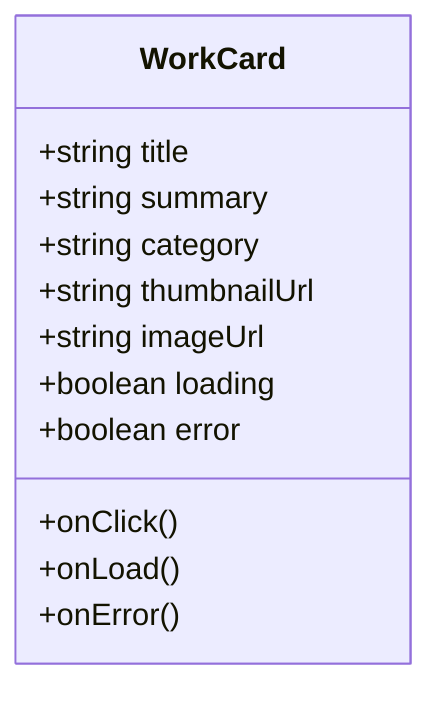
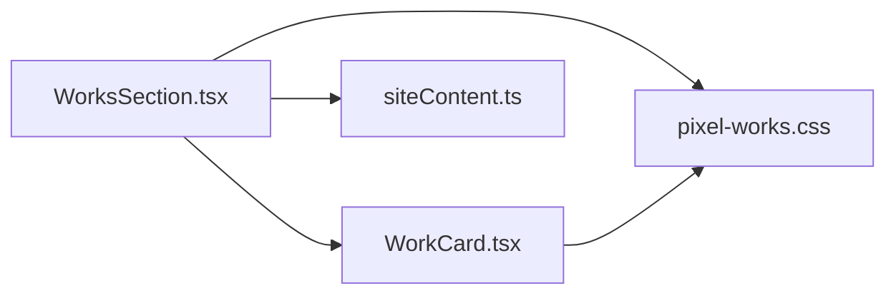

# 作品展示组件 (WorksSection)

<cite>
**本文引用的文件**   
- [src/components/WorksSection.tsx](file://src/components/WorksSection.tsx)
- [src/components/WorkCard.tsx](file://src/components/WorkCard.tsx)
- [src/styles/pixel-works.css](file://src/styles/pixel-works.css)
- [src/data/siteContent.ts](file://src/data/siteContent.ts)
</cite>

## 目录
1. [简介](#简介)
2. [项目结构](#项目结构)
3. [核心组件](#核心组件)
4. [架构总览](#架构总览)
5. [详细组件分析](#详细组件分析)
6. [依赖分析](#依赖分析)
7. [性能考虑](#性能考虑)
8. [故障排查指南](#故障排查指南)
9. [结论](#结论)
10. [附录](#附录) 

## 简介
本文件为“作品展示组件（WorksSection）”的完整 UI 组件文档，面向前端开发者与内容运营人员。文档聚焦以下目标：
- 作品卡片的网格布局、悬停效果与点击交互
- 作品数据绑定方式、卡片状态管理与筛选功能实现
- 图片懒加载、缩略图生成与高清预览
- 数据结构定义、排序算法与分页逻辑
- 响应式设计与适配策略
- 性能优化与错误处理机制

## 项目结构
WorksSection 位于 src/components 下，配合样式文件 src/styles/pixel-works.css 与数据源 src/data/siteContent.ts。WorkCard 作为单张作品卡片组件被 WorksSection 复用。整体采用“容器 + 卡片”的分层结构，便于扩展与维护。

图表来源 
- [src/components/WorksSection.tsx](file://src/components/WorksSection.tsx)
- [src/components/WorkCard.tsx](file://src/components/WorkCard.tsx)
- [src/styles/pixel-works.css](file://src/styles/pixel-works.css)
- [src/data/siteContent.ts](file://src/data/siteContent.ts)

章节来源
- [src/components/WorksSection.tsx](file://src/components/WorksSection.tsx)
- [src/components/WorkCard.tsx](file://src/components/WorkCard.tsx)
- [src/styles/pixel-works.css](file://src/styles/pixel-works.css)
- [src/data/siteContent.ts](file://src/data/siteContent.ts)

## 核心组件
- WorksSection：作品列表容器，负责数据获取、筛选、排序、分页、网格布局与模态预览控制。
- WorkCard：单张作品卡片，负责图片懒加载、缩略图显示、悬停动效与点击打开预览。
- pixel-works.css：网格、间距、动画、响应式断点等样式定义。
- siteContent.ts：作品数据源（标题、描述、分类、图片路径、链接等）。

章节来源
- [src/components/WorksSection.tsx](file://src/components/WorksSection.tsx)
- [src/components/WorkCard.tsx](file://src/components/WorkCard.tsx)
- [src/styles/pixel-works.css](file://src/styles/pixel-works.css)
- [src/data/siteContent.ts](file://src/data/siteContent.ts)

## 架构总览
WorksSection 通过数据源提供作品集合，内部维护筛选条件、排序规则与分页状态；渲染时按网格布局输出 WorkCard。点击卡片触发预览模态，支持高清大图查看与关闭。

图表来源 
- [src/components/WorksSection.tsx](file://src/components/WorksSection.tsx)
- [src/components/WorkCard.tsx](file://src/components/WorkCard.tsx)
- [src/styles/pixel-works.css](file://src/styles/pixel-works.css)
- [src/data/siteContent.ts](file://src/data/siteContent.ts)

## 详细组件分析

### 组件：WorksSection（作品列表容器）
职责
- 数据接入与缓存：从 siteContent.ts 获取作品数据，并在组件内做筛选、排序、分页计算。
- 视图渲染：以网格形式渲染 WorkCard，支持不同屏幕尺寸下的列数变化。
- 交互控制：管理筛选条件、排序选项、分页页码与预览模态开关。
- 可访问性：为键盘导航与屏幕阅读器提供必要属性。

关键状态
- 筛选：按分类、标签或关键词过滤。
- 排序：按时间、名称或自定义权重排序。
- 分页：每页数量、当前页码、总页数。
- 预览：是否显示高清预览、当前预览项索引。

交互流程
- 切换筛选/排序：重新计算可见列表并刷新分页。
- 翻页：根据页码切片数据并渲染。
- 点击卡片：设置预览项并打开模态。
- 关闭预览：清空预览项并回到列表。

图表来源 
- [src/components/WorksSection.tsx](file://src/components/WorksSection.tsx)

章节来源
- [src/components/WorksSection.tsx](file://src/components/WorksSection.tsx)

### 组件：WorkCard（作品卡片）
职责
- 展示缩略图与基本信息（标题、摘要、分类等）。
- 图片懒加载：仅在进入视口时加载真实图片，减少首屏压力。
- 悬停效果：缩放、阴影、遮罩文字等视觉反馈。
- 点击行为：触发父级预览打开事件。

关键状态
- 加载状态：加载中、成功、失败三种状态。
- 占位图：在图片未加载时显示占位图或骨架屏。
- 焦点与键盘：支持 Tab 导航与 Enter 打开预览。

图表来源 
- [src/components/WorkCard.tsx](file://src/components/WorkCard.tsx)

章节来源
- [src/components/WorkCard.tsx](file://src/components/WorkCard.tsx)

### 样式：pixel-works.css（网格与动效）
要点
- 网格布局：使用 CSS Grid 或 Flexbox 实现多列自适应，随断点调整列数。
- 间距与对齐：统一卡片间距、行高与文本对齐。
- 悬停动效：过渡动画、缩放、阴影增强。
- 响应式：移动端单列/双列，平板三列，桌面四列及以上。
- 主题适配：明暗主题下的颜色与对比度。

章节来源
- [src/styles/pixel-works.css](file://src/styles/pixel-works.css)

### 数据：siteContent.ts（作品数据源）
建议的数据结构
- id：唯一标识
- title：标题
- summary：摘要
- category：分类
- tags：标签数组
- thumbnailUrl：缩略图路径
- imageUrl：高清大图路径
- link：外部链接（可选）
- createdAt：创建时间（用于排序）
- status：状态（如已发布/草稿）

章节来源
- [src/data/siteContent.ts](file://src/data/siteContent.ts)

## 依赖分析
- WorksSection 依赖 WorkCard 进行单项渲染。
- WorksSection 依赖 siteContent.ts 提供数据。
- WorksSection 与 WorkCard 共同依赖 pixel-works.css 完成样式与动效。
- 组件间通过 props 与回调函数解耦，避免循环依赖。

图表来源 
- [src/components/WorksSection.tsx](file://src/components/WorksSection.tsx)
- [src/components/WorkCard.tsx](file://src/components/WorkCard.tsx)
- [src/styles/pixel-works.css](file://src/styles/pixel-works.css)
- [src/data/siteContent.ts](file://src/data/siteContent.ts)

章节来源
- [src/components/WorksSection.tsx](file://src/components/WorksSection.tsx)
- [src/components/WorkCard.tsx](file://src/components/WorkCard.tsx)
- [src/styles/pixel-works.css](file://src/styles/pixel-works.css)
- [src/data/siteContent.ts](file://src/data/siteContent.ts)

## 性能考虑
- 图片懒加载：仅对可视区域图片发起请求，降低首屏带宽与渲染耗时。
- 缩略图优先：先展示压缩后的缩略图，再按需加载高清大图。
- 虚拟滚动：当作品数量较大时，可采用虚拟列表技术只渲染可视区卡片。
- 防抖与节流：搜索输入与窗口 resize 事件需加防抖/节流。
- 预加载策略：对下一页或热门作品进行预加载，提升交互流畅度。
- 资源缓存：利用浏览器缓存与 CDN 加速静态资源。
- 内存管理：及时释放预览模态中的大图片引用，避免内存泄漏。

[本节为通用指导，不直接分析具体文件]

## 故障排查指南
常见问题与定位方法
- 图片无法加载
  - 检查图片路径是否正确，CDN 是否可达。
  - 确认网络权限与跨域策略。
  - 查看控制台报错与网络面板请求状态。
- 筛选无效
  - 校验筛选字段是否存在于数据模型中。
  - 检查大小写与空格处理逻辑。
- 排序异常
  - 确认排序键类型一致（字符串/数字/日期）。
  - 检查空值与缺失字段的默认值处理。
- 分页错乱
  - 验证每页数量与总条数计算。
  - 检查边界页码（小于 1 或大于最大页）的处理。
- 预览不显示
  - 确认高清大图路径有效。
  - 检查模态框 z-index 与遮挡问题。
- 性能卡顿
  - 开启性能面板观察长任务与重排重绘。
  - 评估是否启用虚拟滚动与懒加载。

章节来源
- [src/components/WorksSection.tsx](file://src/components/WorksSection.tsx)
- [src/components/WorkCard.tsx](file://src/components/WorkCard.tsx)
- [src/styles/pixel-works.css](file://src/styles/pixel-works.css)
- [src/data/siteContent.ts](file://src/data/siteContent.ts)

## 结论
WorksSection 通过清晰的分层结构与模块化设计，实现了高效的作品展示能力。结合懒加载、缩略图与高清预览，兼顾了用户体验与性能。完善的筛选、排序与分页机制使内容组织更加灵活。建议在大数据量场景引入虚拟滚动与更严格的错误边界，进一步提升稳定性与流畅度。

[本节为总结，不直接分析具体文件]

## 附录

### 数据结构定义（建议）
- id：string
- title：string
- summary：string
- category：string
- tags：string[]
- thumbnailUrl：string
- imageUrl：string
- link：string | null
- createdAt：string | number
- status：enum("published","draft")

章节来源
- [src/data/siteContent.ts](file://src/data/siteContent.ts)

### 排序算法说明
- 默认排序：按创建时间降序。
- 可选排序：按名称升序、按权重降序。
- 稳定排序：保证相同键值的相对顺序不变。
- 空值处理：缺失字段赋予默认值参与比较。

章节来源
- [src/components/WorksSection.tsx](file://src/components/WorksSection.tsx)

### 分页逻辑说明
- 参数：每页数量、当前页码。
- 计算：总页数 = ceil(总数 / 每页数量)。
- 边界：页码越界自动修正到有效范围。
- 渲染：基于页码切片数据渲染卡片。

章节来源
- [src/components/WorksSection.tsx](file://src/components/WorksSection.tsx)

### 响应式设计适配
- 断点建议：
  - 手机：1 列
  - 平板：2~3 列
  - 桌面：4+ 列
- 卡片比例：固定宽高比，避免布局抖动。
- 字体与间距：随屏幕尺寸缩放，保持可读性。

章节来源
- [src/styles/pixel-works.css](file://src/styles/pixel-works.css)

### 图片懒加载与缩略图生成
- 懒加载：使用 IntersectionObserver 监听可视区域。
- 占位图：加载前显示占位图或骨架屏。
- 缩略图：服务端或构建期生成压缩版本，减小体积。
- 高清预览：点击后按需加载大图，并提供下载或全屏查看。

章节来源
- [src/components/WorkCard.tsx](file://src/components/WorkCard.tsx)
- [src/styles/pixel-works.css](file://src/styles/pixel-works.css)

### 错误处理机制
- 网络错误：重试策略与降级展示。
- 资源错误：显示错误占位图与提示文案。
- 数据异常：过滤非法条目并记录日志。
- 用户反馈：友好的错误提示与恢复操作。

章节来源
- [src/components/WorkCard.tsx](file://src/components/WorkCard.tsx)
- [src/components/WorksSection.tsx](file://src/components/WorksSection.tsx)