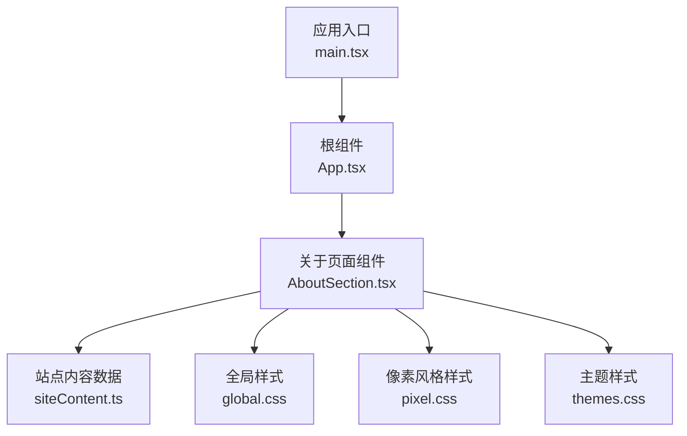
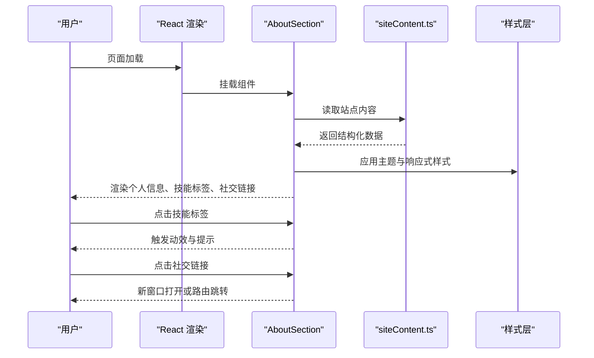
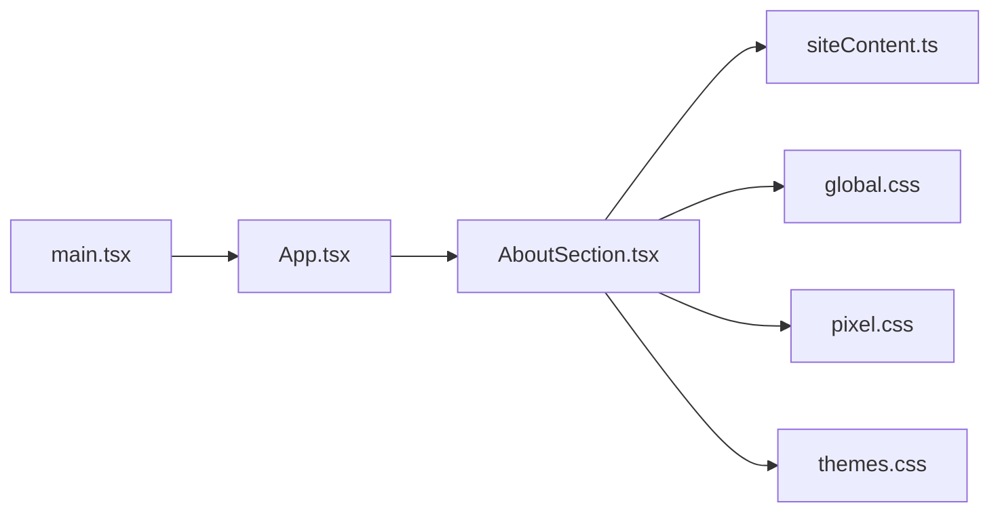

# 关于页面组件 (AboutSection)

<cite>
**本文档引用的文件**   
- [AboutSection.tsx](file://src/components/AboutSection.tsx)
- [siteContent.ts](file://src/data/siteContent.ts)
- [global.css](file://src/styles/global.css)
- [pixel.css](file://src/styles/pixel.css)
- [themes.css](file://src/styles/themes.css)
- [App.tsx](file://src/App.tsx)
- [main.tsx](file://src/main.tsx)
</cite>

## 目录
1. [简介](#简介)
2. [项目结构](#项目结构)
3. [核心组件](#核心组件)
4. [架构总览](#架构总览)
5. [详细组件分析](#详细组件分析)
6. [依赖分析](#依赖分析)
7. [性能考虑](#性能考虑)
8. [故障排查指南](#故障排查指南)
9. [结论](#结论)
10. [附录](#附录)

## 简介
本文件为 AboutSection 关于页面组件的完整 UI 组件文档，聚焦以下方面：
- 个人信息展示布局与排版规范
- 技能标签的动态效果与交互设计
- 社交链接的交互行为与跳转逻辑
- 内容动态渲染机制、图标库使用方式
- 响应式适配、多语言支持与无障碍访问特性
- 内容更新指南、SEO 优化建议与社交媒体集成方法
- 实际内容填充示例与样式定制方案

## 项目结构
AboutSection 位于 src/components 下，数据来源于 src/data/siteContent.ts，样式由全局样式与主题样式共同驱动。应用入口在 src/App.tsx 中引入并渲染该组件，主入口为 src/main.tsx。

图表来源
- [main.tsx](file://src/main.tsx)
- [App.tsx](file://src/App.tsx)
- [AboutSection.tsx](file://src/components/AboutSection.tsx)
- [siteContent.ts](file://src/data/siteContent.ts)
- [global.css](file://src/styles/global.css)
- [pixel.css](file://src/styles/pixel.css)
- [themes.css](file://src/styles/themes.css)

章节来源
- [AboutSection.tsx](file://src/components/AboutSection.tsx)
- [siteContent.ts](file://src/data/siteContent.ts)
- [global.css](file://src/styles/global.css)
- [pixel.css](file://src/styles/pixel.css)
- [themes.css](file://src/styles/themes.css)
- [App.tsx](file://src/App.tsx)
- [main.tsx](file://src/main.tsx)

## 核心组件
AboutSection 负责“关于我”页面的信息呈现，包括：
- 个人基本信息（头像、姓名、简介等）
- 技能标签列表（支持动画与交互）
- 社交链接（外部平台跳转）
- 可配置内容与主题切换

关键职责
- 从 siteContent.ts 读取并渲染内容
- 根据主题与响应式规则调整布局
- 管理技能标签的动效状态与交互反馈
- 统一处理社交链接的打开策略与无障碍属性

章节来源
- [AboutSection.tsx](file://src/components/AboutSection.tsx)
- [siteContent.ts](file://src/data/siteContent.ts)

## 架构总览
组件通过数据驱动渲染，样式层采用 CSS 变量与主题切换，交互层由 React 状态与事件处理器驱动。

图表来源
- [AboutSection.tsx](file://src/components/AboutSection.tsx)
- [siteContent.ts](file://src/data/siteContent.ts)

## 详细组件分析

### 个人信息展示布局
- 布局结构
  - 顶部区域：头像与基础信息（姓名、职位、简介）
  - 中部区域：技能标签网格或横向滚动条
  - 底部区域：社交链接卡片或图标栏
- 响应式适配
  - 移动端优先，单列布局；平板及以上分两列或三列
  - 字号、间距与图标尺寸随断点缩放
- 无障碍访问
  - 头像提供 alt 文本
  - 标题层级合理（h1/h2/h3）
  - 键盘可达性与焦点可见性

章节来源
- [AboutSection.tsx](file://src/components/AboutSection.tsx)
- [global.css](file://src/styles/global.css)
- [pixel.css](file://src/styles/pixel.css)
- [themes.css](file://src/styles/themes.css)

### 技能标签的动态效果与交互
- 动态效果
  - 入场动画（淡入、上移）
  - 悬停高亮与微动效（缩放、阴影）
  - 点击反馈（短暂放大或颜色变化）
- 交互设计
  - 筛选/分组（可选）
  - 工具提示显示技能描述
- 实现要点
  - 使用 CSS 过渡与动画类
  - 通过状态控制激活态与动画触发时机
  - 避免过度动画影响性能

章节来源
- [AboutSection.tsx](file://src/components/AboutSection.tsx)
- [pixel.css](file://src/styles/pixel.css)
- [themes.css](file://src/styles/themes.css)

### 社交链接的交互设计与跳转逻辑
- 交互设计
  - 图标按钮 + 名称标签
  - 悬停高亮、点击涟漪效果
- 跳转逻辑
  - 外链在新窗口打开（target="_blank"），配合 rel="noopener noreferrer"
  - 内部路由跳转（如站内页）使用框架路由
- 无障碍与安全
  - aria-label 明确链接用途
  - 外链安全属性防止反向标签劫持

章节来源
- [AboutSection.tsx](file://src/components/AboutSection.tsx)

### 内容的动态渲染机制
- 数据来源
  - 从 siteContent.ts 导入结构化内容对象
  - 字段包含：个人信息、技能列表、社交链接等
- 渲染流程
  - 组件初始化时读取数据
  - 将数据映射到 UI 节点
  - 主题切换时重新计算样式与布局
- 扩展性
  - 新增字段无需改动组件骨架
  - 支持懒加载与分页（如需）

章节来源
- [AboutSection.tsx](file://src/components/AboutSection.tsx)
- [siteContent.ts](file://src/data/siteContent.ts)

### 图标库的使用
- 图标来源
  - 推荐使用 SVG 图标或字体图标库（如内置 SVG sprite）
- 使用方式
  - 以组件形式或样式类名引用
  - 保持尺寸一致与色彩跟随主题
- 可访问性
  - 图标作为装饰时不纳入语义
  - 功能型图标需有 aria-label

章节来源
- [AboutSection.tsx](file://src/components/AboutSection.tsx)
- [pixel.css](file://src/styles/pixel.css)
- [themes.css](file://src/styles/themes.css)

### 响应式内容适配
- 断点策略
  - 小屏：单列、紧凑间距
  - 中屏：双列、适度留白
  - 大屏：三列、丰富信息密度
- 自适应元素
  - 图片与图标按视口比例缩放
  - 文字行高与字重可读性优先

章节来源
- [AboutSection.tsx](file://src/components/AboutSection.tsx)
- [global.css](file://src/styles/global.css)
- [pixel.css](file://src/styles/pixel.css)

### 多语言支持
- 内容国际化
  - 所有文案来自 siteContent.ts，便于集中管理
  - 可按语言环境切换不同键值
- 运行时切换
  - 通过状态切换当前语言键
  - 组件监听语言变化并重新渲染
- 最佳实践
  - 文案与代码解耦
  - 预留占位符与复数形式

章节来源
- [AboutSection.tsx](file://src/components/AboutSection.tsx)
- [siteContent.ts](file://src/data/siteContent.ts)

### 无障碍访问特性
- 语义化 HTML
  - 使用合适标签（section、article、ul/li）
- 键盘导航
  - 确保所有交互元素可聚焦
- 屏幕阅读器友好
  - 为图像与图标提供替代文本
  - 表单与链接具备清晰描述

章节来源
- [AboutSection.tsx](file://src/components/AboutSection.tsx)
- [global.css](file://src/styles/global.css)

### SEO 优化建议
- 元信息
  - 页面标题与描述在 App.tsx 或路由层设置
  - Open Graph 与 Twitter Card 元数据完善
- 结构化数据
  - 使用 JSON-LD 标注人物与社交资料
- 性能与可抓取
  - 图片懒加载与压缩
  - 避免阻塞渲染的脚本

章节来源
- [App.tsx](file://src/App.tsx)

### 社交媒体集成方法
- 链接标准化
  - 统一社交平台 URL 格式
  - 提供备用链接字段
- 分享与嵌入
  - 按需添加分享按钮与预览图
- 统计与追踪
  - 埋点记录点击行为（可选）

章节来源
- [AboutSection.tsx](file://src/components/AboutSection.tsx)
- [siteContent.ts](file://src/data/siteContent.ts)

## 依赖分析
组件依赖关系如下：
- 数据依赖：siteContent.ts
- 样式依赖：global.css、pixel.css、themes.css
- 应用集成：App.tsx、main.tsx

图表来源
- [AboutSection.tsx](file://src/components/AboutSection.tsx)
- [siteContent.ts](file://src/data/siteContent.ts)
- [global.css](file://src/styles/global.css)
- [pixel.css](file://src/styles/pixel.css)
- [themes.css](file://src/styles/themes.css)
- [App.tsx](file://src/App.tsx)
- [main.tsx](file://src/main.tsx)

章节来源
- [AboutSection.tsx](file://src/components/AboutSection.tsx)
- [siteContent.ts](file://src/data/siteContent.ts)
- [global.css](file://src/styles/global.css)
- [pixel.css](file://src/styles/pixel.css)
- [themes.css](file://src/styles/themes.css)
- [App.tsx](file://src/App.tsx)
- [main.tsx](file://src/main.tsx)

## 性能考虑
- 渲染优化
  - 使用 React.memo 包裹静态区块
  - 列表渲染 key 稳定且唯一
- 动画性能
  - 优先使用 transform 与 opacity 动画
  - 避免频繁重排与重绘
- 资源加载
  - 图标与图片按需加载
  - 预加载关键资源

[本节为通用指导，不直接分析具体文件]

## 故障排查指南
常见问题与解决思路
- 内容未显示
  - 检查 siteContent.ts 数据结构与字段是否齐全
  - 确认组件是否正确导入与挂载
- 样式异常
  - 核对主题变量与断点媒体查询
  - 检查 CSS 优先级与覆盖顺序
- 链接无法打开
  - 外链 target 与 rel 属性是否正确
  - 浏览器拦截弹窗策略
- 无障碍问题
  - 验证键盘可达性与焦点样式
  - 补充缺失的 aria-label 与 alt

章节来源
- [AboutSection.tsx](file://src/components/AboutSection.tsx)
- [siteContent.ts](file://src/data/siteContent.ts)
- [global.css](file://src/styles/global.css)
- [pixel.css](file://src/styles/pixel.css)
- [themes.css](file://src/styles/themes.css)

## 结论
AboutSection 组件通过数据驱动与主题化样式，实现了清晰的个人信息展示、丰富的技能标签动效以及安全的社交链接交互。遵循响应式、多语言与无障碍最佳实践，可为用户提供一致的体验。结合 SEO 与社交媒体集成建议，可进一步提升可发现性与传播能力。

[本节为总结性内容，不直接分析具体文件]

## 附录

### 内容更新指南
- 编辑 siteContent.ts
  - 更新个人信息、技能列表与社交链接
  - 保持字段命名一致，避免破坏渲染逻辑
- 主题与样式
  - 在 themes.css 中调整颜色与变量
  - 在 pixel.css 中微调像素风格细节
- 多语言
  - 新增语言键值并在运行时切换

章节来源
- [siteContent.ts](file://src/data/siteContent.ts)
- [themes.css](file://src/styles/themes.css)
- [pixel.css](file://src/styles/pixel.css)

### SEO 优化清单
- 页面标题与描述
- Open Graph 与 Twitter Card
- 结构化数据（JSON-LD）
- 图片懒加载与压缩
- 无阻塞脚本与缓存策略

章节来源
- [App.tsx](file://src/App.tsx)

### 社交媒体集成示例
- 社交平台字段
  - GitHub、LinkedIn、Twitter/X、邮箱等
- 链接策略
  - 外链新窗口打开，内链路由跳转
- 分享与追踪
  - 可选埋点与分享按钮

章节来源
- [AboutSection.tsx](file://src/components/AboutSection.tsx)
- [siteContent.ts](file://src/data/siteContent.ts)

### 样式定制方案
- 主题色与变量
  - 在 themes.css 定义主色、强调色与背景
- 像素风格
  - 在 pixel.css 调整边框、阴影与字体
- 响应式断点
  - 在 global.css 中统一媒体查询

章节来源
- [themes.css](file://src/styles/themes.css)
- [pixel.css](file://src/styles/pixel.css)
- [global.css](file://src/styles/global.css)