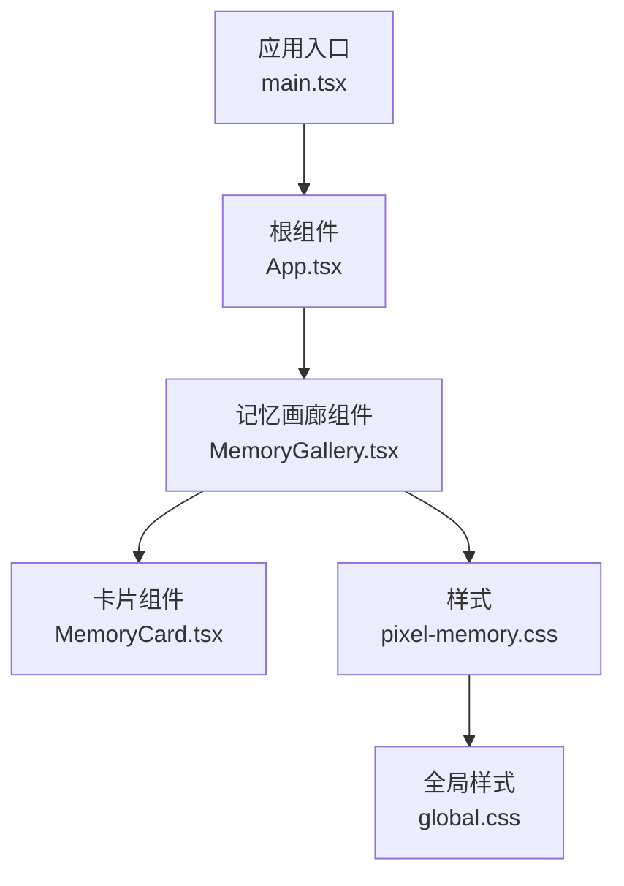
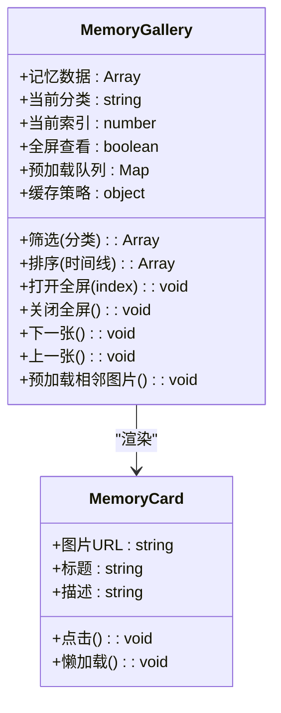
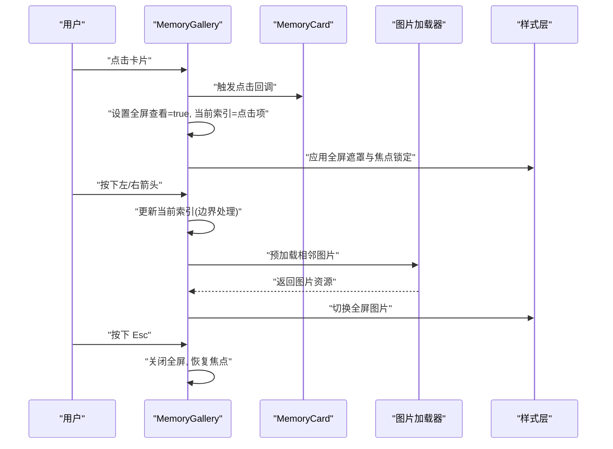
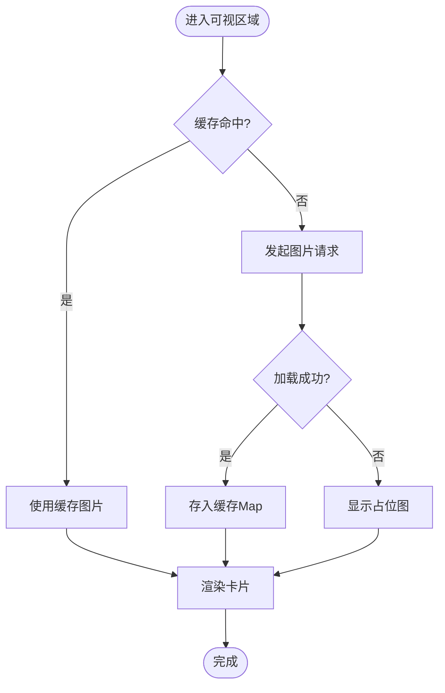
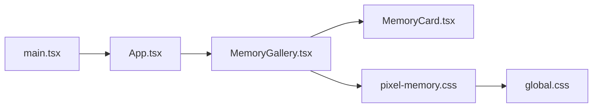

# 记忆画廊组件 (MemoryGallery)

<cite>
**本文引用的文件**   
- [MemoryGallery.tsx](file://src/components/MemoryGallery.tsx)
- [MemoryCard.tsx](file://src/components/MemoryCard.tsx)
- [pixel-memory.css](file://src/styles/pixel-memory.css)
- [global.css](file://src/styles/global.css)
- [App.tsx](file://src/App.tsx)
- [main.tsx](file://src/main.tsx)
</cite>

## 目录
1. [简介](#简介)
2. [项目结构](#项目结构)
3. [核心组件](#核心组件)
4. [架构总览](#架构总览)
5. [详细组件分析](#详细组件分析)
6. [依赖关系分析](#依赖关系分析)
7. [性能考虑](#性能考虑)
8. [故障排查指南](#故障排查指南)
9. [结论](#结论)
10. [附录](#附录)

## 简介
本文件为 MemoryGallery（记忆画廊）UI 组件的完整文档。内容涵盖：
- 瀑布流布局与响应式适配
- 图片切换动画与全屏查看体验
- 记忆数据管理、时间线展示与分类筛选逻辑
- 图片预加载、缓存策略与内存优化
- 用户交互流程：点击放大、左右滑动、键盘导航、触摸手势支持

该组件基于 React + TypeScript 实现，样式采用 CSS 模块化组织，强调可访问性与性能。

## 项目结构
MemoryGallery 位于 src/components 下，相关样式在 src/styles 中，应用入口在 src/main.tsx 与 src/App.tsx。

**图表来源**
- [main.tsx:1-200](file://src/main.tsx#L1-L200)
- [App.tsx:1-200](file://src/App.tsx#L1-L200)
- [MemoryGallery.tsx:1-200](file://src/components/MemoryGallery.tsx#L1-L200)
- [MemoryCard.tsx:1-200](file://src/components/MemoryCard.tsx#L1-L200)
- [pixel-memory.css:1-200](file://src/styles/pixel-memory.css#L1-L200)
- [global.css:1-200](file://src/styles/global.css#L1-L200)

**章节来源**
- [main.tsx:1-200](file://src/main.tsx#L1-L200)
- [App.tsx:1-200](file://src/App.tsx#L1-L200)
- [MemoryGallery.tsx:1-200](file://src/components/MemoryGallery.tsx#L1-L200)
- [MemoryCard.tsx:1-200](file://src/components/MemoryCard.tsx#L1-L200)
- [pixel-memory.css:1-200](file://src/styles/pixel-memory.css#L1-L200)
- [global.css:1-200](file://src/styles/global.css#L1-L200)

## 核心组件
- MemoryGallery：负责记忆数据源、分类筛选、时间线展示、瀑布流布局、全屏查看、预加载与缓存、键盘与触摸交互。
- MemoryCard：单张记忆卡片的渲染与交互（点击放大、悬停效果、懒加载占位）。
- pixel-memory.css：画廊布局、动画、全屏遮罩、响应式断点等样式。
- global.css：全局变量、基础排版与主题色。

**章节来源**
- [MemoryGallery.tsx:1-200](file://src/components/MemoryGallery.tsx#L1-L200)
- [MemoryCard.tsx:1-200](file://src/components/MemoryCard.tsx#L1-L200)
- [pixel-memory.css:1-200](file://src/styles/pixel-memory.css#L1-L200)
- [global.css:1-200](file://src/styles/global.css#L1-L200)

## 架构总览
MemoryGallery 以“数据驱动”的方式组织 UI：
- 数据层：记忆项集合（含标题、描述、图片 URL、分类、时间戳等），提供筛选与排序能力。
- 视图层：瀑布流网格与全屏预览；卡片组件负责单项展示与交互。
- 交互层：键盘导航、触摸滑动、滚动懒加载、预加载策略。
- 样式层：CSS 控制布局、动画与响应式适配。

**图表来源**
- [MemoryGallery.tsx:1-200](file://src/components/MemoryGallery.tsx#L1-L200)
- [MemoryCard.tsx:1-200](file://src/components/MemoryCard.tsx#L1-L200)

## 详细组件分析

### MemoryGallery 组件
- 瀑布流布局：通过列数随视口变化（移动端 1-2 列，平板 3 列，桌面 4 列）实现自适应瀑布流。
- 时间线展示：按时间戳降序排列，支持按年份分组或连续时间轴展示。
- 分类筛选：根据记忆项的分类字段过滤显示，支持多选或单选模式。
- 全屏查看：点击卡片进入全屏遮罩，支持左右切换、ESC 关闭、点击背景关闭。
- 预加载与缓存：对当前项前后若干张图片进行预加载，使用内存 Map 缓存已加载的图片对象，避免重复请求。
- 键盘与触摸：方向键/左右箭头切换，Esc 退出全屏；触摸滑动阈值判定切换。

**图表来源**
- [MemoryGallery.tsx:1-200](file://src/components/MemoryGallery.tsx#L1-L200)
- [pixel-memory.css:1-200](file://src/styles/pixel-memory.css#L1-L200)

**章节来源**
- [MemoryGallery.tsx:1-200](file://src/components/MemoryGallery.tsx#L1-L200)
- [pixel-memory.css:1-200](file://src/styles/pixel-memory.css#L1-L200)

### MemoryCard 组件
- 懒加载：进入可视区域时再加载图片，减少首屏压力。
- 占位骨架：未加载完成时显示骨架屏，提升感知性能。
- 交互反馈：悬停缩放、点击放大、无障碍标签（alt/title）。
- 错误处理：图片加载失败时降级为占位图并提示重试。

**图表来源**
- [MemoryCard.tsx:1-200](file://src/components/MemoryCard.tsx#L1-L200)

**章节来源**
- [MemoryCard.tsx:1-200](file://src/components/MemoryCard.tsx#L1-L200)

### 样式与响应式
- 像素风格主题：通过 CSS 变量统一颜色、圆角、阴影与字体。
- 瀑布流网格：使用多列布局与列间距控制，确保不同屏幕下的视觉一致性。
- 全屏遮罩：固定定位覆盖层，包含导航按钮、关闭按钮与图片容器。
- 动画过渡：淡入淡出、缩放过渡、滑入滑出，增强切换体验。
- 响应式断点：移动端优先，逐步增加列数与间距。

**章节来源**
- [pixel-memory.css:1-200](file://src/styles/pixel-memory.css#L1-L200)
- [global.css:1-200](file://src/styles/global.css#L1-L200)

## 依赖关系分析
- MemoryGallery 依赖 MemoryCard 进行单项渲染。
- 两者共同依赖 pixel-memory.css 与 global.css 进行样式表现。
- 应用入口 main.tsx 挂载 App.tsx，App.tsx 引入 MemoryGallery 作为页面模块之一。

**图表来源**
- [main.tsx:1-200](file://src/main.tsx#L1-L200)
- [App.tsx:1-200](file://src/App.tsx#L1-L200)
- [MemoryGallery.tsx:1-200](file://src/components/MemoryGallery.tsx#L1-L200)
- [MemoryCard.tsx:1-200](file://src/components/MemoryCard.tsx#L1-L200)
- [pixel-memory.css:1-200](file://src/styles/pixel-memory.css#L1-L200)
- [global.css:1-200](file://src/styles/global.css#L1-L200)

**章节来源**
- [main.tsx:1-200](file://src/main.tsx#L1-L200)
- [App.tsx:1-200](file://src/App.tsx#L1-L200)
- [MemoryGallery.tsx:1-200](file://src/components/MemoryGallery.tsx#L1-L200)
- [MemoryCard.tsx:1-200](file://src/components/MemoryCard.tsx#L1-L200)
- [pixel-memory.css:1-200](file://src/styles/pixel-memory.css#L1-L200)
- [global.css:1-200](file://src/styles/global.css#L1-L200)

## 性能考虑
- 预加载策略：在进入全屏后，立即预加载前一张与后一张图片，减少切换等待。
- 缓存策略：使用内存 Map 缓存已加载的图片对象，避免重复网络请求；限制缓存大小，防止内存膨胀。
- 懒加载：仅对可视区域内的卡片发起图片请求，降低首屏负载。
- 去抖与节流：滚动事件监听使用节流，避免频繁重排；切换动画使用 GPU 加速属性。
- 内存优化：离开全屏或组件卸载时清理事件监听与定时器，释放图片引用。
- 降级策略：网络异常或图片损坏时显示占位图，并提供重试入口。

[本节为通用性能建议，不直接分析具体文件]

## 故障排查指南
- 图片无法加载
  - 检查图片 URL 是否可达，跨域是否正确配置。
  - 查看控制台是否有 CORS 或 404 错误。
  - 确认懒加载与预加载逻辑是否被意外中断。
- 全屏切换卡顿
  - 检查是否存在过多并发请求，适当降低预加载数量。
  - 确认动画是否触发了大量重排重绘，尽量使用 transform/opacity。
- 键盘/触摸无效
  - 检查事件监听是否被移除或未正确绑定。
  - 确认焦点管理是否正确，避免焦点丢失导致键盘事件失效。
- 内存占用过高
  - 检查缓存 Map 是否设置了上限与淘汰策略。
  - 确认组件卸载时是否清除了图片引用与事件监听。

**章节来源**
- [MemoryGallery.tsx:1-200](file://src/components/MemoryGallery.tsx#L1-L200)
- [MemoryCard.tsx:1-200](file://src/components/MemoryCard.tsx#L1-L200)
- [pixel-memory.css:1-200](file://src/styles/pixel-memory.css#L1-L200)

## 结论
MemoryGallery 组件通过清晰的数据驱动架构、完善的交互与样式体系，提供了流畅的瀑布流浏览与全屏预览体验。结合预加载、缓存与懒加载策略，在保证用户体验的同时有效控制内存与网络开销。建议在后续迭代中继续完善无障碍支持与更细粒度的性能监控。

[本节为总结性内容，不直接分析具体文件]

## 附录
- 用户交互速查
  - 点击卡片：进入全屏查看。
  - 左右箭头：切换上一张/下一张。
  - Esc：退出全屏。
  - 触摸滑动：水平滑动超过阈值切换图片。
  - 滚轮：在全屏模式下可切换图片（可选）。
- 数据模型建议
  - id：唯一标识
  - title：标题
  - description：描述
  - imageUrl：图片地址
  - category：分类
  - timestamp：时间戳
  - tags：标签（可选）
- 样式定制要点
  - 通过 CSS 变量调整主题色、圆角与阴影。
  - 修改断点以适配更多设备尺寸。
  - 自定义动画时长与缓动函数。

[本节为补充信息，不直接分析具体文件]