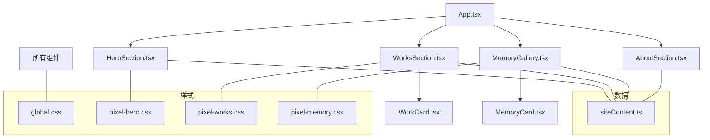
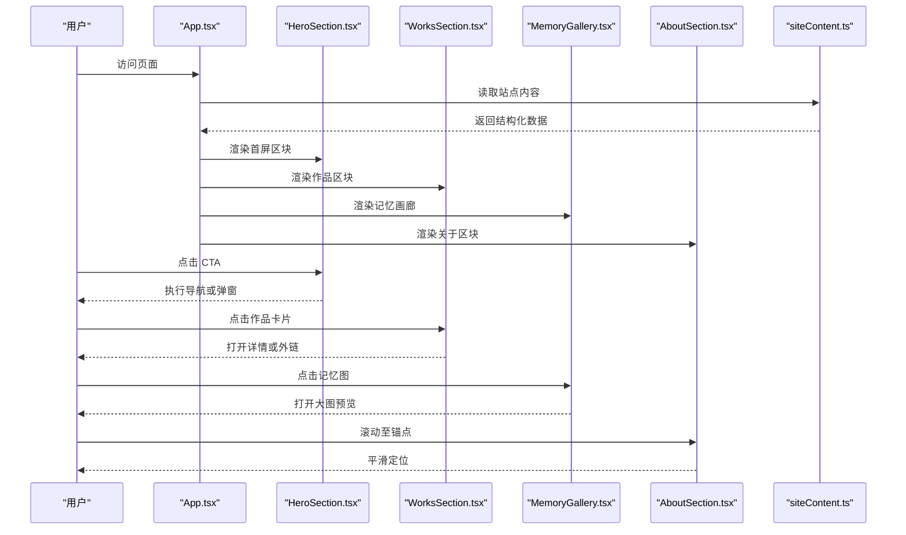
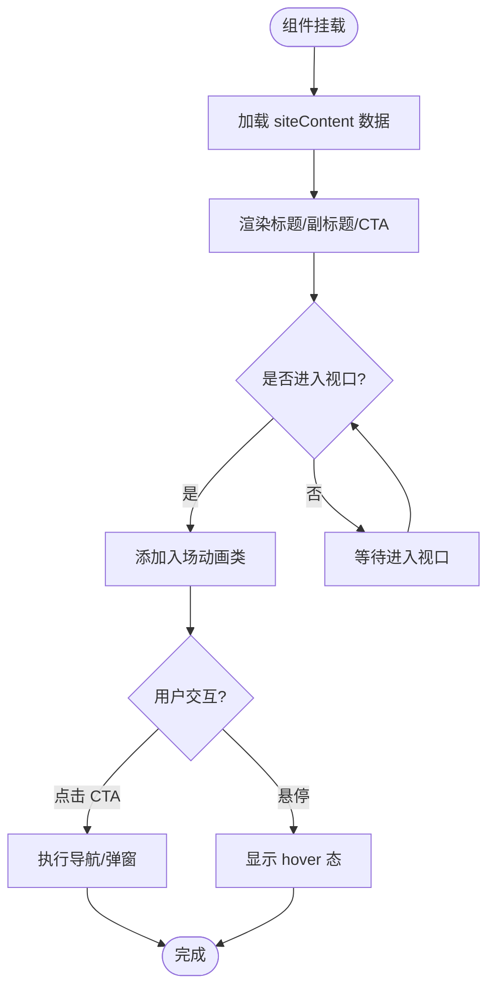
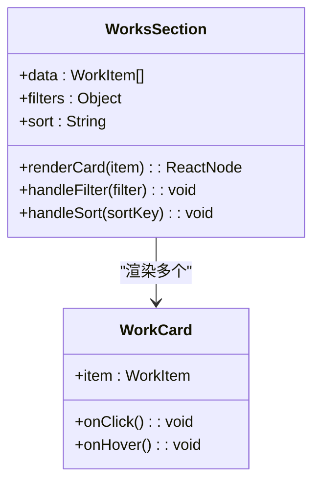
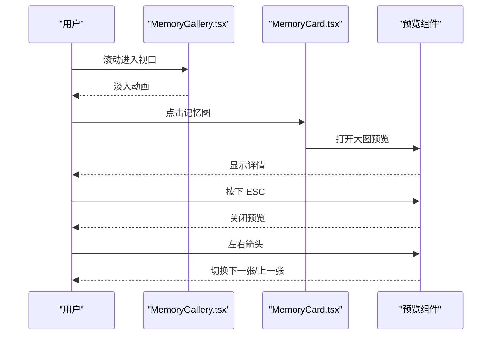
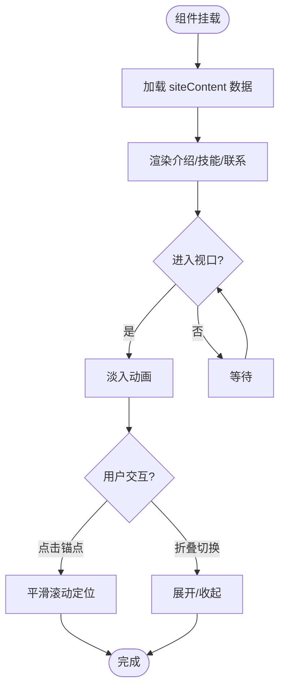
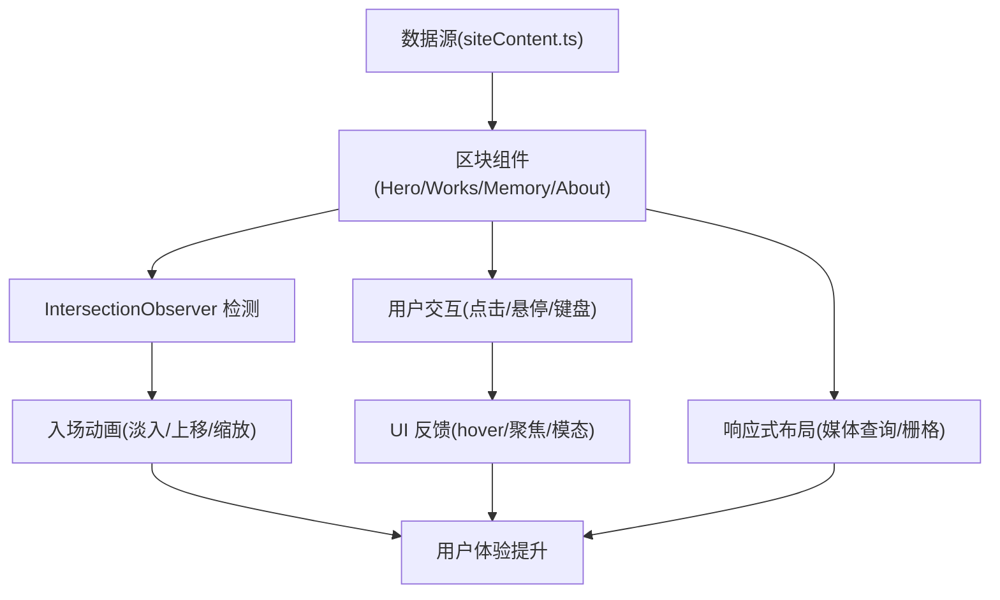
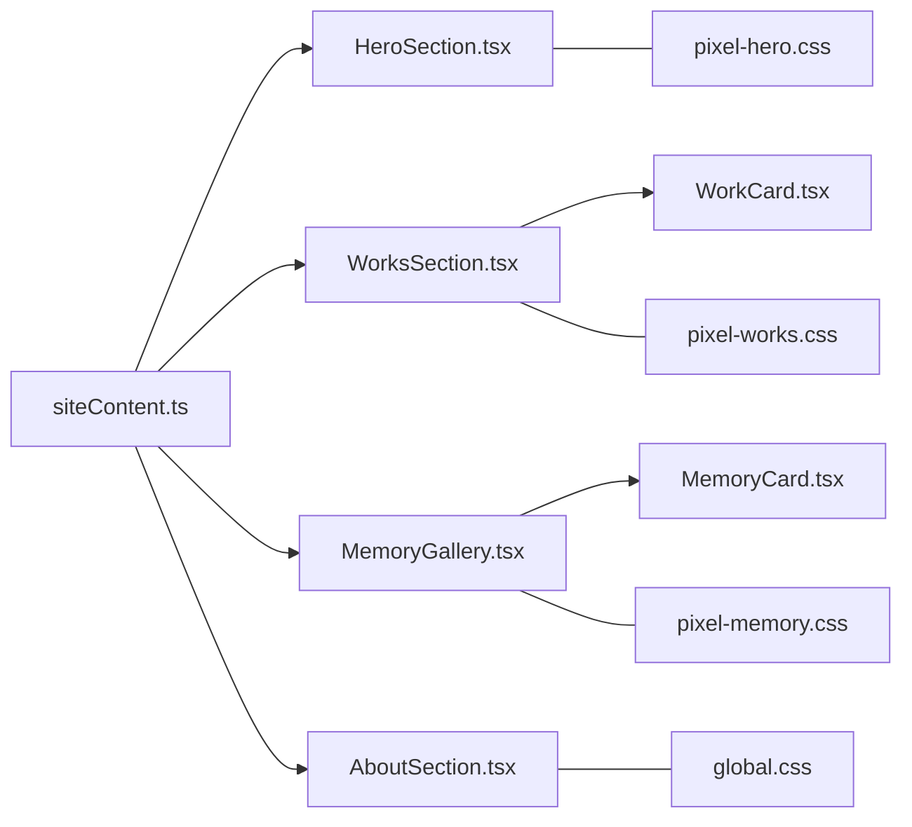

# 页面区块组件

<cite>
**本文引用的文件**   
- [HeroSection.tsx](file://src/components/HeroSection.tsx)
- [WorksSection.tsx](file://src/components/WorksSection.tsx)
- [MemoryGallery.tsx](file://src/components/MemoryGallery.tsx)
- [AboutSection.tsx](file://src/components/AboutSection.tsx)
- [WorkCard.tsx](file://src/components/WorkCard.tsx)
- [MemoryCard.tsx](file://src/components/MemoryCard.tsx)
- [siteContent.ts](file://src/data/siteContent.ts)
- [global.css](file://src/styles/global.css)
- [pixel-hero.css](file://src/styles/pixel-hero.css)
- [pixel-works.css](file://src/styles/pixel-works.css)
- [pixel-memory.css](file://src/styles/pixel-memory.css)
- [App.tsx](file://src/App.tsx)
</cite>

## 目录
1. [简介](#简介)
2. [项目结构](#项目结构)
3. [核心组件](#核心组件)
4. [架构总览](#架构总览)
5. [详细组件分析](#详细组件分析)
6. [依赖关系分析](#依赖关系分析)
7. [性能考虑](#性能考虑)
8. [故障排查指南](#故障排查指南)
9. [结论](#结论)
10. [附录：Props 接口与配置](#附录props-接口与配置)

## 简介
本文件面向 oo-space 项目的主要页面区块组件，系统化梳理 HeroSection（首屏展示）、WorksSection（作品展示）、MemoryGallery（记忆画廊）和 AboutSection（关于页面）四大组件的功能特性、布局结构、交互行为与数据绑定方式。文档同时覆盖响应式布局实现、滚动动画效果、用户交互反馈、完整的 Props 接口说明、配置选项与扩展点，并提供实际使用示例与最佳实践指导，帮助开发者快速集成与定制。

## 项目结构
- 组件层：位于 src/components，包含四个核心区块组件及其子卡片组件（WorkCard、MemoryCard）。
- 数据层：位于 src/data，集中管理站点内容（如标题、文案、作品列表、记忆项等）。
- 样式层：位于 src/styles，提供全局样式与各区块专用样式（像素风、响应式、动效）。
- 应用入口：src/App.tsx 负责组合各区块组件并挂载到页面。

图表来源
- [App.tsx](file://src/App.tsx)
- [HeroSection.tsx](file://src/components/HeroSection.tsx)
- [WorksSection.tsx](file://src/components/WorksSection.tsx)
- [MemoryGallery.tsx](file://src/components/MemoryGallery.tsx)
- [AboutSection.tsx](file://src/components/AboutSection.tsx)
- [WorkCard.tsx](file://src/components/WorkCard.tsx)
- [MemoryCard.tsx](file://src/components/MemoryCard.tsx)
- [siteContent.ts](file://src/data/siteContent.ts)
- [global.css](file://src/styles/global.css)
- [pixel-hero.css](file://src/styles/pixel-hero.css)
- [pixel-works.css](file://src/styles/pixel-works.css)
- [pixel-memory.css](file://src/styles/pixel-memory.css)

章节来源
- [App.tsx](file://src/App.tsx)
- [siteContent.ts](file://src/data/siteContent.ts)

## 核心组件
本节对四个核心区块组件进行概览性说明，包括职责、数据流、交互与样式要点。

- HeroSection（首屏展示）
  - 职责：呈现首页主视觉区域，包含标题、副标题、引导按钮或装饰元素。
  - 数据绑定：从 siteContent.ts 获取标题、描述、CTA 文案等；支持主题切换与季节主题叠加。
  - 交互行为：点击 CTA 触发导航或弹窗；支持鼠标悬停微动效与滚动入场动画。
  - 响应式：基于 CSS 媒体查询与像素网格布局适配移动端与桌面端。
  - 样式：使用 pixel-hero.css 定义像素风背景、文字排版与动效关键帧。

- WorksSection（作品展示）
  - 职责：以网格或瀑布流形式展示作品卡片，支持筛选与排序。
  - 数据绑定：读取 siteContent.ts 中的作品数组，映射为 WorkCard 实例。
  - 交互行为：卡片点击打开详情或外链；支持懒加载图片与骨架屏占位。
  - 响应式：多列栅格在窄屏自动降级为单列；触摸滑动优化。
  - 样式：使用 pixel-works.css 控制卡片阴影、圆角、hover 放大与过渡。

- MemoryGallery（记忆画廊）
  - 职责：以画廊形式展示记忆图片与简短描述，支持轮播或网格浏览。
  - 数据绑定：从 siteContent.ts 读取记忆项，渲染 MemoryCard。
  - 交互行为：点击放大预览；支持键盘左右切换与 ESC 关闭；滚动视差与淡入。
  - 响应式：自适应列数与图片尺寸；移动端启用横向滑动。
  - 样式：使用 pixel-memory.css 控制画廊间距、遮罩与动效。

- AboutSection（关于页面）
  - 职责：展示“关于”信息，包括介绍文本、技能标签、联系方式等。
  - 数据绑定：从 siteContent.ts 获取文案与链接；支持动态更新。
  - 交互行为：平滑锚点跳转；图标 hover 提示；可折叠段落。
  - 响应式：分栏布局在小屏堆叠；字体大小随视口缩放。
  - 样式：继承 global.css 的像素风格与主题变量。

章节来源
- [HeroSection.tsx](file://src/components/HeroSection.tsx)
- [WorksSection.tsx](file://src/components/WorksSection.tsx)
- [MemoryGallery.tsx](file://src/components/MemoryGallery.tsx)
- [AboutSection.tsx](file://src/components/AboutSection.tsx)
- [WorkCard.tsx](file://src/components/WorkCard.tsx)
- [MemoryCard.tsx](file://src/components/MemoryCard.tsx)
- [siteContent.ts](file://src/data/siteContent.ts)
- [pixel-hero.css](file://src/styles/pixel-hero.css)
- [pixel-works.css](file://src/styles/pixel-works.css)
- [pixel-memory.css](file://src/styles/pixel-memory.css)
- [global.css](file://src/styles/global.css)

## 架构总览
整体采用“组件 + 数据 + 样式”的分层架构：
- 组件层：React 函数组件，通过 props 接收数据与回调，内部状态仅用于 UI 表现（如展开/收起、焦点态）。
- 数据层：集中化的 siteContent.ts 提供只读数据源，便于统一管理与热更新。
- 样式层：按模块拆分 CSS，配合全局主题变量与像素风规范，确保一致性与可维护性。

图表来源
- [App.tsx](file://src/App.tsx)
- [HeroSection.tsx](file://src/components/HeroSection.tsx)
- [WorksSection.tsx](file://src/components/WorksSection.tsx)
- [MemoryGallery.tsx](file://src/components/MemoryGallery.tsx)
- [AboutSection.tsx](file://src/components/AboutSection.tsx)
- [siteContent.ts](file://src/data/siteContent.ts)

## 详细组件分析

### HeroSection（首屏展示）
- 功能特性
  - 展示主标题、副标题与行动号召（CTA）。
  - 支持主题切换与季节主题叠加，营造氛围感。
  - 滚动入场动画与鼠标跟随微动效。
- 布局结构
  - 全屏容器，居中布局；背景可使用像素风纹理或渐变。
  - 文本层级清晰，CTA 按钮突出。
- 交互行为
  - CTA 点击触发导航或弹窗。
  - 悬停时按钮高亮与轻微位移。
  - 滚动进入视口时渐显。
- 数据绑定
  - 从 siteContent.ts 读取标题、描述、CTA 文案与链接。
  - 支持通过 props 覆盖默认文案。
- 响应式实现
  - 使用媒体查询调整字号与间距；移动端减少装饰元素。
- 滚动动画
  - 基于 IntersectionObserver 触发入场动画类名。
- 事件处理
  - onClick 绑定 CTA；onMouseEnter/Leave 控制 hover 态。
- 自定义扩展点
  - 支持传入自定义背景、动画时长与缓动曲线。
  - 可通过插槽替换 CTA 组件。

图表来源
- [HeroSection.tsx](file://src/components/HeroSection.tsx)
- [siteContent.ts](file://src/data/siteContent.ts)
- [pixel-hero.css](file://src/styles/pixel-hero.css)

章节来源
- [HeroSection.tsx](file://src/components/HeroSection.tsx)
- [siteContent.ts](file://src/data/siteContent.ts)
- [pixel-hero.css](file://src/styles/pixel-hero.css)

### WorksSection（作品展示）
- 功能特性
  - 网格/瀑布流展示作品卡片，支持筛选与排序。
  - 懒加载图片与骨架屏提升体验。
- 布局结构
  - 响应式栅格：大屏多列，中屏两列，小屏一列。
  - 卡片内包含封面图、标题、摘要与标签。
- 交互行为
  - 点击卡片打开详情或外链。
  - 筛选器改变列表视图；排序切换顺序。
  - 滚动加载更多（可选）。
- 数据绑定
  - 从 siteContent.ts 读取作品数组，映射为 WorkCard。
  - 支持通过 props 注入额外字段或过滤逻辑。
- 响应式实现
  - CSS Grid/Flex 结合媒体查询；触摸滑动优化。
- 滚动动画
  - 卡片进入视口时淡入上移。
- 事件处理
  - onClick 打开详情；onChange 处理筛选与排序。
- 自定义扩展点
  - 支持自定义卡片渲染函数 renderCard。
  - 支持自定义筛选器与排序算法。

图表来源
- [WorksSection.tsx](file://src/components/WorksSection.tsx)
- [WorkCard.tsx](file://src/components/WorkCard.tsx)
- [siteContent.ts](file://src/data/siteContent.ts)
- [pixel-works.css](file://src/styles/pixel-works.css)

章节来源
- [WorksSection.tsx](file://src/components/WorksSection.tsx)
- [WorkCard.tsx](file://src/components/WorkCard.tsx)
- [siteContent.ts](file://src/data/siteContent.ts)
- [pixel-works.css](file://src/styles/pixel-works.css)

### MemoryGallery（记忆画廊）
- 功能特性
  - 以画廊形式展示记忆图片与描述，支持轮播或网格浏览。
  - 点击放大预览，键盘导航友好。
- 布局结构
  - 网格布局，图片等比缩放；描述置于底部或悬浮遮罩。
- 交互行为
  - 点击打开大图预览；ESC 关闭；左右箭头切换。
  - 滚动进入视口时淡入；视差背景（可选）。
- 数据绑定
  - 从 siteContent.ts 读取记忆项，映射为 MemoryCard。
  - 支持通过 props 注入自定义描述模板。
- 响应式实现
  - 自适应列数；移动端启用横向滑动与手势支持。
- 滚动动画
  - IntersectionObserver 触发入场动画；懒加载图片。
- 事件处理
  - onClick 打开预览；onKeyDown 处理键盘事件。
- 自定义扩展点
  - 支持自定义预览组件与过渡动画。
  - 支持插入广告或水印图层。

图表来源
- [MemoryGallery.tsx](file://src/components/MemoryGallery.tsx)
- [MemoryCard.tsx](file://src/components/MemoryCard.tsx)
- [siteContent.ts](file://src/data/siteContent.ts)
- [pixel-memory.css](file://src/styles/pixel-memory.css)

章节来源
- [MemoryGallery.tsx](file://src/components/MemoryGallery.tsx)
- [MemoryCard.tsx](file://src/components/MemoryCard.tsx)
- [siteContent.ts](file://src/data/siteContent.ts)
- [pixel-memory.css](file://src/styles/pixel-memory.css)

### AboutSection（关于页面）
- 功能特性
  - 展示“关于”信息，包括介绍、技能标签、联系方式等。
  - 支持可折叠段落与平滑锚点跳转。
- 布局结构
  - 分栏布局：左侧介绍，右侧技能/联系；小屏堆叠。
- 交互行为
  - 点击锚点平滑滚动；图标 hover 显示提示。
  - 可折叠段落展开/收起。
- 数据绑定
  - 从 siteContent.ts 读取文案与链接；支持动态更新。
- 响应式实现
  - Flex/Grid 布局；字体与间距随视口缩放。
- 滚动动画
  - 各区块进入视口时依次淡入。
- 事件处理
  - onClick 处理锚点跳转；onToggle 控制折叠态。
- 自定义扩展点
  - 支持自定义段落模板与社交链接渲染。
  - 支持插入第三方统计或埋点。

图表来源
- [AboutSection.tsx](file://src/components/AboutSection.tsx)
- [siteContent.ts](file://src/data/siteContent.ts)
- [global.css](file://src/styles/global.css)

章节来源
- [AboutSection.tsx](file://src/components/AboutSection.tsx)
- [siteContent.ts](file://src/data/siteContent.ts)
- [global.css](file://src/styles/global.css)

### Conceptual Overview（概念总览）
以下流程图概括了四个组件的共同模式：数据驱动渲染、视口检测触发动画、用户交互反馈与响应式适配。

[本图为概念性流程，不直接映射具体源码文件]

## 依赖关系分析
- 组件依赖
  - WorksSection 依赖 WorkCard；MemoryGallery 依赖 MemoryCard。
  - 所有组件依赖 siteContent.ts 提供的数据。
- 样式依赖
  - 各区块使用对应 CSS 文件；全局样式由 global.css 提供基础主题与像素风。
- 外部依赖
  - 无重型第三方库依赖，主要使用原生 API（IntersectionObserver、键盘事件等）。

图表来源
- [siteContent.ts](file://src/data/siteContent.ts)
- [HeroSection.tsx](file://src/components/HeroSection.tsx)
- [WorksSection.tsx](file://src/components/WorksSection.tsx)
- [MemoryGallery.tsx](file://src/components/MemoryGallery.tsx)
- [AboutSection.tsx](file://src/components/AboutSection.tsx)
- [WorkCard.tsx](file://src/components/WorkCard.tsx)
- [MemoryCard.tsx](file://src/components/MemoryCard.tsx)
- [pixel-hero.css](file://src/styles/pixel-hero.css)
- [pixel-works.css](file://src/styles/pixel-works.css)
- [pixel-memory.css](file://src/styles/pixel-memory.css)
- [global.css](file://src/styles/global.css)

章节来源
- [siteContent.ts](file://src/data/siteContent.ts)
- [global.css](file://src/styles/global.css)

## 性能考虑
- 懒加载与虚拟滚动
  - 图片懒加载与按需渲染，避免首屏过大。
  - 长列表场景建议使用虚拟滚动（可选扩展）。
- 动画与重排
  - 使用 transform 与 opacity 实现动画，减少重排重绘。
  - IntersectionObserver 节流处理，避免频繁计算。
- 资源优化
  - 图片压缩与 WebP 格式；CDN 加速。
  - CSS 按需加载与代码分割。
- 内存管理
  - 及时移除事件监听与观察者，防止泄漏。
  - 大对象缓存与去重策略。

[本节为通用性能建议，不直接分析具体文件]

## 故障排查指南
- 常见问题
  - 数据未加载：检查 siteContent.ts 路径与导出是否正确。
  - 动画不触发：确认 IntersectionObserver 是否被正确初始化与销毁。
  - 响应式异常：检查媒体查询断点与栅格配置。
  - 键盘事件无效：确认焦点管理与事件冒泡。
- 调试技巧
  - 使用浏览器控制台查看组件 props 与状态。
  - 临时禁用动画观察视口触发。
  - 逐步注释样式定位问题。
- 错误处理
  - 捕获网络请求失败与图片加载错误。
  - 提供降级 UI（骨架屏/占位图）。

章节来源
- [siteContent.ts](file://src/data/siteContent.ts)
- [global.css](file://src/styles/global.css)

## 结论
HeroSection、WorksSection、MemoryGallery 与 AboutSection 构成了 oo-space 的核心页面区块，采用数据驱动与模块化样式设计，具备良好的可维护性与扩展性。通过统一的 Props 接口与配置选项，开发者可以快速定制与集成。遵循本文的最佳实践，可在保证性能与体验的前提下，灵活扩展功能与视觉风格。

[本节为总结性内容，不直接分析具体文件]

## 附录：Props 接口与配置
以下为各组件的 Props 接口概览（类型与默认值以实际实现为准）：

- HeroSection
  - title: string（必填）
  - subtitle: string（可选）
  - ctaText: string（可选）
  - ctaLink: string（可选）
  - theme: object（可选，覆盖主题变量）
  - animationDuration: number（可选，毫秒）
  - onCtaClick: function（可选回调）

- WorksSection
  - data: Array~WorkItem~（必填）
  - filters: object（可选，键值对）
  - sort: string（可选，排序键）
  - renderCard: function（可选，自定义卡片渲染）
  - lazyLoad: boolean（可选，默认 true）
  - onCardClick: function（可选回调）

- MemoryGallery
  - data: Array~MemoryItem~（必填）
  - layout: string（可选，grid/carousel）
  - showDescription: boolean（可选，默认 true）
  - enableKeyboardNav: boolean（可选，默认 true）
  - renderPreview: function（可选，自定义预览组件）
  - onImageClick: function（可选回调）

- AboutSection
  - content: object（必填，含介绍/技能/联系）
  - collapsibleSections: boolean（可选，默认 false）
  - smoothScroll: boolean（可选，默认 true）
  - socialLinks: Array~Link~（可选）
  - onAnchorClick: function（可选回调）

- WorkCard
  - item: WorkItem（必填）
  - onClick: function（可选回调）
  - onHover: function（可选回调）

- MemoryCard
  - item: MemoryItem（必填）
  - onClick: function（可选回调）
  - onKeyDown: function（可选回调）

章节来源
- [HeroSection.tsx](file://src/components/HeroSection.tsx)
- [WorksSection.tsx](file://src/components/WorksSection.tsx)
- [MemoryGallery.tsx](file://src/components/MemoryGallery.tsx)
- [AboutSection.tsx](file://src/components/AboutSection.tsx)
- [WorkCard.tsx](file://src/components/WorkCard.tsx)
- [MemoryCard.tsx](file://src/components/MemoryCard.tsx)
- [siteContent.ts](file://src/data/siteContent.ts)