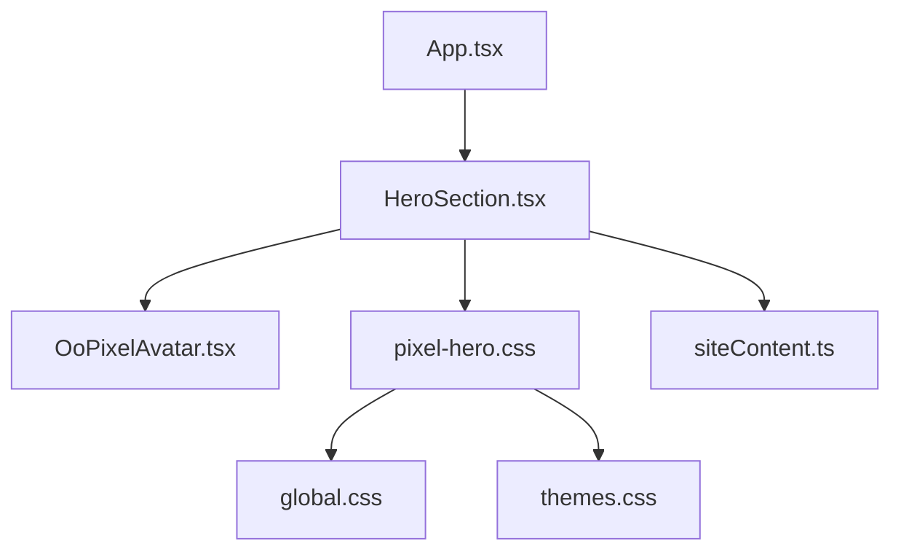
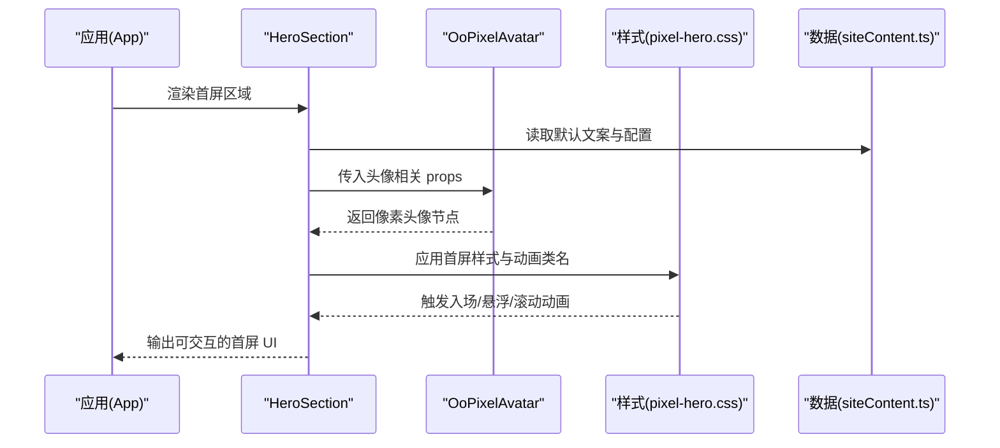
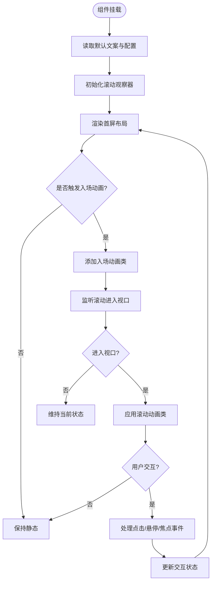
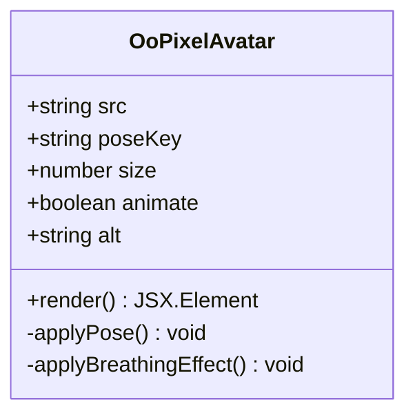
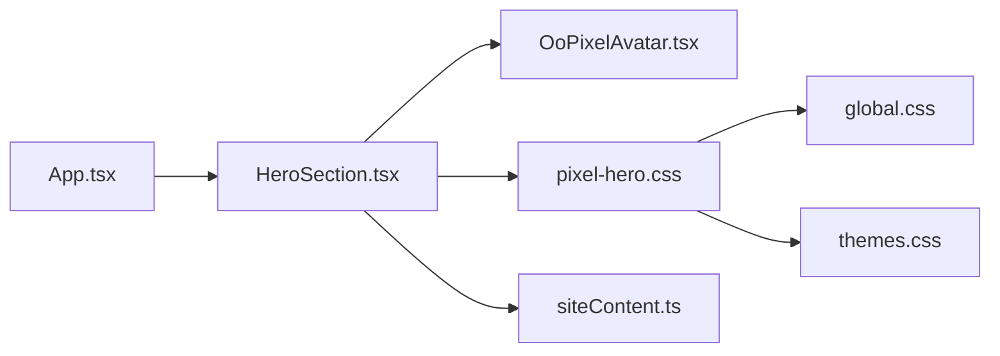

# 首屏展示组件 (HeroSection)

<cite>
**本文引用的文件**   
- [HeroSection.tsx](file://src/components/HeroSection.tsx)
- [OoPixelAvatar.tsx](file://src/components/OoPixelAvatar.tsx)
- [pixel-hero.css](file://src/styles/pixel-hero.css)
- [global.css](file://src/styles/global.css)
- [themes.css](file://src/styles/themes.css)
- [siteContent.ts](file://src/data/siteContent.ts)
- [App.tsx](file://src/App.tsx)
</cite>

## 目录
1. [简介](#简介)
2. [项目结构](#项目结构)
3. [核心组件](#核心组件)
4. [架构总览](#架构总览)
5. [详细组件分析](#详细组件分析)
6. [依赖关系分析](#依赖关系分析)
7. [性能考量](#性能考量)
8. [故障排查指南](#故障排查指南)
9. [结论](#结论)
10. [附录：Props 接口与使用示例](#附录props-接口与使用示例)

## 简介
本文件为 HeroSection 首屏展示组件的完整 UI 文档，覆盖视觉设计、动画效果、交互行为、像素风格头像渲染机制、背景特效实现、滚动触发动画、状态管理、事件处理与响应式布局。同时提供完整的 Props 接口说明、实际使用示例以及自定义样式覆盖方法，帮助开发者快速集成与定制。

## 项目结构
HeroSection 位于 src/components 下，配合样式文件 src/styles/pixel-hero.css 与主题/全局样式共同工作。数据内容来源于 src/data/siteContent.ts，组件在应用入口 App.tsx 中引入并使用。

图表来源 
- [App.tsx](file://src/App.tsx)
- [HeroSection.tsx](file://src/components/HeroSection.tsx)
- [OoPixelAvatar.tsx](file://src/components/OoPixelAvatar.tsx)
- [pixel-hero.css](file://src/styles/pixel-hero.css)
- [global.css](file://src/styles/global.css)
- [themes.css](file://src/styles/themes.css)
- [siteContent.ts](file://src/data/siteContent.ts)

章节来源
- [App.tsx](file://src/App.tsx)
- [HeroSection.tsx](file://src/components/HeroSection.tsx)
- [pixel-hero.css](file://src/styles/pixel-hero.css)
- [siteContent.ts](file://src/data/siteContent.ts)

## 核心组件
- HeroSection：首屏主容器，负责标题、副标题、描述文本、CTA 按钮等布局与动画触发逻辑。
- OoPixelAvatar：像素风格头像渲染组件，支持姿态切换、缩放、呼吸光效等。
- 样式层：pixel-hero.css 定义首屏专属样式；global.css 提供基础排版与变量；themes.css 提供主题色与明暗模式变量。
- 数据源：siteContent.ts 提供默认文案与配置（如标题、副标题、描述、链接等）。

章节来源
- [HeroSection.tsx](file://src/components/HeroSection.tsx)
- [OoPixelAvatar.tsx](file://src/components/OoPixelAvatar.tsx)
- [pixel-hero.css](file://src/styles/pixel-hero.css)
- [global.css](file://src/styles/global.css)
- [themes.css](file://src/styles/themes.css)
- [siteContent.ts](file://src/data/siteContent.ts)

## 架构总览
HeroSection 采用“数据驱动 + 样式驱动”的组合方式：
- 数据层：从 siteContent.ts 读取默认文案与配置，也可通过 props 覆盖。
- 表现层：HeroSection 组织布局与动画触发；OoPixelAvatar 专注像素头像渲染。
- 样式层：pixel-hero.css 定义首屏布局、动效关键帧与媒体查询；global.css 与 themes.css 提供基础变量与主题。

图表来源 
- [App.tsx](file://src/App.tsx)
- [HeroSection.tsx](file://src/components/HeroSection.tsx)
- [OoPixelAvatar.tsx](file://src/components/OoPixelAvatar.tsx)
- [pixel-hero.css](file://src/styles/pixel-hero.css)
- [siteContent.ts](file://src/data/siteContent.ts)

## 详细组件分析

### HeroSection 组件
- 职责
  - 组织首屏信息：标题、副标题、描述、CTA 按钮等。
  - 控制动画触发：入场动画、滚动触发的淡入/位移效果。
  - 响应式布局：适配移动端与桌面端布局差异。
  - 事件处理：按钮点击、键盘导航、焦点管理等。
- 视觉设计
  - 大字号标题与层级分明的副标题、描述文本。
  - 像素头像居右或居中（随断点变化），配合背景渐变与粒子装饰。
- 动画效果
  - 入场：标题与描述依次淡入上移，头像轻微缩放/呼吸光效。
  - 滚动触发：进入视口时触发淡入与位移，离开视口恢复初始态。
  - 交互反馈：按钮悬停高亮、按下态缩放、焦点可见性。
- 状态管理
  - 本地状态：是否已入场、是否进入视口、是否处于交互态（hover/focus/active）。
  - 外部状态：由 props 控制的文案、链接、主题开关等。
- 事件处理
  - 点击 CTA：跳转链接或触发业务回调。
  - 键盘操作：Enter/Space 激活按钮，Tab 顺序合理。
  - 滚动监听：使用 IntersectionObserver 检测进入视口并添加动画类。
- 响应式布局
  - 小屏：单列布局，头像置于上方或下方，字号与间距自适应。
  - 大屏：左右分栏，头像右侧对齐，留白与网格对齐。

图表来源 
- [HeroSection.tsx](file://src/components/HeroSection.tsx)
- [pixel-hero.css](file://src/styles/pixel-hero.css)

章节来源
- [HeroSection.tsx](file://src/components/HeroSection.tsx)
- [pixel-hero.css](file://src/styles/pixel-hero.css)

### OoPixelAvatar 像素头像组件
- 职责
  - 渲染像素风格的头像图像，支持姿态切换、缩放、呼吸光效。
  - 接收 props：头像图片路径、姿态映射、尺寸、动画开关、无障碍标签等。
- 渲染机制
  - 使用像素化图像与网格采样，确保清晰锐利的像素边缘。
  - 姿态切换通过替换图片源或切换 CSS 类实现。
  - 呼吸光效通过 CSS 动画与阴影叠加实现。
- 动画与交互
  - 入场缩放、悬浮放大、点击微动效。
  - 键盘可达性与屏幕阅读器友好。
- 性能优化
  - 图片懒加载与预加载策略。
  - 避免频繁重绘，使用 transform 与 opacity 动画。

图表来源 
- [OoPixelAvatar.tsx](file://src/components/OoPixelAvatar.tsx)

章节来源
- [OoPixelAvatar.tsx](file://src/components/OoPixelAvatar.tsx)

### 样式与主题
- pixel-hero.css
  - 定义首屏布局、字体层级、间距、背景渐变、粒子装饰层。
  - 关键帧动画：入场淡入上移、滚动触发淡入位移、悬浮高亮、呼吸光效。
  - 媒体查询：适配移动端与桌面端的布局与字号。
- global.css
  - 基础排版、颜色变量、字体栈、重置样式。
- themes.css
  - 明暗主题变量、对比度、强调色、背景与前景色。

章节来源
- [pixel-hero.css](file://src/styles/pixel-hero.css)
- [global.css](file://src/styles/global.css)
- [themes.css](file://src/styles/themes.css)

### 数据与内容
- siteContent.ts
  - 提供默认标题、副标题、描述、CTA 文案与链接等。
  - 可通过 props 覆盖默认值，便于多语言与动态内容。

章节来源
- [siteContent.ts](file://src/data/siteContent.ts)

## 依赖关系分析
- HeroSection 依赖 OoPixelAvatar 进行头像渲染。
- 样式依赖 pixel-hero.css、global.css、themes.css。
- 数据依赖 siteContent.ts 提供默认文案。
- 应用入口 App.tsx 引入并渲染 HeroSection。

图表来源 
- [App.tsx](file://src/App.tsx)
- [HeroSection.tsx](file://src/components/HeroSection.tsx)
- [OoPixelAvatar.tsx](file://src/components/OoPixelAvatar.tsx)
- [pixel-hero.css](file://src/styles/pixel-hero.css)
- [global.css](file://src/styles/global.css)
- [themes.css](file://src/styles/themes.css)
- [siteContent.ts](file://src/data/siteContent.ts)

章节来源
- [App.tsx](file://src/App.tsx)
- [HeroSection.tsx](file://src/components/HeroSection.tsx)
- [OoPixelAvatar.tsx](file://src/components/OoPixelAvatar.tsx)
- [pixel-hero.css](file://src/styles/pixel-hero.css)
- [global.css](file://src/styles/global.css)
- [themes.css](file://src/styles/themes.css)
- [siteContent.ts](file://src/data/siteContent.ts)

## 性能考量
- 动画性能
  - 优先使用 transform 与 opacity 动画，避免触发重排。
  - 合理使用 IntersectionObserver 减少不必要的监听。
- 资源加载
  - 头像图片懒加载与预加载结合，降低首屏阻塞。
  - 使用合适的图片格式与尺寸，避免过大资源。
- 样式与主题
  - 变量集中管理，减少重复计算与样式冲突。
  - 媒体查询仅在必要时启用，避免过度重绘。

[本节为通用指导，不直接分析具体文件]

## 故障排查指南
- 动画未触发
  - 检查 IntersectionObserver 是否正确绑定与移除。
  - 确认 CSS 类名与关键帧是否存在。
- 头像显示异常
  - 检查图片路径与格式是否正确。
  - 确认姿态映射与尺寸参数是否匹配。
- 主题不一致
  - 检查 themes.css 变量是否被覆盖或未生效。
  - 确认明暗模式切换逻辑是否正确。
- 响应式布局错乱
  - 检查媒体查询断点与布局属性。
  - 确认父容器宽高与定位设置。

章节来源
- [pixel-hero.css](file://src/styles/pixel-hero.css)
- [OoPixelAvatar.tsx](file://src/components/OoPixelAvatar.tsx)
- [themes.css](file://src/styles/themes.css)

## 结论
HeroSection 首屏展示组件通过数据驱动与样式驱动相结合，实现了清晰的视觉层次、流畅的动画体验与良好的交互反馈。配合 OoPixelAvatar 像素头像渲染与完善的样式系统，能够在不同设备上保持一致的表现。开发者可通过 Props 灵活定制内容与样式，满足多样化需求。

[本节为总结，不直接分析具体文件]

## 附录：Props 接口与使用示例

### Props 接口
- title: string — 主标题文本
- subtitle: string — 副标题文本
- description: string — 描述内容
- ctaText: string — CTA 按钮文案
- ctaLink: string — CTA 按钮链接
- avatarSrc: string — 像素头像图片路径
- avatarAlt: string — 头像无障碍描述
- avatarSize: number — 头像尺寸（px）
- avatarPose: string — 头像姿态键（用于切换图片）
- animateOnMount: boolean — 是否启用入场动画
- animateOnScroll: boolean — 是否启用滚动触发动画
- themeMode: "light" | "dark" — 主题模式
- className?: string — 自定义类名（用于样式覆盖）
- style?: React.CSSProperties — 内联样式对象
- onCtaClick?: () => void — CTA 点击回调
- onAvatarHover?: () => void — 头像悬停回调
- onAvatarClick?: () => void — 头像点击回调

章节来源
- [HeroSection.tsx](file://src/components/HeroSection.tsx)
- [OoPixelAvatar.tsx](file://src/components/OoPixelAvatar.tsx)
- [siteContent.ts](file://src/data/siteContent.ts)

### 使用示例
- 基本用法
  - 在 App.tsx 中引入 HeroSection，传入必要的 title、subtitle、description、ctaText、ctaLink、avatarSrc 等 props。
  - 可根据需要开启/关闭动画与主题模式。
- 自定义样式覆盖
  - 通过 className 注入自定义类名，覆盖 pixel-hero.css 中的样式。
  - 通过 style 直接设置内联样式，优先级高于 CSS 类。
- 事件处理
  - 为 CTA 按钮绑定 onCtaClick，执行跳转或业务逻辑。
  - 为头像绑定 onAvatarHover/onAvatarClick，实现额外交互。

章节来源
- [App.tsx](file://src/App.tsx)
- [HeroSection.tsx](file://src/components/HeroSection.tsx)
- [pixel-hero.css](file://src/styles/pixel-hero.css)