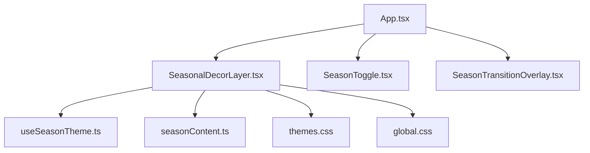
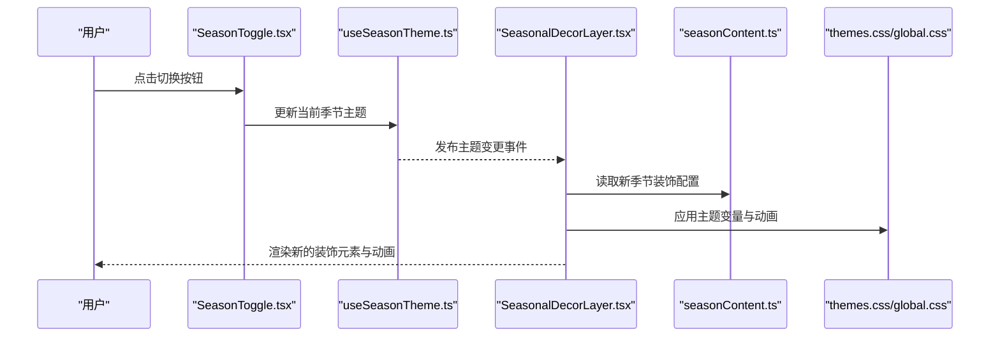
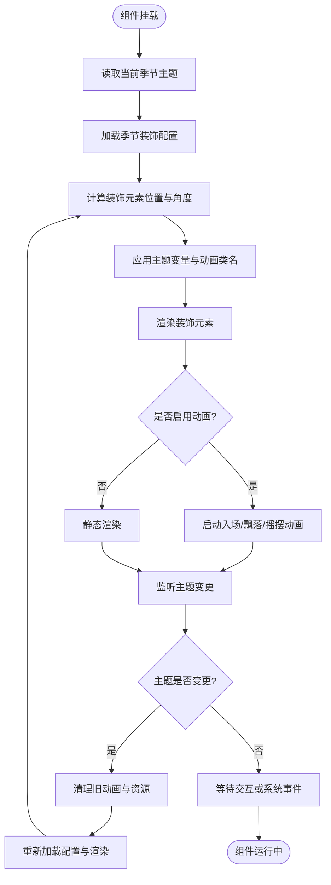
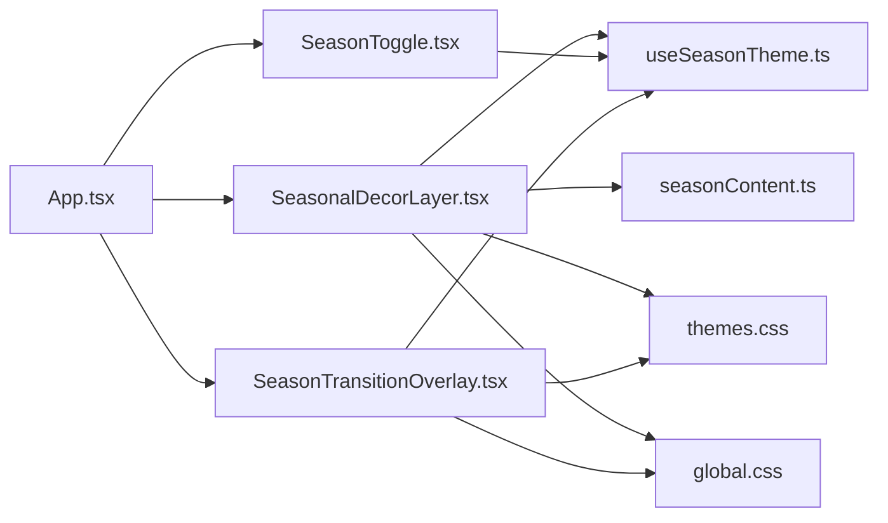

# 季节装饰层

<cite>
**本文档引用的文件**   
- [SeasonalDecorLayer.tsx](file://src/components/SeasonalDecorLayer.tsx)
- [useSeasonTheme.ts](file://src/hooks/useSeasonTheme.ts)
- [seasonContent.ts](file://src/data/seasonContent.ts)
- [SeasonToggle.tsx](file://src/components/SeasonToggle.tsx)
- [SeasonTransitionOverlay.tsx](file://src/components/SeasonTransitionOverlay.tsx)
- [themes.css](file://src/styles/themes.css)
- [global.css](file://src/styles/global.css)
- [App.tsx](file://src/App.tsx)
</cite>

## 目录
1. [简介](#简介)
2. [项目结构](#项目结构)
3. [核心组件](#核心组件)
4. [架构总览](#架构总览)
5. [详细组件分析](#详细组件分析)
6. [依赖关系分析](#依赖关系分析)
7. [性能考虑](#性能考虑)
8. [故障排查指南](#故障排查指南)
9. [结论](#结论)
10. [附录](#附录)

## 简介
本文件为“季节装饰层”组件提供系统化文档，重点围绕 SeasonalDecorLayer.tsx 的实现原理展开，涵盖：
- 季节性装饰元素的选择逻辑、位置算法与动画效果
- 不同季节的装饰主题配置与动态加载机制
- 使用示例：如何添加自定义装饰元素与配置行为
- 与 CSS 动画和 JavaScript 动画库的集成方式
- 装饰元素的性能优化与资源管理策略

该组件通过数据驱动的方式，根据当前季节主题渲染对应的装饰元素（如雪花、花瓣、落叶等），并配合过渡动画与交互切换，提升页面氛围感与沉浸体验。

## 项目结构
与季节装饰层相关的代码分布在以下模块：
- 组件层：SeasonalDecorLayer.tsx、SeasonToggle.tsx、SeasonTransitionOverlay.tsx
- 钩子层：useSeasonTheme.ts（负责获取/订阅当前季节主题）
- 数据层：seasonContent.ts（定义各季节的装饰主题与资源映射）
- 样式层：themes.css、global.css（主题变量与通用动画基础）
- 应用入口：App.tsx（挂载装饰层与主题切换入口）

图表来源
- [App.tsx](file://src/App.tsx)
- [SeasonalDecorLayer.tsx](file://src/components/SeasonalDecorLayer.tsx)
- [SeasonToggle.tsx](file://src/components/SeasonToggle.tsx)
- [SeasonTransitionOverlay.tsx](file://src/components/SeasonTransitionOverlay.tsx)
- [useSeasonTheme.ts](file://src/hooks/useSeasonTheme.ts)
- [seasonContent.ts](file://src/data/seasonContent.ts)
- [themes.css](file://src/styles/themes.css)
- [global.css](file://src/styles/global.css)

章节来源
- [App.tsx](file://src/App.tsx)
- [SeasonalDecorLayer.tsx](file://src/components/SeasonalDecorLayer.tsx)
- [seasonContent.ts](file://src/data/seasonContent.ts)
- [useSeasonTheme.ts](file://src/hooks/useSeasonTheme.ts)
- [themes.css](file://src/styles/themes.css)
- [global.css](file://src/styles/global.css)

## 核心组件
- SeasonalDecorLayer.tsx：负责按当前季节主题渲染装饰元素，处理图标选择、布局定位、动画触发与生命周期管理。
- useSeasonTheme.ts：暴露当前季节主题状态与变更事件，供装饰层与切换控件订阅。
- seasonContent.ts：集中维护各季节的装饰主题配置，包括图标集合、颜色、密度、动画参数等。
- SeasonToggle.tsx：用户交互入口，用于切换季节主题。
- SeasonTransitionOverlay.tsx：在主题切换时提供视觉过渡覆盖层，增强切换体验。
- themes.css / global.css：定义主题变量、关键帧动画与通用样式。

章节来源
- [SeasonalDecorLayer.tsx](file://src/components/SeasonalDecorLayer.tsx)
- [useSeasonTheme.ts](file://src/hooks/useSeasonTheme.ts)
- [seasonContent.ts](file://src/data/seasonContent.ts)
- [SeasonToggle.tsx](file://src/components/SeasonToggle.tsx)
- [SeasonTransitionOverlay.tsx](file://src/components/SeasonTransitionOverlay.tsx)
- [themes.css](file://src/styles/themes.css)
- [global.css](file://src/styles/global.css)

## 架构总览
整体流程如下：
- App 初始化并挂载 SeasonalDecorLayer、SeasonToggle 与 SeasonTransitionOverlay
- useSeasonTheme 提供当前季节主题状态与变更监听
- SeasonalDecorLayer 订阅主题变化，从 seasonContent 读取对应季节的配置
- 根据配置计算装饰元素的位置与动画参数，渲染到页面
- 用户通过 SeasonToggle 切换季节，触发过渡动画与资源重绘

图表来源
- [SeasonToggle.tsx](file://src/components/SeasonToggle.tsx)
- [useSeasonTheme.ts](file://src/hooks/useSeasonTheme.ts)
- [SeasonalDecorLayer.tsx](file://src/components/SeasonalDecorLayer.tsx)
- [seasonContent.ts](file://src/data/seasonContent.ts)
- [themes.css](file://src/styles/themes.css)
- [global.css](file://src/styles/global.css)

## 详细组件分析

### SeasonalDecorLayer.tsx 组件分析
职责与实现要点：
- 装饰元素选择逻辑：依据当前季节主题，从 seasonContent 中选取对应的图标集合与样式配置。
- 位置算法：基于容器尺寸与随机分布策略，生成装饰元素的坐标与旋转角度，确保视觉均匀且避免重叠。
- 动画效果：结合 CSS 关键帧与可选的 JS 动画库，控制入场、飘落、摇摆等动效；支持节流与按需启用。
- 生命周期管理：在主题切换时清理旧动画实例，避免内存泄漏；在组件卸载时移除事件监听与定时器。
- 可访问性与降级：对不支持动画的环境提供静态展示；遵循 prefers-reduced-motion 减少动效。

图表来源
- [SeasonalDecorLayer.tsx](file://src/components/SeasonalDecorLayer.tsx)
- [seasonContent.ts](file://src/data/seasonContent.ts)
- [themes.css](file://src/styles/themes.css)
- [global.css](file://src/styles/global.css)

章节来源
- [SeasonalDecorLayer.tsx](file://src/components/SeasonalDecorLayer.tsx)
- [seasonContent.ts](file://src/data/seasonContent.ts)
- [themes.css](file://src/styles/themes.css)
- [global.css](file://src/styles/global.css)

### useSeasonTheme.ts 钩子分析
职责与实现要点：
- 状态管理：维护当前季节主题（如春/夏/秋/冬）及其相关属性（主色、密度、动画强度）。
- 事件订阅：对外暴露 subscribe/unsubscribe 接口，供装饰层与切换控件订阅主题变更。
- 持久化：可选地将主题偏好存储至本地存储，保证刷新后保持一致。
- 默认值与校验：提供默认季节与无效值回退策略。

章节来源
- [useSeasonTheme.ts](file://src/hooks/useSeasonTheme.ts)

### seasonContent.ts 数据模型分析
职责与实现要点：
- 主题配置：每个季节包含装饰图标集合、颜色方案、密度、动画参数（时长、延迟、缓动）、背景渐变等。
- 资源映射：将图标名称映射到实际资源路径，便于动态加载与缓存。
- 扩展点：预留自定义装饰项字段，支持运行时注入新元素。

章节来源
- [seasonContent.ts](file://src/data/seasonContent.ts)

### SeasonToggle.tsx 与 SeasonTransitionOverlay.tsx
- SeasonToggle.tsx：提供用户界面用于切换季节主题，调用 useSeasonTheme 更新状态。
- SeasonTransitionOverlay.tsx：在主题切换期间显示覆盖层，执行淡入淡出或转场动画，提升用户体验。

章节来源
- [SeasonToggle.tsx](file://src/components/SeasonToggle.tsx)
- [SeasonTransitionOverlay.tsx](file://src/components/SeasonTransitionOverlay.tsx)
- [useSeasonTheme.ts](file://src/hooks/useSeasonTheme.ts)

### 样式与动画集成（themes.css / global.css）
- 主题变量：定义颜色、阴影、透明度等变量，供装饰层动态引用。
- 关键帧动画：定义飘落、摇摆、闪烁等动画序列，支持跨浏览器兼容。
- 响应式适配：在不同屏幕尺寸下调整装饰元素大小与密度。

章节来源
- [themes.css](file://src/styles/themes.css)
- [global.css](file://src/styles/global.css)

## 依赖关系分析
组件与模块之间的依赖关系如下：
- SeasonalDecorLayer 依赖 useSeasonTheme 获取主题状态，依赖 seasonContent 获取装饰配置，依赖样式文件应用主题与动画。
- SeasonToggle 依赖 useSeasonTheme 更新主题。
- SeasonTransitionOverlay 依赖 useSeasonTheme 与样式文件执行过渡动画。
- App 作为入口，组合上述组件并提供全局上下文。

图表来源
- [App.tsx](file://src/App.tsx)
- [SeasonalDecorLayer.tsx](file://src/components/SeasonalDecorLayer.tsx)
- [SeasonToggle.tsx](file://src/components/SeasonToggle.tsx)
- [SeasonTransitionOverlay.tsx](file://src/components/SeasonTransitionOverlay.tsx)
- [useSeasonTheme.ts](file://src/hooks/useSeasonTheme.ts)
- [seasonContent.ts](file://src/data/seasonContent.ts)
- [themes.css](file://src/styles/themes.css)
- [global.css](file://src/styles/global.css)

章节来源
- [App.tsx](file://src/App.tsx)
- [SeasonalDecorLayer.tsx](file://src/components/SeasonalDecorLayer.tsx)
- [SeasonToggle.tsx](file://src/components/SeasonToggle.tsx)
- [SeasonTransitionOverlay.tsx](file://src/components/SeasonTransitionOverlay.tsx)
- [useSeasonTheme.ts](file://src/hooks/useSeasonTheme.ts)
- [seasonContent.ts](file://src/data/seasonContent.ts)
- [themes.css](file://src/styles/themes.css)
- [global.css](file://src/styles/global.css)

## 性能考虑
- 渲染优化
  - 使用虚拟列表或分片渲染，仅在可视区域内生成装饰元素。
  - 合并样式更新，避免频繁重排与重绘。
  - 对大型图标进行懒加载与缓存，减少首次渲染开销。
- 动画优化
  - 优先使用 CSS 动画与 GPU 加速属性（transform、opacity）。
  - 限制同时运行的动画数量，采用节流与防抖策略。
  - 尊重 prefers-reduced-motion，自动降级为静态展示。
- 资源管理
  - 预加载常用季节资源，避免切换时的卡顿。
  - 及时清理定时器与事件监听，防止内存泄漏。
  - 使用 Web Worker 处理复杂位置计算，降低主线程压力。
- 可观测性
  - 记录动画帧率与内存占用，监控性能回归。
  - 提供开关以禁用非必要动画，满足低性能设备需求。

[本节为通用指导，不直接分析具体文件]

## 故障排查指南
常见问题与解决建议：
- 装饰元素未显示
  - 检查 seasonContent 中对应季节的图标资源路径是否正确。
  - 确认主题变量与样式类名已正确应用。
- 动画不生效
  - 验证浏览器是否支持关键帧动画与 transform。
  - 检查是否启用了 prefers-reduced-motion 导致动画被禁用。
- 切换主题卡顿
  - 评估装饰元素数量与复杂度，适当降低密度或关闭部分动画。
  - 确认资源是否已缓存，避免重复下载。
- 内存泄漏
  - 确保在主题切换与组件卸载时清理所有定时器与事件监听。
  - 避免闭包持有大对象引用。

章节来源
- [SeasonalDecorLayer.tsx](file://src/components/SeasonalDecorLayer.tsx)
- [seasonContent.ts](file://src/data/seasonContent.ts)
- [themes.css](file://src/styles/themes.css)
- [global.css](file://src/styles/global.css)

## 结论
SeasonalDecorLayer.tsx 通过数据驱动的装饰主题与灵活的动画策略，实现了高质量的季节氛围渲染。结合 useSeasonTheme 的状态管理与 seasonContent 的配置中心，组件具备良好的可扩展性与可维护性。通过合理的性能优化与资源管理，可在多设备与多环境下提供流畅的用户体验。建议在后续迭代中持续完善可访问性、可观测性与国际化支持。

[本节为总结性内容，不直接分析具体文件]

## 附录
- 使用示例：添加自定义装饰元素
  - 在 seasonContent.ts 中为新季节或现有季节增加装饰项配置，包括图标名称、资源路径、颜色与动画参数。
  - 在 SeasonalDecorLayer.tsx 中确保新装饰项被纳入位置算法与动画管线。
  - 如需自定义行为，可通过 props 或扩展点注入额外逻辑。
- 与 JavaScript 动画库集成
  - 若需更复杂的动效，可在 SeasonalDecorLayer 中引入轻量级动画库（如 GSAP 或 Framer Motion），并在主题切换时触发相应动画序列。
  - 注意与 CSS 动画的协调，避免冲突与重复渲染。

章节来源
- [seasonContent.ts](file://src/data/seasonContent.ts)
- [SeasonalDecorLayer.tsx](file://src/components/SeasonalDecorLayer.tsx)