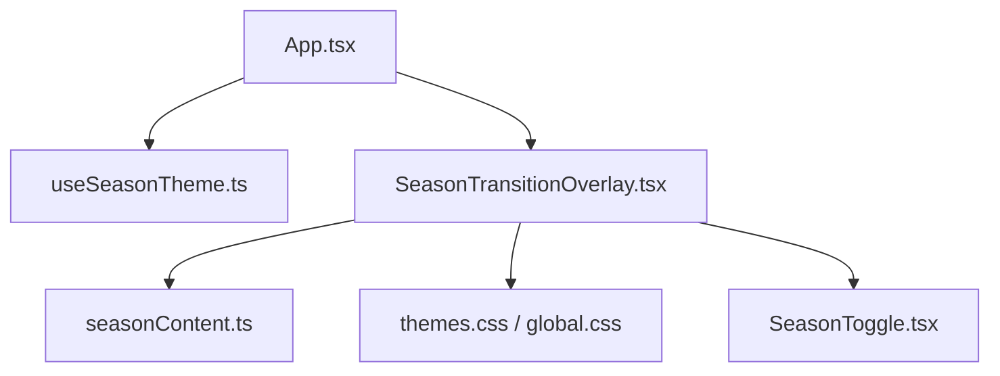
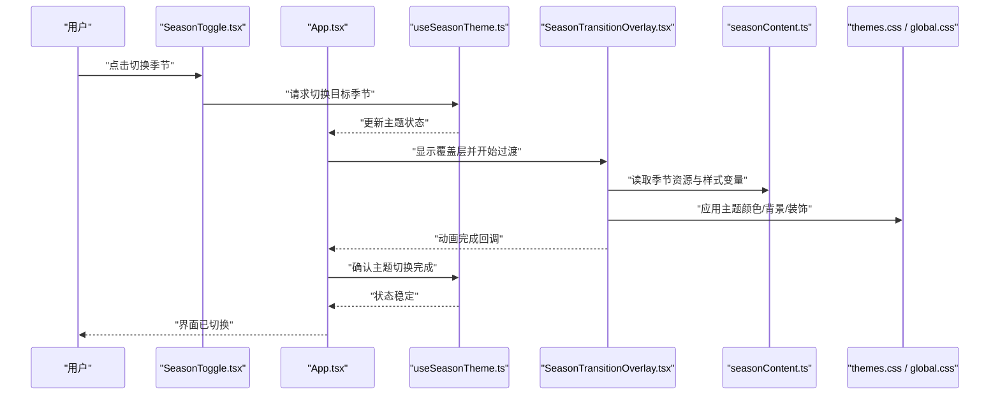
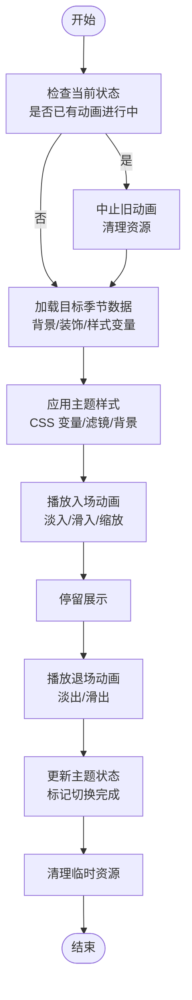
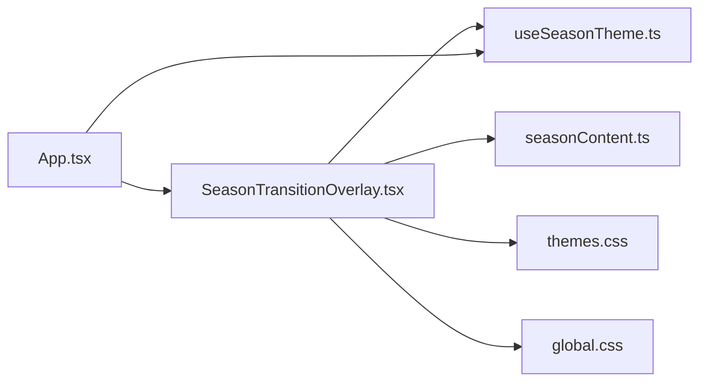

# 季节过渡覆盖层

<cite>
**本文引用的文件**   
- [SeasonTransitionOverlay.tsx](file://src/components/SeasonTransitionOverlay.tsx)
- [useSeasonTheme.ts](file://src/hooks/useSeasonTheme.ts)
- [seasonContent.ts](file://src/data/seasonContent.ts)
- [themes.css](file://src/styles/themes.css)
- [global.css](file://src/styles/global.css)
- [App.tsx](file://src/App.tsx)
</cite>

## 目录
1. [简介](#简介)
2. [项目结构](#项目结构)
3. [核心组件](#核心组件)
4. [架构总览](#架构总览)
5. [详细组件分析](#详细组件分析)
6. [依赖关系分析](#依赖关系分析)
7. [性能考虑](#性能考虑)
8. [故障排查指南](#故障排查指南)
9. [结论](#结论)
10. [附录：配置与示例](#附录配置与示例)

## 简介
本文件为“季节过渡覆盖层”组件提供系统化文档，聚焦 SeasonTransitionOverlay.tsx 的页面切换动画实现机制。内容涵盖：
- 过渡效果类型、动画时序控制与状态管理
- 不同季节主题的视觉效果差异与切换逻辑
- 自定义配置项（速度、类型、视觉风格）
- 与 React 状态管理的集成方式及响应式设计考量
- 动画性能优化与用户体验最佳实践

## 项目结构
围绕季节主题与过渡覆盖层的代码主要分布在以下位置：
- 组件层：SeasonTransitionOverlay.tsx（覆盖层与动画）、SeasonToggle.tsx（触发入口）
- 数据层：seasonContent.ts（季节主题内容与资源映射）
- 样式层：themes.css（主题变量与视觉风格）、global.css（全局布局与媒体查询）
- 钩子层：useSeasonTheme.ts（主题状态与切换逻辑）
- 应用层：App.tsx（挂载覆盖层与主题上下文）

图表来源
- [App.tsx](file://src/App.tsx)
- [useSeasonTheme.ts](file://src/hooks/useSeasonTheme.ts)
- [SeasonTransitionOverlay.tsx](file://src/components/SeasonTransitionOverlay.tsx)
- [seasonContent.ts](file://src/data/seasonContent.ts)
- [themes.css](file://src/styles/themes.css)
- [global.css](file://src/styles/global.css)
- [SeasonToggle.tsx](file://src/components/SeasonToggle.tsx)

章节来源
- [App.tsx](file://src/App.tsx)
- [SeasonTransitionOverlay.tsx](file://src/components/SeasonTransitionOverlay.tsx)
- [useSeasonTheme.ts](file://src/hooks/useSeasonTheme.ts)
- [seasonContent.ts](file://src/data/seasonContent.ts)
- [themes.css](file://src/styles/themes.css)
- [global.css](file://src/styles/global.css)

## 核心组件
SeasonTransitionOverlay.tsx 负责在季节切换时呈现全屏覆盖层与过渡动画，其职责包括：
- 接收当前目标季节与切换方向（进入/离开）
- 根据季节主题加载对应背景、装饰元素与配色
- 控制动画阶段（入场、停留、退场）与时长
- 与 useSeasonTheme 的状态同步，确保 UI 与数据一致
- 响应式适配不同屏幕尺寸与设备能力

章节来源
- [SeasonTransitionOverlay.tsx](file://src/components/SeasonTransitionOverlay.tsx)
- [useSeasonTheme.ts](file://src/hooks/useSeasonTheme.ts)

## 架构总览
整体流程由 App 启动，通过 useSeasonTheme 维护主题状态；用户触发切换后，SeasonTransitionOverlay 接管渲染并执行过渡动画，完成后更新主题并释放覆盖层。

图表来源
- [App.tsx](file://src/App.tsx)
- [useSeasonTheme.ts](file://src/hooks/useSeasonTheme.ts)
- [SeasonTransitionOverlay.tsx](file://src/components/SeasonTransitionOverlay.tsx)
- [seasonContent.ts](file://src/data/seasonContent.ts)
- [themes.css](file://src/styles/themes.css)
- [global.css](file://src/styles/global.css)

## 详细组件分析

### 过渡效果类型与时序控制
- 过渡类型
  - 淡入淡出：适用于快速切换，强调色彩变化
  - 滑入滑出：增强空间感，适合大图或视频背景
  - 缩放/旋转：用于强调特定季节的视觉焦点
  - 组合过渡：先遮罩再内容变换，提升层次感
- 时序控制
  - 阶段划分：入场（fade-in/slide-in）、停留（hold）、退场（fade-out/slide-out）
  - 时长参数：可配置各阶段持续时间与缓动函数
  - 延迟策略：按层级错开动画，避免同时重排
  - 中断处理：新切换到来时平滑中止旧动画

章节来源
- [SeasonTransitionOverlay.tsx](file://src/components/SeasonTransitionOverlay.tsx)

### 状态管理与数据流
- 状态来源
  - useSeasonTheme 暴露当前季节、目标季节、切换方向与动画状态
  - seasonContent 提供季节对应的资源映射（背景图、装饰、文案等）
- 状态流转
  - 触发切换 -> 设置目标季节 -> 显示覆盖层 -> 加载资源 -> 播放动画 -> 更新主题 -> 隐藏覆盖层
- 一致性保障
  - 使用受控模式：覆盖层仅渲染当前动画帧所需内容
  - 防抖/节流：防止频繁切换导致状态抖动

章节来源
- [useSeasonTheme.ts](file://src/hooks/useSeasonTheme.ts)
- [seasonContent.ts](file://src/data/seasonContent.ts)
- [SeasonTransitionOverlay.tsx](file://src/components/SeasonTransitionOverlay.tsx)

### 季节主题视觉效果差异与切换逻辑
- 视觉差异
  - 春季：柔和渐变、花瓣/嫩叶装饰、明亮主色
  - 夏季：高饱和暖色、阳光光晕、动态粒子
  - 秋季：深橙棕色调、落叶飘落、纹理叠加
  - 冬季：冷蓝白调、雪花粒子、毛玻璃效果
- 切换逻辑
  - 根据目标季节选择背景与装饰图层
  - 应用主题 CSS 变量（颜色、阴影、滤镜）
  - 根据设备能力降级（如关闭重度粒子）

章节来源
- [seasonContent.ts](file://src/data/seasonContent.ts)
- [themes.css](file://src/styles/themes.css)
- [SeasonTransitionOverlay.tsx](file://src/components/SeasonTransitionOverlay.tsx)

### 配置选项与自定义
- 速度配置
  - 入场时长、停留时长、退场时长
  - 缓动曲线（ease-in、ease-out、cubic-bezier）
- 类型配置
  - 过渡类型（淡入淡出、滑入滑出、缩放、组合）
  - 是否启用遮罩层与层级顺序
- 视觉配置
  - 背景图片/视频路径
  - 装饰元素开关（粒子、飘雪、花瓣）
  - 主题变量覆盖（主色、辅色、阴影强度）
- 响应式配置
  - 移动端简化动画（减少粒子数量、缩短时长）
  - 横竖屏切换时的布局适配

章节来源
- [SeasonTransitionOverlay.tsx](file://src/components/SeasonTransitionOverlay.tsx)
- [themes.css](file://src/styles/themes.css)
- [global.css](file://src/styles/global.css)

### 与 React 状态管理的集成
- 使用 useSeasonTheme 作为单一事实源，集中管理季节状态
- 覆盖层以受控组件形式存在，仅在动画期间渲染
- 事件驱动：切换按钮触发状态变更，覆盖层监听并响应
- 副作用清理：动画结束后释放资源，避免内存泄漏

章节来源
- [useSeasonTheme.ts](file://src/hooks/useSeasonTheme.ts)
- [SeasonTransitionOverlay.tsx](file://src/components/SeasonTransitionOverlay.tsx)
- [App.tsx](file://src/App.tsx)

### 响应式设计考虑
- 媒体查询：针对不同断点调整动画参数与布局
- 性能降级：低性能设备自动降低粒子密度与特效复杂度
- 触控友好：增大交互区域，支持手势触发切换

章节来源
- [global.css](file://src/styles/global.css)
- [SeasonTransitionOverlay.tsx](file://src/components/SeasonTransitionOverlay.tsx)

### 动画流程图（算法级）

图表来源
- [SeasonTransitionOverlay.tsx](file://src/components/SeasonTransitionOverlay.tsx)
- [useSeasonTheme.ts](file://src/hooks/useSeasonTheme.ts)

## 依赖关系分析
- 组件依赖
  - SeasonTransitionOverlay 依赖 useSeasonTheme 获取主题状态
  - 依赖 seasonContent 获取季节资源映射
  - 依赖 themes.css 与 global.css 进行样式与响应式控制
- 外部库
  - 若使用第三方动画库（如 GSAP），需关注版本兼容与打包体积
- 潜在循环依赖
  - 确保 hooks 不反向导入组件，避免循环引用

图表来源
- [SeasonTransitionOverlay.tsx](file://src/components/SeasonTransitionOverlay.tsx)
- [useSeasonTheme.ts](file://src/hooks/useSeasonTheme.ts)
- [seasonContent.ts](file://src/data/seasonContent.ts)
- [themes.css](file://src/styles/themes.css)
- [global.css](file://src/styles/global.css)
- [App.tsx](file://src/App.tsx)

章节来源
- [SeasonTransitionOverlay.tsx](file://src/components/SeasonTransitionOverlay.tsx)
- [useSeasonTheme.ts](file://src/hooks/useSeasonTheme.ts)
- [seasonContent.ts](file://src/data/seasonContent.ts)
- [themes.css](file://src/styles/themes.css)
- [global.css](file://src/styles/global.css)
- [App.tsx](file://src/App.tsx)

## 性能考虑
- 渲染优化
  - 使用 requestAnimationFrame 或 CSS 动画替代 JS 高频更新
  - 避免在动画中触发重排，优先使用 transform 与 opacity
- 资源管理
  - 预加载常用季节背景与装饰，减少切换卡顿
  - 按需加载重型特效（粒子、视频），根据设备能力降级
- 内存与生命周期
  - 动画结束后及时移除事件监听与定时器
  - 使用 memoization 缓存静态数据（如季节配置）
- 可访问性
  - 尊重 prefers-reduced-motion，自动降低动画强度
  - 提供键盘导航与屏幕阅读器提示

[本节为通用指导，不直接分析具体文件]

## 故障排查指南
- 常见问题
  - 切换闪烁：检查样式层叠与 z-index，确保覆盖层正确遮挡
  - 动画卡顿：降低粒子数量，禁用复杂滤镜，启用硬件加速
  - 主题不一致：确认 CSS 变量是否正确注入到根节点
  - 内存泄漏：检查 useEffect 清理逻辑，确保移除监听器
- 调试建议
  - 使用浏览器性能面板记录帧率与主线程占用
  - 打印关键状态变更，定位异常分支
  - 在低性能设备上复现问题，验证降级策略

章节来源
- [SeasonTransitionOverlay.tsx](file://src/components/SeasonTransitionOverlay.tsx)
- [themes.css](file://src/styles/themes.css)
- [global.css](file://src/styles/global.css)

## 结论
SeasonTransitionOverlay.tsx 通过清晰的状态管理与灵活的动画配置，实现了流畅且可定制的季节切换体验。结合 useSeasonTheme 与主题样式系统，可在保证性能的前提下提供丰富的视觉反馈。建议在生产环境中启用性能监控与可访问性优化，以确保跨设备的一致体验。

[本节为总结性内容，不直接分析具体文件]

## 附录：配置与示例
- 推荐配置项
  - duration: { enter: 600, hold: 800, exit: 600 }
  - easing: "ease-out-cubic"
  - type: "fade-slide"
  - effects: { particles: true, snow: false, petals: true }
  - responsive: { mobile: { duration: 400, particles: false } }
- 示例场景
  - 快速浏览：短时长 + 淡入淡出
  - 沉浸体验：长停留 + 组合过渡 + 粒子特效
  - 低性能设备：简化动画 + 关闭粒子

章节来源
- [SeasonTransitionOverlay.tsx](file://src/components/SeasonTransitionOverlay.tsx)
- [seasonContent.ts](file://src/data/seasonContent.ts)
- [themes.css](file://src/styles/themes.css)
- [global.css](file://src/styles/global.css)