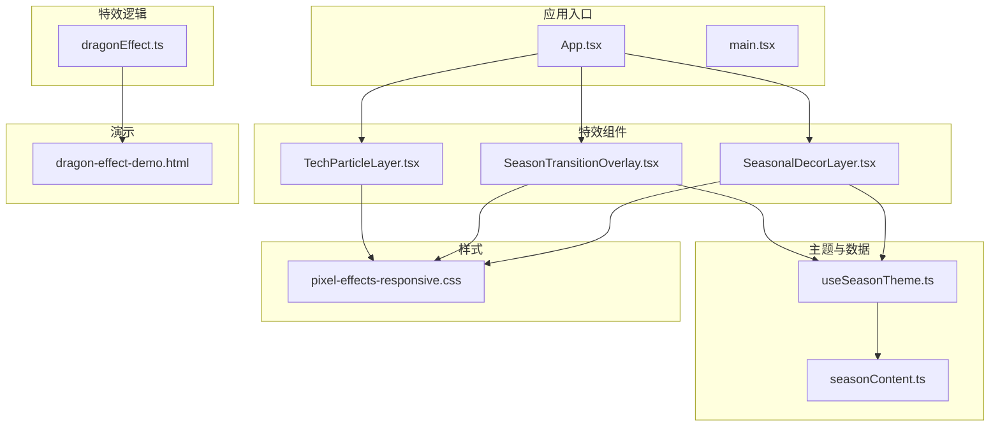
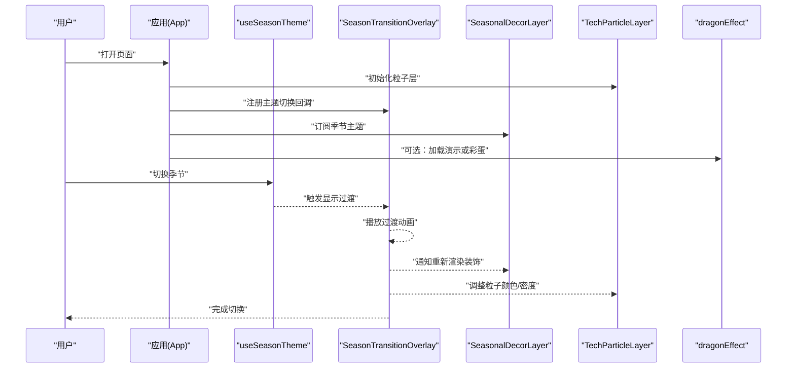
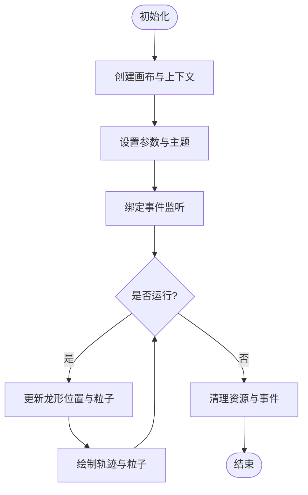
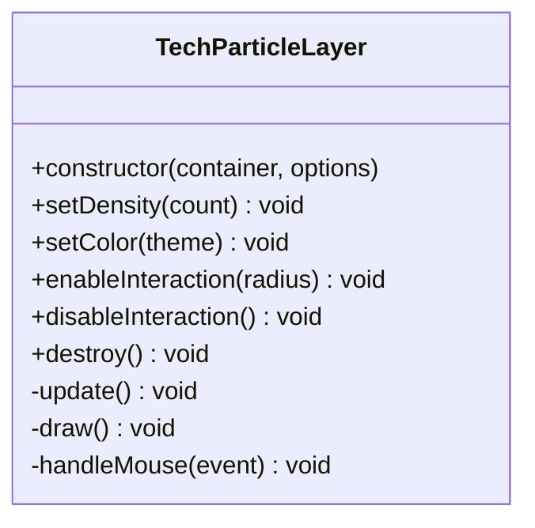
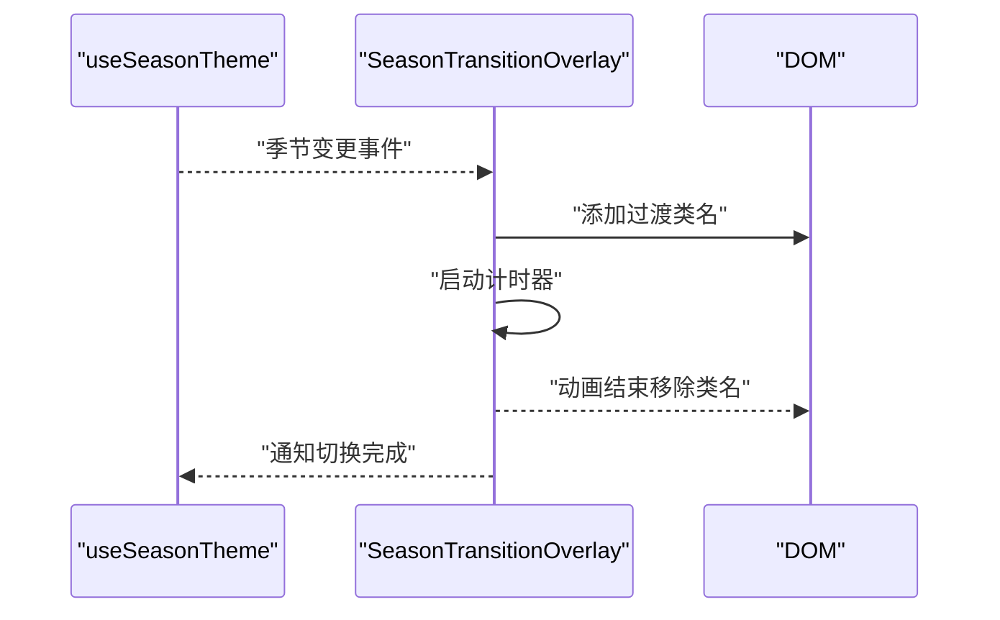
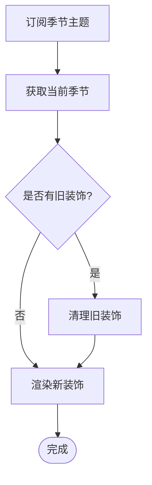
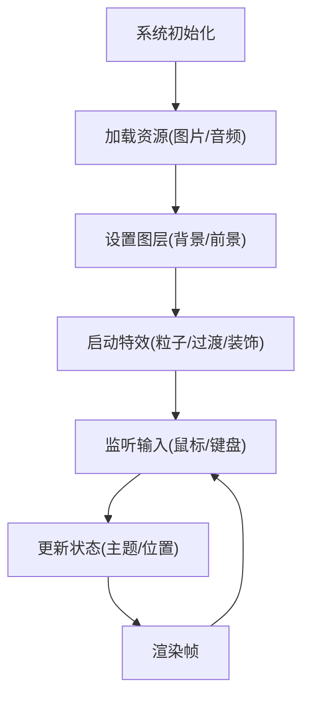
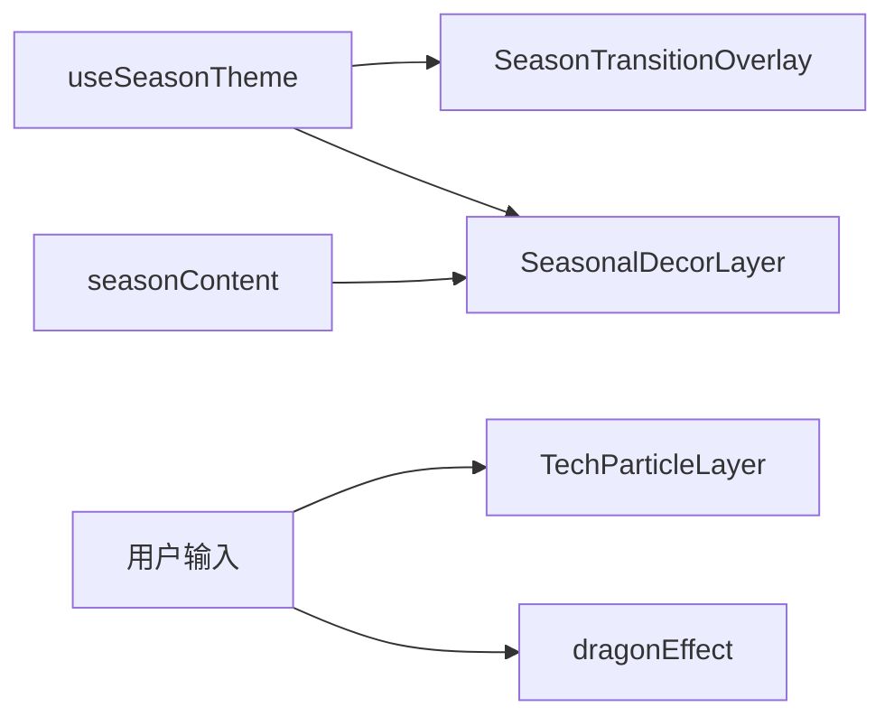

# 特效系统

<cite>
**本文引用的文件**   
- [src/effects/dragonEffect.ts](file://src/effects/dragonEffect.ts)
- [src/components/TechParticleLayer.tsx](file://src/components/TechParticleLayer.tsx)
- [src/components/SeasonTransitionOverlay.tsx](file://src/components/SeasonTransitionOverlay.tsx)
- [src/components/SeasonalDecorLayer.tsx](file://src/components/SeasonalDecorLayer.tsx)
- [src/hooks/useSeasonTheme.ts](file://src/hooks/useSeasonTheme.ts)
- [src/data/seasonContent.ts](file://src/data/seasonContent.ts)
- [src/styles/pixel-effects-responsive.css](file://src/styles/pixel-effects-responsive.css)
- [public/dragon-effect-demo.html](file://public/dragon-effect-demo.html)
</cite>

## 目录
1. [简介](#简介)
2. [项目结构](#项目结构)
3. [核心组件](#核心组件)
4. [架构总览](#架构总览)
5. [详细组件分析](#详细组件分析)
6. [依赖关系分析](#依赖关系分析)
7. [性能考量](#性能考量)
8. [故障排查指南](#故障排查指南)
9. [结论](#结论)
10. [附录](#附录) 

## 简介
本文件为 oo-space 项目的“特效系统”提供系统化文档，覆盖以下关键能力：
- 龙形特效（Dragon Effect）：基于 Canvas 的粒子与路径动画，用于营造视觉焦点或彩蛋体验。
- 科技粒子层（Tech Particle Layer）：全屏粒子背景，增强科技感氛围。
- 季节过渡覆盖层（Season Transition Overlay）：切换主题时的全屏过渡动画与遮罩效果。
- 季节装饰层（Seasonal Decor Layer）：根据当前季节渲染装饰元素，提升沉浸感。

文档将解释各模块的职责、调用关系、接口与领域模型，并给出配置项、参数与返回值的说明，同时包含常见问题与解决方案，帮助初学者快速上手，也为有经验的开发者提供深入的技术细节。

## 项目结构
特效系统主要分布在以下目录与文件中：
- effects：特效逻辑实现（如龙形特效）
- components：React 组件封装（粒子层、过渡层、装饰层等）
- hooks：状态与主题相关 Hook（如季节主题）
- data：数据与内容（如季节内容）
- styles：样式与响应式适配
- public：演示页面与静态资源

图表来源 
- [src/effects/dragonEffect.ts](file://src/effects/dragonEffect.ts)
- [src/components/TechParticleLayer.tsx](file://src/components/TechParticleLayer.tsx)
- [src/components/SeasonTransitionOverlay.tsx](file://src/components/SeasonTransitionOverlay.tsx)
- [src/components/SeasonalDecorLayer.tsx](file://src/components/SeasonalDecorLayer.tsx)
- [src/hooks/useSeasonTheme.ts](file://src/hooks/useSeasonTheme.ts)
- [src/data/seasonContent.ts](file://src/data/seasonContent.ts)
- [src/styles/pixel-effects-responsive.css](file://src/styles/pixel-effects-responsive.css)
- [public/dragon-effect-demo.html](file://public/dragon-effect-demo.html)

章节来源
- [src/effects/dragonEffect.ts](file://src/effects/dragonEffect.ts)
- [src/components/TechParticleLayer.tsx](file://src/components/TechParticleLayer.tsx)
- [src/components/SeasonTransitionOverlay.tsx](file://src/components/SeasonTransitionOverlay.tsx)
- [src/components/SeasonalDecorLayer.tsx](file://src/components/SeasonalDecorLayer.tsx)
- [src/hooks/useSeasonTheme.ts](file://src/hooks/useSeasonTheme.ts)
- [src/data/seasonContent.ts](file://src/data/seasonContent.ts)
- [src/styles/pixel-effects-responsive.css](file://src/styles/pixel-effects-responsive.css)
- [public/dragon-effect-demo.html](file://public/dragon-effect-demo.html)

## 核心组件
- 龙形特效（Dragon Effect）
  - 职责：在 Canvas 上绘制龙形轨迹与粒子，支持启动、停止、重置等控制。
  - 典型用法：通过外部脚本或演示页面调用初始化函数，传入容器与配置。
  - 关键接口：初始化函数、更新循环、销毁清理。
  - 性能要点：帧率控制、粒子数量限制、离屏渲染。

- 科技粒子层（Tech Particle Layer）
  - 职责：全屏粒子背景，随鼠标移动产生交互效果。
  - 典型用法：作为全局背景层挂载到根节点。
  - 关键接口：创建实例、设置密度/速度/颜色、监听窗口尺寸变化。
  - 性能要点：requestAnimationFrame 节流、对象池复用、减少重绘。

- 季节过渡覆盖层（Season Transition Overlay）
  - 职责：在季节切换时显示全屏过渡动画与遮罩，平滑视觉切换。
  - 典型用法：在主题切换钩子触发时显示/隐藏。
  - 关键接口：显示、隐藏、动画时长配置。
  - 性能要点：CSS 动画优先、避免频繁 DOM 操作。

- 季节装饰层（Seasonal Decor Layer）
  - 职责：根据当前季节渲染装饰元素（如雪花、花瓣等）。
  - 典型用法：订阅季节主题变化，动态插入装饰节点。
  - 关键接口：获取当前季节、渲染装饰、清理旧装饰。
  - 性能要点：按需渲染、事件委托、最小化重排。

章节来源
- [src/effects/dragonEffect.ts](file://src/effects/dragonEffect.ts)
- [src/components/TechParticleLayer.tsx](file://src/components/TechParticleLayer.tsx)
- [src/components/SeasonTransitionOverlay.tsx](file://src/components/SeasonTransitionOverlay.tsx)
- [src/components/SeasonalDecorLayer.tsx](file://src/components/SeasonalDecorLayer.tsx)

## 架构总览
特效系统的整体架构遵循“逻辑与视图分离”的原则：
- 逻辑层（effects）：负责复杂动画与物理模拟（如龙形轨迹计算）。
- 视图层（components）：React 组件封装，管理生命周期与 UI 状态。
- 主题层（hooks + data）：统一季节主题与内容数据，驱动装饰与过渡。
- 样式层（styles）：统一的视觉效果与响应式适配。

图表来源 
- [src/components/SeasonTransitionOverlay.tsx](file://src/components/SeasonTransitionOverlay.tsx)
- [src/components/SeasonalDecorLayer.tsx](file://src/components/SeasonalDecorLayer.tsx)
- [src/components/TechParticleLayer.tsx](file://src/components/TechParticleLayer.tsx)
- [src/hooks/useSeasonTheme.ts](file://src/hooks/useSeasonTheme.ts)
- [src/effects/dragonEffect.ts](file://src/effects/dragonEffect.ts)

## 详细组件分析

### 龙形特效（Dragon Effect）
- 功能概述
  - 使用 Canvas 绘制龙形轨迹与粒子，支持路径跟随、粒子扩散、尾迹拖尾等效果。
  - 可通过外部 API 控制播放状态（开始、暂停、重置）、调整参数（速度、密度、颜色）。

- 关键流程
  - 初始化：创建 Canvas、绑定容器、设置初始参数。
  - 更新循环：每帧计算龙形位置、生成粒子、绘制轨迹。
  - 销毁：释放资源、移除事件监听。

- 接口与配置
  - 初始化参数：容器选择器、画布尺寸、粒子数量、颜色主题、运动曲线。
  - 控制方法：start()、pause()、reset()、destroy()。
  - 事件回调：onFrame、onComplete、onError。

- 性能优化
  - 使用 requestAnimationFrame 控制帧率。
  - 粒子对象池复用，避免频繁 GC。
  - 离屏 Canvas 缓存静态元素。

图表来源 
- [src/effects/dragonEffect.ts](file://src/effects/dragonEffect.ts)

章节来源
- [src/effects/dragonEffect.ts](file://src/effects/dragonEffect.ts)
- [public/dragon-effect-demo.html](file://public/dragon-effect-demo.html)

### 科技粒子层（Tech Particle Layer）
- 功能概述
  - 全屏粒子背景，支持鼠标交互（吸引/排斥）、颜色主题切换、密度调节。

- 关键流程
  - 初始化：创建粒子数组、绑定窗口 resize 事件。
  - 更新循环：每帧更新粒子位置、绘制连线、处理交互。
  - 销毁：清空粒子数组、移除事件监听。

- 接口与配置
  - 初始化参数：容器选择器、粒子数量、最大距离、颜色主题、交互半径。
  - 控制方法：setDensity()、setColor()、enableInteraction()、disableInteraction()。
  - 事件回调：onMouseMove、onResize。

- 性能优化
  - 使用对象池管理粒子实例。
  - 限制连线绘制数量，避免 O(n^2)。
  - 使用 CSS transform 替代频繁 DOM 操作。

图表来源 
- [src/components/TechParticleLayer.tsx](file://src/components/TechParticleLayer.tsx)

章节来源
- [src/components/TechParticleLayer.tsx](file://src/components/TechParticleLayer.tsx)

### 季节过渡覆盖层（Season Transition Overlay）
- 功能概述
  - 在季节切换时显示全屏过渡动画与遮罩，确保视觉平滑过渡。

- 关键流程
  - 监听主题变化：通过 useSeasonTheme 订阅季节变更。
  - 显示遮罩：添加过渡类名，触发 CSS 动画。
  - 隐藏遮罩：动画结束后移除类名，清理状态。

- 接口与配置
  - 配置项：动画时长、遮罩颜色、淡入淡出效果。
  - 方法：show()、hide()、toggle()。
  - 事件回调：onStart、onEnd。

- 性能优化
  - 优先使用 CSS 动画与 GPU 加速。
  - 避免在动画期间进行大量 DOM 操作。

图表来源 
- [src/components/SeasonTransitionOverlay.tsx](file://src/components/SeasonTransitionOverlay.tsx)
- [src/hooks/useSeasonTheme.ts](file://src/hooks/useSeasonTheme.ts)

章节来源
- [src/components/SeasonTransitionOverlay.tsx](file://src/components/SeasonTransitionOverlay.tsx)
- [src/hooks/useSeasonTheme.ts](file://src/hooks/useSeasonTheme.ts)

### 季节装饰层（Seasonal Decor Layer）
- 功能概述
  - 根据当前季节渲染装饰元素（如雪花、花瓣），提升沉浸感。

- 关键流程
  - 订阅主题：通过 useSeasonTheme 获取当前季节。
  - 渲染装饰：根据季节类型插入对应装饰节点。
  - 清理旧装饰：切换季节前移除旧节点，避免内存泄漏。

- 接口与配置
  - 配置项：装饰类型、数量、位置分布、动画效果。
  - 方法：renderDecorations()、clearDecorations()。
  - 事件回调：onRender、onClear。

- 性能优化
  - 使用 DocumentFragment 批量插入节点。
  - 事件委托减少监听器数量。

图表来源 
- [src/components/SeasonalDecorLayer.tsx](file://src/components/SeasonalDecorLayer.tsx)
- [src/hooks/useSeasonTheme.ts](file://src/hooks/useSeasonTheme.ts)

章节来源
- [src/components/SeasonalDecorLayer.tsx](file://src/components/SeasonalDecorLayer.tsx)
- [src/hooks/useSeasonTheme.ts](file://src/hooks/useSeasonTheme.ts)

### 概念总览
以下为不直接映射到具体代码的概念性流程图，展示特效系统的通用工作流：

[此图为概念性流程图，无需源码映射]

## 依赖关系分析
- 组件间依赖
  - SeasonTransitionOverlay 依赖 useSeasonTheme 获取主题状态。
  - SeasonalDecorLayer 依赖 useSeasonTheme 与 seasonContent 数据。
  - TechParticleLayer 独立运行，但可接受主题颜色配置。
  - dragonEffect 独立于 React 组件，可通过外部脚本调用。

- 数据流向
  - 主题数据从 useSeasonTheme 流向 SeasonTransitionOverlay 与 SeasonalDecorLayer。
  - 季节内容数据从 seasonContent 流向 SeasonalDecorLayer。
  - 用户输入（鼠标/键盘）影响 TechParticleLayer 与 dragonEffect 的行为。

图表来源 
- [src/hooks/useSeasonTheme.ts](file://src/hooks/useSeasonTheme.ts)
- [src/data/seasonContent.ts](file://src/data/seasonContent.ts)
- [src/components/SeasonTransitionOverlay.tsx](file://src/components/SeasonTransitionOverlay.tsx)
- [src/components/SeasonalDecorLayer.tsx](file://src/components/SeasonalDecorLayer.tsx)
- [src/components/TechParticleLayer.tsx](file://src/components/TechParticleLayer.tsx)
- [src/effects/dragonEffect.ts](file://src/effects/dragonEffect.ts)

章节来源
- [src/hooks/useSeasonTheme.ts](file://src/hooks/useSeasonTheme.ts)
- [src/data/seasonContent.ts](file://src/data/seasonContent.ts)
- [src/components/SeasonTransitionOverlay.tsx](file://src/components/SeasonTransitionOverlay.tsx)
- [src/components/SeasonalDecorLayer.tsx](file://src/components/SeasonalDecorLayer.tsx)
- [src/components/TechParticleLayer.tsx](file://src/components/TechParticleLayer.tsx)
- [src/effects/dragonEffect.ts](file://src/effects/dragonEffect.ts)

## 性能考量
- 帧率控制
  - 使用 requestAnimationFrame 确保动画流畅。
  - 在高负载设备上降低粒子数量或关闭非必要效果。

- 内存管理
  - 及时销毁不再使用的 Canvas 与事件监听器。
  - 使用对象池复用粒子与装饰节点。

- 渲染优化
  - 优先使用 CSS 动画与 GPU 加速。
  - 避免频繁 DOM 操作，使用 DocumentFragment 批量更新。

- 交互优化
  - 对高频事件（如鼠标移动）进行节流或防抖。
  - 限制粒子连线计算范围，避免 O(n^2) 复杂度。

## 故障排查指南
- 常见问题
  - Canvas 未正确初始化：检查容器是否存在且可见。
  - 粒子层卡顿：减少粒子数量或禁用交互。
  - 过渡动画不生效：确认 CSS 类名是否正确添加。
  - 装饰层重复渲染：确保在切换前清理旧装饰。

- 调试建议
  - 使用浏览器开发者工具监控帧率与内存占用。
  - 在关键步骤添加日志输出，定位问题点。
  - 逐步禁用特效以隔离问题源。

章节来源
- [src/components/TechParticleLayer.tsx](file://src/components/TechParticleLayer.tsx)
- [src/components/SeasonTransitionOverlay.tsx](file://src/components/SeasonTransitionOverlay.tsx)
- [src/components/SeasonalDecorLayer.tsx](file://src/components/SeasonalDecorLayer.tsx)
- [src/effects/dragonEffect.ts](file://src/effects/dragonEffect.ts)

## 结论
oo-space 的特效系统通过模块化设计实现了龙形特效、科技粒子层、季节过渡与装饰等功能。各组件职责清晰、依赖关系明确，便于扩展与维护。通过合理的性能优化与故障排查策略，可在不同设备上提供一致的视觉体验。

## 附录
- 配置示例参考
  - 龙形特效：容器选择器、粒子数量、颜色主题、运动曲线。
  - 科技粒子层：粒子数量、最大距离、颜色主题、交互半径。
  - 季节过渡：动画时长、遮罩颜色、淡入淡出效果。
  - 季节装饰：装饰类型、数量、位置分布、动画效果。

- 最佳实践
  - 优先使用 CSS 动画与 GPU 加速。
  - 合理设置粒子数量与交互范围。
  - 及时清理资源，避免内存泄漏。