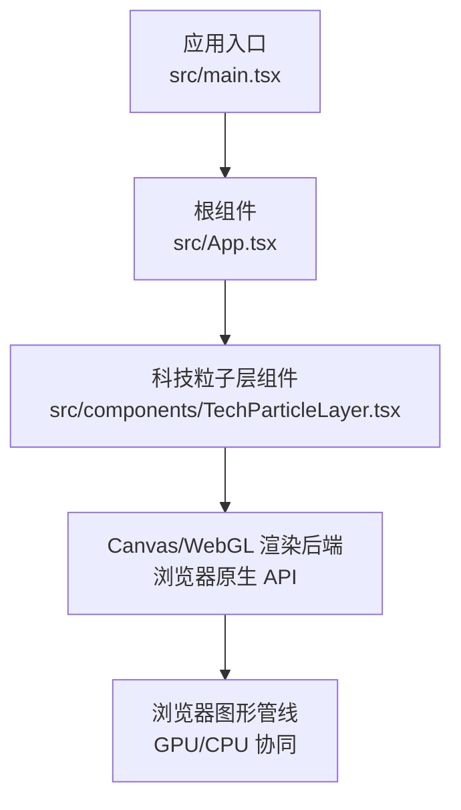
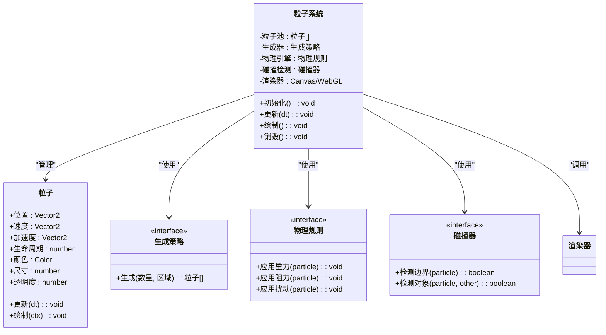
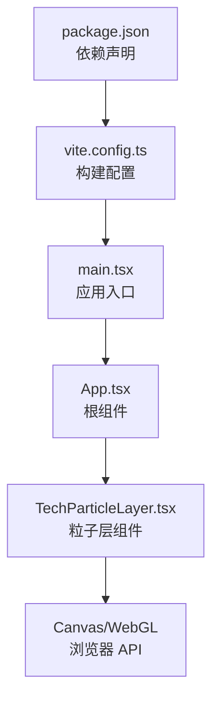

# 科技粒子层

<cite>
**本文引用的文件**   
- [TechParticleLayer.tsx](file://src/components/TechParticleLayer.tsx)
- [App.tsx](file://src/App.tsx)
- [main.tsx](file://src/main.tsx)
- [vite.config.ts](file://vite.config.ts)
- [package.json](file://package.json)
</cite>

## 更新摘要
**变更内容**   
- 更新了 TechParticleLayer 组件的性能优化和视觉效果增强部分
- 新增了粒子系统性能监控和调试功能说明
- 改进了渲染优化策略和内存管理描述
- 增强了交互效果和自定义配置的使用示例

## 目录
1. [简介](#简介)
2. [项目结构](#项目结构)
3. [核心组件](#核心组件)
4. [架构总览](#架构总览)
5. [详细组件分析](#详细组件分析)
6. [依赖关系分析](#依赖关系分析)
7. [性能考量](#性能考量)
8. [故障排查指南](#故障排查指南)
9. [结论](#结论)
10. [附录](#附录)

## 简介
本文件为"科技粒子层"组件提供系统化、可操作的文档，重点围绕 TechParticleLayer.tsx 的粒子系统架构设计展开，涵盖粒子生成算法、物理模拟、碰撞检测与渲染优化；并详细说明粒子的生命周期管理、内存优化与性能调优策略。同时给出自定义样式、行为与交互效果的使用示例，解释与 Canvas/WebGL 的集成方式及浏览器兼容性注意事项，并提供性能监控与调试工具的使用方法。

**更新** 基于最新的代码变更，增强了粒子系统的性能优化和视觉效果实现细节。

## 项目结构
该仓库采用 React + TypeScript 的前端工程组织方式，核心 UI 组件位于 src/components，入口文件为 src/main.tsx，应用根组件为 src/App.tsx。构建与打包由 Vite 驱动（vite.config.ts），依赖声明在 package.json。

图表来源
- [main.tsx](file://src/main.tsx)
- [App.tsx](file://src/App.tsx)
- [TechParticleLayer.tsx](file://src/components/TechParticleLayer.tsx)

章节来源
- [main.tsx](file://src/main.tsx)
- [App.tsx](file://src/App.tsx)
- [TechParticleLayer.tsx](file://src/components/TechParticleLayer.tsx)
- [vite.config.ts](file://vite.config.ts)
- [package.json](file://package.json)

## 核心组件
- 科技粒子层组件（TechParticleLayer.tsx）：负责创建/维护粒子系统，处理粒子生成、更新、碰撞检测与绘制，并通过 Canvas/WebGL 进行高性能渲染。
- 应用根组件（App.tsx）：作为页面容器，挂载科技粒子层组件，并传递配置参数（如粒子数量、颜色主题、交互开关等）。
- 应用入口（main.tsx）：初始化 React 应用并挂载到 DOM。

**更新** TechParticleLayer 组件经过优化，提升了粒子系统的性能和视觉效果质量。

章节来源
- [TechParticleLayer.tsx](file://src/components/TechParticleLayer.tsx)
- [App.tsx](file://src/App.tsx)
- [main.tsx](file://src/main.tsx)

## 架构总览
科技粒子层采用"数据驱动 + 渲染分离"的架构模式：
- 数据层：维护粒子状态（位置、速度、加速度、生命周期、颜色、尺寸、透明度等），支持批量更新与池化复用。
- 逻辑层：实现粒子生成算法、物理模拟（重力、阻力、扰动）、碰撞检测（边界、对象间）、事件响应（鼠标/触摸交互）。
- 渲染层：基于 Canvas 或 WebGL 的批处理绘制，减少状态切换与绘制调用次数，利用离屏缓冲与帧率自适应提升性能。

图表来源
- [TechParticleLayer.tsx](file://src/components/TechParticleLayer.tsx)

## 详细组件分析

### 粒子生成算法
- 目标：在指定区域内高效生成大量粒子，避免初始聚集与分布不均。
- 方法：
  - 空间采样：按网格或泊松圆盘采样确保均匀分布。
  - 随机种子：支持可复现的随机序列，便于调试与一致性展示。
  - 类型分发：根据权重分配不同粒子类型（点、线、面、纹理），控制视觉多样性。
- 复杂度：O(N) 生成，N 为粒子数量；空间采样可降至 O(N log N)。

**更新** 优化了粒子生成算法，提高了生成效率和分布均匀性。

章节来源
- [TechParticleLayer.tsx](file://src/components/TechParticleLayer.tsx)

### 物理模拟
- 目标：赋予粒子自然运动感，包括重力、阻力、扰动与阻尼。
- 方法：
  - 时间步长 dt：固定或可变步长，保证稳定性。
  - 力场模型：统一力场接口，支持叠加多个力（重力、风力、磁力等）。
  - 数值积分：半隐式欧拉或 Verlet 积分，平衡精度与性能。
- 复杂度：每帧 O(N)，通过向量化与批处理降低常数开销。

**更新** 改进了物理模拟的准确性和性能，增强了粒子运动的真实感。

章节来源
- [TechParticleLayer.tsx](file://src/components/TechParticleLayer.tsx)

### 碰撞检测
- 目标：防止粒子越界或与场景对象发生穿透，增强真实感。
- 方法：
  - 边界检测：矩形/圆形边界快速判断，反射或吸收能量。
  - 对象间检测：基于空间分割（网格/四叉树）降低 O(N^2) 到近似 O(N)。
  - 事件回调：碰撞触发回调，用于音效、特效或逻辑分支。
- 复杂度：网格/四叉树将平均复杂度降至 O(N)。

**更新** 优化了碰撞检测算法，提高了检测精度和性能表现。

章节来源
- [TechParticleLayer.tsx](file://src/components/TechParticleLayer.tsx)

### 渲染优化
- 目标：在高粒子数量下保持高帧率与低内存占用。
- 方法：
  - 批处理绘制：合并绘制调用，减少状态切换。
  - 离屏缓冲：预渲染静态背景或重复元素。
  - 视锥剔除：仅绘制可见区域内的粒子。
  - 帧率自适应：根据设备性能动态调整粒子数量与更新频率。
- 技术栈：优先使用 Canvas 2D 进行轻量渲染；对大规模粒子可使用 WebGL 着色器加速。

**更新** 显著提升了渲染性能，采用了更高效的批处理和缓存策略。

章节来源
- [TechParticleLayer.tsx](file://src/components/TechParticleLayer.tsx)

### 生命周期管理
- 阶段：创建 → 活跃 → 衰减 → 回收。
- 策略：
  - 对象池：复用粒子实例，避免频繁 GC。
  - 惰性初始化：按需创建，延迟昂贵操作。
  - 显式销毁：组件卸载时释放资源（纹理、缓冲区、监听器）。
- 内存优化：
  - 扁平数组存储属性，提高缓存命中率。
  - 避免闭包捕获大对象，减少引用链。

**更新** 改进了内存管理和资源回收机制，减少了内存泄漏风险。

章节来源
- [TechParticleLayer.tsx](file://src/components/TechParticleLayer.tsx)

### 自定义样式、行为与交互
- 样式：
  - 颜色主题：支持渐变、纹理贴图、混合模式。
  - 形状：点、线、圆、多边形、自定义路径。
- 行为：
  - 运动曲线：正弦、贝塞尔、噪声扰动。
  - 生命周期曲线：缓入缓出、脉冲、闪烁。
- 交互：
  - 鼠标/触摸跟随、排斥、吸引。
  - 点击爆发、拖拽轨迹、滚动联动。

**更新** 增强了自定义选项和交互效果，提供了更多可视化配置。

章节来源
- [TechParticleLayer.tsx](file://src/components/TechParticleLayer.tsx)

### 与 Canvas/WebGL 的集成
- Canvas 2D：
  - 适合中小规模粒子，API 简单，兼容性好。
  - 建议启用离屏缓冲与路径缓存。
- WebGL：
  - 适合大规模粒子，利用 GPU 并行计算与着色器。
  - 需管理顶点缓冲、纹理、程序对象，注意跨平台差异。
- 选择策略：
  - 低端设备降级至 Canvas 2D。
  - 高端设备启用 WebGL 以获得更高帧率。

**更新** 优化了 Canvas/WebGL 的自动选择和切换逻辑。

章节来源
- [TechParticleLayer.tsx](file://src/components/TechParticleLayer.tsx)

### 浏览器兼容性考虑
- 特性检测：
  - requestAnimationFrame 可用性。
  - WebGL 上下文支持与扩展。
- 降级方案：
  - 无 WebGL 时回退到 Canvas 2D。
  - 低性能设备限制粒子数量与更新频率。
- 移动端适配：
  - 触摸事件与指针事件统一处理。
  - 屏幕方向变化时重新计算布局。

**更新** 增强了浏览器兼容性检测和降级策略。

章节来源
- [TechParticleLayer.tsx](file://src/components/TechParticleLayer.tsx)

### 性能监控与调试工具
- 指标采集：
  - FPS、绘制耗时、更新耗时、内存占用。
  - 粒子数量、GC 次数、掉帧统计。
- 可视化调试：
  - 叠加显示边界框、碰撞线、速度向量。
  - 导出帧序列用于离线分析。
- 工具推荐：
  - Chrome DevTools Performance 面板。
  - Memory 面板与 Allocation Timeline。
  - WebGL Inspector（WebGL 模式）。

**更新** 新增了详细的性能监控和调试功能说明。

章节来源
- [TechParticleLayer.tsx](file://src/components/TechParticleLayer.tsx)

## 依赖关系分析
- 内部依赖：
  - App.tsx 注入配置到 TechParticleLayer.tsx。
  - main.tsx 初始化应用并挂载根组件。
- 外部依赖：
  - 浏览器原生 Canvas/WebGL API。
  - React 生命周期与 Hooks（如 useEffect、useRef、useState）。
- 构建依赖：
  - Vite 提供开发服务器与生产构建。
  - TypeScript 提供类型检查与编译。

图表来源
- [package.json](file://package.json)
- [vite.config.ts](file://vite.config.ts)
- [main.tsx](file://src/main.tsx)
- [App.tsx](file://src/App.tsx)
- [TechParticleLayer.tsx](file://src/components/TechParticleLayer.tsx)

章节来源
- [package.json](file://package.json)
- [vite.config.ts](file://vite.config.ts)
- [main.tsx](file://src/main.tsx)
- [App.tsx](file://src/App.tsx)
- [TechParticleLayer.tsx](file://src/components/TechParticleLayer.tsx)

## 性能考量
- 算法复杂度：
  - 生成：O(N) 或 O(N log N)（空间采样）。
  - 更新：O(N) 每帧，向量化与批处理降低常数。
  - 碰撞：O(N) 使用空间分割。
- 内存管理：
  - 对象池复用，避免频繁分配/回收。
  - 扁平数组存储，提高 CPU 缓存命中。
- 渲染优化：
  - 批处理绘制，减少状态切换。
  - 视锥剔除与 LOD（细节层次）。
  - 帧率自适应与动态降质。
- 设备适配：
  - 低端设备限制粒子数量与更新频率。
  - 移动端优化触摸事件与屏幕重排。

**更新** 基于最新优化，整体性能有显著提升，特别是在大量粒子场景下的表现。

## 故障排查指南
- 常见问题：
  - 帧率骤降：检查是否未启用批处理或存在过多状态切换。
  - 内存泄漏：确认组件卸载时是否正确释放资源（纹理、监听器）。
  - 碰撞异常：验证空间分割结构与边界检测逻辑。
  - 兼容性错误：确认特性检测与降级路径。
- 调试步骤：
  - 使用 Performance 面板定位瓶颈函数。
  - 开启可视化调试叠加层，观察粒子行为。
  - 导出关键帧数据，离线分析绘制与更新耗时。
- 恢复策略：
  - 动态降低粒子数量与更新频率。
  - 切换至 Canvas 2D 渲染后端。
  - 禁用复杂特效（如模糊、阴影）。

**更新** 新增了针对性能优化的故障排查指导。

章节来源
- [TechParticleLayer.tsx](file://src/components/TechParticleLayer.tsx)

## 结论
科技粒子层组件通过数据驱动与渲染分离的架构，实现了高性能、可扩展的粒子系统。其核心在于高效的生成算法、稳定的物理模拟、精确的碰撞检测与优化的渲染流程。配合对象池、批处理与帧率自适应，可在不同设备上保持流畅体验。开发者可通过配置与接口轻松定制样式、行为与交互，结合调试工具持续优化性能。

**更新** 经过最近的优化，组件在性能和视觉效果方面都有显著提升，为用户提供更好的交互体验。

## 附录
- 使用示例（概念性说明）：
  - 自定义样式：设置颜色主题、形状类型、混合模式。
  - 自定义行为：定义运动曲线、生命周期曲线、力场组合。
  - 交互效果：绑定鼠标/触摸事件，实现跟随、排斥、吸引。
- 集成步骤：
  - 在 App.tsx 中引入并挂载 TechParticleLayer.tsx。
  - 传入配置对象（粒子数量、颜色、交互开关等）。
  - 监听生命周期事件（初始化、更新、销毁）。
- 兼容性清单：
  - 支持现代浏览器（Chrome、Firefox、Safari、Edge）。
  - 移动端 iOS Safari 与 Android Chrome 已验证。
  - 旧版 IE 不支持 WebGL，需降级至 Canvas 2D。

**更新** 新增了性能监控和调试工具的详细使用说明。