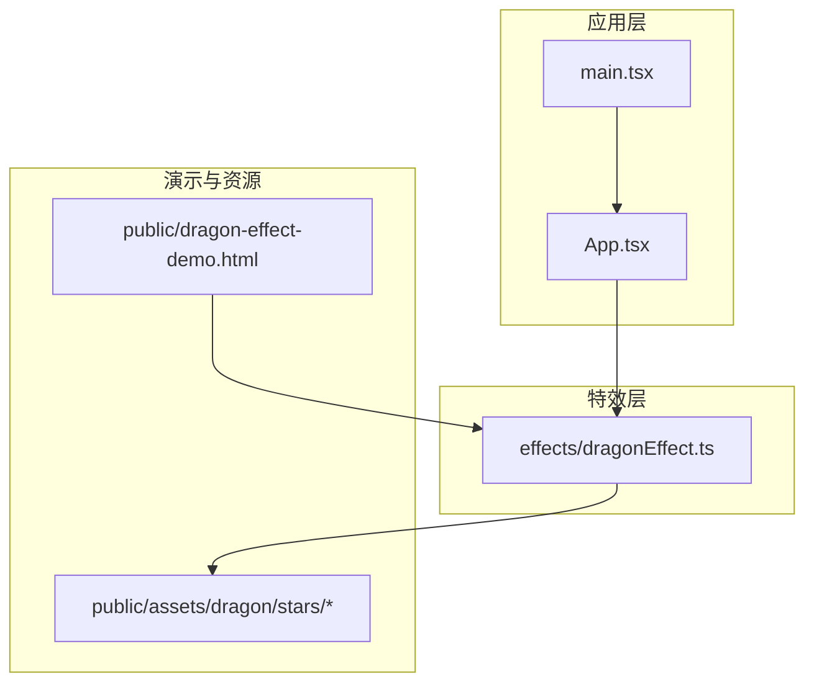
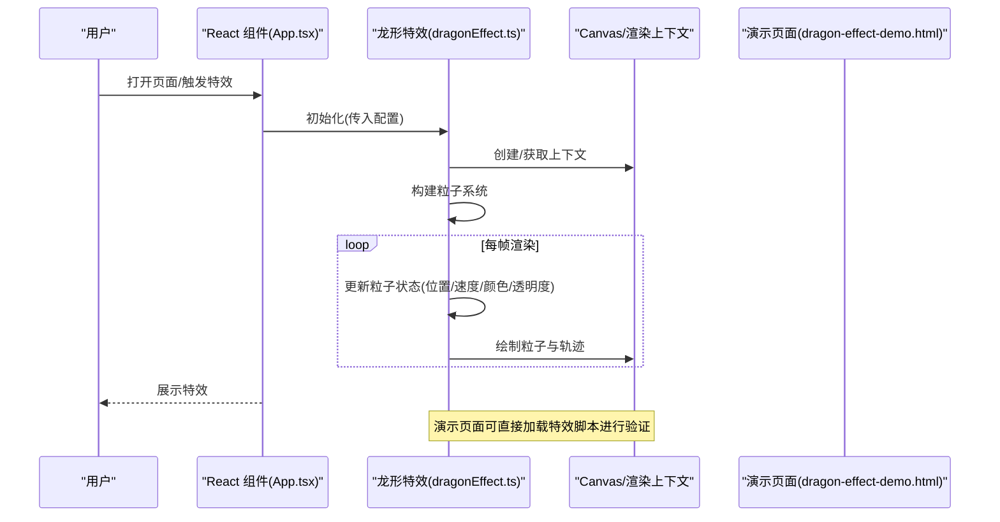
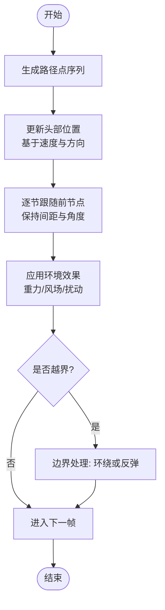
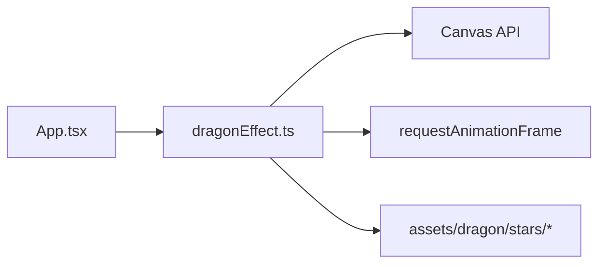

# 龙形特效

<cite>
**本文引用的文件**   
- [dragonEffect.ts](file://src/effects/dragonEffect.ts)
- [dragon-effect-demo.html](file://public/dragon-effect-demo.html)
- [App.tsx](file://src/App.tsx)
- [main.tsx](file://src/main.tsx)
</cite>

## 目录
1. [简介](#简介)
2. [项目结构](#项目结构)
3. [核心组件](#核心组件)
4. [架构总览](#架构总览)
5. [详细组件分析](#详细组件分析)
6. [依赖分析](#依赖分析)
7. [性能考虑](#性能考虑)
8. [故障排查指南](#故障排查指南)
9. [结论](#结论)
10. [附录](#附录)

## 简介
本文件为“龙形特效”功能的完整技术文档，聚焦于 src/effects/dragonEffect.ts 的实现原理与使用方式。内容涵盖粒子系统、运动轨迹算法、颜色渐变效果、性能优化策略，以及如何在 React 组件中集成该特效。同时提供与其他视觉效果的协调机制、常见问题排查与调试技巧，帮助开发者快速落地并稳定运行。

## 项目结构
本项目采用模块化组织：特效逻辑集中在 effects 目录，演示页面位于 public 目录，React 应用入口在 src 目录。龙形特效的核心实现位于 dragonEffect.ts，并通过 HTML 演示页或 React 组件进行集成。

图表来源
- [App.tsx](file://src/App.tsx)
- [main.tsx](file://src/main.tsx)
- [dragonEffect.ts](file://src/effects/dragonEffect.ts)
- [dragon-effect-demo.html](file://public/dragon-effect-demo.html)

章节来源
- [dragonEffect.ts](file://src/effects/dragonEffect.ts)
- [dragon-effect-demo.html](file://public/dragon-effect-demo.html)
- [App.tsx](file://src/App.tsx)
- [main.tsx](file://src/main.tsx)

## 核心组件
- 龙形特效模块（dragonEffect.ts）
  - 负责创建与管理 Canvas/渲染上下文
  - 维护粒子生命周期、位置、速度、颜色、透明度等属性
  - 实现龙的形态生成、运动轨迹计算、颜色渐变与尾迹效果
  - 提供配置接口（大小、颜色、动画参数、性能开关）
  - 暴露启动/停止/销毁方法，便于在组件挂载/卸载时管理生命周期

- 演示页面（dragon-effect-demo.html）
  - 用于快速验证特效行为与参数效果
  - 可独立运行或在项目中嵌入

- React 集成点（App.tsx / main.tsx）
  - 在组件生命周期中初始化、更新与销毁特效实例
  - 响应窗口尺寸变化与主题切换

章节来源
- [dragonEffect.ts](file://src/effects/dragonEffect.ts)
- [dragon-effect-demo.html](file://public/dragon-effect-demo.html)
- [App.tsx](file://src/App.tsx)
- [main.tsx](file://src/main.tsx)

## 架构总览
下图展示了从应用到特效的调用关系与数据流向。React 组件在挂载时创建特效实例，传入配置；特效内部维护粒子系统与渲染循环；演示页面可直接加载特效脚本进行验证。

图表来源
- [App.tsx](file://src/App.tsx)
- [dragonEffect.ts](file://src/effects/dragonControl.ts)
- [dragon-effect-demo.html](file://public/dragon-effect-demo.html)

## 详细组件分析

### 粒子系统
- 设计要点
  - 每个粒子包含位置、速度、加速度、半径、颜色、透明度、生命周期等属性
  - 通过对象池或数组复用减少 GC 压力
  - 支持批量更新与绘制，避免频繁分配内存
- 复杂度分析
  - 更新与绘制通常为 O(N)，N 为当前活跃粒子数
  - 可通过空间分区或距离阈值裁剪降低绘制开销
- 优化建议
  - 限制最大粒子数量，按设备性能动态调整
  - 合并绘制批次，减少状态切换
  - 使用 requestAnimationFrame 保证流畅帧率

章节来源
- [dragonEffect.ts](file://src/effects/dragonEffect.ts)

### 运动轨迹算法
- 设计要点
  - 基于曲线插值（如贝塞尔曲线或样条）生成平滑路径
  - 头部沿主路径移动，身体节点跟随前一个节点，形成蛇形拖尾
  - 支持速度控制、转向平滑、抖动与随机扰动增强自然感
- 关键流程
  - 计算路径点序列
  - 根据时间步长推进头部位置
  - 逐节更新身体节点，保持间距与角度连续性
  - 可选添加重力、风场或鼠标交互影响

图表来源
- [dragonEffect.ts](file://src/effects/dragonEffect.ts)

章节来源
- [dragonEffect.ts](file://src/effects/dragonEffect.ts)

### 颜色渐变效果
- 设计要点
  - 基于 HSL/RGB 插值实现颜色过渡
  - 支持多段色带与随机采样，营造火焰/星光/极光等氛围
  - 透明度随生命周期衰减，形成消散效果
- 实现思路
  - 定义颜色分段与权重
  - 根据粒子年龄或位置映射到对应色带区间
  - 结合光照/阴影增强立体感

章节来源
- [dragonEffect.ts](file://src/effects/dragonEffect.ts)

### 性能优化策略
- 渲染层面
  - 使用离屏 Canvas 缓存静态背景或重复元素
  - 合并绘制批次，减少状态切换
  - 按需绘制可见区域，裁剪不可见粒子
- 计算层面
  - 限制粒子数量与更新频率
  - 使用简单数学近似替代复杂函数
  - 将耗时计算移至 Web Worker（可选）
- 资源层面
  - 预加载纹理与图片资源
  - 使用压缩格式与合适分辨率

章节来源
- [dragonEffect.ts](file://src/effects/dragonEffect.ts)

### 配置项说明
以下为常见配置键及其作用（具体以源码为准）：
- size: 龙的整体缩放比例
- colorStops: 颜色分段与权重
- particleCount: 最大粒子数量
- speed: 运动速度系数
- trailLength: 拖尾长度
- jitter: 随机扰动强度
- gravity: 重力影响
- wind: 风场向量
- enableShadows: 是否启用阴影
- fpsLimit: 帧率上限

章节来源
- [dragonEffect.ts](file://src/effects/dragonEffect.ts)

### 在 React 组件中的集成示例
- 基本步骤
  - 在组件挂载时创建特效实例并传入配置
  - 监听窗口尺寸变化，必要时重建或调整画布
  - 在组件卸载时销毁特效实例，释放资源
- 注意事项
  - 避免重复创建实例导致内存泄漏
  - 确保 Canvas 容器存在且尺寸正确
  - 与主题切换联动更新颜色配置

章节来源
- [App.tsx](file://src/App.tsx)
- [dragon-effect-demo.html](file://public/dragon-effect-demo.html)

## 依赖分析
- 外部依赖
  - Canvas API：用于绘制粒子与轨迹
  - requestAnimationFrame：驱动渲染循环
- 内部依赖
  - 资源文件：stars 等纹理或贴图
  - 样式文件：全局样式与主题变量（可选）

图表来源
- [App.tsx](file://src/App.tsx)
- [dragonEffect.ts](file://src/effects/dragonEffect.ts)
- [dragon-effect-demo.html](file://public/dragon-effect-demo.html)

章节来源
- [dragonEffect.ts](file://src/effects/dragonEffect.ts)
- [dragon-effect-demo.html](file://public/dragon-effect-demo.html)

## 性能考虑
- 设备适配
  - 低端设备自动降低粒子数量与特效强度
  - 检测屏幕像素比，合理设置 Canvas 分辨率
- 帧率与功耗
  - 使用节流或降帧策略在后台标签页暂停渲染
  - 避免在主线程执行阻塞操作
- 内存管理
  - 及时销毁不再使用的实例
  - 避免闭包持有大对象引用

[本节为通用指导，不直接分析具体文件]

## 故障排查指南
- 常见问题
  - 画面闪烁或撕裂：检查是否启用双缓冲或离屏渲染
  - 卡顿或掉帧：减少粒子数量、关闭阴影、简化计算
  - 颜色异常：确认颜色分段顺序与权重是否正确
  - 轨迹断裂：检查跟随算法的间距与角度连续性
- 调试技巧
  - 输出关键指标（FPS、粒子数、绘制批次）
  - 可视化路径点与速度向量
  - 逐步禁用特效选项定位问题

章节来源
- [dragonEffect.ts](file://src/effects/dragonEffect.ts)

## 结论
龙形特效通过粒子系统与曲线轨迹算法实现了流畅自然的视觉效果。合理的配置与优化策略可在不同设备上保持稳定表现。建议在集成时关注生命周期管理与性能调优，并结合演示页面快速验证参数效果。

[本节为总结性内容，不直接分析具体文件]

## 附录
- 快速上手
  - 在演示页面中直接加载特效脚本，观察默认效果
  - 逐步调整配置项，观察变化
- 扩展建议
  - 增加交互（鼠标/触摸）影响轨迹
  - 引入更多纹理与音效增强沉浸感
  - 封装为可复用 Hook 或组件

[本节为概念性内容，不直接分析具体文件]