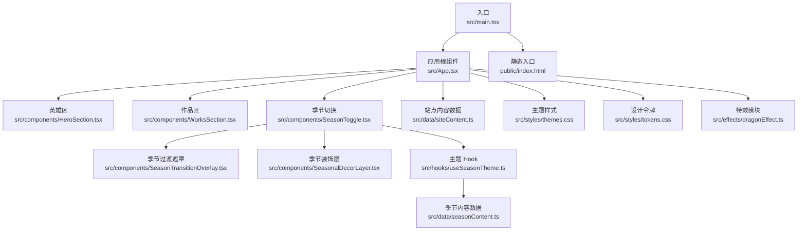
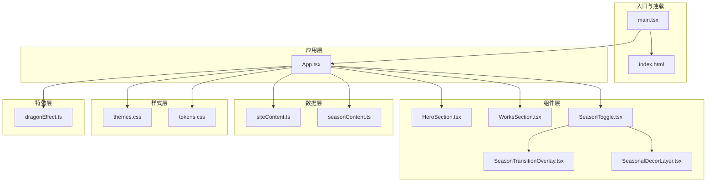
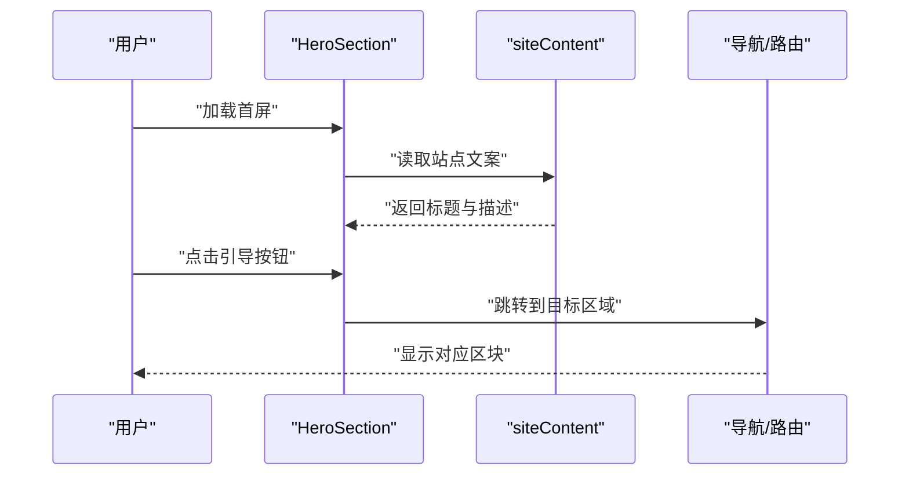
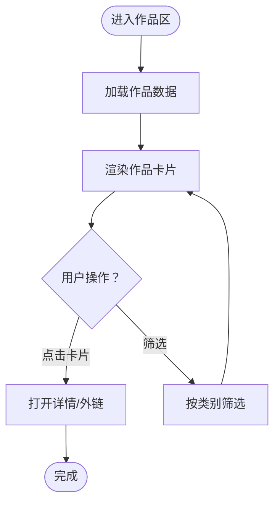
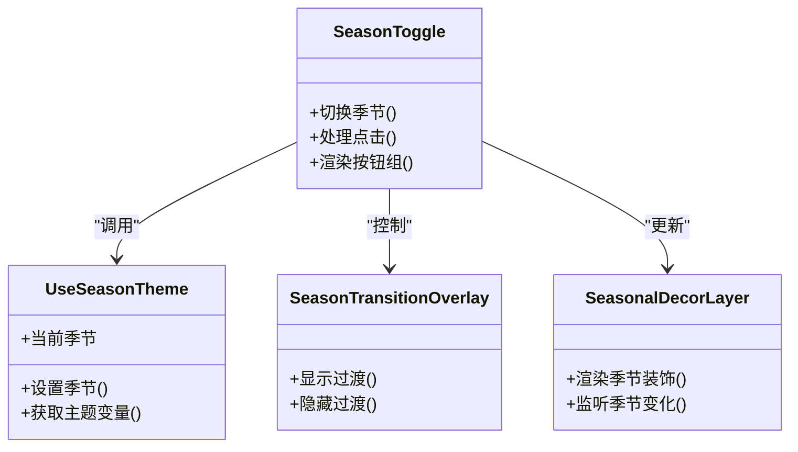
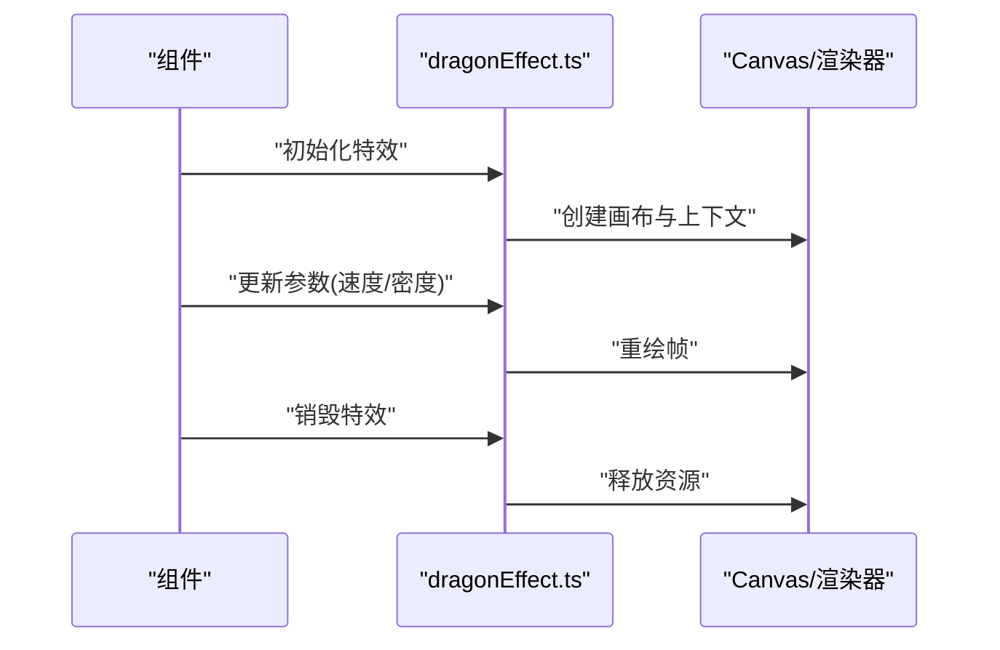
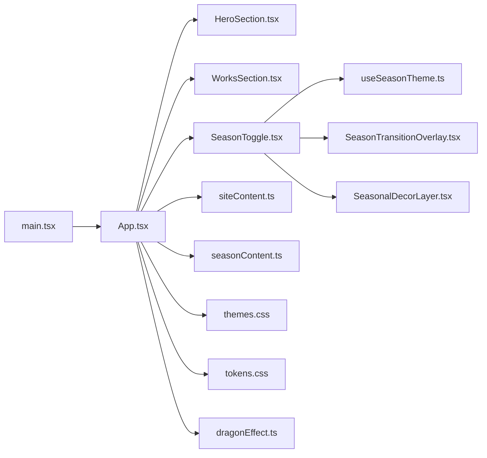

# 项目概览

<cite>
**本文引用的文件**   
- [README.md](file://README.md)
- [package.json](file://package.json)
- [vite.config.ts](file://vite.config.ts)
- [src/main.tsx](file://src/main.tsx)
- [src/App.tsx](file://src/App.tsx)
- [src/components/HeroSection.tsx](file://src/components/HeroSection.tsx)
- [src/components/WorksSection.tsx](file://src/components/WorksSection.tsx)
- [src/components/SeasonToggle.tsx](file://src/components/SeasonToggle.tsx)
- [src/components/SeasonTransitionOverlay.tsx](file://src/components/SeasonTransitionOverlay.tsx)
- [src/components/SeasonalDecorLayer.tsx](file://src/components/SeasonalDecorLayer.tsx)
- [src/hooks/useSeasonTheme.ts](file://src/hooks/useSeasonTheme.ts)
- [src/data/seasonContent.ts](file://src/data/seasonContent.ts)
- [src/data/siteContent.ts](file://src/data/siteContent.ts)
- [src/styles/themes.css](file://src/styles/themes.css)
- [src/styles/tokens.css](file://src/styles/tokens.css)
- [src/effects/dragonEffect.ts](file://src/effects/dragonEffect.ts)
- [public/index.html](file://public/index.html)
</cite>

## 目录
1. [简介](#简介)
2. [项目结构](#项目结构)
3. [核心组件](#核心组件)
4. [架构总览](#架构总览)
5. [详细组件分析](#详细组件分析)
6. [依赖关系分析](#依赖关系分析)
7. [性能考量](#性能考量)
8. [故障排查指南](#故障排查指南)
9. [结论](#结论)
10. [附录](#附录)

## 简介
oo-space 是一个基于 React + TypeScript 的现代化个人展示网站，采用像素风格设计，支持季节主题切换与作品展示等特性。项目以 Vite 为构建工具，强调可维护性与可扩展性，通过清晰的组件分层、数据与样式分离、以及特效模块解耦，提供流畅的用户体验与良好的开发体验。

主要特点
- 像素风视觉：统一的像素风格 UI 与动效，营造沉浸式浏览体验
- 季节主题切换：一键切换春/夏/秋/冬主题，配合过渡动画与装饰层
- 作品展示：卡片式布局展示项目与作品，便于扩展与维护
- 响应式适配：移动端友好的交互与布局
- 可配置内容：站点内容与主题数据集中管理，便于更新与维护

技术栈选择原因
- React + TypeScript：类型安全与组件化开发，提升可维护性与协作效率
- Vite：快速启动与热更新，优化开发与构建流程
- CSS 变量与主题系统：统一的设计令牌，便于多主题与像素风格一致性
- 模块化特效：将复杂动效（如龙形粒子）独立封装，降低耦合度

**章节来源**
- [README.md](file://README.md)
- [package.json](file://package.json)
- [vite.config.ts](file://vite.config.ts)

## 项目结构
项目采用按功能与层次划分的目录组织方式：
- src/components：UI 组件（页面区块、导航、卡片、头像、特效层等）
- src/data：站点内容与主题数据（作品信息、季节内容、站点文案）
- src/hooks：自定义 Hook（季节主题、彩蛋点击等）
- src/styles：全局样式、主题与令牌、像素风格样式
- src/effects：特效逻辑（如龙形粒子效果）
- public：静态资源与入口 HTML
- scripts：构建与图像处理脚本
- .github/workflows：部署流水线

**图表来源**
- [src/main.tsx](file://src/main.tsx)
- [src/App.tsx](file://src/App.tsx)
- [src/components/HeroSection.tsx](file://src/components/HeroSection.tsx)
- [src/components/WorksSection.tsx](file://src/components/WorksSection.tsx)
- [src/components/SeasonToggle.tsx](file://src/components/SeasonToggle.tsx)
- [src/components/SeasonTransitionOverlay.tsx](file://src/components/SeasonTransitionOverlay.tsx)
- [src/components/SeasonalDecorLayer.tsx](file://src/components/SeasonalDecorLayer.tsx)
- [src/hooks/useSeasonTheme.ts](file://src/hooks/useSeasonTheme.ts)
- [src/data/seasonContent.ts](file://src/data/seasonContent.ts)
- [src/data/siteContent.ts](file://src/data/siteContent.ts)
- [src/styles/themes.css](file://src/styles/themes.css)
- [src/styles/tokens.css](file://src/styles/tokens.css)
- [src/effects/dragonEffect.ts](file://src/effects/dragonEffect.ts)
- [public/index.html](file://public/index.html)

**章节来源**
- [src/main.tsx](file://src/main.tsx)
- [src/App.tsx](file://src/App.tsx)
- [public/index.html](file://public/index.html)

## 核心组件
- 英雄区（HeroSection）：首页首屏展示，包含标题、简介与引导交互
- 作品区（WorksSection）：作品卡片列表，支持筛选与跳转
- 季节切换（SeasonToggle）：触发季节主题切换，协调过渡与装饰层
- 季节过渡遮罩（SeasonTransitionOverlay）：切换时的全屏过渡动画
- 季节装饰层（SeasonalDecorLayer）：根据季节渲染背景装饰元素
- 主题 Hook（useSeasonTheme）：管理当前季节状态与主题切换逻辑
- 站点内容（siteContent）与季节内容（seasonContent）：集中管理文案与素材路径

这些组件通过数据与样式解耦，确保高内聚低耦合，便于扩展与维护。

**章节来源**
- [src/components/HeroSection.tsx](file://src/components/HeroSection.tsx)
- [src/components/WorksSection.tsx](file://src/components/WorksSection.tsx)
- [src/components/SeasonToggle.tsx](file://src/components/SeasonToggle.tsx)
- [src/components/SeasonTransitionOverlay.tsx](file://src/components/SeasonTransitionOverlay.tsx)
- [src/components/SeasonalDecorLayer.tsx](file://src/components/SeasonalDecorLayer.tsx)
- [src/hooks/useSeasonTheme.ts](file://src/hooks/useSeasonTheme.ts)
- [src/data/siteContent.ts](file://src/data/siteContent.ts)
- [src/data/seasonContent.ts](file://src/data/seasonContent.ts)

## 架构总览
整体架构遵循“入口 → 应用根 → 页面区块 → 数据/样式/特效”的分层模式：
- 入口层：main.tsx 挂载 React 应用到 index.html
- 应用层：App.tsx 编排页面区块与全局状态
- 组件层：各区块组件负责 UI 与交互
- 数据层：siteContent 与 seasonContent 提供站点与主题数据
- 样式层：themes.css 与 tokens.css 定义主题与设计令牌
- 特效层：dragonEffect.ts 提供独立的动效能力

**图表来源**
- [src/main.tsx](file://src/main.tsx)
- [public/index.html](file://public/index.html)
- [src/App.tsx](file://src/App.tsx)
- [src/components/HeroSection.tsx](file://src/components/HeroSection.tsx)
- [src/components/WorksSection.tsx](file://src/components/WorksSection.tsx)
- [src/components/SeasonToggle.tsx](file://src/components/SeasonToggle.tsx)
- [src/components/SeasonTransitionOverlay.tsx](file://src/components/SeasonTransitionOverlay.tsx)
- [src/components/SeasonalDecorLayer.tsx](file://src/components/SeasonalDecorLayer.tsx)
- [src/data/siteContent.ts](file://src/data/siteContent.ts)
- [src/data/seasonContent.ts](file://src/data/seasonContent.ts)
- [src/styles/themes.css](file://src/styles/themes.css)
- [src/styles/tokens.css](file://src/styles/tokens.css)
- [src/effects/dragonEffect.ts](file://src/effects/dragonEffect.ts)

## 详细组件分析

### 英雄区（HeroSection）
- 职责：展示首页首屏信息，包含标题、描述与引导按钮
- 交互：点击引导进入作品区或关于页
- 数据：从 siteContent 获取文案与链接
- 样式：使用像素风格与主题变量

**图表来源**
- [src/components/HeroSection.tsx](file://src/components/HeroSection.tsx)
- [src/data/siteContent.ts](file://src/data/siteContent.ts)

**章节来源**
- [src/components/HeroSection.tsx](file://src/components/HeroSection.tsx)
- [src/data/siteContent.ts](file://src/data/siteContent.ts)

### 作品区（WorksSection）
- 职责：展示作品卡片，支持点击查看详情或跳转外链
- 数据：从 siteContent 获取作品列表与元信息
- 样式：像素风卡片与响应式网格
- 扩展：可按类别筛选与排序

**图表来源**
- [src/components/WorksSection.tsx](file://src/components/WorksSection.tsx)
- [src/data/siteContent.ts](file://src/data/siteContent.ts)

**章节来源**
- [src/components/WorksSection.tsx](file://src/components/WorksSection.tsx)
- [src/data/siteContent.ts](file://src/data/siteContent.ts)

### 季节主题切换（SeasonToggle 与 useSeasonTheme）
- 职责：切换季节主题，协调过渡动画与装饰层
- 状态：当前季节、是否正在过渡
- 数据：从 seasonContent 获取季节相关文案与素材
- 样式：通过 themes.css 与 tokens.css 动态切换颜色与纹理

**图表来源**
- [src/components/SeasonToggle.tsx](file://src/components/SeasonToggle.tsx)
- [src/hooks/useSeasonTheme.ts](file://src/hooks/useSeasonTheme.ts)
- [src/components/SeasonTransitionOverlay.tsx](file://src/components/SeasonTransitionOverlay.tsx)
- [src/components/SeasonalDecorLayer.tsx](file://src/components/SeasonalDecorLayer.tsx)
- [src/data/seasonContent.ts](file://src/data/seasonContent.ts)
- [src/styles/themes.css](file://src/styles/themes.css)
- [src/styles/tokens.css](file://src/styles/tokens.css)

**章节来源**
- [src/components/SeasonToggle.tsx](file://src/components/SeasonToggle.tsx)
- [src/hooks/useSeasonTheme.ts](file://src/hooks/useSeasonTheme.ts)
- [src/components/SeasonTransitionOverlay.tsx](file://src/components/SeasonTransitionOverlay.tsx)
- [src/components/SeasonalDecorLayer.tsx](file://src/components/SeasonalDecorLayer.tsx)
- [src/data/seasonContent.ts](file://src/data/seasonContent.ts)
- [src/styles/themes.css](file://src/styles/themes.css)
- [src/styles/tokens.css](file://src/styles/tokens.css)

### 特效模块（dragonEffect）
- 职责：实现龙形粒子等动效，作为独立模块被组件按需引入
- 接口：初始化、销毁、更新帧率与参数
- 集成：在 HeroSection 或其他区块中按需启用

**图表来源**
- [src/effects/dragonEffect.ts](file://src/effects/dragonEffect.ts)

**章节来源**
- [src/effects/dragonEffect.ts](file://src/effects/dragonEffect.ts)

## 依赖关系分析
- 入口依赖：main.tsx 依赖 App.tsx 与 index.html
- 应用编排：App.tsx 组合各区块组件与数据/样式/特效
- 组件依赖：SeasonToggle 依赖 useSeasonTheme、seasonContent、themes.css
- 数据依赖：siteContent 与 seasonContent 为只读数据源
- 样式依赖：themes.css 与 tokens.css 提供主题与设计令牌
- 特效依赖：dragonEffect.ts 被组件按需调用

**图表来源**
- [src/main.tsx](file://src/main.tsx)
- [src/App.tsx](file://src/App.tsx)
- [src/components/HeroSection.tsx](file://src/components/HeroSection.tsx)
- [src/components/WorksSection.tsx](file://src/components/WorksSection.tsx)
- [src/components/SeasonToggle.tsx](file://src/components/SeasonToggle.tsx)
- [src/hooks/useSeasonTheme.ts](file://src/hooks/useSeasonTheme.ts)
- [src/components/SeasonTransitionOverlay.tsx](file://src/components/SeasonTransitionOverlay.tsx)
- [src/components/SeasonalDecorLayer.tsx](file://src/components/SeasonalDecorLayer.tsx)
- [src/data/siteContent.ts](file://src/data/siteContent.ts)
- [src/data/seasonContent.ts](file://src/data/seasonContent.ts)
- [src/styles/themes.css](file://src/styles/themes.css)
- [src/styles/tokens.css](file://src/styles/tokens.css)
- [src/effects/dragonEffect.ts](file://src/effects/dragonEffect.ts)

**章节来源**
- [src/main.tsx](file://src/main.tsx)
- [src/App.tsx](file://src/App.tsx)
- [src/components/SeasonToggle.tsx](file://src/components/SeasonToggle.tsx)
- [src/hooks/useSeasonTheme.ts](file://src/hooks/useSeasonTheme.ts)
- [src/data/siteContent.ts](file://src/data/siteContent.ts)
- [src/data/seasonContent.ts](file://src/data/seasonContent.ts)
- [src/styles/themes.css](file://src/styles/themes.css)
- [src/styles/tokens.css](file://src/styles/tokens.css)
- [src/effects/dragonEffect.ts](file://src/effects/dragonEffect.ts)

## 性能考量
- 组件懒加载：对非首屏区块与特效模块进行按需加载，减少初始包体积
- 主题切换优化：通过 CSS 变量与类名切换，避免重排与重绘
- 资源预取：图片与媒体资源按需加载与缓存
- 动画节流：对高频事件（滚动、鼠标移动）进行节流与防抖
- 构建优化：Vite 的 Tree Shaking 与代码分割，提升加载速度

[本节为通用指导，不直接分析具体文件]

## 故障排查指南
- 主题未生效：检查 themes.css 与 tokens.css 是否正确引入，确认 useSeasonTheme 的状态更新
- 季节切换卡顿：确认过渡动画与装饰层渲染逻辑，避免不必要的重绘
- 作品无法加载：检查 siteContent 数据结构与网络请求（如有），确认路径与权限
- 特效异常：检查 dragonEffect 初始化与销毁时机，确保资源释放
- 构建失败：查看 vite.config.ts 配置与依赖版本，清理缓存后重试

**章节来源**
- [src/hooks/useSeasonTheme.ts](file://src/hooks/useSeasonTheme.ts)
- [src/styles/themes.css](file://src/styles/themes.css)
- [src/styles/tokens.css](file://src/styles/tokens.css)
- [src/data/siteContent.ts](file://src/data/siteContent.ts)
- [src/effects/dragonEffect.ts](file://src/effects/dragonEffect.ts)
- [vite.config.ts](file://vite.config.ts)

## 结论
oo-space 通过清晰的组件分层、数据与样式解耦、以及特效模块独立化，实现了像素风格与季节主题的个性化展示。项目具备良好的可维护性与扩展性，适合个人作品集展示与品牌传播。建议后续持续优化资源加载与动画性能，并丰富内容数据与交互细节。

[本节为总结性内容，不直接分析具体文件]

## 附录
- 常见用例示例
  - 切换季节主题：点击季节切换按钮，观察过渡动画与装饰层变化
  - 浏览作品：在作品区点击卡片，查看详情或跳转外链
  - 启用特效：在英雄区启用龙形粒子，调整参数以获得最佳视觉效果
- 术语说明
  - 像素风格：以像素为单位的视觉表现与 UI 元素
  - 季节主题：春/夏/秋/冬四种主题配色与素材集合
  - 设计令牌：CSS 变量定义的尺寸、颜色、字体等基础值

[本节为概念性内容，不直接分析具体文件]